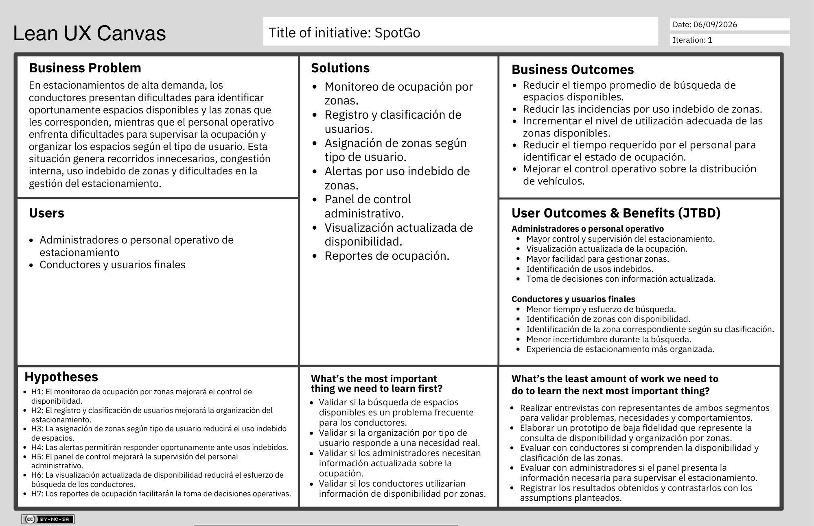

# Capítulo I: Presentación

## 1.1. Startup Profile

### 1.1.1. Descripción de la Startup

**Nombre de la Startup**

Yachiqo

**Descripción**

Yachiqo es una startup ficticia de ingeniería de software dedicada al diseño y desarrollo de soluciones digitales, con énfasis en aplicaciones móviles nativas y multiplataforma para distintos sectores y modelos de negocio. La arquitectura, las tecnologías y las integraciones se definen de acuerdo con los objetivos y las necesidades de cada proyecto.

**Visión**

Ser la empresa de tecnología referente en América Latina en la creación de soluciones móviles versátiles, liderando la transformación digital en diversas industrias mediante la aplicación de arquitecturas de software modernas e innovación continua.

**Misión**

Empoderar a organizaciones y usuarios finales mediante el desarrollo de experiencias móviles intuitivas, seguras y de alto rendimiento que resuelvan problemas del mundo real en cualquier contexto de negocio.

**Propuesta de valor**

Ofrecemos un ecosistema de desarrollo móvil flexible y a medida para cualquier caso de uso: combinamos rendimiento nativo, sincronización de datos en tiempo real y componentes de accesibilidad universal para garantizar aplicaciones de calidad profesional orientadas a maximizar la satisfacción del usuario.

**Características principales**

- Diseño y desarrollo de aplicaciones móviles nativas y multiplataforma para distintos sectores, con soluciones web complementarias cuando las necesidades del proyecto lo requieren.
- Aplicación de Domain-Driven Design para organizar las reglas del negocio y adaptar cada solución a su contexto.
- Diseño de mecanismos de almacenamiento local cuando el producto requiere mantener algunas funciones sin conexión a internet.
- Integración con servicios web RESTful para sincronizar información entre aplicaciones y plataformas.
- Diseño inclusivo con soporte de internacionalización (i18n) y accesibilidad (a11y) para todo tipo de público.

La selección de criterios para la experiencia de usuario móvil y el uso de prototipos se fundamenta en investigaciones recientes sobre atributos, métodos de evaluación y procesos de diseño de aplicaciones móviles (Alshammare et al., 2025; İlhan, 2025).

### 1.1.2. Perfiles de integrantes del equipo

| Foto | Integrante | Descripción |
| :---: | :---: | :---: |
|  | Carhuaz Centeno, Briguite Eryka (U20241D932) | Estudiante de Ingeniería de Software con conocimientos en Java, HTML, CSS y JavaScript. Me considero una persona responsable, colaborativa y con facilidad para aprender nuevas tecnologías. Me gusta trabajar en equipo, resolver problemas y buscar soluciones que permitan mejorar continuamente. |
|  | Contreras Rojas, Cesar Jair (U20241D995) | Estudiante de Ingeniería de Software. He practicado con Python, C++ y Java, entre otros lenguajes. Me considero una persona responsable, colaborativa, amable y dispuesta a ayudar a mis compañeros. También me esfuerzo por encontrar soluciones a los problemas. |
|  | Cotrina Siclla, Sofia Alessandra (U20231B120) | Estudiante de Ingeniería de Software con conocimientos en C++, C#, Python y Java, y énfasis en el desarrollo frontend y el diseño en Figma. Me considero una persona creativa, colaborativa y comprometida con el trabajo en equipo, dispuesta a aportar soluciones visuales e interfaces atractivas para los proyectos. |
|  | Rojas Tello, Nestor Alonso (U202317099) | Estudiante de Ingeniería de Software. Tengo conocimientos en C++, Python, JavaScript y CSS. Me considero una persona colaborativa, responsable y con disposición para resolver dudas y proponer soluciones ante cualquier desafío. |
|  | Ruiz Mideyros, Adrian (U20241E177) | Estudiante de Ingeniería de Software con experiencia en desarrollo web y de videojuegos. Manejo Java, C#, Python, JavaScript, C++ y SQL. Me considero una persona proactiva, enfocada en resolver problemas y capaz de adaptarme a proyectos en constante cambio. También tengo disposición para seguir aprendiendo y colaborar con el equipo. |

## 1.2. Solution Profile

### 1.2.1. Antecedentes y problemática

Los establecimientos con alta afluencia de vehículos suelen tener dificultades para gestionar y distribuir los espacios de sus estacionamientos y mantener actualizada la información sobre su disponibilidad. Esto afecta tanto a los conductores que buscan dónde estacionar como al personal responsable de administrar y supervisar el servicio.

En periodos de alta demanda, la falta de información actualizada sobre la ocupación puede hacer que los conductores recorran distintas zonas en busca de un espacio disponible. Además, si las zonas no están organizadas según el tipo de usuario, algunas pueden utilizarse de manera inadecuada y el administrador del estacionamiento puede tener dificultades para supervisar la operación.

La búsqueda de estacionamiento se ha estudiado en distintos entornos urbanos. Assemi et al. (2020) encontraron que el 35% de los conductores participantes de una investigación en una zona urbana de alta densidad tardó más de cinco minutos en encontrar estacionamiento. Los autores señalan que contar con información confiable y en tiempo real sobre los estacionamientos puede ayudar a reducir el tiempo total de viaje y la congestión asociada a la búsqueda de espacios. Investigaciones recientes también indican que la escasez de espacios, la velocidad de circulación y las características del destino influyen en el momento en que los conductores empiezan a buscar estacionamiento (Saki & Hagen, 2024; Xiao & Jaller, 2025). Además, las simulaciones sobre decisiones de búsqueda muestran que el precio, la distancia a pie y el tiempo de búsqueda influyen en la elección entre distintas alternativas de estacionamiento (Fulman et al., 2025).

Para comprender y delimitar la problemática se aplica la técnica 5W2H, considerando las preguntas Who, What, Where, When, Why, How y How Much.

**Técnica 5W2H**

1. ¿Quiénes están involucrados o afectados? (Who?)

El problema afecta principalmente a dos grupos. Por un lado, los conductores pueden tener dificultades para encontrar espacios disponibles o identificar las zonas que pueden utilizar. Por otro, los administradores de estacionamientos son responsables de supervisar la ocupación, gestionar el flujo de vehículos y distribuir adecuadamente los espacios.

Asimismo, las empresas e instituciones que ofrecen servicios de estacionamiento pueden verse afectadas debido a que una gestión ineficiente puede repercutir negativamente en la experiencia de sus clientes y en la calidad percibida del servicio.

2. ¿Qué ocurre o qué problema se presenta? (What?)

Los estacionamientos con alta afluencia de vehículos tienen dificultades para gestionar los espacios disponibles y organizarlos según el tipo de usuario.

La falta de información actualizada sobre la ocupación dificulta que los conductores identifiquen rápidamente dónde hay espacios disponibles y puede generar recorridos innecesarios dentro del estacionamiento.

Además, una clasificación insuficiente de las zonas según el tipo de usuario puede generar desorden, uso inadecuado de los espacios y dificultades para supervisar la operación.

Como consecuencia, pueden producirse demoras y congestión dentro del estacionamiento, y la experiencia puede resultar poco organizada tanto para los conductores como para el personal encargado de la operación.

3. ¿Dónde sucede? (Where?)

El problema puede presentarse en estacionamientos con alta afluencia y rotación de vehículos, como los ubicados en centros comerciales, supermercados, aeropuertos, universidades, oficinas corporativas, hospitales y otros establecimientos similares.

También puede ocurrir en estacionamientos públicos o privados donde la supervisión de la disponibilidad y distribución de espacios depende principalmente de procesos manuales o donde los usuarios no disponen de información actualizada sobre la ocupación.

4. ¿Cuándo se presenta el problema? (When?)

El problema se presenta principalmente durante periodos de alta demanda, como las mañanas y tardes de días laborales, así como durante fines de semana y feriados en establecimientos que reciben una gran cantidad de vehículos.

También puede presentarse durante eventos especiales, como conciertos, partidos, ferias u otras actividades que incrementan temporalmente la afluencia de personas y vehículos.

En estas situaciones, el incremento de la ocupación dificulta la identificación de espacios disponibles y puede generar una mayor circulación de vehículos dentro del estacionamiento, además de complicar la supervisión y organización de las zonas.

5. ¿Por qué ocurre? (Why?)

El problema ocurre principalmente por la falta de mecanismos que permitan conocer de manera oportuna la disponibilidad de espacios y gestionar su distribución según las reglas de cada estacionamiento.

En algunos estacionamientos, el control depende de procesos manuales o de la supervisión directa del personal, lo que dificulta mantener información actualizada sobre la ocupación.

Asimismo, la ausencia de una clasificación clara de las zonas puede provocar el uso inadecuado de espacios, dificultades en la distribución de vehículos y una mayor complejidad en la administración del estacionamiento.

6. ¿Cómo se manifiesta el problema? (How?)

El problema se manifiesta cuando los conductores ingresan al estacionamiento y deben recorrer diferentes zonas para identificar un espacio disponible sin contar con información actualizada sobre su ubicación.

Paralelamente, el administrador de estacionamiento debe supervisar el ingreso de vehículos, la ocupación de espacios y el cumplimiento de las zonas asignadas a los diferentes tipos de usuario.

Durante los periodos de alta demanda, esta situación puede generar recorridos innecesarios, acumulación de vehículos, ocupación indebida de determinadas zonas y dificultades para mantener una distribución organizada de los espacios.

7. ¿Cuánto cuesta o cuál es la magnitud? (How Much?)

La magnitud del problema se observa en el tiempo dedicado a buscar estacionamiento y en el esfuerzo de supervisión manual. Assemi et al. (2020) reportaron que el 35% de los participantes de su estudio empleó más de cinco minutos buscando estacionamiento; este resultado corresponde al entorno estudiado por los autores y no se extrapola al Perú.

Los estudios citados describen factores asociados con la búsqueda de estacionamiento, pero no ofrecen una estimación representativa de su duración ni de su impacto económico en el Perú.

**Objetivos de la solución**

SpotGo busca alcanzar los siguientes objetivos:

- Reducir el tiempo requerido por los conductores para identificar espacios disponibles.
- Facilitar la organización y distribución de espacios según las necesidades operativas de cada estacionamiento.
- Proporcionar a los administradores información actualizada sobre la ocupación de sus estacionamientos.
- Reducir incidencias relacionadas con el uso indebido de zonas asignadas.
- Facilitar la supervisión del flujo y distribución de vehículos.
- Mejorar la experiencia de los conductores durante el proceso de estacionamiento.
- Proporcionar información que facilite la toma de decisiones operativas por parte de los administradores de estacionamientos.
- Facilitar la gestión de las operaciones de estacionamiento y el seguimiento de la información asociada.
- Integrar un mapa de estacionamientos con MapLibre y cartografía de OpenStreetMap para mostrar los establecimientos registrados y sus datos operativos, y permitir que los conductores abran una ruta externa en Google Maps.

**Restricciones de la solución**

La solución considera las siguientes restricciones:

- La solución estará orientada principalmente a estacionamientos con alta afluencia de vehículos.
- La disponibilidad de información en tiempo real dependerá de los mecanismos de monitoreo e integración implementados en el estacionamiento.
- La solución mostrará la disponibilidad general por zonas. La asignación de espacios específicos dependerá de las condiciones y reglas definidas para cada estacionamiento.
- La organización de los espacios dependerá de las reglas definidas para cada estacionamiento.
- La solución requerirá conectividad para aquellas funcionalidades que necesiten sincronización con el backend.
- El alcance estará centrado en los administradores de estacionamientos y los conductores que utilizan estos espacios. La organización de las zonas considerará los tipos de usuario y las reglas definidas por cada establecimiento.
- SpotGo no utilizará OCR, inteligencia artificial ni sensores para leer o identificar placas o vehículos. Los sensores solo detectarán la ocupación física de los espacios de estacionamiento.
- SpotGo mostrará los estacionamientos registrados y sus datos operativos en un mapa integrado con MapLibre y cartografía de OpenStreetMap; la aplicación de Google Maps calculará la ruta externa hacia el estacionamiento seleccionado.

### 1.2.2. Lean UX Process

El Lean UX Process permite establecer y validar los principales supuestos sobre el problema, los usuarios, los resultados esperados y las funcionalidades del producto.

A partir del análisis inicial de los estacionamientos de alta demanda, se elaboran los Lean UX Problem Statements, se definen los Assumptions y se plantean los Hypothesis Statements. Estos elementos estructuran la propuesta inicial de SpotGo y orientan las decisiones de diseño del producto.

#### *1.2.2.1. Lean UX Problem Statements*

Actualmente, la gestión de estacionamientos de alta demanda se enfoca principalmente en controlar el ingreso y la salida de vehículos y en administrar la disponibilidad general de espacios. Sin embargo, los conductores aún tienen dificultades para identificar espacios disponibles, mientras que los administradores de estacionamientos deben supervisar la ocupación y organizar las zonas según el tipo de usuario.

Las soluciones y los procesos actuales no siempre integran información actualizada sobre la ocupación con una organización de las zonas acorde con las condiciones de cada estacionamiento.

SpotGo abordará esta brecha mediante una plataforma que permita monitorear la ocupación, organizar los espacios según las reglas de cada estacionamiento y facilitar la consulta y administración de su disponibilidad.

La solución estará dirigida a los administradores de estacionamientos de alta demanda y a los conductores que utilizan estos espacios.

Consideraremos que SpotGo contribuye a resolver el problema si reduce el tiempo que los conductores necesitan para encontrar espacios disponibles y las incidencias por uso inadecuado de las zonas, y mejora el control de la ocupación por parte del personal administrativo.

#### *1.2.2.2. Lean UX Assumptions*

**Business Assumptions**

- Creemos que los estacionamientos ubicados en zonas de alta demanda necesitan mejorar la administración y distribución de sus espacios disponibles.
- Creemos que una gestión más eficiente de los espacios puede mejorar la calidad del servicio ofrecido por los establecimientos.
- Creemos que los administradores de estacionamientos valorarán una solución que les permita obtener información actualizada sobre la ocupación.
- Creemos que los conductores valorarán una solución que reduzca el esfuerzo necesario para encontrar un espacio disponible.
- Creemos que los establecimientos estarán dispuestos a adoptar una solución digital si esta contribuye a mejorar la organización de sus estacionamientos.
- Creemos que la información sobre la ocupación puede facilitar la toma de decisiones operativas de los administradores de estacionamientos.

**Business Outcome Assumptions**

- Creemos que la implementación de la solución permitirá reducir el tiempo promedio que los conductores emplean para encontrar espacios disponibles.
- Creemos que la solución permitirá mejorar la organización y distribución de los espacios del estacionamiento.
- Creemos que la clasificación de zonas permitirá disminuir las incidencias relacionadas con el uso indebido de espacios.
- Creemos que la disponibilidad de información actualizada permitirá mejorar el control y supervisión del estacionamiento.
- Creemos que el análisis de información de ocupación permitirá optimizar la utilización de los espacios disponibles.
- Creemos que una gestión más organizada contribuirá a mejorar la eficiencia del servicio ofrecido a los usuarios.

**User Assumptions**

***Administradores de estacionamientos***

- Creemos que los administradores de estacionamientos necesitan consultar con frecuencia el estado de ocupación.
- Creemos que necesitan identificar las zonas que corresponden a cada tipo de usuario.
- Creemos que necesitan detectar situaciones en las que un vehículo utilice una zona que no le corresponde.
- Creemos que necesitan disponer de información actualizada para tomar decisiones relacionadas con la distribución de los vehículos.
- Creemos que requieren una forma sencilla de supervisar el funcionamiento general del estacionamiento durante su jornada laboral.

***Conductores***

- Creemos que los conductores necesitan identificar rápidamente las zonas con espacios disponibles.
- Creemos que los conductores desean reducir los recorridos innecesarios dentro del estacionamiento.
- Creemos que los conductores necesitan reconocer qué zonas pueden utilizar según las condiciones de cada estacionamiento.
- Creemos que los conductores valorarán recibir información actualizada sobre la disponibilidad de espacios.
- Creemos que una experiencia de estacionamiento más organizada reducirá la frustración asociada a la búsqueda de espacios.

**User Outcome and Benefit Assumptions**

***Administradores de estacionamientos***

- Creemos que los administradores de estacionamientos podrán controlar y supervisar mejor la operación.
- Creemos que podrán visualizar la ocupación de las diferentes zonas de manera actualizada.
- Creemos que podrán gestionar con mayor facilidad las zonas correspondientes a cada tipo de usuario.
- Creemos que podrán identificar con mayor rapidez posibles usos indebidos de las zonas.
- Creemos que podrán tomar decisiones operativas utilizando información actualizada sobre la ocupación.
- Creemos que podrán analizar el comportamiento de la ocupación mediante información histórica.

***Conductores***

- Creemos que los conductores podrán identificar espacios disponibles con mayor rapidez.
- Creemos que podrán reducir el tiempo y esfuerzo destinados a recorrer el estacionamiento.
- Creemos que podrán identificar con mayor claridad la zona que les corresponde.
- Creemos que podrán reducir la incertidumbre asociada a la búsqueda de estacionamiento.
- Creemos que tendrán una experiencia de estacionamiento más organizada.

**Feature Assumptions**

- **FA01 - Monitoreo de ocupación por zonas:** Creemos que el monitoreo permitirá a los administradores de estacionamientos conocer con mayor precisión la disponibilidad de los espacios.
- **FA02 - Registro de conductores, perfiles y vehículos:** Creemos que organizar la información necesaria sobre los conductores y sus vehículos permitirá definir adecuadamente el acceso a las zonas de cada estacionamiento.
- **FA03 - Asignación de zonas según tipo de usuario:** Creemos que la asignación de zonas según el tipo de usuario permitirá reducir el uso indebido de espacios y mejorar la distribución de vehículos.
- **FA04 - Sistema de alertas por uso indebido:** Creemos que un sistema de alertas permitirá a los administradores de estacionamientos identificar oportunamente posibles usos inadecuados de las zonas.
- **FA05 - Panel de control para administradores de estacionamientos:** Creemos que un panel de control permitirá a los administradores supervisar de manera centralizada la ocupación y distribución de las zonas.
- **FA06 - Visualización de disponibilidad y zonas de estacionamiento cercanas:** Creemos que mostrar en un mapa integrado con MapLibre y cartografía de OpenStreetMap la disponibilidad de los espacios y las zonas registradas en SpotGo permitirá a los conductores identificar dónde estacionar y cómo llegar.
- **FA07 - Reportes de ocupación:** Creemos que los reportes de ocupación permitirán a los administradores analizar los patrones de uso del estacionamiento y tomar decisiones operativas con esa información.
- **FA08 - Reservas y pagos:** Creemos que facilitar la gestión de las reservas, los pagos y el seguimiento de las operaciones permitirá mejorar la experiencia de uso y la supervisión del servicio.
- **FA09 - Suscripciones y facturación electrónica:** Creemos que ofrecer opciones de suscripción y comprobantes electrónicos facilitará el seguimiento de las operaciones de estacionamiento.
- **FA10 - Configuración de infraestructura y clientes empresariales:** Creemos que permitir la configuración de espacios, zonas y cuentas de clientes empresariales facilitará la incorporación y operación de nuevos estacionamientos en SpotGo.
- **FA11 - Presencia digital y calidad móvil:** Creemos que una página de presentación estática, accesible y disponible en español e inglés ayudará a comunicar el valor de SpotGo y facilitará el acceso a la aplicación móvil.

#### *1.2.2.3. Lean UX Hypothesis Statements*

A partir de los Feature Assumptions identificados, se plantean los siguientes Hypothesis Statements. Cada hipótesis relaciona un resultado esperado del negocio con los usuarios, los beneficios y las funcionalidades identificadas.

- **HS01 - Monitoreo de ocupación por zonas:** Creemos que mejoraremos el control de la ocupación si los administradores de estacionamientos pueden conocer oportunamente la disponibilidad de las distintas zonas mediante una función de monitoreo.
- **HS02 - Registro de conductores, perfiles y vehículos:** Creemos que mejoraremos la organización del estacionamiento si sus zonas y condiciones de acceso se definen de acuerdo con las necesidades de conductores y administradores.
- **HS03 - Asignación de zonas según tipo de usuario:** Creemos que reduciremos las incidencias por uso inadecuado de los espacios si los conductores pueden identificar las zonas que les corresponden y los administradores pueden organizar su distribución según el tipo de usuario.
- **HS04 - Sistema de alertas por uso indebido:** Creemos que mejoraremos la capacidad de respuesta ante el uso inadecuado de ciertas zonas si los administradores reciben alertas sobre posibles incidencias.
- **HS05 - Panel de control para administradores de estacionamientos:** Creemos que mejoraremos la supervisión del estacionamiento si los administradores pueden consultar de manera centralizada la ocupación, la distribución de los espacios y las incidencias.
- **HS06 - Visualización de disponibilidad y zonas de estacionamiento cercanas:** Creemos que reduciremos el tiempo y el esfuerzo necesarios para encontrar estacionamiento si los conductores pueden consultar la disponibilidad, identificar las zonas registradas en SpotGo en un mapa integrado y abrir una ruta en Google Maps.
- **HS07 - Reportes de ocupación:** Creemos que mejoraremos la toma de decisiones sobre el uso de los espacios si los administradores pueden analizar información histórica y patrones de ocupación mediante reportes.
- **HS08 - Reservas y pagos:** Creemos que mejoraremos la experiencia de uso y el control de la operación si SpotGo facilita la gestión de las reservas, los pagos y la información relacionada con las estadías.
- **HS09 - Suscripciones y facturación electrónica:** Creemos que facilitar el seguimiento de las operaciones y la consulta de sus comprobantes mejorará la información disponible sobre el servicio.
- **HS10 - Configuración de infraestructura y clientes empresariales:** Creemos que facilitaremos la adopción de SpotGo si los administradores de estacionamientos y el administrador de la plataforma pueden configurar la infraestructura, los perfiles, las cuentas de clientes empresariales y las condiciones operativas del servicio.
- **HS11 - Presencia digital y calidad móvil:** Creemos que mejoraremos la comprensión y adopción inicial de SpotGo si las personas interesadas pueden conocer la propuesta de valor, acceder a la aplicación y consultar la página de presentación en su idioma mediante una experiencia accesible.

#### 1.2.2.4. Lean UX Canvas

El Lean UX Canvas sintetiza los principales elementos identificados durante el Lean UX Process: el problema del negocio, los segmentos objetivo, los resultados esperados, los beneficios para los usuarios, las soluciones del producto y las hipótesis que deberán validarse durante el desarrollo del proyecto.

**Lean UX Canvas Link:** [https://canva.link/i0pin0nnlvbg3rd](https://canva.link/i0pin0nnlvbg3rd)

*Figura 1 (Lean UX Canvas)*  

## 1.3. Segmentos objetivo

La solución está dirigida inicialmente a dos segmentos relacionados directamente con la problemática: los administradores de estacionamientos y los conductores que utilizan estos espacios.

Para contextualizar la demanda potencial de estacionamiento entre conductores, se consideran estadísticas oficiales del Ministerio de Transportes y Comunicaciones (MTC, 2026a, 2026b) sobre el parque automotor y las licencias de conducir. Para los administradores de estacionamientos se incluye un dato acotado sobre establecimientos de Lima y Callao, que no permite estimar sus características demográficas a nivel nacional.

**Primer Segmento Objetivo (Administradores de estacionamientos)**

Este segmento está conformado por las personas responsables de supervisar, controlar o administrar las operaciones realizadas dentro de estacionamientos con alta afluencia de vehículos.

- Datos demográficos:
  - **Edad:** No se establece un rango de edad específico para pertenecer a este segmento.
  - **Ocupación:** Personas responsables de la gestión y supervisión de estacionamientos.
  - **País de residencia:** Perú.
- Datos estadísticos de contexto:
  - En la revisión tarifaria del servicio de estacionamiento vehicular del nuevo terminal del Aeropuerto Internacional Jorge Chávez, el Organismo Supervisor de la Inversión en Infraestructura de Transporte de Uso Público (OSITRAN, 2025) consideró una muestra de 52 playas de estacionamiento de Lima y Callao. Esta muestra corresponde al análisis tarifario y no representa el total de establecimientos del país ni permite estimar el número o las características demográficas de sus administradores.
- Datos conductuales:
  - **Dominio:** Cuentan con conocimientos sobre la operación de estacionamientos, la supervisión de espacios y el control del flujo de vehículos. El nivel de conocimiento requerido puede variar según las funciones y las características de cada estacionamiento.
  - **Necesidades:** Supervisar la ocupación, controlar el flujo de vehículos, identificar incidencias y mantener una adecuada organización de las zonas.
  - **Beneficios buscados:** Mejorar la organización del estacionamiento, reducir el esfuerzo requerido para supervisar la ocupación y disponer de información actualizada para tomar decisiones operativas.

- Interacción esperada con la solución:
  - **Frecuencia de uso:** Se espera un uso frecuente durante la jornada laboral debido a las responsabilidades de supervisión y administración.
  - **Principales actividades:** Consultar ocupación, supervisar zonas, clasificar usuarios, identificar incidencias y analizar información relacionada con la utilización de los espacios.

**Segundo Segmento Objetivo (Conductores)**

Este segmento está formado por personas que conducen y utilizan estacionamientos de establecimientos concurridos. Sus necesidades se relacionan con encontrar espacios disponibles, reconocer las zonas que pueden utilizar y reducir el tiempo y el esfuerzo dedicados a estacionar.

- Datos demográficos:
  - **Edad:** Personas adultas habilitadas para conducir. Según el Ministerio de Transportes y Comunicaciones (MTC, 2026b), durante 2025 se emitieron 801 474 licencias de conducir en el Perú, de las cuales 256 252 correspondieron a nuevas licencias. Estas cifras permiten contextualizar la cantidad de personas habilitadas para conducir en el país.
  - **Ocupación:** Diversa; incluye compradores, trabajadores, taxistas y otras personas que se desplazan en vehículo a estos establecimientos.
  - **País de residencia:** Perú.
- Datos conductuales:
  - **Dominio:** Cuentan con conocimientos básicos sobre el uso de estacionamientos, la señalización y la ubicación de espacios disponibles.
  - **Necesidades:** Encontrar un espacio disponible, identificar la zona que les corresponde y reducir recorridos innecesarios dentro del estacionamiento.
  - **Beneficios buscados:** Reducir el tiempo y el esfuerzo dedicados a encontrar estacionamiento, identificar zonas disponibles y disfrutar de una experiencia más organizada.
- Interacción esperada con la solución:
  - **Frecuencia de uso:** Variable, según la frecuencia con que necesiten estacionar en establecimientos incorporados a SpotGo.
  - **Principales actividades:** Buscar estacionamiento, identificar espacios y zonas disponibles, estacionar y completar su estadía de acuerdo con las condiciones del establecimiento.

**Relación entre los segmentos objetivo**

Ambos segmentos participan en un mismo proceso, pero presentan necesidades diferentes.

Los administradores necesitan información que les permita supervisar, organizar y controlar el estacionamiento. Por su parte, los conductores necesitan identificar dónde hay espacios disponibles y reducir el esfuerzo que les toma encontrar estacionamiento.

SpotGo busca atender ambas necesidades mediante información actualizada sobre la ocupación y una organización de los espacios acorde con las reglas de cada estacionamiento.

Las características descritas para ambos segmentos son supuestos iniciales que orientan el diseño de SpotGo.
