# Capítulo II: Requirements Development and Software Solution Design

## 2.1. Competidores

### 2.1.1. Análisis competitivo

**Competitive Analysis Landscape**

*¿Por qué llevar a cabo este análisis?*

Permite identificar cómo funcionan las soluciones actuales de estacionamiento, detectar sus fortalezas y limitaciones, y determinar oportunidades de diferenciación para SpotGo, especialmente en la organización por zonas, la clasificación de usuarios y el monitoreo de la ocupación.

*Logos*

| SpotGo | Apparka | iPark | Parkopedia |
| --- | --- | --- | --- |
|  |  |  |  |

*Perfil*

|     | SpotGo | Apparka | iPark | Parkopedia |
| --- | --- | --- | --- | --- |
| Overview | Solución de estacionamiento con aplicaciones móviles y web para consultar disponibilidad, administrar zonas, reservar y pagar. | Empresa peruana de gestión de estacionamientos con una aplicación para consultar ubicaciones y disponibilidad, realizar pagos y reservas, y acceder a servicios empresariales. | Solución peruana en la nube para la gestión digital de estacionamientos, pagos, registro de vehículos y control operativo. | Plataforma global de datos de estacionamiento con información estática, disponibilidad dinámica, reservas, pagos e integraciones. |
| Ventaja competitiva | Organización por perfiles y zonas, monitoreo de ocupación, reservas y alertas operativas. | Amplia presencia en Perú, operación directa de estacionamientos y servicios digitales integrados. | Integra la gestión administrativa, los pagos digitales, el control vehicular y el aforo en tiempo real. | Cobertura global, gran volumen de datos y fuerte integración con vehículos y servicios de movilidad. |

*Perfil de marketing*

|     | SpotGo | Apparka | iPark | Parkopedia |
| --- | --- | --- | --- | --- |
| Mercado Objetivo | Administradores de estacionamientos de alta demanda y conductores que utilizan estos espacios. | Conductores urbanos que buscan reducir el tiempo que les toma estacionar. | Administradores de estacionamientos y empresas que los gestionan. | Conductores, fabricantes de vehículos, administradores de estacionamientos y empresas de movilidad. |
| Estrategias de Marketing | Pruebas piloto con administradores de estacionamientos y alianzas con centros comerciales, universidades y empresas. | Presencia física nacional, aplicación móvil, servicios empresariales y alianzas con distintos tipos de establecimientos. | Venta a empresas orientada a la digitalización y la mejora operativa. | Alianzas con fabricantes, integración mediante API y presencia internacional. |

*Perfil de producto*

|     | SpotGo | Apparka | iPark | Parkopedia |
| --- | --- | --- | --- | --- |
| Productos y Servicios | Aplicaciones móviles y web para consultar disponibilidad, gestionar zonas, reservas y pagos; incluye monitoreo y reportes. | Consulta de ubicación y disponibilidad, pagos, reservas, administración de suscripciones y gestión de estacionamientos. | Registro de vehículos, pagos, facturación, aforo y portal administrativo. | Datos de estacionamiento, disponibilidad, reservas, pagos e interfaces de programación (API). |
| Precios y costos | Modelo preliminar basado en suscripciones para administradores de estacionamientos; los costos de implementación dependerán de los mecanismos de monitoreo requeridos. | Tarifas variables según el estacionamiento, el servicio o la modalidad de suscripción. | Modelo de suscripción con planes según capacidad y requerimientos. | Servicios gratuitos para usuarios finales y servicios empresariales con licenciamiento de datos. |
| Canales de distribución | Aplicaciones móviles y web, página de presentación y servicios en la nube. | Aplicación móvil, sitio web y red física de estacionamientos. | Plataforma web, aplicación e integraciones con dispositivos. | Sitio web, aplicación, interfaces de programación (API) y sistemas integrados en vehículos. |

*Análisis SWOT*

|     | SpotGo | Apparka | iPark | Parkopedia |
| --- | --- | --- | --- | --- |
| Fortalezas | Organización por tipo de usuario, monitoreo por zonas y alertas integradas. | Presencia nacional, operación de estacionamientos y servicios digitales. | Gestión en la nube, pagos digitales y aforo en tiempo real. | Cobertura global, datos dinámicos e integración vehicular. |
| Debilidades | Producto nuevo y aún en proceso de validación. | Menor enfoque en clasificación interna de usuarios por zonas. | Puede requerir mayor configuración e integración operativa. | Menor enfoque en gestión interna de zonas por usuario. |
| Oportunidades | Digitalización de estacionamientos de alta demanda. | Expansión de servicios digitales y empresariales. | Incorporación de más administradores de estacionamientos y expansión a otros sectores. | Mayor integración con movilidad conectada y vehículos. |
| Amenazas | Competidores consolidados con mayor infraestructura y alcance. | Nuevas soluciones digitales y plataformas globales. | Soluciones más simples o especializadas. | Competidores locales con enfoque operativo específico. |

La información comparativa de Apparka, iPark y Parkopedia se elaboró a partir de sus páginas institucionales citadas en la bibliografía (Apparka, s. f.; iPark, s. f.; Parkopedia, s. f.). Las características comerciales y los precios publicados se presentan como referencias del análisis y pueden variar según el servicio o la fecha de consulta.

### 2.1.2. Estrategias y tácticas frente a competidores

1. Organización por zonas según tipo de usuario.
   - SpotGo busca diferenciarse mediante la clasificación de conductores y la asignación de zonas específicas, lo que facilita una distribución más ordenada y ayuda a reducir posibles usos indebidos.

2. Monitoreo actualizado de ocupación.
   - La solución ofrecerá información actualizada sobre la disponibilidad por zonas para que los conductores y los administradores de estacionamientos tomen decisiones con mayor rapidez.

3. Gestión centralizada para administradores de estacionamientos.
   - La aplicación administrativa multiplataforma permitirá consultar ocupación, distribución de zonas e incidencias desde un único entorno, facilitando la supervisión operativa.

4. Experiencia de búsqueda enfocada en disponibilidad.
   - Los conductores podrán consultar qué zonas presentan disponibilidad y cuáles pueden utilizar según su perfil, con el objetivo de reducir recorridos innecesarios.

5. Modelo modular y adaptable.
   - La solución podrá implementarse progresivamente según las necesidades y características de cada estacionamiento, buscando reducir las barreras de adopción.

6. Analítica para soporte de decisiones.
   - Los reportes de ocupación permitirán identificar patrones de uso, periodos de alta demanda y comportamiento de las diferentes zonas.

## 2.2. Entrevistas

### 2.2.1. Diseño de entrevistas

**Primer Segmento Objetivo (Administradores de estacionamientos)**

1. ¿Cuáles son los principales retos que enfrenta en la gestión del estacionamiento?
2. ¿Cómo organiza actualmente la distribución de espacios dentro del estacionamiento?
3. ¿De qué manera registra y diferencia a los usuarios entre clientes y colaboradores?
4. ¿Qué situaciones ocurren cuando un vehículo ocupa un espacio que no le corresponde?
5. ¿Cómo monitorea la ocupación de las diferentes zonas del estacionamiento?
6. ¿Qué problemas se presentan con mayor frecuencia en horas de alta demanda?
7. ¿Qué dificultades enfrenta el personal de vigilancia para mantener el orden?
8. ¿Qué herramientas o sistemas utiliza actualmente para la gestión del estacionamiento?
9. ¿Qué limitaciones o inconvenientes encuentra en el sistema actual?
10. ¿Cómo cree que la visualización en tiempo real de la ocupación podría ayudar en la gestión?
11. ¿Qué tipo de alertas o notificaciones considera necesarias para mejorar el control?
12. ¿Cómo influye el registro de usuarios en la organización del estacionamiento?
13. ¿Qué beneficios esperaría obtener de un sistema inteligente de estacionamiento?
14. ¿De qué manera considera que se podría reducir el tiempo de búsqueda de espacios?
15. ¿Cómo evaluaría la implementación de una solución como SpotGo en su entorno?

**Segundo Segmento Objetivo (Conductores)**

1. ¿Cómo suele ser su experiencia al buscar estacionamiento en lugares concurridos?
2. ¿En qué tipos de lugares encuentra más dificultades para estacionar y por qué?
3. ¿Cuánto tiempo suele invertir en encontrar un espacio disponible?
4. ¿Qué siente o piensa cuando no logra encontrar estacionamiento rápidamente?
5. ¿Qué acciones suele tomar cuando no encuentra un espacio libre?
6. ¿Cómo describiría la organización de los estacionamientos que frecuenta?
7. ¿Qué tan fácil le resulta orientarse dentro de un estacionamiento grande?
8. ¿Cómo cree que una aplicación podría ayudarle durante la búsqueda de estacionamiento?
9. ¿Qué tipo de información le gustaría recibir antes de ingresar a un estacionamiento?
10. ¿Qué información le sería útil mientras busca un espacio dentro del lugar?
11. ¿Cómo prefiere visualizar la disponibilidad de espacios: por zonas o de otra forma?
12. ¿Qué opinión tiene sobre la existencia de zonas exclusivas dentro de un estacionamiento?
13. ¿Qué problemas ha tenido relacionados con la señalización dentro del estacionamiento?
14. ¿Cómo mejoraría su experiencia al momento de estacionar?
15. ¿Qué valor le daría a un sistema que reduzca el tiempo de búsqueda de espacios?

### 2.2.2. Registro de entrevistas

**Needfinding Interviews Link:** [https://upcedupe-my.sharepoint.com/:v:/g/personal/u20241e177_upc_edu_pe/IQBqZCnYsXk5TbTE0vg1_trYAcXeX9iY3VyxVWvInncaOEI?nav=eyJyZWZlcnJhbEluZm8iOnsicmVmZXJyYWxBcHAiOiJPbmVEcml2ZUZvckJ1c2luZXNzIiwicmVmZXJyYWxBcHBQbGF0Zm9ybSI6IldlYiIsInJlZmVycmFsTW9kZSI6InZpZXciLCJyZWZlcnJhbFZpZXciOiJNeUZpbGVzTGlua0NvcHkifX0&e=bKCoNf](https://upcedupe-my.sharepoint.com/:v:/g/personal/u20241e177_upc_edu_pe/IQBqZCnYsXk5TbTE0vg1_trYAcXeX9iY3VyxVWvInncaOEI?nav=eyJyZWZlcnJhbEluZm8iOnsicmVmZXJyYWxBcHAiOiJPbmVEcml2ZUZvckJ1c2luZXNzIiwicmVmZXJyYWxBcHBQbGF0Zm9ybSI6IldlYiIsInJlZmVycmFsTW9kZSI6InZpZXciLCJyZWZlcnJhbFZpZXciOiJNeUZpbGVzTGlua0NvcHkifX0&e=bKCoNf)

**Primer Segmento Objetivo (Administradores de estacionamientos)**

***Entrevista 1***

| Screenshot: |  |
| --- | --- |
| Inicia: | 00:00 |
| Duración: | 4:50 |
| Nombre completo: | Cecilia Lopez |
| Edad: | 31 años |
| Distrito: | Cercado de Lima |
| Resumen: | Cecilia señala que la gestión del estacionamiento se basa en la organización manual y en el registro mediante boletas y tablas, sin asignación de zonas específicas, por lo que los vehículos ocupan cualquier espacio disponible. El monitoreo se realiza con cámaras y control físico. En horas de alta demanda surgen dificultades para movilizar los vehículos debido al espacio reducido. Aunque el sistema actual funciona, depende en gran medida de la intervención manual, incluso se solicitan las llaves para reorganizar los autos. Considera que un sistema inteligente podría mejorar la organización, la visibilidad y el control, además de atraer a más clientes. |

***Entrevista 2***

| Screenshot: |  |
| --- | --- |
| Inicia: | 04:50 |
| Duración: | 5:04 |
| Nombre completo: | Reinaldo Torres |
| Edad: | 42 años |
| Distrito: | Breña |
| Resumen: | Reinaldo comenta que la gestión de su estacionamiento combina métodos manuales y digitales. Registra a los clientes sin asignarles espacios fijos, pues estos ocupan cualquier lugar disponible. El monitoreo se realiza mediante una aplicación que permite el control remoto, pero en horas de alta demanda surgen problemas de congestión y la necesidad de movilizar vehículos. También señala que un sistema con información en tiempo real mejoraría la gestión, permitiría un mayor control y reduciría las pérdidas económicas. Destaca la importancia de las alertas, especialmente las relacionadas con los pagos, y considera que implementar una solución inteligente sería beneficioso, aunque requeriría capacitar al personal. |

***Entrevista 3***

| Screenshot: |  |
| --- | --- |
| Inicia: | 10:44 |
| Duración: | 6:18 |
| Nombre completo: | Juan Vega |
| Edad: | 30 años |
| Distrito: | La Victoria |
| Resumen: | La entrevista a Juan Vega, administrador de estacionamiento de 30 años, expone las dificultades de una gestión basada en procesos manuales, registros en papel y vigilancia visual. Estas prácticas generan desorden durante las horas punta y dificultan el control de los espacios reservados. Ante la falta de información en tiempo real, el personal debe recorrer el estacionamiento a pie y anunciar las placas en voz alta para gestionar la ocupación, una carga operativa que Juan busca eliminar. Recibió con optimismo la propuesta de SpotGo y considera que los sensores de ocupación y un mapa digital del estacionamiento permitirían automatizar la supervisión de los espacios, mejorar el control de los pagos y proyectar una imagen más profesional y organizada del negocio. |

**Segundo Segmento Objetivo (Conductores)**

***Entrevista 1***

| Screenshot: |  |
| --- | --- |
| Inicia: | 17:02 |
| Duración: | 3:51 |
| Nombre completo: | Emiliano Lozano |
| Edad: | 51 años |
| Distrito: | San Martín de Porres |
| Resumen: | Emiliano señala que, como taxista, cuenta con un espacio asignado dentro del estacionamiento, lo que facilita su experiencia y evita que tenga dificultades para encontrar dónde estacionar. La organización se apoya en señalización básica, como carteles; en algunos casos, también se utilizan conos para reservar espacios. En momentos de alta demanda, otros usuarios ocupan el espacio asignado, lo que lo obliga a esperar o a buscar alternativas. Además, señala que los clientes tienen más dificultades para estacionar. Considera que una solución tecnológica con señales o alertas podría mejorar la organización. |

***Entrevista 2***

| Screenshot: |  |
| --- | --- |
| Inicia: | 20:54 |
| Duración: | 7:06 |
| Nombre completo: | Angel Pariona |
| Edad: | 23 años |
| Distrito: | Lince |
| Resumen: | Angel menciona que le resulta difícil encontrar estacionamiento debido a zonas no autorizadas o cocheras ocupadas, especialmente cerca de cines y parques acuáticos. Encontrar un espacio puede tomar entre 10 y 15 minutos. Describe la organización actual como muy desordenada, pues algunos vehículos ocupan más de un espacio y generan bloqueos ante la falta de fiscalización municipal. Cuando no encuentra espacio, da vueltas por las cuadras o se aleja, lo que le resulta frustrante por la pérdida de tiempo. Considera que una aplicación sería útil si le indica dónde hay espacios libres, informa sobre la seguridad del lugar y permite reservar. También propone medir mejor los tiempos de búsqueda y tener en cuenta las horas punta; valora que una solución así podría reducir el tiempo que toma encontrar estacionamiento en Lima. |

***Entrevista 3***

| Screenshot: |  |
| --- | --- |
| Inicia: | 28:00 |
| Duración: | 3:58 |
| Nombre completo: | Jorge Luis |
| Edad: | 26 años |
| Distrito: | El Tambo |
| Resumen: | Jorge Luis mencionó que buscar estacionamiento en lugares concurridos suele ser complicado, ya que encontrar un espacio libre puede tomar varios minutos y generar estrés. También señaló que la falta de señalización y organización dificulta orientarse dentro de algunos estacionamientos. Considera que una aplicación que muestre la disponibilidad por zonas y guíe al conductor ayudaría a reducir el tiempo de búsqueda y a mejorar la experiencia al estacionar. |

### 2.2.3. Análisis de entrevistas

**Primer Segmento Objetivo (Administradores de estacionamientos)**

Este segmento es clave porque sus integrantes son responsables de la organización, el control y el funcionamiento del estacionamiento. Las entrevistas muestran cómo se gestionan actualmente estos espacios y cuáles son las principales limitaciones, así como las oportunidades de mejora mediante soluciones tecnológicas.

*¿Quiénes son?*
Se trata de administradores de estacionamientos encargados de supervisar el establecimiento y organizar el flujo de vehículos.
- Utilizan una combinación de métodos manuales y sistemas básicos (boletas, registros, aplicaciones).
- Se encargan del control de ingresos, ocupación y organización de los vehículos.
- En muchos casos, deben intervenir directamente para reordenar los autos.

*¿Qué les preocupa y anhelan?*
- Desorden en la ocupación: No existen zonas definidas, los usuarios ocupan cualquier espacio disponible.
- Congestión en horas pico: Dificultad para movilizar vehículos en espacios reducidos.
- Dependencia de procesos manuales: Uso de boletas, registros y control físico. 
- Necesidad de control: Buscan mayor visibilidad sin tener que estar presentes todo el tiempo.
- Pérdidas operativas: Riesgo de errores en cobros o control del tiempo de permanencia.

*Requisitos del producto*
- Eficiente, permitiendo una mejor organización del estacionamiento.
- Clara y visual, mostrando la ocupación por zonas en tiempo real.
- Con alertas, para detectar uso indebido de espacios o eventos importantes.
- De fácil control remoto, para que el administrador supervise el estacionamiento sin estar presente.
- Apoyo a la gestión, reduciendo la dependencia de procesos manuales.

**Segundo Segmento Objetivo (Conductores)**

Este segmento es fundamental porque sus integrantes utilizan directamente el estacionamiento y experimentan dificultades al buscar un espacio. Las entrevistas muestran problemas relacionados con el tiempo de búsqueda, la organización del lugar y la falta de información clara, lo que afecta su experiencia.

*¿Quiénes son?*
Se trata de conductores que utilizan estacionamientos en centros comerciales, universidades u otros espacios concurridos.
- Buscan estacionar de forma rápida, segura y sencilla.
- Su experiencia varía según el nivel de congestión y organización del lugar.
- Dependen de la señalización, su conocimiento del lugar o apoyo del personal.
- En algunos casos, recurren a alternativas como estacionar en la calle.

*¿Qué les preocupa y anhelan?*
- Tiempo de búsqueda elevado: Puede tomar varios minutos encontrar un espacio, especialmente en horas pico.
- Congestión y desorden: Tráfico interno y mala organización en entradas, salidas o pisos.
- Falta de orientación: Dificultad para ubicarse dentro del estacionamiento o encontrar salidas.
- Información limitada: No conocen disponibilidad, tarifas o condiciones antes de ingresar.
- Estrés y frustración: Sensaciones negativas cuando no encuentran espacio rápidamente. 

*Requisitos del producto*
- Rápida y eficiente, para reducir el tiempo de búsqueda de espacios.
- Visual y clara, para mostrar la disponibilidad por zonas o pisos.
- Informativa, con datos sobre espacios libres, tarifas y horarios.
- Fácil de usar, con una interfaz intuitiva que facilite la orientación.
- Con información de disponibilidad en tiempo real y una ruta externa hacia el estacionamiento seleccionado, sin guiar al usuario dentro de la instalación.

## 2.3. Needfinding

### 2.3.1. User Personas

**Primer Segmento Objetivo (Administradores de estacionamientos)**

*Figura 2 (User Persona 1)*  
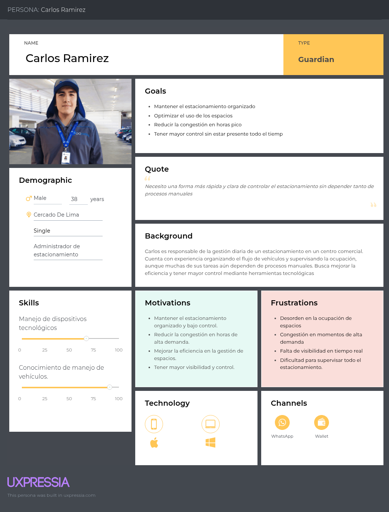

**Segundo Segmento Objetivo (Conductores)**

*Figura 3 (User Persona 2)*  
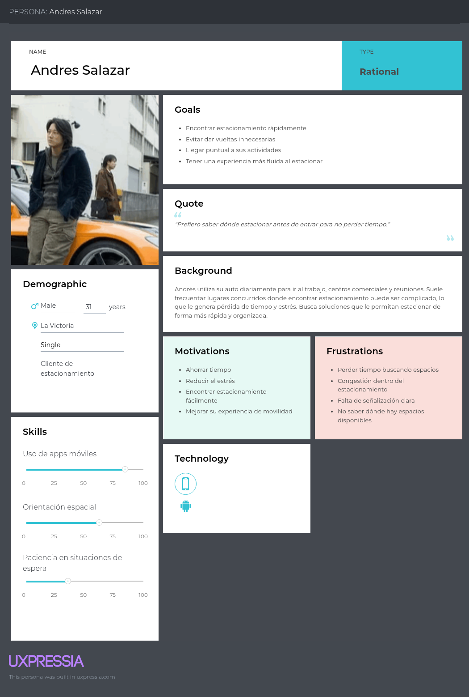

### 2.3.2. User Task Matrix

**Primer Segmento Objetivo (Administradores de estacionamientos)**

*Figura 4 (User Task Matrix 1)*  
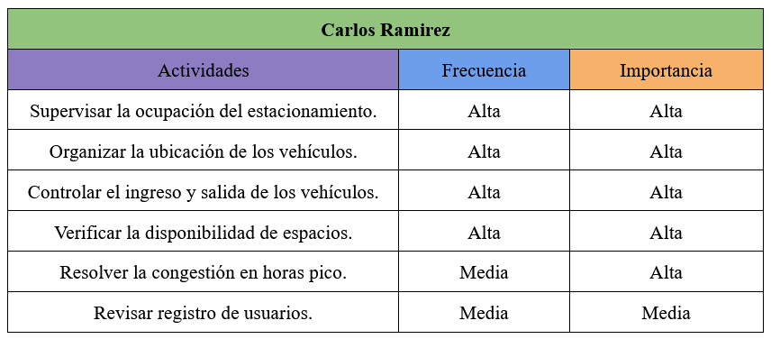

**Segundo Segmento Objetivo (Conductores)**

*Figura 5 (User Task Matrix 2)*  
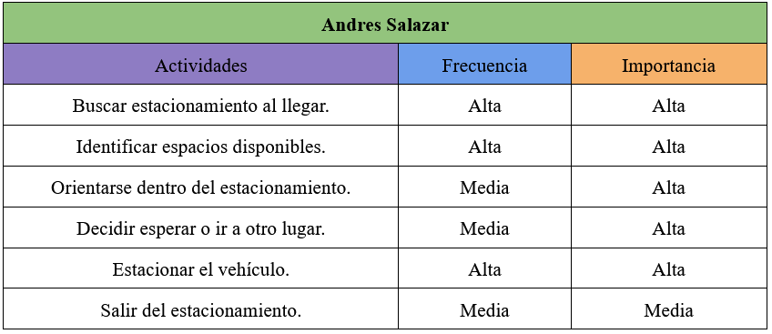

### 2.3.3. User Journey Mapping

**Primer Segmento Objetivo (Administradores de estacionamientos)**

*Figura 6 (User Journey Map 1)*  
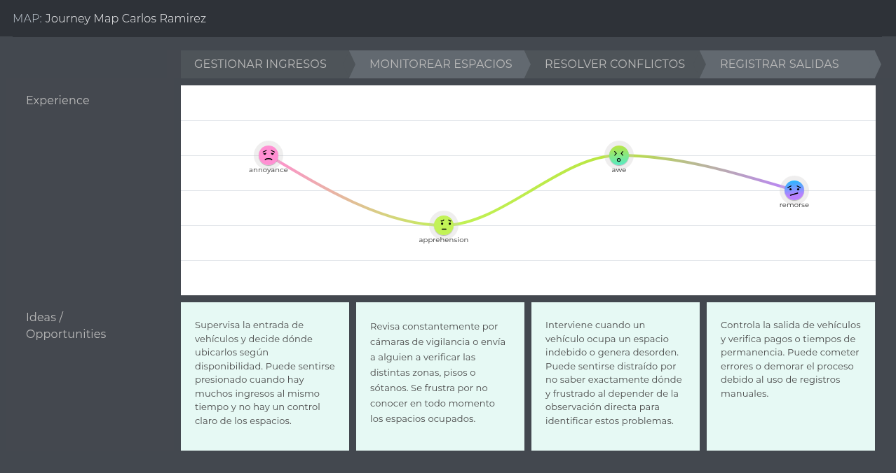

**Segundo Segmento Objetivo (Conductores)**

*Figura 7 (User Journey Map 2)*  
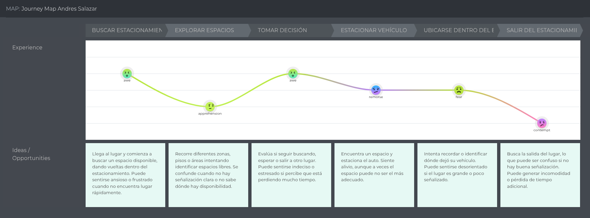

### 2.3.4. Empathy Mapping

**Primer Segmento Objetivo (Administradores de estacionamientos)**

*Figura 8 (Empathy Map 1)*  
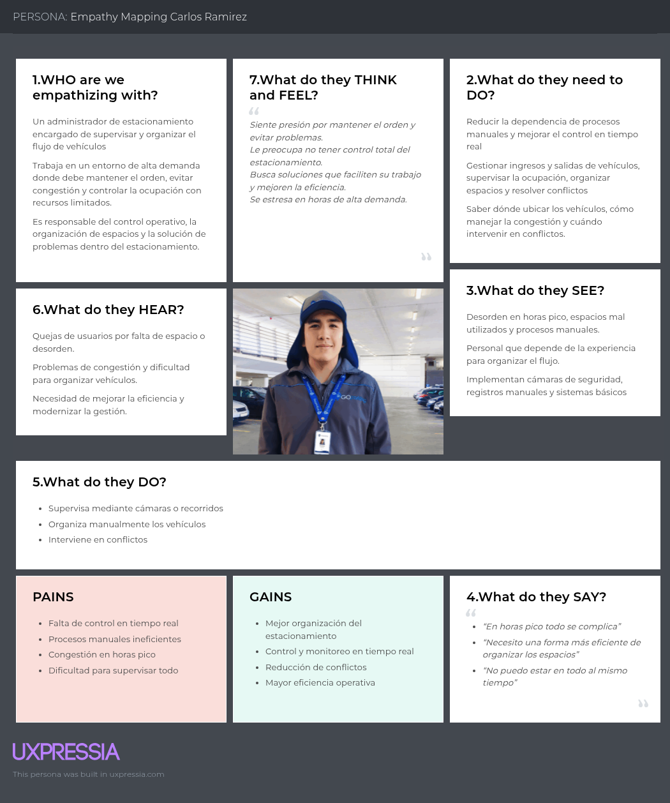

**Segundo Segmento Objetivo (Conductores)**

*Figura 9 (Empathy Map 2)*  
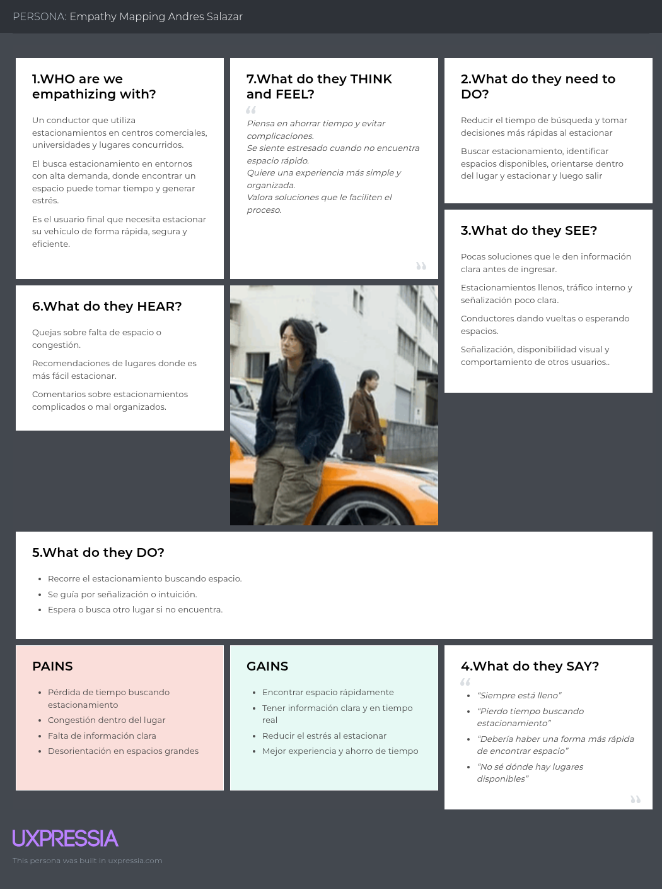

### 2.3.5. Big Picture EventStorming

Para modelar la visión general del dominio se siguió la guía *Step-by-Step Guide* de Philippe Bourgau, incluida en la rúbrica del *Final Problem Statement*. El proceso de Big Picture EventStorming se organizó en las siguientes etapas:

- **Open:** se delimita el espacio del problema y se prepara el tablero para el modelado colaborativo.
- **Explore:** se identifican y organizan los eventos, comandos, actores y reglas principales del dominio.
- **Close:** se revisa el flujo obtenido y se consolidan los elementos relevantes para continuar con el diseño de la solución.

**Miro Board Link:** [https://miro.com/app/board/uXjVHoqrvyc=/](https://miro.com/app/board/uXjVHoqrvyc=/)

*Figura 10 (Big Picture EventStorming)*  
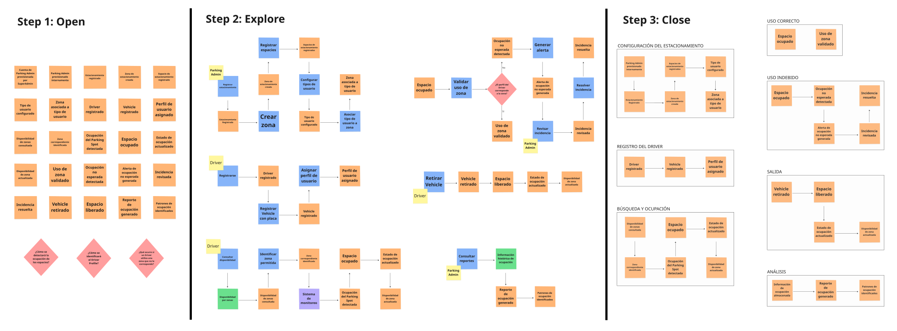

### 2.3.6. Ubiquitous Language

El Ubiquitous Language conserva únicamente conceptos del negocio y sus reglas; los nombres de servicios, APIs e interfaces se documentan en el glosario técnico separado (Evans, 2003).

- **Parking Facility (Estacionamiento físico):** Establecimiento que cada Tenant representa en SpotGo junto con la empresa cliente. Su dirección, coordenadas y reglas se guardan en el registro del Tenant; contiene sus Parking Zones.
- **Parking Spot (Espacio de estacionamiento):** Espacio físico individual dentro de un estacionamiento destinado a la ubicación de un solo vehículo.
- **Parking Zone (Zona de estacionamiento):** Subdivisión configurable de una Parking Facility que agrupa Parking Spots. Su nombre depende de la organización del estacionamiento, por ejemplo, por pisos o por áreas interiores y exteriores; también puede asociarse a uno o más Profile Types definidos por la administración del Tenant.
- **Vehicle (Vehículo):** Medio de transporte asociado a un Driver, identificado mediante la placa registrada y otros datos descriptivos de la cuenta, y utilizado para ocupar un Parking Spot. Un conductor puede registrar varios vehículos y seleccionarlos en sus reservas.
- **User Profile (Perfil de usuario):** Perfil de datos asociado uno a uno con una Account. No contiene el rol, el correo ni el estado de la cuenta. Para un Driver, su Profile Type determina las zonas que puede utilizar en cada Tenant; un Guest no tiene User Profile.
- **Profile Type (Tipo de perfil):** Clasificación de un Driver dentro de un Tenant, asignada por el Parking Admin correspondiente. Cada Driver tiene como máximo un Profile Type por Tenant; si no se asigna otro, se aplica PRIVATE. Los valores disponibles son TAXI, EMPLOYEE y PRIVATE.
- **Role Type (Tipo de rol):** Rol único asociado a una Account que determina sus permisos en SpotGo. Los valores son DRIVER, PARKING_ADMIN y SUPERADMIN; no reemplaza el Profile Type del Driver.
- **Occupancy Status (Estado de ocupación):** Estado físico actual de un *Parking Spot*, utilizado para determinar su disponibilidad operativa. Puede ser *Available*, *Occupied* o *Unavailable*. El estado *Reserved* pertenece a la reserva y no reemplaza el estado físico del espacio.
- **High Capacity:** Estado operativo que se activa cuando la ocupación total supera el 95% de los espacios de estacionamiento operativos disponibles y requiere una alerta para el Parking Admin.
- **Reservation Status (Estado de reserva):** Estado comercial y operativo de una *reserva*. Puede ser *Pending Payment*, *Reserved*, *Active*, *Completed*, *Cancelled*, *No-show*, *Overstayed* o *Payment Rejected*; *Pending Payment* y *Payment Rejected* representan estados de la intención y del resultado del pago.
- **Zone Assignment (Asignación de zona):** Proceso mediante el cual se determina qué *Parking Zone* corresponde a un Driver según su *User Profile*.
- **Unvalidated Occupancy (Ocupación no validada):** Situación que ocurre cuando un *Parking Spot* aparece ocupado sin una *reserva* activa o una *Guest Parking Session* activa asociada al espacio. Esta situación requiere revisión administrativa y no permite identificar automáticamente el vehículo.
- **Unauthorized Parking (Estacionamiento indebido):** Ocupación no validada que el Parking Admin confirma como uso no autorizado después de revisar la reserva, la Guest Parking Session, la Zone Assignment y las condiciones del estacionamiento.
- **Occupancy Monitoring (Monitoreo de ocupación):** Proceso mediante el cual el sistema obtiene y mantiene actualizada, en un máximo de 5 segundos, la información sobre la ocupación de los espacios y zonas del estacionamiento a partir de sensores instalados en cada *Parking Spot*.

- **Occupancy Sensor (Sensor de ocupación):** Dispositivo instalado en un *Parking Spot* para detectar si el espacio está disponible u ocupado y comunicar el cambio de estado al sistema.
- **Sensor Health (Salud del sensor):** Estado operativo de un *Occupancy Sensor*, utilizado para identificar si el dispositivo comunica datos correctamente o requiere revisión. Cuando el sensor no comunica datos confiables, el *Occupancy Status* correspondiente es *Unavailable*.
- **Floor Plan:** Representación o archivo que describe la distribución física del estacionamiento y constituye la fuente autorizada para configurar el Digital Parking Map.
- **Digital Parking Map:** Representación de la infraestructura del estacionamiento que identifica sus Parking Spots, Parking Zones, accesos y destinos de navegación.
- **Availability (Disponibilidad):** Información que indica la existencia de espacios libres dentro de una *Parking Zone*.
- **Reservation (Reserva):** Registro mediante el cual un Driver registrado obtiene el uso de un *Parking Spot* dentro de una *Parking Zone* en una fecha, hora de inicio y duración determinadas. Las reservas se asocian con el Driver y un Vehicle de su cuenta y requieren la aprobación del Digital Payment correspondiente.
- **Parking Session (Sesión de estacionamiento):** Registro de la ocupación real de un *Parking Spot*. Para una reserva de un Driver registrado, se vincula con la reserva mediante el espacio asignado y el periodo reservado; el sensor confirma la ocupación física, pero no identifica al Vehicle. Para un Guest, la **Guest Parking Session** se crea manualmente al ingresar y se cierra al salir.
- **Virtual Receipt (Comprobante virtual):** Confirmación digital, no necesariamente fiscal, de una reserva o Digital Payment que contiene la información necesaria para identificar la operación y el espacio asignado.
- **Check-in / Check-out (Ingreso / Salida):** Eventos que marcan el inicio y el final de la estadía de un vehículo en el estacionamiento. En una reserva, la asociación se establece mediante el espacio asignado, el periodo reservado y la reserva; en una Guest Parking Session, el Parking Admin registra manualmente la placa y el inicio de la sesión. Los sensores solo confirman la ocupación física del Parking Spot.
- **Digital Payment (Pago digital):** Transacción económica procesada por SpotGo. Puede corresponder al pago de una reserva o servicio de un Driver, o a una cuota de suscripción de un Tenant.
- **Payment Token (Token de pago):** Referencia segura administrada por el servicio interno de pagos que permite reutilizar un método de pago autorizado sin almacenar los datos completos de la tarjeta. Driver puede elegir su método de pago predeterminado entre los tokens simulados guardados en su perfil. El token predeterminado del Tenant se utiliza para cobrar el ajuste prorrateado cuando Parking Admin agrega un Parking Spot durante un periodo activo.
- **Outstanding Balance (Saldo pendiente):** Importe que no pudo cobrarse mediante el Payment Token y que debe regularizarse antes de crear nuevas reservas.
- **Subscription (Suscripción):** Periodo pagado de un plan SpotGo para un Driver o Tenant. Su configuración se conserva en `plan` JSONB y `type` distingue `DRIVER` de `TENANT`. Driver paga S/15 al mes con 10% de descuento sobre el precio final de las reservas o S/160 al año con 15%; el descuento no se aplica a multas. Tenant paga S/30 mensuales por el uso de la app más S/1 por cada Parking Spot registrado, esté operativo o no. Si se agrega un spot durante un periodo pagado, el backend cobra de inmediato el importe prorrateado correspondiente al tiempo restante mediante el token predeterminado; el spot no se activa hasta que el pago sea aprobado. No existe renovación mensual automática. Cada periodo pagado crea otra fila Subscription. `start_at` y `end_at` delimitan el periodo.
- **Subscription Type (Tipo de suscripción):** Discriminador `type` dentro del JSONB `plan` que identifica `DRIVER` o `TENANT` y selecciona la configuración aplicable; no es el Role Type de IAM.
- **Subscription Billing Period (Periodo de cobro de suscripción):** Duración cubierta por una fila Subscription. `plan` JSONB conserva la configuración del periodo y el snapshot del precio y los beneficios; para Tenant también conserva el número de Parking Spots registrados incluidos en el periodo.
- **Electronic Receipt (Comprobante de pago electrónico):** Documento fiscal digital generado para una operación elegible de un Driver cuando proporciona un DNI. Conserva su relación con el Digital Payment y con la reserva o Parking Session correspondiente.
- **Electronic Invoice (Factura electrónica):** Documento fiscal digital generado para una operación que requiere información tributaria empresarial, como un RUC. Conserva su relación con el Digital Payment y con la operación del Driver o la suscripción del Tenant que la originó.
- **Electronic Billing (Facturación electrónica):** Capacidad del negocio que determina y genera el Electronic Receipt o Electronic Invoice aplicable a una operación de un Driver o a una cuota de suscripción de un Tenant.
- **Nearby Parking Zones (Parking Zones cercanas):** Zonas de estacionamiento registradas en SpotGo que la aplicación muestra alrededor de la ubicación del Driver. SpotGo proporciona las coordenadas, disponibilidad, horarios, precios y demás detalles operativos de cada zona.
- **Unauthorized Parking Alert (Alerta por estacionamiento indebido):** Alerta operativa generada cuando un Parking Spot presenta Unvalidated Occupancy. La alerta identifica el Parking Spot, la Parking Zone y el momento del evento, pero no afirma por sí sola que exista estacionamiento indebido ni identifica automáticamente el Vehicle; el Parking Admin debe revisar y clasificar el incidente.
- **Occupancy Report (Reporte de ocupación):** Información histórica o resumida sobre la utilización de los espacios y zonas del estacionamiento, utilizada para apoyar decisiones operativas.
- **Parking Admin (Administrador de estacionamiento):** Usuario cuya cuenta tiene el rol PARKING_ADMIN, es creada por un SuperAdmin y pertenece a un único Tenant. Un Tenant puede tener uno o más Parking Admins; ninguno se crea mediante el registro público.
- **Tenant (Cliente B2B):** Empresa registrada como cliente de SpotGo que, en el modelo de datos, representa también su único estacionamiento físico. Sus datos de ubicación y reglas están en el Tenant; sus Parking Zones y Parking Spots se registran por separado.
- **SuperAdmin (Administrador de plataforma):** Usuario cuya cuenta tiene el rol SUPERADMIN y que puede registrar *Tenants* y crear cuentas de Parking Admin y de otros SuperAdmins, además de administrar configuraciones de clientes B2B y consultar la facturación asociada al servicio de SpotGo.
- **Driver (Conductor):** Usuario cuya cuenta tiene el rol DRIVER y que puede registrarse con correo y contraseña o con Google Identity validada por el backend. Tiene un User Profile y recibe un Profile Type por Tenant; PRIVATE se aplica por defecto hasta que el Parking Admin de ese Tenant lo cambie. Administra sus vehículos, consulta Availability, crea reservas y consulta Nearby Parking Zones.
- **Guest (Invitado):** Persona sin cuenta que llega directamente al estacionamiento. No tiene un Vehicle persistente ni una reserva en SpotGo y paga físicamente el tiempo utilizado al finalizar su estadía.
- **Guest Parking Session (Sesión de estacionamiento de invitado):** Sesión creada manualmente por un Parking Admin cuando un Guest ingresa al estacionamiento. Conserva la placa ingresada manualmente, el Parking Spot asignado, la hora de ingreso, la hora de salida y el monto calculado. El pago se realiza físicamente al finalizar la sesión mediante efectivo o POS; SpotGo no procesa el pago ni almacena datos financieros sensibles.

## 2.4. Requirements specification

La especificación de requisitos de SpotGo se construye a partir de la problemática, las entrevistas, los User Personas, el Ubiquitous Language y las hipótesis definidas en los capítulos anteriores. Su propósito es traducir las necesidades de los conductores y del personal de estacionamiento en comportamientos verificables del producto.

SpotGo ofrece clientes separados por rol para los siguientes actores:

- **Driver (Conductor):** utiliza la aplicación Android nativa para consultar disponibilidad y las zonas permitidas según su Profile Type en cada Parking Zone.
- **Parking Admin (Administrador de estacionamiento):** utiliza la aplicación multiplataforma Flutter para asignar Profile Types a Drivers dentro de su Tenant, configurar las zonas por tipo de perfil, supervisar el Occupancy Status, atender incidencias y consultar Occupancy Reports.
- **SuperAdmin:** utiliza la página web administrativa de SpotGo; es un rol reservado a los creadores de la plataforma, quienes registran clientes B2B y crean cuentas de Parking Admin y SuperAdmin.

En las historias técnicas y de investigación (TS y SP), **Developer** identifica al responsable técnico; no es un actor de la aplicación.

La solución también contempla una Landing Page estática como producto digital de apoyo para comunicar la propuesta de valor de SpotGo. La Landing Page no reemplaza los clientes operativos ni se considera parte del flujo del estacionamiento.

La aplicación Android Driver ofrece inglés de Estados Unidos (en_US) como idioma predeterminado y español latinoamericano (es_419) como alternativa seleccionable desde el perfil y los ajustes de idioma de Android. La Landing Page también ofrece ambos idiomas. El Backend y su documentación REST usan inglés; el Backend no localiza sus respuestas según el idioma del cliente.

El alcance funcional se concentra en la organización por zonas, la clasificación de conductores por Tenant mediante Profile Types, el registro de vehículos, la visualización actualizada de disponibilidad, el monitoreo de ocupación, las alertas por uso indebido y los reportes operativos. También incluye Guest Parking Sessions para invitados, cuyo pago se realiza físicamente al administrador del estacionamiento mediante efectivo o POS al finalizar la estadía; reservas para conductores, Digital Payments, suscripciones de Driver y Tenant, Virtual Receipts y Electronic Billing, además de la consulta de zonas de estacionamiento registradas por SpotGo mediante un mapa integrado con MapLibre y cartografía de OpenStreetMap, con apertura de la ruta en la aplicación de Google Maps.

El Occupancy Monitoring se realizará mediante un *Occupancy Sensor* instalado en cada *Parking Spot*. La solución debe operar en estacionamientos interiores y exteriores y comunicar los cambios de *Occupancy Status*, dejándolos disponibles para la aplicación móvil en un máximo de 5 segundos. Cada *Parking Spot* tendrá capacidad para un solo vehículo y cada *Vehicle* podrá mantener como máximo un *Parking Spot* activo. Los sensores únicamente detectan si el espacio está ocupado; no identifican el vehículo que lo ocupa. No se utilizarán OCR, inteligencia artificial ni lectura automática de placas. Para una Guest Parking Session, el Parking Admin ingresa manualmente la placa y el dato se conserva únicamente en el registro de esa sesión.

Las reservas se crean únicamente para conductores registrados y corresponden a un *Parking Spot* específico dentro de una *Parking Zone*, con fecha, hora de inicio y duración. El Digital Payment debe aprobarse antes de asignar el estado de la reserva *Reserved*. El Driver puede llegar en cualquier momento dentro del periodo reservado; si el sensor mantiene un Sensor Health operativo y nunca registra ocupación durante todo ese periodo, la reserva se marca como *No-show* y se devuelve el importe pagado cuando corresponda. Una llegada tardía no modifica la hora final ni el importe de la reserva.

Los invitados no reservan ni pagan desde la aplicación. Cuando un invitado llega al estacionamiento, el Parking Admin selecciona un Parking Spot disponible, ingresa manualmente la placa y crea una Guest Parking Session con la hora de ingreso. El tiempo de uso se calcula desde ese momento. Al salir, el Parking Admin registra la hora de salida, el monto correspondiente y la confirmación del pago físico mediante efectivo o POS. SpotGo conserva la sesión y la confirmación operativa, pero no procesa el pago ni almacena datos financieros sensibles.

La duración mínima de una reserva corresponde a una fracción de cobro configurada por el estacionamiento. No existe una duración máxima global, pero la hora final debe permanecer dentro del horario operativo del estacionamiento. Una reserva puede crearse como máximo 3 días calendario antes de su hora de inicio y no puede solaparse con otra reserva del mismo vehículo ni con una sesión de estacionamiento activa de ese vehículo. Durante el proceso de pago, el espacio seleccionado mantiene un bloqueo temporal para evitar asignaciones simultáneas. Una Guest Parking Session no utiliza estado de la reserva ni bloqueo anticipado: ocupa un Parking Spot disponible desde el ingreso hasta el cierre de la sesión.

La ocupación física y la reserva se controlan como estados independientes. El Occupancy Status puede ser *Available*, *Occupied* o *Unavailable*, mientras que el estado de la reserva puede ser *Pending Payment*, *Reserved*, *Active*, *Completed*, *Cancelled*, *No-show*, *Overstayed* o *Payment Rejected*. Si el Driver se retira antes de la hora final, el Parking Spot puede quedar físicamente *Available*, pero la reserva continúa protegida hasta su finalización y no genera devolución.

Al superar la hora final de la reserva se aplica una tolerancia de 5 minutos. Si el Parking Spot continúa ocupado después de la tolerancia, el sistema calcula el sobretiempo según la fracción configurada por el estacionamiento y, cuando la reserva pertenece a un Driver registrado con un Payment Token autorizado, realiza el cobro adicional mediante el servicio interno de pagos. El descuento de Driver se aplica al precio final de las reservas y no a las multas. Los cargos por sobretiempo se calculan por separado según las reglas del estacionamiento. Si el cobro falla, se registra un Outstanding Balance, se notifica al Driver, se permiten nuevos intentos con el mismo u otro método y se bloquean nuevas reservas hasta regularizarlo.

Cuando se confirma el Check-out de una reserva, la Parking Session se cierra; una lectura del sensor por sí sola solo actualiza el Occupancy Status y no identifica al Driver ni al Vehicle. En una Guest Parking Session, el Parking Admin puede cerrar la sesión con la hora de salida cuando confirma el retiro del vehículo. Al concluir una reserva, el sistema marca su estado de la reserva como *Completed* si no existe sobretiempo pendiente; si existió sobretiempo, conserva el registro del cobro adicional y completa la operación cuando el saldo correspondiente queda regularizado.

Las reservas pueden cancelarse, modificarse o extenderse según la disponibilidad. Una cancelación antes del inicio devuelve el importe pagado cuando corresponda; una cancelación después del inicio o una salida anticipada no genera devolución. Una modificación actualiza el horario o espacio únicamente cuando la nueva asignación es válida y cualquier diferencia de precio queda confirmada. Una extensión no puede afectar una reserva posterior. Si un espacio reservado está ocupado antes del inicio o por una estadía excedida, el sistema busca un Parking Spot disponible y compatible, notifica al Driver y actualiza la reserva, el Virtual Receipt y la Parking Zone de destino para abrirla en Google Maps. Si no existe una alternativa, se ofrecen otros estacionamientos o la cancelación con devolución completa cuando exista un importe pagado.

Los invitados no generan cuentas ni registran vehículos persistentes por sí mismos. El Parking Admin debe registrar su llegada, ingresar manualmente la placa y asignarles un Parking Spot disponible para crear una Guest Parking Session. El pago físico mediante efectivo o POS se realiza al finalizar la sesión. SpotGo no procesa ni almacena datos financieros sensibles; conserva únicamente la sesión, el monto calculado y la confirmación operativa del pago. Las incidencias de sensores marcan el espacio como *Unavailable*, bloquean nuevas reservas y sesiones de estacionamiento de invitados y requieren resolución administrativa; las reservas afectadas se reasignan o reciben devolución completa cuando exista un importe pagado, mientras que las sesiones de estacionamiento de invitados abiertas se revisan y cierran manualmente.

Los planes de Driver se organizan como *Free*, *Plus Monthly* y *Plus Annual*. Free permite reservar sin descuento (0%) y sin zonas especiales. Plus Monthly cuesta S/15 al mes y ofrece prioridad para nuevas reservas, acceso a zonas especiales y un descuento de 10% sobre el precio final de cada reserva. Plus Annual cuesta S/160 al año, conserva esos beneficios y aplica un descuento de 15%. Ambos precios son fijos en el Backend. La prioridad se aplica entre solicitudes que todavía no fueron confirmadas y no desplaza reservas ya pagadas. El descuento se aplica a la reserva y no a las multas; los cargos por sobretiempo se calculan por separado según las reglas del estacionamiento. Los porcentajes no se acumulan con otro descuento de la misma operación.

El backend publica eventos para las notificaciones de reservas, sobretiempo, reasignaciones, pagos, devoluciones y saldos pendientes. El envío push mediante Firebase Cloud Messaging está implementado, pero permanece deshabilitado por defecto hasta configurar credenciales; los eventos locales siguen funcionando sin FCM. Las acciones administrativas se conservan en una bitácora de auditoría.

Las historias de usuario de SpotGo se organizan por capacidades funcionales, técnicas y de investigación para mantener claridad, trazabilidad y verificabilidad. La página de presentación se mantiene como producto digital complementario; las capacidades operativas, comerciales y administrativas se especifican para las aplicaciones móviles, la aplicación web de SuperAdmin y la API del backend. La tabla de trazabilidad incluida más adelante relaciona las capacidades del producto con los requisitos definidos.

### 2.4.1. User Stories

Las siguientes historias especifican los requisitos funcionales, técnicos y de investigación para los clientes de SpotGo y la API del backend. Cada historia se relaciona con una épica, tiene una prioridad de negocio y define criterios de aceptación comprobables. Priority **High** identifica capacidades directamente vinculadas con los objetivos de negocio; **Medium** corresponde a capacidades de soporte; y **Low**, a documentación o capacidades complementarias.

Los criterios de aceptación siguen la estructura Gherkin **Dado que - Cuando - Entonces**, se redactan en presente y tercera persona, y describen resultados observables sin fijar detalles innecesarios de interfaz. Las historias técnicas utilizan el rol Developer cuando la capacidad no implica interacción directa con un usuario final. Las historias de investigación deben cerrarse con resultados documentados y evidencia suficiente para reducir la incertidumbre.

**Epics**

| Epic ID | Title | Description |
| --- | --- | --- |
| E1 | Experiencia móvil para Driver | Funciones que permiten a los conductores registrarse, consultar disponibilidad, ver zonas cercanas, hacer reservas y pagar el servicio, además de abrir una ruta externa en Google Maps. |
| E2 | Organización del estacionamiento y perfiles | Configuración de espacios, zonas, Profile Types de los Drivers, vehículos registrados y sesiones de estacionamiento de invitados por Parking Admin. |
| E3 | Monitoreo de ocupación y operaciones | Monitoreo del estado de ocupación mediante sensores por espacio, un panel operativo, alertas por estacionamiento no autorizado y reportes de ocupación. |
| E4 | Presencia digital y calidad móvil | Página de presentación estática, accesibilidad e internacionalización de los productos digitales de SpotGo. |
| E5 | Servicios y habilitación técnica | Servicios REST, integración con sensores, autenticación, persistencia local, sincronización, documentación y validaciones técnicas para los clientes de SpotGo. |
| E6 | Monetización y facturación | Reservas de conductores registrados, pagos digitales, cargos adicionales, reembolsos, suscripciones, confirmaciones asíncronas, comprobantes virtuales, facturación electrónica y consulta de facturación B2C y B2B. |

**User Stories**

<table width="100%" style="display: table; width: 100% !important; min-width: 100% !important; max-width: 100% !important; table-layout: fixed !important; border-collapse: collapse; text-align: center; box-sizing: border-box;">
  <colgroup>
    <col width="25%">
    <col width="25%">
    <col width="25%">
    <col width="25%">
  </colgroup>
  <thead>
    <tr>
      <th width="25%" style="width: 25%; padding: 8px; border: 1px solid #666; text-align: center; vertical-align: middle;">User Story ID</th>
      <th width="25%" style="width: 25%; padding: 8px; border: 1px solid #666; text-align: center; vertical-align: middle;">User</th>
      <th width="25%" style="width: 25%; padding: 8px; border: 1px solid #666; text-align: center; vertical-align: middle;">Priority</th>
      <th width="25%" style="width: 25%; padding: 8px; border: 1px solid #666; text-align: center; vertical-align: middle;">Epic</th>
    </tr>
  </thead>
  <tbody>
    <tr>
      <td width="25%" align="center" style="width: 25%; padding: 8px; border: 1px solid #666; text-align: center !important; vertical-align: middle;">US01</td>
      <td width="25%" align="center" style="width: 25%; padding: 8px; border: 1px solid #666; text-align: center !important; vertical-align: middle;">Driver</td>
      <td width="25%" align="center" style="width: 25%; padding: 8px; border: 1px solid #666; text-align: center !important; vertical-align: middle;">High</td>
      <td width="25%" align="center" style="width: 25%; padding: 8px; border: 1px solid #666; text-align: center !important; vertical-align: middle;">E1</td>
    </tr>
    <tr>
      <th width="25%" align="center" style="width: 25%; padding: 8px; border: 1px solid #666;">Title</th>
      <td colspan="3" width="75%" align="center" style="width: 75%; padding: 8px; border: 1px solid #666; text-align: center !important;">Consultar disponibilidad por zona</td>
    </tr>
    <tr>
      <th colspan="4" width="100%" style="padding: 8px; border: 1px solid #666;">Description</th>
    </tr>
    <tr>
      <td colspan="4" width="100%" style="padding: 20px; border: 1px solid #666; text-align: left;"><strong>Como</strong> Driver, <strong>quiero</strong> consultar la disponibilidad actual por zona,  <strong>para</strong> identificar dónde podría haber un espacio de estacionamiento disponible.</td>
    </tr>
    <tr>
      <th colspan="4" width="100%" style="padding: 8px; border: 1px solid #666;">Acceptance Criteria</th>
    </tr>
    <tr>
      <td colspan="4" width="100%" style="padding: 20px; border: 1px solid #666; text-align: left;"><strong>Escenario 1: Zona con disponibilidad</strong> <strong>Dado que</strong> una zona de estacionamiento tiene al menos un espacio con estado de ocupación disponible, el sensor funciona correctamente y no existe una reserva, sesión de estacionamiento de invitado ni bloqueo temporal activo <strong>Cuando</strong> el Driver consulta la disponibilidad actual <strong>Entonces</strong> la aplicación informa cuántos espacios están disponibles y la hora de la última actualización  <strong>Escenario 2: Zona sin disponibilidad</strong> <strong>Dado que</strong> todos los espacios de una zona están ocupados, reservados, tienen una sesión de invitado o un bloqueo temporal activo, o figuran como no disponibles <strong>Cuando</strong> el Driver consulta la disponibilidad <strong>Entonces</strong> la aplicación informa que no hay espacios disponibles y no ofrece para reserva espacios no disponibles o bloqueados temporalmente  <strong>Escenario 3: Actualización manual</strong> <strong>Dado que</strong> el Driver consulta información sincronizada previamente <strong>Cuando</strong> el Driver solicita actualizarla <strong>Entonces</strong> la aplicación obtiene el estado más reciente disponible y muestra la hora de la actualización</td>
    </tr>
  </tbody>
</table>

<table width="100%" style="display: table; width: 100% !important; min-width: 100% !important; max-width: 100% !important; table-layout: fixed !important; border-collapse: collapse; text-align: center; box-sizing: border-box;">
  <colgroup>
    <col width="25%">
    <col width="25%">
    <col width="25%">
    <col width="25%">
  </colgroup>
  <thead>
    <tr>
      <th width="25%" style="width: 25%; padding: 8px; border: 1px solid #666; text-align: center; vertical-align: middle;">User Story ID</th>
      <th width="25%" style="width: 25%; padding: 8px; border: 1px solid #666; text-align: center; vertical-align: middle;">User</th>
      <th width="25%" style="width: 25%; padding: 8px; border: 1px solid #666; text-align: center; vertical-align: middle;">Priority</th>
      <th width="25%" style="width: 25%; padding: 8px; border: 1px solid #666; text-align: center; vertical-align: middle;">Epic</th>
    </tr>
  </thead>
  <tbody>
    <tr>
      <td width="25%" align="center" style="width: 25%; padding: 8px; border: 1px solid #666; text-align: center !important; vertical-align: middle;">US02</td>
      <td width="25%" align="center" style="width: 25%; padding: 8px; border: 1px solid #666; text-align: center !important; vertical-align: middle;">Parking Admin</td>
      <td width="25%" align="center" style="width: 25%; padding: 8px; border: 1px solid #666; text-align: center !important; vertical-align: middle;">High</td>
      <td width="25%" align="center" style="width: 25%; padding: 8px; border: 1px solid #666; text-align: center !important; vertical-align: middle;">E2</td>
    </tr>
    <tr>
      <th width="25%" align="center" style="width: 25%; padding: 8px; border: 1px solid #666;">Title</th>
      <td colspan="3" width="75%" align="center" style="width: 75%; padding: 8px; border: 1px solid #666; text-align: center !important;">Configurar zonas de estacionamiento</td>
    </tr>
    <tr>
      <th colspan="4" width="100%" style="padding: 8px; border: 1px solid #666;">Description</th>
    </tr>
    <tr>
      <td colspan="4" width="100%" style="padding: 20px; border: 1px solid #666; text-align: left;"><strong>Como</strong> Parking Admin, <strong>quiero</strong> crear zonas de estacionamiento, asociarlas con los Profile Types permitidos en mi Tenant y asignar un Profile Type a cada Driver de ese Tenant, <strong>para</strong> organizar los espacios del estacionamiento y aplicar condiciones uniformes para reservas y facturación.</td>
    </tr>
    <tr>
      <th colspan="4" width="100%" style="padding: 8px; border: 1px solid #666;">Acceptance Criteria</th>
    </tr>
    <tr>
      <td colspan="4" width="100%" style="padding: 20px; border: 1px solid #666; text-align: left;"><strong>Escenario 1: Configuración válida</strong> <strong>Dado que</strong> los espacios están registrados, los datos de la zona son válidos y el Tenant tiene Profile Types disponibles <strong>Cuando</strong> el Parking Admin crea una zona, asocia los espacios seleccionados y define los Profile Types permitidos <strong>Entonces</strong> el sistema guarda la relación entre la zona, sus espacios y los Profile Types autorizados en ese Tenant  <strong>Escenario 2: Conflicto en la asignación de un espacio</strong> <strong>Dado que</strong> un espacio ya pertenece a otra zona <strong>Cuando</strong> el Parking Admin intenta guardarlo en una zona nueva <strong>Entonces</strong> el sistema identifica el conflicto y no guarda la nueva relación hasta que se resuelva la asignación  <strong>Escenario 3: Configuración de reglas de operación</strong> <strong>Dado que</strong> el Parking Admin proporciona reglas válidas de tarifa, sobretiempo y asignación para el estacionamiento <strong>Cuando</strong> el Parking Admin actualiza las reglas de operación y convivencia de la única Parking Facility de su Tenant <strong>Entonces</strong> el sistema permite reservas solo dentro del horario de operación y calcula el tiempo adicional con la fracción configurada  <strong>Escenario 4: Clasificación de un Driver por Tenant</strong> <strong>Dado que</strong> el Driver tiene un User Profile y el Parking Admin pertenece al Tenant correspondiente <strong>Cuando</strong> el Parking Admin asigna TAXI, EMPLOYEE o PRIVATE al Driver <strong>Entonces</strong> el sistema guarda un único Profile Type para el par Driver y Tenant; si todavía no existe una asignación específica, se aplica PRIVATE</td>
    </tr>
  </tbody>
</table>

<table width="100%" style="display: table; width: 100% !important; min-width: 100% !important; max-width: 100% !important; table-layout: fixed !important; border-collapse: collapse; text-align: center; box-sizing: border-box;">
  <colgroup>
    <col width="25%">
    <col width="25%">
    <col width="25%">
    <col width="25%">
  </colgroup>
  <thead>
    <tr>
      <th width="25%" style="width: 25%; padding: 8px; border: 1px solid #666; text-align: center; vertical-align: middle;">User Story ID</th>
      <th width="25%" style="width: 25%; padding: 8px; border: 1px solid #666; text-align: center; vertical-align: middle;">User</th>
      <th width="25%" style="width: 25%; padding: 8px; border: 1px solid #666; text-align: center; vertical-align: middle;">Priority</th>
      <th width="25%" style="width: 25%; padding: 8px; border: 1px solid #666; text-align: center; vertical-align: middle;">Epic</th>
    </tr>
  </thead>
  <tbody>
    <tr>
      <td width="25%" align="center" style="width: 25%; padding: 8px; border: 1px solid #666; text-align: center !important; vertical-align: middle;">US03</td>
      <td width="25%" align="center" style="width: 25%; padding: 8px; border: 1px solid #666; text-align: center !important; vertical-align: middle;">Parking Admin</td>
      <td width="25%" align="center" style="width: 25%; padding: 8px; border: 1px solid #666; text-align: center !important; vertical-align: middle;">High</td>
      <td width="25%" align="center" style="width: 25%; padding: 8px; border: 1px solid #666; text-align: center !important; vertical-align: middle;">E2</td>
    </tr>
    <tr>
      <th width="25%" align="center" style="width: 25%; padding: 8px; border: 1px solid #666;">Title</th>
      <td colspan="3" width="75%" align="center" style="width: 75%; padding: 8px; border: 1px solid #666; text-align: center !important;">Registrar una sesión de estacionamiento de invitado</td>
    </tr>
    <tr>
      <th colspan="4" width="100%" style="padding: 8px; border: 1px solid #666;">Description</th>
    </tr>
    <tr>
      <td colspan="4" width="100%" style="padding: 20px; border: 1px solid #666; text-align: left;"><strong>Como</strong> Parking Admin, <strong>quiero</strong> registrar una sesión de estacionamiento cuando llega un invitado, <strong>para</strong> que SpotGo calcule su tiempo de estacionamiento mientras el pago presencial se realiza al salir.</td>
    </tr>
    <tr>
      <th colspan="4" width="100%" style="padding: 8px; border: 1px solid #666;">Acceptance Criteria</th>
    </tr>
    <tr>
      <td colspan="4" width="100%" style="padding: 20px; border: 1px solid #666; text-align: left;"><strong>Escenario 1: Iniciar una sesión de invitado</strong> <strong>Dado que</strong> llega un invitado, Parking Admin está autorizado para operar y hay un espacio disponible <strong>Cuando</strong> el Parking Admin selecciona el espacio, ingresa manualmente la placa e inicia la sesión <strong>Entonces</strong> el sistema crea una sesión activa con el espacio, la placa y la hora de ingreso; no crea una cuenta Driver ni un vehículo permanente, no crea una reserva ni procesa un pago  <strong>Escenario 2: Conflicto por espacio reservado, ocupado o no disponible</strong> <strong>Dado que</strong> el espacio solicitado tiene una reserva activa, está ocupado o figura como no disponible <strong>Cuando</strong> el Parking Admin intenta iniciar la sesión de invitado <strong>Entonces</strong> el sistema rechaza la operación y solicita seleccionar un espacio disponible  <strong>Escenario 3: Cerrar la sesión y confirmar el pago presencial</strong> <strong>Dado que</strong> existe una sesión de estacionamiento de invitado activa <strong>Cuando</strong> el Parking Admin registra la salida y confirma el pago presencial en efectivo o con POS <strong>Entonces</strong> el sistema registra la hora de salida, calcula la duración y el importe, cierra la sesión y conserva la confirmación del pago sin procesar ni almacenar datos financieros sensibles  <strong>Escenario 4: Datos obligatorios en cada operación</strong> <strong>Dado que</strong> el Parking Admin intenta iniciar la sesión sin espacio, placa u hora de ingreso, o cerrarla sin hora de salida o confirmación de pago <strong>Cuando</strong> el Parking Admin inicia o cierra la sesión <strong>Entonces</strong> el sistema rechaza la operación y mantiene sin cambios los registros existentes</td>
    </tr>
  </tbody>
</table>

<table width="100%" style="display: table; width: 100% !important; min-width: 100% !important; max-width: 100% !important; table-layout: fixed !important; border-collapse: collapse; text-align: center; box-sizing: border-box;">
  <colgroup>
    <col width="25%">
    <col width="25%">
    <col width="25%">
    <col width="25%">
  </colgroup>
  <thead>
    <tr>
      <th width="25%" style="width: 25%; padding: 8px; border: 1px solid #666; text-align: center; vertical-align: middle;">User Story ID</th>
      <th width="25%" style="width: 25%; padding: 8px; border: 1px solid #666; text-align: center; vertical-align: middle;">User</th>
      <th width="25%" style="width: 25%; padding: 8px; border: 1px solid #666; text-align: center; vertical-align: middle;">Priority</th>
      <th width="25%" style="width: 25%; padding: 8px; border: 1px solid #666; text-align: center; vertical-align: middle;">Epic</th>
    </tr>
  </thead>
  <tbody>
    <tr>
      <td width="25%" align="center" style="width: 25%; padding: 8px; border: 1px solid #666; text-align: center !important; vertical-align: middle;">US04</td>
      <td width="25%" align="center" style="width: 25%; padding: 8px; border: 1px solid #666; text-align: center !important; vertical-align: middle;">Driver</td>
      <td width="25%" align="center" style="width: 25%; padding: 8px; border: 1px solid #666; text-align: center !important; vertical-align: middle;">High</td>
      <td width="25%" align="center" style="width: 25%; padding: 8px; border: 1px solid #666; text-align: center !important; vertical-align: middle;">E1</td>
    </tr>
    <tr>
      <th width="25%" align="center" style="width: 25%; padding: 8px; border: 1px solid #666;">Title</th>
      <td colspan="3" width="75%" align="center" style="width: 75%; padding: 8px; border: 1px solid #666; text-align: center !important;">Consultar las zonas permitidas</td>
    </tr>
    <tr>
      <th colspan="4" width="100%" style="padding: 8px; border: 1px solid #666;">Description</th>
    </tr>
    <tr>
      <td colspan="4" width="100%" style="padding: 20px; border: 1px solid #666; text-align: left;"><strong>Como</strong> Driver, <strong>quiero</strong> consultar las zonas permitidas según mi Profile Type en cada Tenant, <strong>para</strong> utilizar únicamente las áreas autorizadas para mí en cada estacionamiento.</td>
    </tr>
    <tr>
      <th colspan="4" width="100%" style="padding: 8px; border: 1px solid #666;">Acceptance Criteria</th>
    </tr>
    <tr>
      <td colspan="4" width="100%" style="padding: 20px; border: 1px solid #666; text-align: left;"><strong>Escenario 1: Zonas permitidas según el perfil del Tenant</strong> <strong>Dado que</strong> la Account del Driver está activa y existen zonas asociadas con su Profile Type en cada Tenant <strong>Cuando</strong> la aplicación consulta las zonas disponibles <strong>Entonces</strong> el sistema resuelve el Profile Type del Driver para cada Tenant y devuelve solo las zonas autorizadas junto con su disponibilidad actual  <strong>Escenario 2: Sin zonas permitidas disponibles</strong> <strong>Dado que</strong> el Driver no tiene ninguna zona autorizada con espacios disponibles <strong>Cuando</strong> la aplicación consulta las zonas correspondientes <strong>Entonces</strong> el sistema informa que no hay disponibilidad en las zonas autorizadas y excluye las zonas asignadas a otros Profile Types</td>
    </tr>
  </tbody>
</table>

<table width="100%" style="display: table; width: 100% !important; min-width: 100% !important; max-width: 100% !important; table-layout: fixed !important; border-collapse: collapse; text-align: center; box-sizing: border-box;">
  <colgroup>
    <col width="25%">
    <col width="25%">
    <col width="25%">
    <col width="25%">
  </colgroup>
  <thead>
    <tr>
      <th width="25%" style="width: 25%; padding: 8px; border: 1px solid #666; text-align: center; vertical-align: middle;">User Story ID</th>
      <th width="25%" style="width: 25%; padding: 8px; border: 1px solid #666; text-align: center; vertical-align: middle;">User</th>
      <th width="25%" style="width: 25%; padding: 8px; border: 1px solid #666; text-align: center; vertical-align: middle;">Priority</th>
      <th width="25%" style="width: 25%; padding: 8px; border: 1px solid #666; text-align: center; vertical-align: middle;">Epic</th>
    </tr>
  </thead>
  <tbody>
    <tr>
      <td width="25%" align="center" style="width: 25%; padding: 8px; border: 1px solid #666; text-align: center !important; vertical-align: middle;">US05</td>
      <td width="25%" align="center" style="width: 25%; padding: 8px; border: 1px solid #666; text-align: center !important; vertical-align: middle;">Parking Admin</td>
      <td width="25%" align="center" style="width: 25%; padding: 8px; border: 1px solid #666; text-align: center !important; vertical-align: middle;">High</td>
      <td width="25%" align="center" style="width: 25%; padding: 8px; border: 1px solid #666; text-align: center !important; vertical-align: middle;">E3</td>
    </tr>
    <tr>
      <th width="25%" align="center" style="width: 25%; padding: 8px; border: 1px solid #666;">Title</th>
      <td colspan="3" width="75%" align="center" style="width: 75%; padding: 8px; border: 1px solid #666; text-align: center !important;">Supervisar la ocupación por zona</td>
    </tr>
    <tr>
      <th colspan="4" width="100%" style="padding: 8px; border: 1px solid #666;">Description</th>
    </tr>
    <tr>
      <td colspan="4" width="100%" style="padding: 20px; border: 1px solid #666; text-align: left;"><strong>Como</strong> Parking Admin, <strong>quiero</strong> supervisar el estado de ocupación de los espacios agrupados por zona, <strong>para</strong> controlar la operación actual del estacionamiento.</td>
    </tr>
    <tr>
      <th colspan="4" width="100%" style="padding: 8px; border: 1px solid #666;">Acceptance Criteria</th>
    </tr>
    <tr>
      <td colspan="4" width="100%" style="padding: 20px; border: 1px solid #666; text-align: left;"><strong>Escenario 1: Datos de monitoreo actuales</strong> <strong>Dado que</strong> los sensores transmiten el estado actual de los espacios de un estacionamiento interior o exterior <strong>Cuando</strong> el Parking Admin solicita los datos de monitoreo <strong>Entonces</strong> el sistema agrupa la información por zona y muestra el estado de ocupación (disponible, ocupado o no disponible) y, cuando corresponda, el estado de la reserva por separado  <strong>Escenario 2: Cambio de ocupación dentro del tiempo máximo</strong> <strong>Dado que</strong> un sensor instalado en un espacio detecta un cambio de ocupación <strong>Cuando</strong> el sistema recibe el evento del sensor <strong>Entonces</strong> actualiza el estado de ocupación, recalcula la disponibilidad de la zona y pone la información a disposición de la aplicación móvil en un máximo de 5 segundos  <strong>Escenario 3: Sensor no disponible</strong> <strong>Dado que</strong> un sensor deja de transmitir datos confiables <strong>Cuando</strong> el sistema detecta el incidente <strong>Entonces</strong> marca el espacio como no disponible, bloquea nuevas reservas y sesiones de invitados, evita cargos automáticos basados en lecturas no confiables, notifica a Parking Admin e inicia la revisión de las reservas afectadas</td>
    </tr>
  </tbody>
</table>

<table width="100%" style="display: table; width: 100% !important; min-width: 100% !important; max-width: 100% !important; table-layout: fixed !important; border-collapse: collapse; text-align: center; box-sizing: border-box;">
  <colgroup>
    <col width="25%">
    <col width="25%">
    <col width="25%">
    <col width="25%">
  </colgroup>
  <thead>
    <tr>
      <th width="25%" style="width: 25%; padding: 8px; border: 1px solid #666; text-align: center; vertical-align: middle;">User Story ID</th>
      <th width="25%" style="width: 25%; padding: 8px; border: 1px solid #666; text-align: center; vertical-align: middle;">User</th>
      <th width="25%" style="width: 25%; padding: 8px; border: 1px solid #666; text-align: center; vertical-align: middle;">Priority</th>
      <th width="25%" style="width: 25%; padding: 8px; border: 1px solid #666; text-align: center; vertical-align: middle;">Epic</th>
    </tr>
  </thead>
  <tbody>
    <tr>
      <td width="25%" align="center" style="width: 25%; padding: 8px; border: 1px solid #666; text-align: center !important; vertical-align: middle;">US06</td>
      <td width="25%" align="center" style="width: 25%; padding: 8px; border: 1px solid #666; text-align: center !important; vertical-align: middle;">Parking Admin</td>
      <td width="25%" align="center" style="width: 25%; padding: 8px; border: 1px solid #666; text-align: center !important; vertical-align: middle;">High</td>
      <td width="25%" align="center" style="width: 25%; padding: 8px; border: 1px solid #666; text-align: center !important; vertical-align: middle;">E3</td>
    </tr>
    <tr>
      <th width="25%" align="center" style="width: 25%; padding: 8px; border: 1px solid #666;">Title</th>
      <td colspan="3" width="75%" align="center" style="width: 75%; padding: 8px; border: 1px solid #666; text-align: center !important;">Generar alertas operativas</td>
    </tr>
    <tr>
      <th colspan="4" width="100%" style="padding: 8px; border: 1px solid #666;">Description</th>
    </tr>
    <tr>
      <td colspan="4" width="100%" style="padding: 20px; border: 1px solid #666; text-align: left;"><strong>Como</strong> Parking Admin, <strong>quiero</strong> recibir alertas sobre estacionamiento no autorizado y alta ocupación, <strong>para</strong> revisar incidentes y actuar antes de que afecten la operación.</td>
    </tr>
    <tr>
      <th colspan="4" width="100%" style="padding: 8px; border: 1px solid #666;">Acceptance Criteria</th>
    </tr>
    <tr>
      <td colspan="4" width="100%" style="padding: 20px; border: 1px solid #666; text-align: left;"><strong>Escenario 1: Ocupación no autorizada o no validada</strong> <strong>Dado que</strong> un espacio está ocupado y no existe una reserva o sesión de invitado activa que autorice su uso <strong>Cuando</strong> el sistema compara la ocupación con las autorizaciones registradas <strong>Entonces</strong> crea una alerta de estacionamiento no autorizado con la zona, el espacio y la hora del evento, clasifica la ocupación como no validada y no intenta identificar el vehículo mediante imágenes o la placa  <strong>Escenario 2: Conflicto con una reserva</strong> <strong>Dado que</strong> una reserva futura está asignada a un espacio que sigue ocupado por una sesión anterior <strong>Cuando</strong> el sistema detecta el conflicto <strong>Entonces</strong> busca un espacio disponible y compatible, conserva el registro del incidente y notifica a Parking Admin y a Driver cuando confirma la reasignación o una alternativa  <strong>Escenario 3: Alta ocupación</strong> <strong>Dado que</strong> la ocupación total supera el 95% de los espacios operativos disponibles <strong>Cuando</strong> el sistema evalúa el nivel de ocupación <strong>Entonces</strong> crea una alerta crítica de alta ocupación y la pone a disposición de Parking Admin  <strong>Escenario 4: Resolución de una alerta</strong> <strong>Dado que</strong> existe una alerta operativa pendiente <strong>Cuando</strong> el Parking Admin registra la clasificación del incidente y la acción realizada <strong>Entonces</strong> el sistema marca la alerta como resuelta solo cuando se completa la acción requerida y conserva su historial</td>
    </tr>
  </tbody>
</table>

<table width="100%" style="display: table; width: 100% !important; min-width: 100% !important; max-width: 100% !important; table-layout: fixed !important; border-collapse: collapse; text-align: center; box-sizing: border-box;">
  <colgroup>
    <col width="25%">
    <col width="25%">
    <col width="25%">
    <col width="25%">
  </colgroup>
  <thead>
    <tr>
      <th width="25%" style="width: 25%; padding: 8px; border: 1px solid #666; text-align: center; vertical-align: middle;">User Story ID</th>
      <th width="25%" style="width: 25%; padding: 8px; border: 1px solid #666; text-align: center; vertical-align: middle;">User</th>
      <th width="25%" style="width: 25%; padding: 8px; border: 1px solid #666; text-align: center; vertical-align: middle;">Priority</th>
      <th width="25%" style="width: 25%; padding: 8px; border: 1px solid #666; text-align: center; vertical-align: middle;">Epic</th>
    </tr>
  </thead>
  <tbody>
    <tr>
      <td width="25%" align="center" style="width: 25%; padding: 8px; border: 1px solid #666; text-align: center !important; vertical-align: middle;">US07</td>
      <td width="25%" align="center" style="width: 25%; padding: 8px; border: 1px solid #666; text-align: center !important; vertical-align: middle;">Parking Admin</td>
      <td width="25%" align="center" style="width: 25%; padding: 8px; border: 1px solid #666; text-align: center !important; vertical-align: middle;">High</td>
      <td width="25%" align="center" style="width: 25%; padding: 8px; border: 1px solid #666; text-align: center !important; vertical-align: middle;">E3</td>
    </tr>
    <tr>
      <th width="25%" align="center" style="width: 25%; padding: 8px; border: 1px solid #666;">Title</th>
      <td colspan="3" width="75%" align="center" style="width: 75%; padding: 8px; border: 1px solid #666; text-align: center !important;">Consultar el panel operativo móvil</td>
    </tr>
    <tr>
      <th colspan="4" width="100%" style="padding: 8px; border: 1px solid #666;">Description</th>
    </tr>
    <tr>
      <td colspan="4" width="100%" style="padding: 20px; border: 1px solid #666; text-align: left;"><strong>Como</strong> Parking Admin, <strong>quiero</strong> consultar un resumen operativo centralizado y el mapa de ocupación en tiempo real desde la aplicación móvil, <strong>para</strong> revisar la ocupación, la disponibilidad y los incidentes pendientes en un solo lugar.</td>
    </tr>
    <tr>
      <th colspan="4" width="100%" style="padding: 8px; border: 1px solid #666;">Acceptance Criteria</th>
    </tr>
    <tr>
      <td colspan="4" width="100%" style="padding: 20px; border: 1px solid #666; text-align: left;"><strong>Escenario 1: Resumen operativo actual</strong> <strong>Dado que</strong> el Parking Admin tiene acceso autorizado y existen datos operativos <strong>Cuando</strong> el Parking Admin solicita el resumen actual <strong>Entonces</strong> el sistema devuelve el total de espacios, la disponibilidad por zona, las reservas activas, las sesiones de invitados abiertas, los saldos pendientes de operaciones de los conductores asociadas con el Tenant y las alertas operativas pendientes  <strong>Escenario 2: Detalle de una zona</strong> <strong>Dado que</strong> el Parking Admin solicita información de una zona específica <strong>Cuando</strong> el sistema procesa la solicitud <strong>Entonces</strong> devuelve el estado de ocupación de cada espacio, el estado de la reserva cuando corresponda, las sesiones de invitados activas y el estado de los sensores; permite filtrar por perfil de usuario o zona  <strong>Escenario 3: Auditoría administrativa</strong> <strong>Dado que</strong> el Parking Admin modifica una configuración, asignación, reserva, sesión de invitado o incidente <strong>Cuando</strong> el sistema confirma la operación <strong>Entonces</strong> registra en el historial de auditoría al usuario, la acción, la fecha, la hora y los datos anteriores y nuevos</td>
    </tr>
  </tbody>
</table>

<table width="100%" style="display: table; width: 100% !important; min-width: 100% !important; max-width: 100% !important; table-layout: fixed !important; border-collapse: collapse; text-align: center; box-sizing: border-box;">
  <colgroup>
    <col width="25%">
    <col width="25%">
    <col width="25%">
    <col width="25%">
  </colgroup>
  <thead>
    <tr>
      <th width="25%" style="width: 25%; padding: 8px; border: 1px solid #666; text-align: center; vertical-align: middle;">User Story ID</th>
      <th width="25%" style="width: 25%; padding: 8px; border: 1px solid #666; text-align: center; vertical-align: middle;">User</th>
      <th width="25%" style="width: 25%; padding: 8px; border: 1px solid #666; text-align: center; vertical-align: middle;">Priority</th>
      <th width="25%" style="width: 25%; padding: 8px; border: 1px solid #666; text-align: center; vertical-align: middle;">Epic</th>
    </tr>
  </thead>
  <tbody>
    <tr>
      <td width="25%" align="center" style="width: 25%; padding: 8px; border: 1px solid #666; text-align: center !important; vertical-align: middle;">US08</td>
      <td width="25%" align="center" style="width: 25%; padding: 8px; border: 1px solid #666; text-align: center !important; vertical-align: middle;">Parking Admin</td>
      <td width="25%" align="center" style="width: 25%; padding: 8px; border: 1px solid #666; text-align: center !important; vertical-align: middle;">Medium</td>
      <td width="25%" align="center" style="width: 25%; padding: 8px; border: 1px solid #666; text-align: center !important; vertical-align: middle;">E3</td>
    </tr>
    <tr>
      <th width="25%" align="center" style="width: 25%; padding: 8px; border: 1px solid #666;">Title</th>
      <td colspan="3" width="75%" align="center" style="width: 75%; padding: 8px; border: 1px solid #666; text-align: center !important;">Generar reportes de ocupación</td>
    </tr>
    <tr>
      <th colspan="4" width="100%" style="padding: 8px; border: 1px solid #666;">Description</th>
    </tr>
    <tr>
      <td colspan="4" width="100%" style="padding: 20px; border: 1px solid #666; text-align: left;"><strong>Como</strong> Parking Admin, <strong>quiero</strong> consultar reportes de ocupación agrupados por periodo y zona, <strong>para</strong> identificar patrones de uso y respaldar decisiones operativas.</td>
    </tr>
    <tr>
      <th colspan="4" width="100%" style="padding: 8px; border: 1px solid #666;">Acceptance Criteria</th>
    </tr>
    <tr>
      <td colspan="4" width="100%" style="padding: 20px; border: 1px solid #666; text-align: left;"><strong>Escenario 1: Periodo con datos históricos</strong> <strong>Dado que</strong> existen registros del estado de ocupación, reservas, sesiones de invitados y sesiones de estacionamiento para el periodo solicitado <strong>Cuando</strong> el Parking Admin genera el reporte de ocupación <strong>Entonces</strong> el sistema agrupa los datos por zona y periodo e informa patrones de uso, sesiones de invitados completadas, reservas marcadas como inasistencia, tiempos excedidos e incidentes registrados  <strong>Escenario 2: Periodo sin datos</strong> <strong>Dado que</strong> no existen registros para el periodo solicitado <strong>Cuando</strong> el Parking Admin genera el reporte de ocupación <strong>Entonces</strong> el sistema informa que no hay datos disponibles y no infiere valores inexistentes</td>
    </tr>
  </tbody>
</table>

<table width="100%" style="display: table; width: 100% !important; min-width: 100% !important; max-width: 100% !important; table-layout: fixed !important; border-collapse: collapse; text-align: center; box-sizing: border-box;">
  <colgroup>
    <col width="25%">
    <col width="25%">
    <col width="25%">
    <col width="25%">
  </colgroup>
  <thead>
    <tr>
      <th width="25%" style="width: 25%; padding: 8px; border: 1px solid #666; text-align: center; vertical-align: middle;">User Story ID</th>
      <th width="25%" style="width: 25%; padding: 8px; border: 1px solid #666; text-align: center; vertical-align: middle;">User</th>
      <th width="25%" style="width: 25%; padding: 8px; border: 1px solid #666; text-align: center; vertical-align: middle;">Priority</th>
      <th width="25%" style="width: 25%; padding: 8px; border: 1px solid #666; text-align: center; vertical-align: middle;">Epic</th>
    </tr>
  </thead>
  <tbody>
    <tr>
      <td width="25%" align="center" style="width: 25%; padding: 8px; border: 1px solid #666; text-align: center !important; vertical-align: middle;">US09</td>
      <td width="25%" align="center" style="width: 25%; padding: 8px; border: 1px solid #666; text-align: center !important; vertical-align: middle;">Driver, Parking Admin y SuperAdmin</td>
      <td width="25%" align="center" style="width: 25%; padding: 8px; border: 1px solid #666; text-align: center !important; vertical-align: middle;">Medium</td>
      <td width="25%" align="center" style="width: 25%; padding: 8px; border: 1px solid #666; text-align: center !important; vertical-align: middle;">E5</td>
    </tr>
    <tr>
      <th width="25%" align="center" style="width: 25%; padding: 8px; border: 1px solid #666;">Title</th>
      <td colspan="3" width="75%" align="center" style="width: 75%; padding: 8px; border: 1px solid #666; text-align: center !important;">Autenticarse y acceder a las funciones de SpotGo según el rol</td>
    </tr>
    <tr>
      <th colspan="4" width="100%" style="padding: 8px; border: 1px solid #666;">Description</th>
    </tr>
    <tr>
      <td colspan="4" width="100%" style="padding: 20px; border: 1px solid #666; text-align: left;"><strong>Como</strong> Driver, Parking Admin o SuperAdmin, <strong>quiero</strong> acceder a SpotGo con mi cuenta autorizada, <strong>para</strong> utilizar solo las funciones correspondientes a mi rol.</td>
    </tr>
    <tr>
      <th colspan="4" width="100%" style="padding: 8px; border: 1px solid #666;">Acceptance Criteria</th>
    </tr>
    <tr>
      <td colspan="4" width="100%" style="padding: 20px; border: 1px solid #666; text-align: left;"><strong>Escenario 1: Acceso válido con credenciales de SpotGo</strong> <strong>Dado que</strong> la cuenta está activa y las credenciales son válidas <strong>Cuando</strong> el usuario solicita acceso a SpotGo <strong>Entonces</strong> el sistema autentica al usuario, crea una sesión válida y habilita las funciones asociadas con su rol  <strong>Escenario 2: Acceso inválido o vencido</strong> <strong>Dado que</strong> las credenciales son inválidas o la sesión ya no es válida <strong>Cuando</strong> el usuario solicita acceder a información protegida <strong>Entonces</strong> el sistema rechaza la solicitud y no entrega datos de ocupación, perfil o zonas restringidas  <strong>Escenario 3: Acceso válido con Google</strong> <strong>Dado que</strong> Google devuelve un token de identidad con firma, emisor, audiencia y vencimiento válidos, y la cuenta SpotGo vinculada está activa <strong>Cuando</strong> el usuario envía el token al servicio de gestión de identidad y acceso <strong>Entonces</strong> SpotGo autentica la cuenta vinculada, crea su propia sesión y habilita solo las funciones de los roles previamente autorizados  <strong>Escenario 4: Acceso de Google rechazado o cancelado</strong> <strong>Dado que</strong> se cancela el acceso de Google o el token de identidad es inválido o venció <strong>Cuando</strong> el usuario intenta completar la autenticación <strong>Entonces</strong> SpotGo no emite una sesión y permite reintentar o usar correo electrónico y contraseña  <strong>Escenario 5: Restricción de roles administrativos</strong> <strong>Dado que</strong> una identidad de Google no tiene una cuenta Parking Admin o SuperAdmin habilitada <strong>Cuando</strong> el usuario inicia sesión mediante el acceso público <strong>Entonces</strong> SpotGo no asigna un rol administrativo; el registro público solo crea cuentas Driver mediante US13. La aplicación Flutter de Parking Admin y la página web administrativa de SpotGo autentican cuentas provisionadas y no ofrecen registro público.</td>
    </tr>
  </tbody>
</table>

<table width="100%" style="display: table; width: 100% !important; min-width: 100% !important; max-width: 100% !important; table-layout: fixed !important; border-collapse: collapse; text-align: center; box-sizing: border-box;">
  <colgroup>
    <col width="25%">
    <col width="25%">
    <col width="25%">
    <col width="25%">
  </colgroup>
  <thead>
    <tr>
      <th width="25%" style="width: 25%; padding: 8px; border: 1px solid #666; text-align: center; vertical-align: middle;">User Story ID</th>
      <th width="25%" style="width: 25%; padding: 8px; border: 1px solid #666; text-align: center; vertical-align: middle;">User</th>
      <th width="25%" style="width: 25%; padding: 8px; border: 1px solid #666; text-align: center; vertical-align: middle;">Priority</th>
      <th width="25%" style="width: 25%; padding: 8px; border: 1px solid #666; text-align: center; vertical-align: middle;">Epic</th>
    </tr>
  </thead>
  <tbody>
    <tr>
      <td width="25%" align="center" style="width: 25%; padding: 8px; border: 1px solid #666; text-align: center !important; vertical-align: middle;">US10</td>
      <td width="25%" align="center" style="width: 25%; padding: 8px; border: 1px solid #666; text-align: center !important; vertical-align: middle;">Driver o Parking Admin</td>
      <td width="25%" align="center" style="width: 25%; padding: 8px; border: 1px solid #666; text-align: center !important; vertical-align: middle;">Medium</td>
      <td width="25%" align="center" style="width: 25%; padding: 8px; border: 1px solid #666; text-align: center !important; vertical-align: middle;">E4</td>
    </tr>
    <tr>
      <th width="25%" align="center" style="width: 25%; padding: 8px; border: 1px solid #666;">Title</th>
      <td colspan="3" width="75%" align="center" style="width: 75%; padding: 8px; border: 1px solid #666; text-align: center !important;">Incorporar accesibilidad y opciones de idioma en la aplicación móvil</td>
    </tr>
    <tr>
      <th colspan="4" width="100%" style="padding: 8px; border: 1px solid #666;">Accessibility Baseline</th>
    </tr>
    <tr>
      <td colspan="4" width="100%" style="padding: 12px; border: 1px solid #666; text-align: left;">La aplicación móvil expone las funciones de accesibilidad de la plataforma y se verifica con un lector de pantalla compatible y ajustes de tamaño de texto en los dispositivos admitidos.</td>
    </tr>
    <tr>
      <th colspan="4" width="100%" style="padding: 8px; border: 1px solid #666;">Description</th>
    </tr>
    <tr>
      <td colspan="4" width="100%" style="padding: 20px; border: 1px solid #666; text-align: left;"><strong>Como</strong> Driver, <strong>quiero</strong> que la aplicación Android Driver exponga funciones de accesibilidad y presente sus textos, mensajes y estados en inglés (en_US) o español latinoamericano (es_419), <strong>para</strong> usar SpotGo con mensajes coherentes y accesibles en mi idioma preferido.</td>
    </tr>
    <tr>
      <th colspan="4" width="100%" style="padding: 8px; border: 1px solid #666;">Acceptance Criteria</th>
    </tr>
    <tr>
      <td colspan="4" width="100%" style="padding: 20px; border: 1px solid #666; text-align: left;"><strong>Escenario 1: Selección de idioma</strong> <strong>Dado que</strong> el Driver utiliza la aplicación Android <strong>Cuando</strong> selecciona inglés (en_US) o español latinoamericano (es_419) desde el perfil o los ajustes de idioma de Android <strong>Entonces</strong> todos los textos, mensajes y estados de la aplicación se muestran en el idioma seleccionado, y en_US se usa como idioma predeterminado  <strong>Escenario 2: Controles y campos accesibles</strong> <strong>Dado que</strong> el usuario abre una pantalla móvil con acciones, formularios o estados <strong>Cuando</strong> el usuario navega con un lector de pantalla compatible <strong>Entonces</strong> cada elemento interactivo comunica un nombre, rol y estado actual comprensibles, y cada error de validación se asocia con el campo correspondiente y se comunica al usuario  <strong>Escenario 3: Mensajes de estado accesibles</strong> <strong>Dado que</strong> la aplicación muestra o actualiza la disponibilidad, el estado de ocupación o de una reserva, un resultado de pago o una alerta operativa <strong>Cuando</strong> se presenta o cambia un estado <strong>Entonces</strong> la información se comunica mediante texto o un estado semántico equivalente, no depende únicamente del color y está disponible para la tecnología de asistencia  <strong>Escenario 4: Orden de lectura y tamaño de texto</strong> <strong>Dado que</strong> el usuario utiliza un lector de pantalla o aumenta el tamaño del texto del dispositivo <strong>Cuando</strong> navega por los flujos principales de la aplicación <strong>Entonces</strong> el orden de lectura es lógico, el contenido y las acciones no se recortan ni se superponen, y todas las acciones requeridas siguen disponibles  <strong>Escenario 5: Verificación de accesibilidad</strong> <strong>Dado que</strong> una versión candidata incluye los flujos principales de la aplicación <strong>Cuando</strong> el equipo verifica los flujos con TalkBack o VoiceOver y los ajustes de tamaño de texto configurados <strong>Entonces</strong> el informe compartido registra el dispositivo y sistema operativo, los flujos probados, resultados, defectos y evidencias, y no queda ningún problema crítico de accesibilidad sin resolver</td>
    </tr>
  </tbody>
</table>

<table width="100%" style="display: table; width: 100% !important; min-width: 100% !important; max-width: 100% !important; table-layout: fixed !important; border-collapse: collapse; text-align: center; box-sizing: border-box;">
  <colgroup>
    <col width="25%">
    <col width="25%">
    <col width="25%">
    <col width="25%">
  </colgroup>
  <thead>
    <tr>
      <th width="25%" style="width: 25%; padding: 8px; border: 1px solid #666; text-align: center; vertical-align: middle;">User Story ID</th>
      <th width="25%" style="width: 25%; padding: 8px; border: 1px solid #666; text-align: center; vertical-align: middle;">User</th>
      <th width="25%" style="width: 25%; padding: 8px; border: 1px solid #666; text-align: center; vertical-align: middle;">Priority</th>
      <th width="25%" style="width: 25%; padding: 8px; border: 1px solid #666; text-align: center; vertical-align: middle;">Epic</th>
    </tr>
  </thead>
  <tbody>
    <tr>
      <td width="25%" align="center" style="width: 25%; padding: 8px; border: 1px solid #666; text-align: center !important; vertical-align: middle;">US11</td>
      <td width="25%" align="center" style="width: 25%; padding: 8px; border: 1px solid #666; text-align: center !important; vertical-align: middle;">Driver</td>
      <td width="25%" align="center" style="width: 25%; padding: 8px; border: 1px solid #666; text-align: center !important; vertical-align: middle;">Medium</td>
      <td width="25%" align="center" style="width: 25%; padding: 8px; border: 1px solid #666; text-align: center !important; vertical-align: middle;">E4</td>
    </tr>
    <tr>
      <th width="25%" align="center" style="width: 25%; padding: 8px; border: 1px solid #666;">Title</th>
      <td colspan="3" width="75%" align="center" style="width: 75%; padding: 8px; border: 1px solid #666; text-align: center !important;">Comunicar la propuesta de valor en la página de presentación</td>
    </tr>
    <tr>
      <th colspan="4" width="100%" style="padding: 8px; border: 1px solid #666;">Accessibility Baseline</th>
    </tr>
    <tr>
      <td colspan="4" width="100%" style="padding: 12px; border: 1px solid #666; text-align: left;">La página de presentación busca cumplir los criterios de éxito aplicables del nivel AA de las Pautas de Accesibilidad para el Contenido Web (WCAG) 2.2 (World Wide Web Consortium, 2024).</td>
    </tr>
    <tr>
      <th colspan="4" width="100%" style="padding: 8px; border: 1px solid #666;">Description</th>
    </tr>
    <tr>
      <td colspan="4" width="100%" style="padding: 20px; border: 1px solid #666; text-align: left;"><strong>Como</strong> Driver, <strong>quiero</strong> conocer el problema, la propuesta de valor y las principales funciones de SpotGo mediante una página de presentación estática, <strong>para</strong> evaluar el producto y acceder a la aplicación móvil.</td>
    </tr>
    <tr>
      <th colspan="4" width="100%" style="padding: 8px; border: 1px solid #666;">Acceptance Criteria</th>
    </tr>
    <tr>
      <td colspan="4" width="100%" style="padding: 20px; border: 1px solid #666; text-align: left;"><strong>Escenario 1: Contenido público</strong> <strong>Dado que</strong> el Driver accede a la página de presentación <strong>Cuando</strong> se carga el contenido <strong>Entonces</strong> la página comunica el problema, la propuesta de valor y las principales funciones de SpotGo sin exigir autenticación  <strong>Escenario 2: Vista en dispositivos móviles</strong> <strong>Dado que</strong> el Driver accede a la página desde un dispositivo móvil <strong>Cuando</strong> consulta la página <strong>Entonces</strong> el contenido sigue siendo legible, se adapta al tamaño disponible y mantiene un acceso claro a la información de la aplicación móvil  <strong>Escenario 3: Navegación semántica y con teclado</strong> <strong>Dado que</strong> el Driver navega por la página con teclado o lector de pantalla <strong>Cuando</strong> recorre las secciones y acciones <strong>Entonces</strong> la página ofrece un título descriptivo, encabezados jerárquicos, regiones identificables, una opción para saltar la navegación repetida, enlaces y botones operables con teclado, un orden lógico de tabulación y foco visible; usa roles, estados y propiedades ARIA cuando el HTML nativo no brinda la información requerida  <strong>Escenario 4: Alternativas de texto y distinción visual</strong> <strong>Dado que</strong> la página contiene imágenes, íconos, video u otra información visual <strong>Cuando</strong> se carga el contenido <strong>Entonces</strong> el contenido informativo no textual tiene una alternativa equivalente en texto, el contenido decorativo puede ignorarse con tecnología de asistencia, ningún estado depende solo del color, el texto normal alcanza una relación de contraste de al menos 4,5:1, el texto grande al menos 3:1, los componentes de interfaz y los indicadores de foco al menos 3:1, y el contenido sigue siendo utilizable con texto ampliado al 200% y en una vista móvil estrecha  <strong>Escenario 5: Verificación de accesibilidad</strong> <strong>Dado que</strong> hay una versión candidata de la página de presentación <strong>Cuando</strong> el equipo la verifica con navegación por teclado, lector de pantalla, herramienta automatizada de accesibilidad y vistas adaptables <strong>Entonces</strong> el informe compartido registra la página, vista, navegador, herramientas, resultados, defectos y evidencias, y no queda ningún problema crítico de accesibilidad sin resolver</td>
    </tr>
  </tbody>
</table>

<table width="100%" style="display: table; width: 100% !important; min-width: 100% !important; max-width: 100% !important; table-layout: fixed !important; border-collapse: collapse; text-align: center; box-sizing: border-box;">
  <colgroup>
    <col width="25%">
    <col width="25%">
    <col width="25%">
    <col width="25%">
  </colgroup>
  <thead>
    <tr>
      <th width="25%" style="width: 25%; padding: 8px; border: 1px solid #666; text-align: center; vertical-align: middle;">User Story ID</th>
      <th width="25%" style="width: 25%; padding: 8px; border: 1px solid #666; text-align: center; vertical-align: middle;">User</th>
      <th width="25%" style="width: 25%; padding: 8px; border: 1px solid #666; text-align: center; vertical-align: middle;">Priority</th>
      <th width="25%" style="width: 25%; padding: 8px; border: 1px solid #666; text-align: center; vertical-align: middle;">Epic</th>
    </tr>
  </thead>
  <tbody>
    <tr>
      <td width="25%" align="center" style="width: 25%; padding: 8px; border: 1px solid #666; text-align: center !important; vertical-align: middle;">US12</td>
      <td width="25%" align="center" style="width: 25%; padding: 8px; border: 1px solid #666; text-align: center !important; vertical-align: middle;">Driver</td>
      <td width="25%" align="center" style="width: 25%; padding: 8px; border: 1px solid #666; text-align: center !important; vertical-align: middle;">Medium</td>
      <td width="25%" align="center" style="width: 25%; padding: 8px; border: 1px solid #666; text-align: center !important; vertical-align: middle;">E4</td>
    </tr>
    <tr>
      <th width="25%" align="center" style="width: 25%; padding: 8px; border: 1px solid #666;">Title</th>
      <td colspan="3" width="75%" align="center" style="width: 75%; padding: 8px; border: 1px solid #666; text-align: center !important;">Navegar desde la página de presentación hasta el producto móvil</td>
    </tr>
    <tr>
      <th colspan="4" width="100%" style="padding: 8px; border: 1px solid #666;">Description</th>
    </tr>
    <tr>
      <td colspan="4" width="100%" style="padding: 20px; border: 1px solid #666; text-align: left;"><strong>Como</strong> Driver, <strong>quiero</strong> recorrer las secciones de la página de presentación y llegar al destino del producto móvil, <strong>para</strong> pasar de la información del producto a la aplicación.</td>
    </tr>
    <tr>
      <th colspan="4" width="100%" style="padding: 8px; border: 1px solid #666;">Acceptance Criteria</th>
    </tr>
    <tr>
      <td colspan="4" width="100%" style="padding: 20px; border: 1px solid #666; text-align: left;"><strong>Escenario 1: Navegación entre secciones</strong> <strong>Dado que</strong> el Driver solicita una sección disponible de la página de presentación <strong>Cuando</strong> se procesa la navegación <strong>Entonces</strong> el sistema dirige al contenido correspondiente sin perder el contexto de la página  <strong>Escenario 2: Destino del producto móvil</strong> <strong>Dado que</strong> el Driver solicita acceder al producto móvil <strong>Cuando</strong> se procesa el enlace de acceso <strong>Entonces</strong> la página dirige al destino oficial de la aplicación móvil configurado para la versión vigente</td>
    </tr>
  </tbody>
</table>

<table width="100%" style="display: table; width: 100% !important; min-width: 100% !important; max-width: 100% !important; table-layout: fixed !important; border-collapse: collapse; text-align: center; box-sizing: border-box;">
  <colgroup>
    <col width="25%">
    <col width="25%">
    <col width="25%">
    <col width="25%">
  </colgroup>
  <thead>
    <tr>
      <th width="25%" style="width: 25%; padding: 8px; border: 1px solid #666; text-align: center; vertical-align: middle;">User Story ID</th>
      <th width="25%" style="width: 25%; padding: 8px; border: 1px solid #666; text-align: center; vertical-align: middle;">User</th>
      <th width="25%" style="width: 25%; padding: 8px; border: 1px solid #666; text-align: center; vertical-align: middle;">Priority</th>
      <th width="25%" style="width: 25%; padding: 8px; border: 1px solid #666; text-align: center; vertical-align: middle;">Epic</th>
    </tr>
  </thead>
  <tbody>
    <tr>
      <td width="25%" align="center" style="width: 25%; padding: 8px; border: 1px solid #666; text-align: center !important; vertical-align: middle;">US13</td>
      <td width="25%" align="center" style="width: 25%; padding: 8px; border: 1px solid #666; text-align: center !important; vertical-align: middle;">Driver</td>
      <td width="25%" align="center" style="width: 25%; padding: 8px; border: 1px solid #666; text-align: center !important; vertical-align: middle;">High</td>
      <td width="25%" align="center" style="width: 25%; padding: 8px; border: 1px solid #666; text-align: center !important; vertical-align: middle;">E1</td>
    </tr>
    <tr>
      <th width="25%" align="center" style="width: 25%; padding: 8px; border: 1px solid #666;">Title</th>
      <td colspan="3" width="75%" align="center" style="width: 75%; padding: 8px; border: 1px solid #666; text-align: center !important;">Registrar una cuenta Driver</td>
    </tr>
    <tr>
      <th colspan="4" width="100%" style="padding: 8px; border: 1px solid #666;">Description</th>
    </tr>
    <tr>
      <td colspan="4" width="100%" style="padding: 20px; border: 1px solid #666; text-align: left;"><strong>Como</strong> Driver, <strong>quiero</strong> crear una cuenta en la aplicación móvil de SpotGo, <strong>para</strong> utilizar los servicios de estacionamiento.</td>
    </tr>
    <tr>
      <th colspan="4" width="100%" style="padding: 8px; border: 1px solid #666;">Acceptance Criteria</th>
    </tr>
    <tr>
      <td colspan="4" width="100%" style="padding: 20px; border: 1px solid #666; text-align: left;"><strong>Escenario 1: Registro correcto con credenciales de SpotGo</strong> <strong>Dado que</strong> el Driver proporciona los datos requeridos (nombre, correo electrónico y contraseña) y un correo que no está registrado <strong>Cuando</strong> el Driver envía la solicitud de registro <strong>Entonces</strong> el sistema crea una Account activa con el único rol DRIVER y un User Profile; el Profile Type PRIVATE se aplica por defecto en cada Tenant hasta que su Parking Admin lo actualice  <strong>Escenario 2: Correo existente o datos inválidos</strong> <strong>Dado que</strong> el correo ya está registrado o falta un dato obligatorio <strong>Cuando</strong> el Driver envía la solicitud de registro <strong>Entonces</strong> el sistema rechaza la operación, informa la causa y no crea una cuenta duplicada  <strong>Escenario 3: Primer acceso con Google</strong> <strong>Dado que</strong> el Driver completa la autenticación de Google, el backend valida el token de identidad, están disponibles los datos de perfil requeridos y no existe una cuenta SpotGo vinculada <strong>Cuando</strong> el Driver confirma el registro público <strong>Entonces</strong> SpotGo crea una Account activa con el único rol DRIVER y un User Profile, asocia el identificador de Google validado y no solicita ni almacena la contraseña de Google  <strong>Escenario 4: Vincular una identidad con una cuenta existente</strong> <strong>Dado que</strong> existe una cuenta SpotGo con el mismo correo, pero sin una asociación de Google validada <strong>Cuando</strong> el usuario intenta asociar su identidad de Google <strong>Entonces</strong> SpotGo exige verificar de forma autorizada la cuenta existente antes de vincularla, conserva su identidad y su único rol, no crea una cuenta duplicada ni asigna automáticamente un rol administrativo</td>
    </tr>
  </tbody>
</table>

<table width="100%" style="display: table; width: 100% !important; min-width: 100% !important; max-width: 100% !important; table-layout: fixed !important; border-collapse: collapse; text-align: center; box-sizing: border-box;">
  <colgroup>
    <col width="25%">
    <col width="25%">
    <col width="25%">
    <col width="25%">
  </colgroup>
  <thead>
    <tr>
      <th width="25%" style="width: 25%; padding: 8px; border: 1px solid #666; text-align: center; vertical-align: middle;">User Story ID</th>
      <th width="25%" style="width: 25%; padding: 8px; border: 1px solid #666; text-align: center; vertical-align: middle;">User</th>
      <th width="25%" style="width: 25%; padding: 8px; border: 1px solid #666; text-align: center; vertical-align: middle;">Priority</th>
      <th width="25%" style="width: 25%; padding: 8px; border: 1px solid #666; text-align: center; vertical-align: middle;">Epic</th>
    </tr>
  </thead>
  <tbody>
    <tr>
      <td width="25%" align="center" style="width: 25%; padding: 8px; border: 1px solid #666; text-align: center !important; vertical-align: middle;">US14</td>
      <td width="25%" align="center" style="width: 25%; padding: 8px; border: 1px solid #666; text-align: center !important; vertical-align: middle;">SuperAdmin</td>
      <td width="25%" align="center" style="width: 25%; padding: 8px; border: 1px solid #666; text-align: center !important; vertical-align: middle;">High</td>
      <td width="25%" align="center" style="width: 25%; padding: 8px; border: 1px solid #666; text-align: center !important; vertical-align: middle;">E2</td>
    </tr>
    <tr>
      <th width="25%" align="center" style="width: 25%; padding: 8px; border: 1px solid #666;">Title</th>
      <td colspan="3" width="75%" align="center" style="width: 75%; padding: 8px; border: 1px solid #666; text-align: center !important;">Registrar un cliente B2B y su cuenta Parking Admin</td>
    </tr>
    <tr>
      <th colspan="4" width="100%" style="padding: 8px; border: 1px solid #666;">Description</th>
    </tr>
    <tr>
      <td colspan="4" width="100%" style="padding: 20px; border: 1px solid #666; text-align: left;"><strong>Como</strong> SuperAdmin, <strong>quiero</strong> registrar una empresa como cliente B2B, crear su único Parking Facility y habilitar la cuenta Parking Admin inicial, <strong>para</strong> que Parking Admin configure y opere SpotGo en ese establecimiento.</td>
    </tr>
    <tr>
      <th colspan="4" width="100%" style="padding: 8px; border: 1px solid #666;">Acceptance Criteria</th>
    </tr>
    <tr>
      <td colspan="4" width="100%" style="padding: 20px; border: 1px solid #666; text-align: left;"><strong>Escenario 1: Registro correcto del cliente y habilitación de Parking Admin</strong> <strong>Dado que</strong> el SuperAdmin proporciona los datos requeridos de una empresa aún no registrada, su Parking Facility y la cuenta Parking Admin inicial <strong>Cuando</strong> el SuperAdmin confirma el registro del cliente <strong>Entonces</strong> el sistema crea el Tenant y su único Parking Facility, crea una Account con el único rol PARKING_ADMIN, la asocia con ese Tenant, crea su único User Profile y envía una invitación de acceso  <strong>Escenario 2: Falta información obligatoria</strong> <strong>Dado que</strong> falta el nombre de la empresa, los datos del Parking Facility o los datos de Parking Admin u otro campo obligatorio <strong>Cuando</strong> el SuperAdmin intenta confirmar el registro <strong>Entonces</strong> el sistema rechaza la operación y no crea el Tenant, su Parking Facility ni la cuenta Parking Admin incompletos  <strong>Escenario 3: Restricción del autorregistro de Parking Admin</strong> <strong>Dado que</strong> una persona intenta crear una cuenta Parking Admin desde la aplicación móvil sin invitación de SuperAdmin <strong>Cuando</strong> envía la solicitud de registro <strong>Entonces</strong> el sistema la rechaza porque las cuentas Parking Admin son habilitadas internamente por SuperAdmin</td>
    </tr>
  </tbody>
</table>

<table width="100%" style="display: table; width: 100% !important; min-width: 100% !important; max-width: 100% !important; table-layout: fixed !important; border-collapse: collapse; text-align: center; box-sizing: border-box;">
  <colgroup>
    <col width="25%">
    <col width="25%">
    <col width="25%">
    <col width="25%">
  </colgroup>
  <thead>
    <tr>
      <th width="25%" style="width: 25%; padding: 8px; border: 1px solid #666; text-align: center; vertical-align: middle;">User Story ID</th>
      <th width="25%" style="width: 25%; padding: 8px; border: 1px solid #666; text-align: center; vertical-align: middle;">User</th>
      <th width="25%" style="width: 25%; padding: 8px; border: 1px solid #666; text-align: center; vertical-align: middle;">Priority</th>
      <th width="25%" style="width: 25%; padding: 8px; border: 1px solid #666; text-align: center; vertical-align: middle;">Epic</th>
    </tr>
  </thead>
  <tbody>
    <tr>
      <td width="25%" align="center" style="width: 25%; padding: 8px; border: 1px solid #666; text-align: center !important; vertical-align: middle;">US15</td>
      <td width="25%" align="center" style="width: 25%; padding: 8px; border: 1px solid #666; text-align: center !important; vertical-align: middle;">SuperAdmin</td>
      <td width="25%" align="center" style="width: 25%; padding: 8px; border: 1px solid #666; text-align: center !important; vertical-align: middle;">Medium</td>
      <td width="25%" align="center" style="width: 25%; padding: 8px; border: 1px solid #666; text-align: center !important; vertical-align: middle;">E2</td>
    </tr>
    <tr>
      <th width="25%" align="center" style="width: 25%; padding: 8px; border: 1px solid #666;">Title</th>
      <td colspan="3" width="75%" align="center" style="width: 75%; padding: 8px; border: 1px solid #666; text-align: center !important;">Habilitar una cuenta Parking Admin</td>
    </tr>
    <tr>
      <th colspan="4" width="100%" style="padding: 8px; border: 1px solid #666;">Description</th>
    </tr>
    <tr>
      <td colspan="4" width="100%" style="padding: 20px; border: 1px solid #666; text-align: left;"><strong>Como</strong> SuperAdmin, <strong>quiero</strong> habilitar una cuenta Parking Admin y asociarla con un cliente, <strong>para</strong> que Parking Admin utilice las vistas administrativas y funciones operativas del estacionamiento asignado.</td>
    </tr>
    <tr>
      <th colspan="4" width="100%" style="padding: 8px; border: 1px solid #666;">Acceptance Criteria</th>
    </tr>
    <tr>
      <td colspan="4" width="100%" style="padding: 20px; border: 1px solid #666; text-align: left;"><strong>Escenario 1: Habilitación correcta de Parking Admin</strong> <strong>Dado que</strong> el SuperAdmin está autenticado, el cliente está activo y los datos de Parking Admin son válidos y no están registrados <strong>Cuando</strong> el SuperAdmin habilita la cuenta <strong>Entonces</strong> el sistema crea una Account con el único rol PARKING_ADMIN, crea su único User Profile, la asocia con un solo Tenant y envía una invitación de acceso; ese Tenant puede tener otros Parking Admins  <strong>Escenario 2: Habilitación inválida o duplicada</strong> <strong>Dado que</strong> los datos de Parking Admin están incompletos, el cliente está inactivo o ya existe una cuenta con la misma identidad <strong>Cuando</strong> el SuperAdmin envía la solicitud <strong>Entonces</strong> el sistema rechaza la operación, informa la causa y no crea una cuenta ni una Role Assignment duplicadas, ni asocia la cuenta con más de un Tenant  <strong>Escenario 3: Restricción del registro público</strong> <strong>Dado que</strong> una persona intenta seleccionar o crear el rol Parking Admin mediante el flujo público de registro Driver <strong>Cuando</strong> envía la solicitud de registro <strong>Entonces</strong> el sistema rechaza la solicitud de rol porque el registro público solo crea cuentas Driver</td>
    </tr>
  </tbody>
</table>

<table width="100%" style="display: table; width: 100% !important; min-width: 100% !important; max-width: 100% !important; table-layout: fixed !important; border-collapse: collapse; text-align: center; box-sizing: border-box;">
  <colgroup>
    <col width="25%">
    <col width="25%">
    <col width="25%">
    <col width="25%">
  </colgroup>
  <thead>
    <tr>
      <th width="25%" style="width: 25%; padding: 8px; border: 1px solid #666; text-align: center; vertical-align: middle;">User Story ID</th>
      <th width="25%" style="width: 25%; padding: 8px; border: 1px solid #666; text-align: center; vertical-align: middle;">User</th>
      <th width="25%" style="width: 25%; padding: 8px; border: 1px solid #666; text-align: center; vertical-align: middle;">Priority</th>
      <th width="25%" style="width: 25%; padding: 8px; border: 1px solid #666; text-align: center; vertical-align: middle;">Epic</th>
    </tr>
  </thead>
  <tbody>
    <tr>
      <td width="25%" align="center" style="width: 25%; padding: 8px; border: 1px solid #666; text-align: center !important; vertical-align: middle;">US16</td>
      <td width="25%" align="center" style="width: 25%; padding: 8px; border: 1px solid #666; text-align: center !important; vertical-align: middle;">Parking Admin</td>
      <td width="25%" align="center" style="width: 25%; padding: 8px; border: 1px solid #666; text-align: center !important; vertical-align: middle;">Medium</td>
      <td width="25%" align="center" style="width: 25%; padding: 8px; border: 1px solid #666; text-align: center !important; vertical-align: middle;">E2</td>
    </tr>
    <tr>
      <th width="25%" align="center" style="width: 25%; padding: 8px; border: 1px solid #666;">Title</th>
      <td colspan="3" width="75%" align="center" style="width: 75%; padding: 8px; border: 1px solid #666; text-align: center !important;">Cargar el plano del estacionamiento</td>
    </tr>
    <tr>
      <th colspan="4" width="100%" style="padding: 8px; border: 1px solid #666;">Description</th>
    </tr>
    <tr>
      <td colspan="4" width="100%" style="padding: 20px; border: 1px solid #666; text-align: left;"><strong>Como</strong> Parking Admin, <strong>quiero</strong> cargar el plano del estacionamiento, <strong>para</strong> que sea la fuente oficial para generar el mapa digital del estacionamiento.</td>
    </tr>
    <tr>
      <th colspan="4" width="100%" style="padding: 8px; border: 1px solid #666;">Acceptance Criteria</th>
    </tr>
    <tr>
      <td colspan="4" width="100%" style="padding: 20px; border: 1px solid #666; text-align: left;"><strong>Escenario 1: Plano válido</strong> <strong>Dado que</strong> el Parking Admin selecciona un archivo de imagen PNG o JPG válido que representa la distribución del establecimiento <strong>Cuando</strong> el Parking Admin lo envía para configurar el estacionamiento <strong>Entonces</strong> el sistema acepta el archivo, lo establece como plano oficial y lo pone a disposición del proceso de generación del mapa  <strong>Escenario 2: Formato inválido</strong> <strong>Dado que</strong> el archivo seleccionado es un PDF, un documento de texto u otro formato no admitido <strong>Cuando</strong> el Parking Admin intenta enviarlo <strong>Entonces</strong> el sistema rechaza el archivo e informa que el formato no es válido  <strong>Escenario 3: Reemplazo del plano</strong> <strong>Dado que</strong> ya existe un plano oficial <strong>Cuando</strong> el Parking Admin carga un plano nuevo y válido <strong>Entonces</strong> el sistema conserva la versión anterior para auditoría y utiliza el nuevo plano como fuente de las siguientes configuraciones del mapa</td>
    </tr>
  </tbody>
</table>

<table width="100%" style="display: table; width: 100% !important; min-width: 100% !important; max-width: 100% !important; table-layout: fixed !important; border-collapse: collapse; text-align: center; box-sizing: border-box;">
  <colgroup>
    <col width="25%">
    <col width="25%">
    <col width="25%">
    <col width="25%">
  </colgroup>
  <thead>
    <tr>
      <th width="25%" style="width: 25%; padding: 8px; border: 1px solid #666; text-align: center; vertical-align: middle;">User Story ID</th>
      <th width="25%" style="width: 25%; padding: 8px; border: 1px solid #666; text-align: center; vertical-align: middle;">User</th>
      <th width="25%" style="width: 25%; padding: 8px; border: 1px solid #666; text-align: center; vertical-align: middle;">Priority</th>
      <th width="25%" style="width: 25%; padding: 8px; border: 1px solid #666; text-align: center; vertical-align: middle;">Epic</th>
    </tr>
  </thead>
  <tbody>
    <tr>
      <td width="25%" align="center" style="width: 25%; padding: 8px; border: 1px solid #666; text-align: center !important; vertical-align: middle;">US17</td>
      <td width="25%" align="center" style="width: 25%; padding: 8px; border: 1px solid #666; text-align: center !important; vertical-align: middle;">Parking Admin</td>
      <td width="25%" align="center" style="width: 25%; padding: 8px; border: 1px solid #666; text-align: center !important; vertical-align: middle;">Medium</td>
      <td width="25%" align="center" style="width: 25%; padding: 8px; border: 1px solid #666; text-align: center !important; vertical-align: middle;">E2</td>
    </tr>
    <tr>
      <th width="25%" align="center" style="width: 25%; padding: 8px; border: 1px solid #666;">Title</th>
      <td colspan="3" width="75%" align="center" style="width: 75%; padding: 8px; border: 1px solid #666; text-align: center !important;">Generar el mapa digital del estacionamiento</td>
    </tr>
    <tr>
      <th colspan="4" width="100%" style="padding: 8px; border: 1px solid #666;">Description</th>
    </tr>
    <tr>
      <td colspan="4" width="100%" style="padding: 20px; border: 1px solid #666; text-align: left;"><strong>Como</strong> Parking Admin, <strong>quiero</strong> que el sistema procese el plano oficial, <strong>para</strong> iniciar el mapa digital, los espacios y las zonas de acuerdo con la distribución del establecimiento.</td>
    </tr>
    <tr>
      <th colspan="4" width="100%" style="padding: 8px; border: 1px solid #666;">Acceptance Criteria</th>
    </tr>
    <tr>
      <td colspan="4" width="100%" style="padding: 20px; border: 1px solid #666; text-align: left;"><strong>Escenario 1: Generar el mapa a partir del plano</strong> <strong>Dado que</strong> existe un plano oficial y Parking Admin definió los elementos de infraestructura que representa <strong>Cuando</strong> el Parking Admin inicia la generación <strong>Entonces</strong> el sistema crea el mapa digital a partir del plano, registra los espacios y las zonas definidos e inicializa cada espacio como no disponible hasta recibir datos operativos confiables  <strong>Escenario 2: Plano poco claro o insuficiente</strong> <strong>Dado que</strong> la información del plano no basta para configurar los elementos del estacionamiento <strong>Cuando</strong> el Parking Admin inicia la generación <strong>Entonces</strong> el sistema no publica un mapa incompleto, informa la limitación y permite continuar con una configuración manual basada en el mismo plano</td>
    </tr>
  </tbody>
</table>

<table width="100%" style="display: table; width: 100% !important; min-width: 100% !important; max-width: 100% !important; table-layout: fixed !important; border-collapse: collapse; text-align: center; box-sizing: border-box;">
  <colgroup>
    <col width="25%">
    <col width="25%">
    <col width="25%">
    <col width="25%">
  </colgroup>
  <thead>
    <tr>
      <th width="25%" style="width: 25%; padding: 8px; border: 1px solid #666; text-align: center; vertical-align: middle;">User Story ID</th>
      <th width="25%" style="width: 25%; padding: 8px; border: 1px solid #666; text-align: center; vertical-align: middle;">User</th>
      <th width="25%" style="width: 25%; padding: 8px; border: 1px solid #666; text-align: center; vertical-align: middle;">Priority</th>
      <th width="25%" style="width: 25%; padding: 8px; border: 1px solid #666; text-align: center; vertical-align: middle;">Epic</th>
    </tr>
  </thead>
  <tbody>
    <tr>
      <td width="25%" align="center" style="width: 25%; padding: 8px; border: 1px solid #666; text-align: center !important; vertical-align: middle;">US18</td>
      <td width="25%" align="center" style="width: 25%; padding: 8px; border: 1px solid #666; text-align: center !important; vertical-align: middle;">Driver</td>
      <td width="25%" align="center" style="width: 25%; padding: 8px; border: 1px solid #666; text-align: center !important; vertical-align: middle;">High</td>
      <td width="25%" align="center" style="width: 25%; padding: 8px; border: 1px solid #666; text-align: center !important; vertical-align: middle;">E1</td>
    </tr>
    <tr>
      <th width="25%" align="center" style="width: 25%; padding: 8px; border: 1px solid #666;">Title</th>
      <td colspan="3" width="75%" align="center" style="width: 75%; padding: 8px; border: 1px solid #666; text-align: center !important;">Gestionar reservas y comprobantes virtuales</td>
    </tr>
    <tr>
      <th colspan="4" width="100%" style="padding: 8px; border: 1px solid #666;">Description</th>
    </tr>
    <tr>
      <td colspan="4" width="100%" style="padding: 20px; border: 1px solid #666; text-align: left;"><strong>Como</strong> Driver, <strong>quiero</strong> reservar un espacio en una zona permitida y gestionar la reserva durante su ciclo de vida, <strong>para</strong> usar el espacio asignado con mi vehículo registrado y recibir información actualizada de la operación.</td>
    </tr>
    <tr>
      <th colspan="4" width="100%" style="padding: 8px; border: 1px solid #666;">Acceptance Criteria</th>
    </tr>
    <tr>
      <td colspan="4" width="100%" style="padding: 20px; border: 1px solid #666; text-align: left;"><strong>Escenario 1: Reserva correcta</strong> <strong>Dado que</strong> el Driver tiene un vehículo registrado y un medio de pago válido, existe una zona permitida y contiene un espacio disponible con sensor operativo <strong>Cuando</strong> el Driver selecciona el vehículo, la zona y el espacio, indica una fecha, hora de inicio y duración válidas, y envía la solicitud de pago digital <strong>Entonces</strong> el sistema crea un bloqueo temporal y una transacción pendiente; cuando el servicio interno de pagos confirma la aprobación, confirma la transacción, crea la reserva con estado Reservada, bloquea el espacio para otros Driver y genera un comprobante virtual con la zona, el espacio, el vehículo y el periodo de vigencia  <strong>Escenario 2: Vehículo obligatorio</strong> <strong>Dado que</strong> el Driver no tiene un vehículo registrado en su cuenta <strong>Cuando</strong> el Driver intenta iniciar una reserva <strong>Entonces</strong> el sistema no le permite continuar y solicita registrar un vehículo antes de seleccionar un espacio  <strong>Escenario 3: El espacio ya no está disponible</strong> <strong>Dado que</strong> el espacio seleccionado dejó de estar disponible o fue reservado por otro Driver antes de que se confirmara la reserva <strong>Cuando</strong> el Driver intenta completar la operación <strong>Entonces</strong> el sistema libera cualquier bloqueo temporal, no crea una reserva para ese espacio e informa que debe seleccionar otra alternativa  <strong>Escenario 4: Pago rechazado</strong> <strong>Dado que</strong> el servicio interno de pagos envía una notificación de rechazo del pago digital de la reserva <strong>Cuando</strong> el sistema procesa la notificación <strong>Entonces</strong> libera el bloqueo temporal, no confirma la reserva ni genera el comprobante virtual  <strong>Escenario 5: Inasistencia y reembolso</strong> <strong>Dado que</strong> una reserva pagada tiene un sensor operativo y el sensor no registra ocupación durante todo el periodo reservado <strong>Cuando</strong> finaliza el periodo reservado <strong>Entonces</strong> el sistema marca la reserva como inasistencia, libera el espacio y reembolsa el importe pagado  <strong>Escenario 6: Llegada tardía dentro del periodo reservado</strong> <strong>Dado que</strong> una reserva tiene estado Reservada y Driver llega después de la hora de inicio, pero antes de la hora de fin <strong>Cuando</strong> el Driver confirma su llegada o Parking Admin confirma que la ocupación corresponde a la reserva <strong>Entonces</strong> el sistema cambia la reserva a Activa, registra la sesión de estacionamiento vinculada con la reserva y el espacio asignado, y conserva la hora de fin y el importe originales; la lectura del sensor por sí sola no identifica el vehículo ni inicia la sesión  <strong>Escenario 7: Cancelación antes del inicio</strong> <strong>Dado que</strong> una reserva pagada aún no ha comenzado <strong>Cuando</strong> el Driver solicita cancelarla <strong>Entonces</strong> el sistema cambia el estado de la reserva a Cancelada, libera el espacio y reembolsa el importe pagado  <strong>Escenario 8: Modificar o ampliar una reserva</strong> <strong>Dado que</strong> el Driver solicita cambiar el horario, el espacio o la duración de una reserva <strong>Cuando</strong> la nueva asignación es válida, compatible con el perfil de usuario y no afecta reservas posteriores <strong>Entonces</strong> el sistema actualiza la reserva, recalcula cualquier diferencia de precio y genera un comprobante virtual actualizado antes de confirmar el cambio  <strong>Escenario 9: Reasignar una reserva</strong> <strong>Dado que</strong> una reserva está asignada a un espacio ocupado antes de su inicio o por una sesión de estacionamiento que excedió el tiempo reservado <strong>Cuando</strong> el sistema confirma una alternativa disponible y compatible <strong>Entonces</strong> actualiza la reserva, el comprobante virtual y la zona de destino que Driver puede abrir en Google Maps, y notifica a Driver  <strong>Escenario 10: No hay una alternativa compatible</strong> <strong>Dado que</strong> se debe reasignar una reserva y no hay otro espacio compatible disponible <strong>Cuando</strong> el sistema procesa el conflicto <strong>Entonces</strong> ofrece estacionamientos alternativos o cancela la reserva con un reembolso completo  <strong>Escenario 11: Salida anticipada</strong> <strong>Dado que</strong> una sesión de estacionamiento activa está vinculada con una reserva y termina antes de la hora de fin <strong>Cuando</strong> el sensor registra el espacio asignado como disponible <strong>Entonces</strong> el sistema mantiene protegido el espacio hasta la hora de fin, no emite un reembolso y no permite que otro Driver lo reserve durante el periodo activo  <strong>Escenario 12: Un espacio activo por vehículo</strong> <strong>Dado que</strong> el vehículo ya tiene asignado un espacio activo o una reserva <strong>Cuando</strong> el Driver intenta obtener una segunda asignación <strong>Entonces</strong> el sistema rechaza la nueva asignación y mantiene como máximo un espacio activo para ese vehículo</td>
    </tr>
  </tbody>
</table>

<table width="100%" style="display: table; width: 100% !important; min-width: 100% !important; max-width: 100% !important; table-layout: fixed !important; border-collapse: collapse; text-align: center; box-sizing: border-box;">
  <colgroup>
    <col width="25%">
    <col width="25%">
    <col width="25%">
    <col width="25%">
  </colgroup>
  <thead>
    <tr>
      <th width="25%" style="width: 25%; padding: 8px; border: 1px solid #666; text-align: center; vertical-align: middle;">User Story ID</th>
      <th width="25%" style="width: 25%; padding: 8px; border: 1px solid #666; text-align: center; vertical-align: middle;">User</th>
      <th width="25%" style="width: 25%; padding: 8px; border: 1px solid #666; text-align: center; vertical-align: middle;">Priority</th>
      <th width="25%" style="width: 25%; padding: 8px; border: 1px solid #666; text-align: center; vertical-align: middle;">Epic</th>
    </tr>
  </thead>
  <tbody>
    <tr>
      <td width="25%" align="center" style="width: 25%; padding: 8px; border: 1px solid #666; text-align: center !important; vertical-align: middle;">US19</td>
      <td width="25%" align="center" style="width: 25%; padding: 8px; border: 1px solid #666; text-align: center !important; vertical-align: middle;">Driver</td>
      <td width="25%" align="center" style="width: 25%; padding: 8px; border: 1px solid #666; text-align: center !important; vertical-align: middle;">High</td>
      <td width="25%" align="center" style="width: 25%; padding: 8px; border: 1px solid #666; text-align: center !important; vertical-align: middle;">E6</td>
    </tr>
    <tr>
      <th width="25%" align="center" style="width: 25%; padding: 8px; border: 1px solid #666;">Title</th>
      <td colspan="3" width="75%" align="center" style="width: 75%; padding: 8px; border: 1px solid #666; text-align: center !important;">Procesar pagos de reservas y cargos adicionales</td>
    </tr>
    <tr>
      <th colspan="4" width="100%" style="padding: 8px; border: 1px solid #666;">Description</th>
    </tr>
    <tr>
      <td colspan="4" width="100%" style="padding: 20px; border: 1px solid #666; text-align: left;"><strong>Como</strong> Driver, <strong>quiero</strong> pagar mi reserva y el tiempo adicional de estacionamiento con un medio de pago guardado, <strong>para</strong> confirmar mi espacio y pagar la duración real de mi sesión de estacionamiento.</td>
    </tr>
    <tr>
      <th colspan="4" width="100%" style="padding: 8px; border: 1px solid #666;">Acceptance Criteria</th>
    </tr>
    <tr>
      <td colspan="4" width="100%" style="padding: 20px; border: 1px solid #666; text-align: left;"><strong>Escenario 1: Medio de pago guardado</strong> <strong>Dado que</strong> el Driver agrega y autoriza un medio de pago mediante el servicio interno de pagos <strong>Cuando</strong> el servicio interno confirma la autorización <strong>Entonces</strong> el sistema guarda el token de pago asociado con el perfil de Driver, no almacena todos los datos del medio de pago y lo deja disponible para futuras operaciones  <strong>Escenario 2: Pago correcto de una reserva</strong> <strong>Dado que</strong> el Driver tiene una solicitud válida para un espacio seleccionado y un token de pago autorizado <strong>Cuando</strong> el servicio interno envía una notificación de aprobación del pago digital <strong>Entonces</strong> el sistema registra la transacción como aprobada, confirma la reserva, notifica el resultado a Driver y permite generar el comprobante virtual  <strong>Escenario 3: Pago de reserva rechazado</strong> <strong>Dado que</strong> el servicio interno envía una notificación de rechazo del pago digital de la reserva <strong>Cuando</strong> el sistema procesa la notificación <strong>Entonces</strong> registra el pago como fallido, informa a Driver, libera el bloqueo temporal y no confirma la reserva ni el espacio seleccionado  <strong>Escenario 4: Tiempo adicional después de la tolerancia</strong> <strong>Dado que</strong> una sesión de estacionamiento sigue ocupando el espacio después de la hora de fin de la reserva y del periodo de tolerancia de 5 minutos <strong>Cuando</strong> el sistema calcula el tiempo adicional <strong>Entonces</strong> marca la reserva como tiempo excedido, genera un cargo adicional según la fracción configurada por el estacionamiento, calculado por separado y sin aplicar el descuento de suscripción de Driver  <strong>Escenario 5: Cargo adicional aprobado</strong> <strong>Dado que</strong> se calculó un cargo adicional y el token de pago está autorizado <strong>Cuando</strong> el servicio interno confirma la transacción <strong>Entonces</strong> registra el cargo como aprobado, actualiza el historial de pagos, notifica el resultado a Driver y genera el comprobante aplicable según los datos tributarios disponibles: comprobante virtual, boleta electrónica o factura electrónica  <strong>Escenario 6: Cargo adicional fallido</strong> <strong>Dado que</strong> el servicio interno no puede completar el cargo adicional con el token de pago <strong>Cuando</strong> el sistema recibe el resultado fallido <strong>Entonces</strong> registra un saldo pendiente, notifica a Driver, permite reintentar con el mismo medio u otro y bloquea nuevas reservas hasta regularizar el saldo</td>
    </tr>
  </tbody>
</table>

<table width="100%" style="display: table; width: 100% !important; min-width: 100% !important; max-width: 100% !important; table-layout: fixed !important; border-collapse: collapse; text-align: center; box-sizing: border-box;">
  <colgroup>
    <col width="25%">
    <col width="25%">
    <col width="25%">
    <col width="25%">
  </colgroup>
  <thead>
    <tr>
      <th width="25%" style="width: 25%; padding: 8px; border: 1px solid #666; text-align: center; vertical-align: middle;">User Story ID</th>
      <th width="25%" style="width: 25%; padding: 8px; border: 1px solid #666; text-align: center; vertical-align: middle;">User</th>
      <th width="25%" style="width: 25%; padding: 8px; border: 1px solid #666; text-align: center; vertical-align: middle;">Priority</th>
      <th width="25%" style="width: 25%; padding: 8px; border: 1px solid #666; text-align: center; vertical-align: middle;">Epic</th>
    </tr>
  </thead>
  <tbody>
    <tr>
      <td width="25%" align="center" style="width: 25%; padding: 8px; border: 1px solid #666; text-align: center !important; vertical-align: middle;">US20</td>
      <td width="25%" align="center" style="width: 25%; padding: 8px; border: 1px solid #666; text-align: center !important; vertical-align: middle;">Driver</td>
      <td width="25%" align="center" style="width: 25%; padding: 8px; border: 1px solid #666; text-align: center !important; vertical-align: middle;">Medium</td>
      <td width="25%" align="center" style="width: 25%; padding: 8px; border: 1px solid #666; text-align: center !important; vertical-align: middle;">E6</td>
    </tr>
    <tr>
      <th width="25%" align="center" style="width: 25%; padding: 8px; border: 1px solid #666;">Title</th>
      <td colspan="3" width="75%" align="center" style="width: 75%; padding: 8px; border: 1px solid #666; text-align: center !important;">Gestionar planes de suscripción</td>
    </tr>
    <tr>
      <th colspan="4" width="100%" style="padding: 8px; border: 1px solid #666;">Description</th>
    </tr>
    <tr>
      <td colspan="4" width="100%" style="padding: 20px; border: 1px solid #666; text-align: left;"><strong>Como</strong> Driver, <strong>quiero</strong> consultar, seleccionar y gestionar los planes de suscripción Free, Plus Monthly y Plus Annual, <strong>para</strong> obtener los beneficios que se ajustan a mi uso de estacionamientos.</td>
    </tr>
    <tr>
      <th colspan="4" width="100%" style="padding: 8px; border: 1px solid #666;">Acceptance Criteria</th>
    </tr>
    <tr>
      <td colspan="4" width="100%" style="padding: 20px; border: 1px solid #666; text-align: left;"><strong>Escenario 1: Plan Free</strong> <strong>Dado que</strong> el Driver selecciona el plan Free <strong>Cuando</strong> el sistema activa el plan <strong>Entonces</strong> permite consultar disponibilidad, buscar estacionamientos y reservar espacios a la tarifa regular, aplica un descuento de 0% por operación y no habilita zonas especiales  <strong>Escenario 2: Plan Plus Monthly</strong> <strong>Dado que</strong> el Driver selecciona Plus Monthly y se aprueba el pago digital <strong>Cuando</strong> el sistema confirma la compra <strong>Entonces</strong> activa la suscripción por 30 días, da prioridad a las reservas de Driver, habilita el acceso a zonas especiales y aplica un descuento del 10% al precio final de cada reserva; no se aplica a multas, sobretiempo ni cargos adicionales  <strong>Escenario 3: Plan Plus Annual</strong> <strong>Dado que</strong> el Driver selecciona Plus Annual y se aprueba el pago digital <strong>Cuando</strong> el sistema confirma la compra <strong>Entonces</strong> activa la suscripción por 12 meses, conserva los beneficios de Plus Monthly, habilita el acceso a zonas especiales y aplica un descuento del 15% al precio final de cada reserva; no se aplica a multas, sobretiempo ni cargos adicionales  <strong>Escenario 4: El descuento no aplica a cargos adicionales</strong> <strong>Dado que</strong> el Driver tiene una suscripción activa y genera una multa o cargo por sobretiempo <strong>Cuando</strong> el sistema calcula el importe adicional <strong>Entonces</strong> conserva el importe completo sin aplicar el descuento de suscripción  <strong>Escenario 5: Cambiar o cancelar un plan</strong> <strong>Dado que</strong> el Driver tiene un plan activo <strong>Cuando</strong> el Driver solicita cambiarlo, mejorarlo o cancelar su renovación <strong>Entonces</strong> el sistema aplica el cambio o la mejora según las condiciones validadas de pago y disponibilidad; al cancelar, la suscripción conserva su historial y el backend no inicia cargos recurrentes automáticos</td>
    </tr>
  </tbody>
</table>

<table width="100%" style="display: table; width: 100% !important; min-width: 100% !important; max-width: 100% !important; table-layout: fixed !important; border-collapse: collapse; text-align: center; box-sizing: border-box;">
  <colgroup>
    <col width="25%">
    <col width="25%">
    <col width="25%">
    <col width="25%">
  </colgroup>
  <thead>
    <tr>
      <th width="25%" style="width: 25%; padding: 8px; border: 1px solid #666; text-align: center; vertical-align: middle;">User Story ID</th>
      <th width="25%" style="width: 25%; padding: 8px; border: 1px solid #666; text-align: center; vertical-align: middle;">User</th>
      <th width="25%" style="width: 25%; padding: 8px; border: 1px solid #666; text-align: center; vertical-align: middle;">Priority</th>
      <th width="25%" style="width: 25%; padding: 8px; border: 1px solid #666; text-align: center; vertical-align: middle;">Epic</th>
    </tr>
  </thead>
  <tbody>
    <tr>
      <td width="25%" align="center" style="width: 25%; padding: 8px; border: 1px solid #666; text-align: center !important; vertical-align: middle;">US21</td>
      <td width="25%" align="center" style="width: 25%; padding: 8px; border: 1px solid #666; text-align: center !important; vertical-align: middle;">Driver</td>
      <td width="25%" align="center" style="width: 25%; padding: 8px; border: 1px solid #666; text-align: center !important; vertical-align: middle;">Medium</td>
      <td width="25%" align="center" style="width: 25%; padding: 8px; border: 1px solid #666; text-align: center !important; vertical-align: middle;">E6</td>
    </tr>
    <tr>
      <th width="25%" align="center" style="width: 25%; padding: 8px; border: 1px solid #666;">Title</th>
      <td colspan="3" width="75%" align="center" style="width: 75%; padding: 8px; border: 1px solid #666; text-align: center !important;">Consultar comprobantes y facturas</td>
    </tr>
    <tr>
      <th colspan="4" width="100%" style="padding: 8px; border: 1px solid #666;">Description</th>
    </tr>
    <tr>
      <td colspan="4" width="100%" style="padding: 20px; border: 1px solid #666; text-align: left;"><strong>Como</strong> Driver, <strong>quiero</strong> consultar mi historial de pagos, descargar los documentos disponibles y recibir el comprobante PDF de una reserva en el correo asociado a mi cuenta cuando el envío esté habilitado, <strong>para</strong> hacer seguimiento a mis operaciones de estacionamiento y gastos.</td>
    </tr>
    <tr>
      <th colspan="4" width="100%" style="padding: 8px; border: 1px solid #666;">Acceptance Criteria</th>
    </tr>
    <tr>
      <td colspan="4" width="100%" style="padding: 20px; border: 1px solid #666; text-align: left;"><strong>Escenario 1: Descargar un comprobante o una factura</strong> <strong>Dado que</strong> el historial de Driver contiene una reserva, una sesión de estacionamiento vinculada con una reserva, una suscripción o un cargo adicional <strong>Cuando</strong> el Driver solicita el documento <strong>Entonces</strong> el sistema permite consultar los datos de la operación y descargar una copia PDF del comprobante o documento disponible  <strong>Escenario 2: Enviar el comprobante de reserva por correo</strong> <strong>Dado que</strong> el Driver tiene disponible el comprobante informativo PDF de una reserva y el servicio de correo está habilitado en el despliegue <strong>Cuando</strong> el Driver solicita su envío <strong>Entonces</strong> el sistema envía el PDF como archivo adjunto al correo asociado a la cuenta y conserva la operación en el historial  <strong>Escenario 3: Reembolso o saldo pendiente</strong> <strong>Dado que</strong> una operación tiene asociado un reembolso o saldo pendiente <strong>Cuando</strong> el Driver consulta el historial <strong>Entonces</strong> el sistema muestra el estado del ajuste, el importe correspondiente y su relación con la operación original</td>
    </tr>
  </tbody>
</table>

<table width="100%" style="display: table; width: 100% !important; min-width: 100% !important; max-width: 100% !important; table-layout: fixed !important; border-collapse: collapse; text-align: center; box-sizing: border-box;">
  <colgroup>
    <col width="25%">
    <col width="25%">
    <col width="25%">
    <col width="25%">
  </colgroup>
  <thead>
    <tr>
      <th width="25%" style="width: 25%; padding: 8px; border: 1px solid #666; text-align: center; vertical-align: middle;">User Story ID</th>
      <th width="25%" style="width: 25%; padding: 8px; border: 1px solid #666; text-align: center; vertical-align: middle;">User</th>
      <th width="25%" style="width: 25%; padding: 8px; border: 1px solid #666; text-align: center; vertical-align: middle;">Priority</th>
      <th width="25%" style="width: 25%; padding: 8px; border: 1px solid #666; text-align: center; vertical-align: middle;">Epic</th>
    </tr>
  </thead>
  <tbody>
    <tr>
      <td width="25%" align="center" style="width: 25%; padding: 8px; border: 1px solid #666; text-align: center !important; vertical-align: middle;">US22</td>
      <td width="25%" align="center" style="width: 25%; padding: 8px; border: 1px solid #666; text-align: center !important; vertical-align: middle;">Parking Admin</td>
      <td width="25%" align="center" style="width: 25%; padding: 8px; border: 1px solid #666; text-align: center !important; vertical-align: middle;">Medium</td>
      <td width="25%" align="center" style="width: 25%; padding: 8px; border: 1px solid #666; text-align: center !important; vertical-align: middle;">E6</td>
    </tr>
    <tr>
      <th width="25%" align="center" style="width: 25%; padding: 8px; border: 1px solid #666;">Title</th>
      <td colspan="3" width="75%" align="center" style="width: 75%; padding: 8px; border: 1px solid #666; text-align: center !important;">Gestionar la facturación B2B</td>
    </tr>
    <tr>
      <th colspan="4" width="100%" style="padding: 8px; border: 1px solid #666;">Description</th>
    </tr>
    <tr>
      <td colspan="4" width="100%" style="padding: 20px; border: 1px solid #666; text-align: left;"><strong>Como</strong> Parking Admin, <strong>quiero</strong> consultar las facturas de la suscripción de mi Tenant y actualizar sus datos tributarios, <strong>para</strong> controlar la facturación B2B de mi estacionamiento.</td>
    </tr>
    <tr>
      <th colspan="4" width="100%" style="padding: 8px; border: 1px solid #666;">Acceptance Criteria</th>
    </tr>
    <tr>
      <td colspan="4" width="100%" style="padding: 20px; border: 1px solid #666; text-align: left;"><strong>Escenario 1: Consultar facturas de la suscripción</strong> <strong>Dado que</strong> el Tenant tiene una Subscription vigente y existen facturas emitidas <strong>Cuando</strong> el Parking Admin consulta el historial de facturación B2B <strong>Entonces</strong> el sistema muestra las facturas disponibles con su estado, fecha e importe  <strong>Escenario 2: Actualizar datos tributarios</strong> <strong>Dado que</strong> el Parking Admin tiene autorización para modificar los datos tributarios del Tenant <strong>Cuando</strong> actualiza el RUC o la dirección con información válida <strong>Entonces</strong> el sistema guarda los datos nuevos y los utiliza en futuras facturas B2B  <strong>Escenario 3: Calcular la cuota mensual</strong> <strong>Dado que</strong> el Tenant consulta su plan mensual <strong>Cuando</strong> el backend cotiza la suscripción <strong>Entonces</strong> calcula S/30 mensuales por el uso de la app más S/1 mensual por cada Parking Spot registrado, esté operativo o no  <strong>Escenario 4: Agregar un Parking Spot durante el periodo pagado</strong> <strong>Dado que</strong> existe una suscripción mensual activa y el Tenant tiene un token predeterminado <strong>Cuando</strong> Parking Admin agrega un Parking Spot <strong>Entonces</strong> el backend cobra automáticamente el importe prorrateado sobre S/1 por el tiempo restante del periodo, mantiene inactivo el spot hasta aprobar el pago y actualiza el snapshot de la suscripción</td>
    </tr>
  </tbody>
</table>

<table width="100%" style="display: table; width: 100% !important; min-width: 100% !important; max-width: 100% !important; table-layout: fixed !important; border-collapse: collapse; text-align: center; box-sizing: border-box;">
  <colgroup>
    <col width="25%">
    <col width="25%">
    <col width="25%">
    <col width="25%">
  </colgroup>
  <thead>
    <tr>
      <th width="25%" style="width: 25%; padding: 8px; border: 1px solid #666; text-align: center; vertical-align: middle;">User Story ID</th>
      <th width="25%" style="width: 25%; padding: 8px; border: 1px solid #666; text-align: center; vertical-align: middle;">User</th>
      <th width="25%" style="width: 25%; padding: 8px; border: 1px solid #666; text-align: center; vertical-align: middle;">Priority</th>
      <th width="25%" style="width: 25%; padding: 8px; border: 1px solid #666; text-align: center; vertical-align: middle;">Epic</th>
    </tr>
  </thead>
  <tbody>
    <tr>
      <td width="25%" align="center" style="width: 25%; padding: 8px; border: 1px solid #666; text-align: center !important; vertical-align: middle;">US23</td>
      <td width="25%" align="center" style="width: 25%; padding: 8px; border: 1px solid #666; text-align: center !important; vertical-align: middle;">Driver</td>
      <td width="25%" align="center" style="width: 25%; padding: 8px; border: 1px solid #666; text-align: center !important; vertical-align: middle;">Low</td>
      <td width="25%" align="center" style="width: 25%; padding: 8px; border: 1px solid #666; text-align: center !important; vertical-align: middle;">E4</td>
    </tr>
    <tr>
      <th width="25%" align="center" style="width: 25%; padding: 8px; border: 1px solid #666;">Title</th>
      <td colspan="3" width="75%" align="center" style="width: 75%; padding: 8px; border: 1px solid #666; text-align: center !important;">Reproducir el video promocional del producto</td>
    </tr>
    <tr>
      <th colspan="4" width="100%" style="padding: 8px; border: 1px solid #666;">Description</th>
    </tr>
    <tr>
      <td colspan="4" width="100%" style="padding: 20px; border: 1px solid #666; text-align: left;"><strong>Como</strong> Driver, <strong>quiero</strong> reproducir un video promocional en la página de presentación, <strong>para</strong> conocer SpotGo mediante un ejemplo de su funcionamiento.</td>
    </tr>
    <tr>
      <th colspan="4" width="100%" style="padding: 8px; border: 1px solid #666;">Acceptance Criteria</th>
    </tr>
    <tr>
      <td colspan="4" width="100%" style="padding: 20px; border: 1px solid #666; text-align: left;"><strong>Escenario 1: Video disponible</strong> <strong>Dado que</strong> el Driver accede a la sección audiovisual de la página de presentación y el recurso está disponible <strong>Cuando</strong> el Driver inicia la reproducción <strong>Entonces</strong> el video se muestra dentro de la página  <strong>Escenario 2: Video no disponible</strong> <strong>Dado que</strong> no se puede cargar el recurso audiovisual <strong>Cuando</strong> se muestra la sección <strong>Entonces</strong> la página de presentación muestra una alternativa visual estática y mantiene el acceso al resto del contenido  <strong>Escenario 3: Contenido audiovisual accesible</strong> <strong>Dado que</strong> el video promocional está disponible <strong>Cuando</strong> el Driver reproduce o pausa el video <strong>Entonces</strong> los controles de reproducción tienen nombres accesibles y se pueden usar con teclado; el video incluye subtítulos sincronizados y una alternativa equivalente en texto</td>
    </tr>
  </tbody>
</table>

<table width="100%" style="display: table; width: 100% !important; min-width: 100% !important; max-width: 100% !important; table-layout: fixed !important; border-collapse: collapse; text-align: center; box-sizing: border-box;">
  <colgroup>
    <col width="25%">
    <col width="25%">
    <col width="25%">
    <col width="25%">
  </colgroup>
  <thead>
    <tr>
      <th width="25%" style="width: 25%; padding: 8px; border: 1px solid #666; text-align: center; vertical-align: middle;">User Story ID</th>
      <th width="25%" style="width: 25%; padding: 8px; border: 1px solid #666; text-align: center; vertical-align: middle;">User</th>
      <th width="25%" style="width: 25%; padding: 8px; border: 1px solid #666; text-align: center; vertical-align: middle;">Priority</th>
      <th width="25%" style="width: 25%; padding: 8px; border: 1px solid #666; text-align: center; vertical-align: middle;">Epic</th>
    </tr>
  </thead>
  <tbody>
    <tr>
      <td width="25%" align="center" style="width: 25%; padding: 8px; border: 1px solid #666; text-align: center !important; vertical-align: middle;">US24</td>
      <td width="25%" align="center" style="width: 25%; padding: 8px; border: 1px solid #666; text-align: center !important; vertical-align: middle;">Driver</td>
      <td width="25%" align="center" style="width: 25%; padding: 8px; border: 1px solid #666; text-align: center !important; vertical-align: middle;">Medium</td>
      <td width="25%" align="center" style="width: 25%; padding: 8px; border: 1px solid #666; text-align: center !important; vertical-align: middle;">E4</td>
    </tr>
    <tr>
      <th width="25%" align="center" style="width: 25%; padding: 8px; border: 1px solid #666;">Title</th>
      <td colspan="3" width="75%" align="center" style="width: 75%; padding: 8px; border: 1px solid #666; text-align: center !important;">Cambiar el idioma de la página de presentación</td>
    </tr>
    <tr>
      <th colspan="4" width="100%" style="padding: 8px; border: 1px solid #666;">Description</th>
    </tr>
    <tr>
      <td colspan="4" width="100%" style="padding: 20px; border: 1px solid #666; text-align: left;"><strong>Como</strong> Driver, <strong>quiero</strong> cambiar el idioma de la página de presentación entre inglés (en_US) y español latinoamericano (es_419), <strong>para</strong> comprender la información del producto en mi idioma preferido.</td>
    </tr>
    <tr>
      <th colspan="4" width="100%" style="padding: 8px; border: 1px solid #666;">Acceptance Criteria</th>
    </tr>
    <tr>
      <td colspan="4" width="100%" style="padding: 20px; border: 1px solid #666; text-align: left;"><strong>Escenario 1: Cambiar a español latinoamericano</strong> <strong>Dado que</strong> la página está en inglés (en_US) y existe una traducción es_419 <strong>Cuando</strong> el Driver selecciona español latinoamericano (es_419) <strong>Entonces</strong> el contenido disponible cambia a es_419 sin perder la sección que se está consultando  <strong>Escenario 2: Volver al inglés</strong> <strong>Dado que</strong> la página está en español latinoamericano (es_419) <strong>Cuando</strong> el Driver selecciona inglés (en_US) <strong>Entonces</strong> el contenido disponible vuelve a inglés (en_US) sin recargar toda la navegación</td>
    </tr>
  </tbody>
</table>

<table width="100%" style="display: table; width: 100% !important; min-width: 100% !important; max-width: 100% !important; table-layout: fixed !important; border-collapse: collapse; text-align: center; box-sizing: border-box;">
  <colgroup>
    <col width="25%">
    <col width="25%">
    <col width="25%">
    <col width="25%">
  </colgroup>
  <thead>
    <tr>
      <th width="25%" style="width: 25%; padding: 8px; border: 1px solid #666; text-align: center; vertical-align: middle;">User Story ID</th>
      <th width="25%" style="width: 25%; padding: 8px; border: 1px solid #666; text-align: center; vertical-align: middle;">User</th>
      <th width="25%" style="width: 25%; padding: 8px; border: 1px solid #666; text-align: center; vertical-align: middle;">Priority</th>
      <th width="25%" style="width: 25%; padding: 8px; border: 1px solid #666; text-align: center; vertical-align: middle;">Epic</th>
    </tr>
  </thead>
  <tbody>
    <tr>
      <td width="25%" align="center" style="width: 25%; padding: 8px; border: 1px solid #666; text-align: center !important; vertical-align: middle;">US25</td>
      <td width="25%" align="center" style="width: 25%; padding: 8px; border: 1px solid #666; text-align: center !important; vertical-align: middle;">Driver</td>
      <td width="25%" align="center" style="width: 25%; padding: 8px; border: 1px solid #666; text-align: center !important; vertical-align: middle;">High</td>
      <td width="25%" align="center" style="width: 25%; padding: 8px; border: 1px solid #666; text-align: center !important; vertical-align: middle;">E1</td>
    </tr>
    <tr>
      <th width="25%" align="center" style="width: 25%; padding: 8px; border: 1px solid #666;">Title</th>
      <td colspan="3" width="75%" align="center" style="width: 75%; padding: 8px; border: 1px solid #666; text-align: center !important;">Consultar zonas de estacionamiento cercanas</td>
    </tr>
    <tr>
      <th colspan="4" width="100%" style="padding: 8px; border: 1px solid #666;">Description</th>
    </tr>
    <tr>
      <td colspan="4" width="100%" style="padding: 20px; border: 1px solid #666; text-align: left;"><strong>Como</strong> Driver, <strong>quiero</strong> ver en un mapa integrado las zonas de estacionamiento registradas en SpotGo, <strong>para</strong> consultar sus datos operativos e identificar alternativas cercanas.</td>
    </tr>
    <tr>
      <th colspan="4" width="100%" style="padding: 8px; border: 1px solid #666;">Acceptance Criteria</th>
    </tr>
    <tr>
      <td colspan="4" width="100%" style="padding: 20px; border: 1px solid #666; text-align: left;"><strong>Escenario 1: Zonas cercanas con permiso de ubicación</strong> <strong>Dado que</strong> el Driver permite el acceso a su ubicación y hay zonas de estacionamiento registradas en el área consultada <strong>Cuando</strong> el Driver solicita ver zonas cercanas mientras usa la función <strong>Entonces</strong> MapLibre muestra el mapa integrado con cartografía de OpenStreetMap, SpotGo presenta las zonas registradas como marcadores y la aplicación muestra datos de SpotGo, como disponibilidad, precio, horario de operación y detalles de cada zona  <strong>Escenario 2: Permiso de ubicación denegado</strong> <strong>Dado que</strong> el Driver no permite el acceso a su ubicación <strong>Cuando</strong> el Driver abre la función de zonas cercanas <strong>Entonces</strong> MapLibre muestra el mapa centrado sobre cartografía de OpenStreetMap en el área predeterminada, como Cercado de Lima; la aplicación informa que la ubicación mejora los resultados y no solicita acceso a la ubicación en segundo plano  <strong>Escenario 3: Permiso habilitado mientras se usa la función</strong> <strong>Dado que</strong> el Driver denegó inicialmente el permiso de ubicación y luego lo habilita mientras usa la función <strong>Cuando</strong> el Driver vuelve a solicitar zonas cercanas <strong>Entonces</strong> SpotGo usa la ubicación actual para esa consulta, sin requerir acceso continuo en segundo plano  <strong>Escenario 4: No hay zonas registradas o falla el servicio de mapas</strong> <strong>Dado que</strong> no hay zonas SpotGo en el área consultada o el mapa integrado no está disponible <strong>Cuando</strong> el Driver solicita la información <strong>Entonces</strong> la aplicación informa la situación y no muestra ubicaciones inexistentes</td>
    </tr>
  </tbody>
</table>

<table width="100%" style="display: table; width: 100% !important; min-width: 100% !important; max-width: 100% !important; table-layout: fixed !important; border-collapse: collapse; text-align: center; box-sizing: border-box;">
  <colgroup>
    <col width="25%">
    <col width="25%">
    <col width="25%">
    <col width="25%">
  </colgroup>
  <thead>
    <tr>
      <th width="25%" style="width: 25%; padding: 8px; border: 1px solid #666; text-align: center; vertical-align: middle;">User Story ID</th>
      <th width="25%" style="width: 25%; padding: 8px; border: 1px solid #666; text-align: center; vertical-align: middle;">User</th>
      <th width="25%" style="width: 25%; padding: 8px; border: 1px solid #666; text-align: center; vertical-align: middle;">Priority</th>
      <th width="25%" style="width: 25%; padding: 8px; border: 1px solid #666; text-align: center; vertical-align: middle;">Epic</th>
    </tr>
  </thead>
  <tbody>
    <tr>
      <td width="25%" align="center" style="width: 25%; padding: 8px; border: 1px solid #666; text-align: center !important; vertical-align: middle;">US26</td>
      <td width="25%" align="center" style="width: 25%; padding: 8px; border: 1px solid #666; text-align: center !important; vertical-align: middle;">Driver</td>
      <td width="25%" align="center" style="width: 25%; padding: 8px; border: 1px solid #666; text-align: center !important; vertical-align: middle;">High</td>
      <td width="25%" align="center" style="width: 25%; padding: 8px; border: 1px solid #666; text-align: center !important; vertical-align: middle;">E1</td>
    </tr>
    <tr>
      <th width="25%" align="center" style="width: 25%; padding: 8px; border: 1px solid #666;">Title</th>
      <td colspan="3" width="75%" align="center" style="width: 75%; padding: 8px; border: 1px solid #666; text-align: center !important;">Abrir una ruta en Google Maps</td>
    </tr>
    <tr>
      <th colspan="4" width="100%" style="padding: 8px; border: 1px solid #666;">Description</th>
    </tr>
    <tr>
      <td colspan="4" width="100%" style="padding: 20px; border: 1px solid #666; text-align: left;"><strong>Como</strong> Driver, <strong>quiero</strong> seleccionar el enlace de navegación externa de una zona elegida, <strong>para</strong> que la aplicación Google Maps calcule la ruta desde mi ubicación hasta el estacionamiento.</td>
    </tr>
    <tr>
      <th colspan="4" width="100%" style="padding: 8px; border: 1px solid #666;">Acceptance Criteria</th>
    </tr>
    <tr>
      <td colspan="4" width="100%" style="padding: 20px; border: 1px solid #666; text-align: left;"><strong>Escenario 1: Abrir una ruta externa</strong> <strong>Dado que</strong> el Driver eligió una zona SpotGo con una ubicación configurada válida <strong>Cuando</strong> el Driver selecciona el botón de navegación externa <strong>Entonces</strong> SpotGo abre Google Maps con la zona como destino y no calcula una ruta interna dentro del estacionamiento  <strong>Escenario 2: Google Maps no está disponible</strong> <strong>Dado que</strong> Google Maps no está instalado o no se puede abrir <strong>Cuando</strong> el Driver selecciona el botón de navegación externa <strong>Entonces</strong> SpotGo ofrece un enlace web compatible o informa que no se puede abrir la navegación externa  <strong>Escenario 3: Datos de destino inválidos</strong> <strong>Dado que</strong> la zona seleccionada fue eliminada o tiene una ubicación configurada inválida <strong>Cuando</strong> el Driver selecciona el botón de navegación externa <strong>Entonces</strong> la aplicación informa que el destino no está disponible y no genera una ruta con coordenadas inválidas</td>
    </tr>
  </tbody>
</table>

<table width="100%" style="display: table; width: 100% !important; min-width: 100% !important; max-width: 100% !important; table-layout: fixed !important; border-collapse: collapse; text-align: center; box-sizing: border-box;">
  <colgroup>
    <col width="25%">
    <col width="25%">
    <col width="25%">
    <col width="25%">
  </colgroup>
  <thead>
    <tr>
      <th width="25%" style="width: 25%; padding: 8px; border: 1px solid #666; text-align: center; vertical-align: middle;">User Story ID</th>
      <th width="25%" style="width: 25%; padding: 8px; border: 1px solid #666; text-align: center; vertical-align: middle;">User</th>
      <th width="25%" style="width: 25%; padding: 8px; border: 1px solid #666; text-align: center; vertical-align: middle;">Priority</th>
      <th width="25%" style="width: 25%; padding: 8px; border: 1px solid #666; text-align: center; vertical-align: middle;">Epic</th>
    </tr>
  </thead>
  <tbody>
    <tr>
      <td width="25%" align="center" style="width: 25%; padding: 8px; border: 1px solid #666; text-align: center !important; vertical-align: middle;">US27</td>
      <td width="25%" align="center" style="width: 25%; padding: 8px; border: 1px solid #666; text-align: center !important; vertical-align: middle;">Driver</td>
      <td width="25%" align="center" style="width: 25%; padding: 8px; border: 1px solid #666; text-align: center !important; vertical-align: middle;">High</td>
      <td width="25%" align="center" style="width: 25%; padding: 8px; border: 1px solid #666; text-align: center !important; vertical-align: middle;">E1</td>
    </tr>
    <tr>
      <th width="25%" align="center" style="width: 25%; padding: 8px; border: 1px solid #666;">Title</th>
      <td colspan="3" width="75%" align="center" style="width: 75%; padding: 8px; border: 1px solid #666; text-align: center !important;">Registrar un vehículo</td>
    </tr>
    <tr>
      <th colspan="4" width="100%" style="padding: 8px; border: 1px solid #666;">Description</th>
    </tr>
    <tr>
      <td colspan="4" width="100%" style="padding: 20px; border: 1px solid #666; text-align: left;"><strong>Como</strong> Driver, <strong>quiero</strong> registrar un vehículo desde mi cuenta, <strong>para</strong> seleccionarlo cuando haga una reserva.</td>
    </tr>
    <tr>
      <th colspan="4" width="100%" style="padding: 8px; border: 1px solid #666;">Acceptance Criteria</th>
    </tr>
    <tr>
      <td colspan="4" width="100%" style="padding: 20px; border: 1px solid #666; text-align: left;"><strong>Escenario 1: Registro correcto de un vehículo</strong> <strong>Dado que</strong> el Driver tiene una cuenta activa y proporciona los datos requeridos del vehículo, incluida la placa <strong>Cuando</strong> el Driver guarda el registro desde la vista de vehículos <strong>Entonces</strong> el sistema crea el vehículo, lo asocia con Driver, guarda la placa y los datos descriptivos registrados, y lo deja disponible para seleccionarlo en una reserva  <strong>Escenario 2: Vehículo inválido o duplicado</strong> <strong>Dado que</strong> falta información obligatoria o el vehículo ya está asociado con la cuenta de Driver <strong>Cuando</strong> el Driver intenta guardar el registro <strong>Entonces</strong> el sistema rechaza la operación, informa la causa y conserva los registros existentes</td>
    </tr>
  </tbody>
</table>

<table width="100%" style="display: table; width: 100% !important; min-width: 100% !important; max-width: 100% !important; table-layout: fixed !important; border-collapse: collapse; text-align: center; box-sizing: border-box;">
  <colgroup>
    <col width="25%">
    <col width="25%">
    <col width="25%">
    <col width="25%">
  </colgroup>
  <thead>
    <tr>
      <th width="25%" style="width: 25%; padding: 8px; border: 1px solid #666; text-align: center; vertical-align: middle;">User Story ID</th>
      <th width="25%" style="width: 25%; padding: 8px; border: 1px solid #666; text-align: center; vertical-align: middle;">User</th>
      <th width="25%" style="width: 25%; padding: 8px; border: 1px solid #666; text-align: center; vertical-align: middle;">Priority</th>
      <th width="25%" style="width: 25%; padding: 8px; border: 1px solid #666; text-align: center; vertical-align: middle;">Epic</th>
    </tr>
  </thead>
  <tbody>
    <tr>
      <td width="25%" align="center" style="width: 25%; padding: 8px; border: 1px solid #666; text-align: center !important; vertical-align: middle;">TS01</td>
      <td width="25%" align="center" style="width: 25%; padding: 8px; border: 1px solid #666; text-align: center !important; vertical-align: middle;">Developer</td>
      <td width="25%" align="center" style="width: 25%; padding: 8px; border: 1px solid #666; text-align: center !important; vertical-align: middle;">High</td>
      <td width="25%" align="center" style="width: 25%; padding: 8px; border: 1px solid #666; text-align: center !important; vertical-align: middle;">E5</td>
    </tr>
    <tr>
      <th width="25%" align="center" style="width: 25%; padding: 8px; border: 1px solid #666;">Title</th>
      <td colspan="3" width="75%" align="center" style="width: 75%; padding: 8px; border: 1px solid #666; text-align: center !important;">Sincronizar datos móviles mediante servicios REST</td>
    </tr>
    <tr>
      <th colspan="4" width="100%" style="padding: 8px; border: 1px solid #666;">Description</th>
    </tr>
    <tr>
      <td colspan="4" width="100%" style="padding: 20px; border: 1px solid #666; text-align: left;"><strong>Como</strong> Developer, <strong>quiero</strong> que los servicios REST expongan zonas, disponibilidad, perfiles de usuario, vehículos, estados de ocupación, reservas, sesiones de estacionamiento, pagos digitales y datos de facturación electrónica, <strong>para</strong> que la aplicación móvil sincronice la información que requiere cada usuario.</td>
    </tr>
    <tr>
      <th colspan="4" width="100%" style="padding: 8px; border: 1px solid #666;">Acceptance Criteria</th>
    </tr>
    <tr>
      <td colspan="4" width="100%" style="padding: 20px; border: 1px solid #666; text-align: left;"><strong>Escenario 1: Solicitud operativa autorizada</strong> <strong>Dado que</strong> la aplicación móvil envía una solicitud válida y autorizada de zonas, disponibilidad, vehículos, reservas, sesiones de estacionamiento o estados operativos <strong>Cuando</strong> el servicio procesa la solicitud <strong>Entonces</strong> responde con la información actual, incluidos los estados de ocupación y de reserva y el estado del sensor cuando corresponda, mediante un esquema consistente; los mensajes del backend se presentan en inglés  <strong>Escenario 2: Solicitud de transacción y facturación</strong> <strong>Dado que</strong> la aplicación móvil envía una solicitud válida y autorizada sobre un pago digital, token de pago, suscripción, saldo pendiente o factura electrónica <strong>Cuando</strong> el servicio procesa la solicitud <strong>Entonces</strong> responde con el estado actual de la operación y su relación con el Driver o cliente correspondiente, y presenta los mensajes de error y validación en inglés  <strong>Escenario 3: Solicitud inválida o no autorizada</strong> <strong>Dado que</strong> la solicitud contiene datos inválidos o no está autorizada <strong>Cuando</strong> el servicio la procesa <strong>Entonces</strong> responde con un error identificable y no expone información protegida</td>
    </tr>
  </tbody>
</table>

<table width="100%" style="display: table; width: 100% !important; min-width: 100% !important; max-width: 100% !important; table-layout: fixed !important; border-collapse: collapse; text-align: center; box-sizing: border-box;">
  <colgroup>
    <col width="25%">
    <col width="25%">
    <col width="25%">
    <col width="25%">
  </colgroup>
  <thead>
    <tr>
      <th width="25%" style="width: 25%; padding: 8px; border: 1px solid #666; text-align: center; vertical-align: middle;">User Story ID</th>
      <th width="25%" style="width: 25%; padding: 8px; border: 1px solid #666; text-align: center; vertical-align: middle;">User</th>
      <th width="25%" style="width: 25%; padding: 8px; border: 1px solid #666; text-align: center; vertical-align: middle;">Priority</th>
      <th width="25%" style="width: 25%; padding: 8px; border: 1px solid #666; text-align: center; vertical-align: middle;">Epic</th>
    </tr>
  </thead>
  <tbody>
    <tr>
      <td width="25%" align="center" style="width: 25%; padding: 8px; border: 1px solid #666; text-align: center !important; vertical-align: middle;">TS02</td>
      <td width="25%" align="center" style="width: 25%; padding: 8px; border: 1px solid #666; text-align: center !important; vertical-align: middle;">Developer</td>
      <td width="25%" align="center" style="width: 25%; padding: 8px; border: 1px solid #666; text-align: center !important; vertical-align: middle;">Medium</td>
      <td width="25%" align="center" style="width: 25%; padding: 8px; border: 1px solid #666; text-align: center !important; vertical-align: middle;">E5</td>
    </tr>
    <tr>
      <th width="25%" align="center" style="width: 25%; padding: 8px; border: 1px solid #666;">Title</th>
      <td colspan="3" width="75%" align="center" style="width: 75%; padding: 8px; border: 1px solid #666; text-align: center !important;">Guardar y sincronizar datos en el dispositivo móvil</td>
    </tr>
    <tr>
      <th colspan="4" width="100%" style="padding: 8px; border: 1px solid #666;">Description</th>
    </tr>
    <tr>
      <td colspan="4" width="100%" style="padding: 20px; border: 1px solid #666; text-align: left;"><strong>Como</strong> Developer, <strong>quiero</strong> que la aplicación móvil conserve localmente la última información sincronizada, <strong>para</strong> que los usuarios consulten los datos conocidos más recientes durante interrupciones temporales de conectividad.</td>
    </tr>
    <tr>
      <th colspan="4" width="100%" style="padding: 8px; border: 1px solid #666;">Acceptance Criteria</th>
    </tr>
    <tr>
      <td colspan="4" width="100%" style="padding: 20px; border: 1px solid #666; text-align: left;"><strong>Escenario 1: Pérdida temporal de conectividad</strong> <strong>Dado que</strong> la aplicación sincronizó datos previamente y no hay conexión de forma temporal <strong>Cuando</strong> el usuario consulta la disponibilidad o las zonas permitidas <strong>Entonces</strong> la aplicación muestra la última información conocida, su hora de actualización y que podría estar desactualizada  <strong>Escenario 2: Conectividad restablecida</strong> <strong>Dado que</strong> se restableció la conexión con los servicios <strong>Cuando</strong> la aplicación ejecuta la sincronización <strong>Entonces</strong> actualiza la información local con los datos más recientes, sin duplicar registros ni conservar estados obsoletos cuando existe una versión más nueva</td>
    </tr>
  </tbody>
</table>

<table width="100%" style="display: table; width: 100% !important; min-width: 100% !important; max-width: 100% !important; table-layout: fixed !important; border-collapse: collapse; text-align: center; box-sizing: border-box;">
  <colgroup>
    <col width="25%">
    <col width="25%">
    <col width="25%">
    <col width="25%">
  </colgroup>
  <thead>
    <tr>
      <th width="25%" style="width: 25%; padding: 8px; border: 1px solid #666; text-align: center; vertical-align: middle;">User Story ID</th>
      <th width="25%" style="width: 25%; padding: 8px; border: 1px solid #666; text-align: center; vertical-align: middle;">User</th>
      <th width="25%" style="width: 25%; padding: 8px; border: 1px solid #666; text-align: center; vertical-align: middle;">Priority</th>
      <th width="25%" style="width: 25%; padding: 8px; border: 1px solid #666; text-align: center; vertical-align: middle;">Epic</th>
    </tr>
  </thead>
  <tbody>
    <tr>
      <td width="25%" align="center" style="width: 25%; padding: 8px; border: 1px solid #666; text-align: center !important; vertical-align: middle;">TS03</td>
      <td width="25%" align="center" style="width: 25%; padding: 8px; border: 1px solid #666; text-align: center !important; vertical-align: middle;">Developer</td>
      <td width="25%" align="center" style="width: 25%; padding: 8px; border: 1px solid #666; text-align: center !important; vertical-align: middle;">Low</td>
      <td width="25%" align="center" style="width: 25%; padding: 8px; border: 1px solid #666; text-align: center !important; vertical-align: middle;">E5</td>
    </tr>
    <tr>
      <th width="25%" align="center" style="width: 25%; padding: 8px; border: 1px solid #666;">Title</th>
      <td colspan="3" width="75%" align="center" style="width: 75%; padding: 8px; border: 1px solid #666; text-align: center !important;">Documentar el contrato de los servicios REST</td>
    </tr>
    <tr>
      <th colspan="4" width="100%" style="padding: 8px; border: 1px solid #666;">Contract Scope</th>
    </tr>
    <tr>
      <td colspan="4" width="100%" style="padding: 12px; border: 1px solid #666; text-align: left;">Contrato REST versionado para los recursos activos que utiliza la aplicación móvil: zonas de estacionamiento, disponibilidad, perfiles de usuario, vehículos, reservas, sesiones de estacionamiento, pagos digitales, suscripciones, saldos pendientes y facturación electrónica.</td>
    </tr>
    <tr>
      <th colspan="4" width="100%" style="padding: 8px; border: 1px solid #666;">Evidencia</th>
    </tr>
    <tr>
      <td colspan="4" width="100%" style="padding: 12px; border: 1px solid #666; text-align: left;">Artefacto OpenAPI/Swagger versionado con una URL base accesible o una ruta en el repositorio, además de ejemplos de solicitudes ejecutables para el servicio activo.</td>
    </tr>
    <tr>
      <th colspan="4" width="100%" style="padding: 8px; border: 1px solid #666;">Description</th>
    </tr>
    <tr>
      <td colspan="4" width="100%" style="padding: 20px; border: 1px solid #666; text-align: left;"><strong>Como</strong> Developer, <strong>quiero</strong> que los servicios REST activos tengan un contrato versionado y trazable, <strong>para</strong> que el equipo de la aplicación móvil pueda integrarlos de forma consistente.</td>
    </tr>
    <tr>
      <th colspan="4" width="100%" style="padding: 8px; border: 1px solid #666;">Acceptance Criteria</th>
    </tr>
    <tr>
      <td colspan="4" width="100%" style="padding: 20px; border: 1px solid #666; text-align: left;"><strong>Escenario 1: Documentación completa de los endpoints</strong> <strong>Dado que</strong> existe un contrato OpenAPI versionado para el servicio activo y está disponible su URL base o ruta en el repositorio <strong>Cuando</strong> el Developer consulta la documentación OpenAPI/Swagger <strong>Entonces</strong> encuentra las rutas y verbos HTTP, versión de la API, parámetros y cuerpos requeridos, respuestas correctas y de error, requisitos de autorización y ejemplos para cada recurso activo  <strong>Escenario 2: Ejemplo del contrato</strong> <strong>Dado que</strong> el Developer ejecuta una solicitud válida con los datos de ejemplo de la documentación versionada <strong>Cuando</strong> el servicio procesa la solicitud <strong>Entonces</strong> la respuesta cumple el esquema, código de estado y reglas de error documentados, y muestra un resultado verificable</td>
    </tr>
  </tbody>
</table>

<table width="100%" style="display: table; width: 100% !important; min-width: 100% !important; max-width: 100% !important; table-layout: fixed !important; border-collapse: collapse; text-align: center; box-sizing: border-box;">
  <colgroup>
    <col width="25%">
    <col width="25%">
    <col width="25%">
    <col width="25%">
  </colgroup>
  <thead>
    <tr>
      <th width="25%" style="width: 25%; padding: 8px; border: 1px solid #666; text-align: center; vertical-align: middle;">User Story ID</th>
      <th width="25%" style="width: 25%; padding: 8px; border: 1px solid #666; text-align: center; vertical-align: middle;">User</th>
      <th width="25%" style="width: 25%; padding: 8px; border: 1px solid #666; text-align: center; vertical-align: middle;">Priority</th>
      <th width="25%" style="width: 25%; padding: 8px; border: 1px solid #666; text-align: center; vertical-align: middle;">Epic</th>
    </tr>
  </thead>
  <tbody>
    <tr>
      <td width="25%" align="center" style="width: 25%; padding: 8px; border: 1px solid #666; text-align: center !important; vertical-align: middle;">TS04</td>
      <td width="25%" align="center" style="width: 25%; padding: 8px; border: 1px solid #666; text-align: center !important; vertical-align: middle;">Developer</td>
      <td width="25%" align="center" style="width: 25%; padding: 8px; border: 1px solid #666; text-align: center !important; vertical-align: middle;">High</td>
      <td width="25%" align="center" style="width: 25%; padding: 8px; border: 1px solid #666; text-align: center !important; vertical-align: middle;">E6</td>
    </tr>
    <tr>
      <th width="25%" align="center" style="width: 25%; padding: 8px; border: 1px solid #666;">Title</th>
      <td colspan="3" width="75%" align="center" style="width: 75%; padding: 8px; border: 1px solid #666; text-align: center !important;">Generar comprobantes electrónicos</td>
    </tr>
    <tr>
      <th colspan="4" width="100%" style="padding: 8px; border: 1px solid #666;">Description</th>
    </tr>
    <tr>
      <td colspan="4" width="100%" style="padding: 20px; border: 1px solid #666; text-align: left;"><strong>Como</strong> Developer, <strong>quiero</strong> que el servicio de facturación genere o actualice la boleta electrónica o factura electrónica correspondiente a pagos digitales aprobados, cargos adicionales y reembolsos, <strong>para</strong> que SpotGo proporcione un registro tributario consistente por cada operación de un conductor registrado.</td>
    </tr>
    <tr>
      <th colspan="4" width="100%" style="padding: 8px; border: 1px solid #666;">Acceptance Criteria</th>
    </tr>
    <tr>
      <td colspan="4" width="100%" style="padding: 20px; border: 1px solid #666; text-align: left;"><strong>Escenario 1: Generar una boleta electrónica</strong> <strong>Dado que</strong> existe un pago digital aprobado de un Driver registrado y Driver proporciona un DNI válido <strong>Cuando</strong> el servicio de facturación procesa la operación <strong>Entonces</strong> genera y asocia una boleta electrónica con el pago y con la reserva o sesión de estacionamiento vinculada del Driver registrado  <strong>Escenario 2: Generar una factura electrónica</strong> <strong>Dado que</strong> quien solicita el comprobante requiere una factura electrónica y proporciona un RUC válido <strong>Cuando</strong> el servicio de facturación procesa el pago digital aprobado <strong>Entonces</strong> genera una factura electrónica y la asocia con los datos tributarios proporcionados  <strong>Escenario 3: Cargo adicional o reembolso</strong> <strong>Dado que</strong> una reserva o sesión de estacionamiento vinculada de un Driver registrado genera un cargo adicional aprobado o un reembolso autorizado <strong>Cuando</strong> el servicio de facturación procesa el ajuste <strong>Entonces</strong> genera o actualiza el documento tributario aplicable cuando dispone de datos válidos; de lo contrario, conserva el comprobante virtual asociado, mantiene el vínculo con la operación original y refleja el importe ajustado</td>
    </tr>
  </tbody>
</table>

<table width="100%" style="display: table; width: 100% !important; min-width: 100% !important; max-width: 100% !important; table-layout: fixed !important; border-collapse: collapse; text-align: center; box-sizing: border-box;">
  <colgroup>
    <col width="25%">
    <col width="25%">
    <col width="25%">
    <col width="25%">
  </colgroup>
  <thead>
    <tr>
      <th width="25%" style="width: 25%; padding: 8px; border: 1px solid #666; text-align: center; vertical-align: middle;">User Story ID</th>
      <th width="25%" style="width: 25%; padding: 8px; border: 1px solid #666; text-align: center; vertical-align: middle;">User</th>
      <th width="25%" style="width: 25%; padding: 8px; border: 1px solid #666; text-align: center; vertical-align: middle;">Priority</th>
      <th width="25%" style="width: 25%; padding: 8px; border: 1px solid #666; text-align: center; vertical-align: middle;">Epic</th>
    </tr>
  </thead>
  <tbody>
    <tr>
      <td width="25%" align="center" style="width: 25%; padding: 8px; border: 1px solid #666; text-align: center !important; vertical-align: middle;">TS05</td>
      <td width="25%" align="center" style="width: 25%; padding: 8px; border: 1px solid #666; text-align: center !important; vertical-align: middle;">Developer</td>
      <td width="25%" align="center" style="width: 25%; padding: 8px; border: 1px solid #666; text-align: center !important; vertical-align: middle;">High</td>
      <td width="25%" align="center" style="width: 25%; padding: 8px; border: 1px solid #666; text-align: center !important; vertical-align: middle;">E6</td>
    </tr>
    <tr>
      <th width="25%" align="center" style="width: 25%; padding: 8px; border: 1px solid #666;">Title</th>
      <td colspan="3" width="75%" align="center" style="width: 75%; padding: 8px; border: 1px solid #666; text-align: center !important;">Confirmar pagos de forma asíncrona</td>
    </tr>
    <tr>
      <th colspan="4" width="100%" style="padding: 8px; border: 1px solid #666;">Description</th>
    </tr>
    <tr>
      <td colspan="4" width="100%" style="padding: 20px; border: 1px solid #666; text-align: left;"><strong>Como</strong> Developer, <strong>quiero</strong> procesar notificaciones asíncronas de pagos de reservas, suscripciones de Driver y Tenant, cargos adicionales y reembolsos, <strong>para</strong> mantener consistentes los pagos digitales, estados de reserva, sesiones y registros de facturación sin procesar pagos de sesiones de estacionamiento de invitados.</td>
    </tr>
    <tr>
      <th colspan="4" width="100%" style="padding: 8px; border: 1px solid #666;">Acceptance Criteria</th>
    </tr>
    <tr>
      <td colspan="4" width="100%" style="padding: 20px; border: 1px solid #666; text-align: left;"><strong>Escenario 1: Pago de reserva aprobado</strong> <strong>Dado que</strong> el servicio interno de pagos envía una notificación aprobada con un identificador válido para una reserva de Driver registrado <strong>Cuando</strong> el backend procesa el evento <strong>Entonces</strong> actualiza la transacción como aprobada, confirma la reserva, permite generar el comprobante virtual y, si hay datos válidos de DNI o RUC, la boleta o factura electrónica correspondiente; además, notifica a Driver  <strong>Escenario 2: Cargo adicional aprobado</strong> <strong>Dado que</strong> el servicio interno envía una notificación aprobada de un cargo adicional con identificador válido <strong>Cuando</strong> el backend procesa el evento <strong>Entonces</strong> registra el cargo, actualiza el historial de la sesión de estacionamiento y permite generar el comprobante aplicable según los datos tributarios disponibles  <strong>Escenario 3: Pago fallido</strong> <strong>Dado que</strong> el servicio interno envía una notificación de pago rechazado con identificador válido <strong>Cuando</strong> el backend procesa el evento <strong>Entonces</strong> actualiza la transacción como fallida, registra un saldo pendiente cuando corresponda, no confirma la operación pendiente si se trata de una reserva y notifica al titular correspondiente  <strong>Escenario 4: Reembolso</strong> <strong>Dado que</strong> el servicio interno confirma un reembolso autorizado para una reserva de Driver registrado <strong>Cuando</strong> el backend procesa el evento <strong>Entonces</strong> actualiza la transacción, conserva su relación con la operación original y pone el estado del reembolso a disposición de Driver  <strong>Escenario 5: Cuota de suscripción de Tenant aprobada</strong> <strong>Dado que</strong> el servicio interno confirma el pago de un periodo de suscripción de un Tenant <strong>Cuando</strong> el backend procesa la notificación aprobada <strong>Entonces</strong> crea la fila Subscription del periodo, conserva el importe aprobado y el conteo de Parking Spots registrados en el snapshot del plan, y emite un comprobante único</td>
    </tr>
  </tbody>
</table>

<table width="100%" style="display: table; width: 100% !important; min-width: 100% !important; max-width: 100% !important; table-layout: fixed !important; border-collapse: collapse; text-align: center; box-sizing: border-box;">
  <colgroup>
    <col width="25%">
    <col width="25%">
    <col width="25%">
    <col width="25%">
  </colgroup>
  <thead>
    <tr>
      <th width="25%" style="width: 25%; padding: 8px; border: 1px solid #666; text-align: center; vertical-align: middle;">User Story ID</th>
      <th width="25%" style="width: 25%; padding: 8px; border: 1px solid #666; text-align: center; vertical-align: middle;">User</th>
      <th width="25%" style="width: 25%; padding: 8px; border: 1px solid #666; text-align: center; vertical-align: middle;">Priority</th>
      <th width="25%" style="width: 25%; padding: 8px; border: 1px solid #666; text-align: center; vertical-align: middle;">Epic</th>
    </tr>
  </thead>
  <tbody>
    <tr>
      <td width="25%" align="center" style="width: 25%; padding: 8px; border: 1px solid #666; text-align: center !important; vertical-align: middle;">SP01</td>
      <td width="25%" align="center" style="width: 25%; padding: 8px; border: 1px solid #666; text-align: center !important; vertical-align: middle;">Developer</td>
      <td width="25%" align="center" style="width: 25%; padding: 8px; border: 1px solid #666; text-align: center !important; vertical-align: middle;">High</td>
      <td width="25%" align="center" style="width: 25%; padding: 8px; border: 1px solid #666; text-align: center !important; vertical-align: middle;">E5</td>
    </tr>
    <tr>
      <th width="25%" align="center" style="width: 25%; padding: 8px; border: 1px solid #666;">Title</th>
      <td colspan="3" width="75%" align="center" style="width: 75%; padding: 8px; border: 1px solid #666; text-align: center !important;">Validar el monitoreo de ocupación con sensores</td>
    </tr>
    <tr>
      <th colspan="4" width="100%" style="padding: 8px; border: 1px solid #666;">Research Objective</th>
    </tr>
    <tr>
      <td colspan="4" width="100%" style="padding: 12px; border: 1px solid #666; text-align: left;">Comparar alternativas de sensores de ocupación y validarlas mediante una prueba de concepto en interiores y exteriores, evaluando precisión, latencia máxima de 5 segundos, conectividad, consumo, mantenimiento e integración; confirmar que detectan únicamente la ocupación física y no identifican vehículos.</td>
    </tr>
    <tr>
      <th colspan="4" width="100%" style="padding: 8px; border: 1px solid #666;">Evidencia esperada</th>
    </tr>
    <tr>
      <td colspan="4" width="100%" style="padding: 12px; border: 1px solid #666; text-align: left;">Matriz comparativa, informe de pruebas con resultados observados, evidencia del prototipo o integración, decisión técnica adoptada, limitaciones y restricciones para la implementación posterior.</td>
    </tr>
    <tr>
      <th colspan="4" width="100%" style="padding: 8px; border: 1px solid #666;">Description</th>
    </tr>
    <tr>
      <td colspan="4" width="100%" style="padding: 20px; border: 1px solid #666; text-align: left;"><strong>Como</strong> Developer, <strong>quiero</strong> validar sensores de ocupación instalados en cada espacio, <strong>para</strong> que SpotGo reciba actualizaciones confiables del estado de ocupación en un máximo de 5 segundos en estacionamientos interiores y exteriores, sin afirmar que identifica el vehículo.</td>
    </tr>
    <tr>
      <th colspan="4" width="100%" style="padding: 8px; border: 1px solid #666;">Acceptance Criteria</th>
    </tr>
    <tr>
      <td colspan="4" width="100%" style="padding: 20px; border: 1px solid #666; text-align: left;"><strong>Escenario 1: Validación de sensores</strong> <strong>Dado que</strong> hay al menos dos alternativas de sensores de ocupación para evaluar y se definieron espacios de prueba <strong>Cuando</strong> el equipo realiza pruebas en interiores y exteriores <strong>Entonces</strong> registra en el informe los criterios de comparación y los resultados observados en cuanto a precisión, latencia, conectividad, consumo, mantenimiento e integración; además, declara explícitamente que los sensores seleccionados solo detectan la ocupación física  <strong>Escenario 2: Integración del evento de ocupación</strong> <strong>Dado que</strong> un sensor detecta que un vehículo ocupa o deja libre un espacio <strong>Cuando</strong> el backend procesa el evento recibido <strong>Entonces</strong> actualiza el estado de ocupación, recalcula la disponibilidad de la zona relacionada y pone la información a disposición de la aplicación móvil en un máximo de 5 segundos, sin identificar imágenes, placas ni el vehículo específico  <strong>Escenario 3: Sensor no disponible</strong> <strong>Dado que</strong> un sensor deja de comunicar datos confiables <strong>Cuando</strong> el backend confirma la falla o desconexión <strong>Entonces</strong> marca el espacio como no disponible, bloquea nuevas reservas y sesiones de invitados, y conserva el incidente para que Parking Admin lo resuelva  <strong>Escenario 4: Cierre de la investigación</strong> <strong>Dado que</strong> la investigación técnica completó las pruebas en interiores y exteriores <strong>Cuando</strong> el equipo cierra SP01 <strong>Entonces</strong> el informe compartido enlaza la matriz de comparación, las evidencias de pruebas o prototipo, la conclusión de viabilidad, la decisión adoptada, las limitaciones y las historias o restricciones posteriores; marca SP01 como completada solo cuando esos artefactos están listos</td>
    </tr>
  </tbody>
</table>

<table width="100%" style="display: table; width: 100% !important; min-width: 100% !important; max-width: 100% !important; table-layout: fixed !important; border-collapse: collapse; text-align: center; box-sizing: border-box;">
  <colgroup>
    <col width="25%">
    <col width="25%">
    <col width="25%">
    <col width="25%">
  </colgroup>
  <thead>
    <tr>
      <th width="25%" style="width: 25%; padding: 8px; border: 1px solid #666; text-align: center; vertical-align: middle;">User Story ID</th>
      <th width="25%" style="width: 25%; padding: 8px; border: 1px solid #666; text-align: center; vertical-align: middle;">User</th>
      <th width="25%" style="width: 25%; padding: 8px; border: 1px solid #666; text-align: center; vertical-align: middle;">Priority</th>
      <th width="25%" style="width: 25%; padding: 8px; border: 1px solid #666; text-align: center; vertical-align: middle;">Epic</th>
    </tr>
  </thead>
  <tbody>
    <tr>
      <td width="25%" align="center" style="width: 25%; padding: 8px; border: 1px solid #666; text-align: center !important; vertical-align: middle;">SP02</td>
      <td width="25%" align="center" style="width: 25%; padding: 8px; border: 1px solid #666; text-align: center !important; vertical-align: middle;">Developer</td>
      <td width="25%" align="center" style="width: 25%; padding: 8px; border: 1px solid #666; text-align: center !important; vertical-align: middle;">Medium</td>
      <td width="25%" align="center" style="width: 25%; padding: 8px; border: 1px solid #666; text-align: center !important; vertical-align: middle;">E5</td>
    </tr>
    <tr>
      <th width="25%" align="center" style="width: 25%; padding: 8px; border: 1px solid #666;">Title</th>
      <td colspan="3" width="75%" align="center" style="width: 75%; padding: 8px; border: 1px solid #666; text-align: center !important;">Investigar la estrategia de sincronización móvil</td>
    </tr>
    <tr>
      <th colspan="4" width="100%" style="padding: 8px; border: 1px solid #666;">Research Objective</th>
    </tr>
    <tr>
      <td colspan="4" width="100%" style="padding: 12px; border: 1px solid #666; text-align: left;">Comparar alternativas de persistencia local y sincronización para contextos con conectividad variable, considerando funcionamiento sin conexión, datos desactualizados, reintentos, resolución de conflictos, recuperación y fuente de verdad, y seleccionar la estrategia que mejor respalde los flujos móviles.</td>
    </tr>
    <tr>
      <th colspan="4" width="100%" style="padding: 8px; border: 1px solid #666;">Evidencia esperada</th>
    </tr>
    <tr>
      <td colspan="4" width="100%" style="padding: 12px; border: 1px solid #666; text-align: left;">Matriz comparativa, evidencia de pruebas o prototipo en línea y sin conexión, decisión documentada, conclusión técnica, limitaciones y restricciones para la implementación posterior.</td>
    </tr>
    <tr>
      <th colspan="4" width="100%" style="padding: 8px; border: 1px solid #666;">Description</th>
    </tr>
    <tr>
      <td colspan="4" width="100%" style="padding: 20px; border: 1px solid #666; text-align: left;"><strong>Como</strong> Developer, <strong>quiero</strong> evaluar la estrategia de persistencia local y sincronización de la aplicación móvil, <strong>para</strong> que SpotGo responda de forma predecible ante interrupciones temporales de conectividad.</td>
    </tr>
    <tr>
      <th colspan="4" width="100%" style="padding: 8px; border: 1px solid #666;">Acceptance Criteria</th>
    </tr>
    <tr>
      <td colspan="4" width="100%" style="padding: 20px; border: 1px solid #666; text-align: left;"><strong>Escenario 1: Evaluación de la estrategia</strong> <strong>Dado que</strong> la aplicación debe consultar información en contextos con conectividad variable y existen al menos dos alternativas de persistencia o sincronización para comparar <strong>Cuando</strong> el equipo prueba las alternativas <strong>Entonces</strong> registra en la matriz de comparación y el informe el comportamiento observado ante pérdida de conexión, consulta de datos desactualizados, recuperación, reintentos, actualizaciones y conflictos  <strong>Escenario 2: Evidencia y decisión</strong> <strong>Dado que</strong> se completaron la prueba técnica y el prototipo <strong>Cuando</strong> el equipo cierra la investigación <strong>Entonces</strong> el informe compartido enlaza la evidencia de prueba o prototipo, identifica la estrategia adoptada y su conclusión técnica, registra limitaciones y restricciones posteriores, y marca SP02 como completada solo cuando esos artefactos están documentados</td>
    </tr>
  </tbody>
</table>

**Trazabilidad con Lean UX y habilitación técnica**

| Ítem de Lean UX o cuestión técnica | User Stories |
| --- | --- |
| FA01 / HS01 - Monitoreo de ocupación por zonas | US05, TS01, TS02, SP01 |
| FA02 / HS02 - Registro de Driver, perfiles y vehículos | US09, US13, US15, US27 |
| FA03 / HS03 - Asignación de zonas según tipo de usuario | US02, US04, US15, US16, US17 |
| FA04 / HS04 - Sistema de alertas operativas | US06, US07 |
| FA05 / HS05 - Panel de control para Parking Admin | US07, US22 |
| FA06 / HS06 - Visualización de disponibilidad y Parking Zones cercanas | US01, US04, US18, US25, US26, TS01 |
| FA07 / HS07 - Reportes de ocupación | US08, TS03 |
| FA08 / HS08 - Reservas, pagos y confirmación de operaciones | US03, US18, US19, TS05 |
| FA09 / HS09 - Suscripciones y facturación electrónica | US20, US21, TS04 |
| FA10 / HS10 - Configuración de infraestructura y clientes B2B | US14, US16, US17 |
| FA11 / HS11 - Presencia digital y calidad móvil | US10, US11, US12, US23, US24 |
| E5 - Estrategia de sincronización móvil | SP02, TS02 |

La matriz cubre las 34 historias del alcance. El Impact Map presenta las historias principales que habilitan directamente los tres Business Goals; las historias de calidad digital y la investigación de sincronización permanecen trazadas en esta matriz y en sus Epics correspondientes, aunque no se repiten como entregables operativos principales del mapa.

### 2.4.2. Impact Mapping

El Impact Mapping de SpotGo representa el alcance mobile-first y conecta los resultados esperados con los actores y requisitos priorizados. Los Business Goals son metas iniciales de validación; no representan resultados ya alcanzados. Se formulan con criterios SMART porque especifican una métrica, un valor objetivo, un contexto y un plazo.

Los actores se toman de los User Personas definidos previamente: **Carlos Ramirez**, de tipo *Guardian*, representa al Parking Admin; y **Andres Salazar**, de tipo *Rational*, representa al Driver. Las relaciones del mapa siguen la secuencia Business Goal, Actor/Persona, Impact, Deliverable y User Story.

Para calcular BG02 y BG03 se propone establecer una línea base antes de iniciar los pilotos, que incluya el tiempo de búsqueda de los conductores y la cantidad de incidencias de estacionamiento indebido durante un periodo comparable. Así, los porcentajes planteados podrán verificarse con datos observables y no solo con percepciones. Las capacidades de reserva, Digital Payment, Subscription y Electronic Billing se relacionan con BG01 porque su validación requiere comprobar el recorrido móvil completo del Driver en los estacionamientos piloto.

**Detalle del Impact Map**

| Business Goal | Actor / Persona | Impact | Deliverable | User Stories |
| --- | --- | --- | --- | --- |
| **BG01:** Validar SpotGo en 3 estacionamientos piloto de alta afluencia durante los primeros 6 meses de operación. | Carlos Ramirez - Parking Admin | Configura y opera el Tenant, la infraestructura, las clasificaciones de los conductores, las Guest Parking Sessions y la información de facturación de acuerdo con las reglas de cada estacionamiento. | Capacidades móviles para configurar infraestructura, Parking Zones, Profile Types, Guest Parking Sessions y facturación B2B. | **US02:** Como Parking Admin, deseo configurar las Parking Zones y asociarlas con Profile Types, para organizar la operación del estacionamiento. **US03:** Como Parking Admin, deseo registrar Guest Parking Sessions, para atender a invitados que llegan sin una cuenta registrada. **US15:** Como SuperAdmin, deseo provisionar cuentas Parking Admin asociadas a un Tenant, para habilitar el acceso administrativo. **US16:** Como Parking Admin, deseo cargar el Floor Plan, para configurar la infraestructura. **US17:** Como Parking Admin, deseo generar el Digital Parking Map, para representar los espacios operativos. **US22:** Como Parking Admin, deseo consultar la facturación B2B, para controlar el servicio contratado. |
| **BG01:** Validar SpotGo en 3 estacionamientos piloto de alta afluencia durante los primeros 6 meses de operación. | Andres Salazar - Driver | Se registra como Driver, registra su Vehicle y completa desde la app el recorrido de reserva, Digital Payment o Subscription, Virtual Receipt y Electronic Billing. | Experiencia móvil de registro de vehículo, reservas, pagos, suscripciones, comprobantes y confirmación de operaciones. | **US13:** Como Driver, deseo crear una cuenta, para utilizar los servicios de estacionamiento. **US27:** Como Driver, deseo registrar un Vehicle, para seleccionarlo al reservar. **US18:** Como Driver, deseo reservar un espacio y recibir un Virtual Receipt, para conocer mi asignación. **US19:** Como Driver, deseo pagar digitalmente, para completar la operación sin una caja física. **US20:** Como Driver, deseo administrar una Subscription, para usar el servicio durante su vigencia. **US21:** Como Driver, deseo consultar mis comprobantes, para controlar mis operaciones y gastos. **TS04:** Como Developer, deseo generar Electronic Billing, para respaldar los pagos aprobados. **TS05:** Como Developer, deseo confirmar pagos de forma asíncrona, para mantener consistentes las operaciones. |
| **BG02:** Reducir en 20% el tiempo promedio de búsqueda reportado por los conductores en los estacionamientos piloto al finalizar el sexto mes, frente a la línea base. | Andres Salazar - Driver | Consulta información actualizada, identifica una zona permitida, revisa Parking Zones cercanas y abre una ruta externa en Google Maps, reduciendo recorridos innecesarios. | Vista móvil de Availability, sincronización, consulta de Parking Zones cercanas mediante MapLibre y OpenStreetMap, y apertura de rutas externas en Google Maps. | **US01:** Como Driver, deseo consultar la Availability por zona, para identificar una zona con posibilidad de espacio. **US04:** Como Driver, deseo consultar mis zonas permitidas, para enfocar mi búsqueda en áreas que puedo utilizar. **US18:** Como Driver, deseo recibir la asignación de mi reserva, para conocer mi destino. **US25:** Como Driver, deseo consultar Parking Zones cercanas, para identificar alternativas alrededor de mi ubicación. **US26:** Como Driver, deseo abrir una ruta en Google Maps, para llegar al estacionamiento seleccionado. **TS01:** Como Developer, deseo sincronizar Availability mediante servicios RESTful, para entregar datos consistentes a la aplicación móvil. **TS02:** Como Developer, deseo conservar datos sincronizados localmente, para responder ante interrupciones temporales. |
| **BG03:** Reducir en 15% las incidencias de estacionamiento indebido en los estacionamientos piloto al finalizar el sexto mes, frente a la línea base. | Carlos Ramirez - Parking Admin | Monitorea el Occupancy Status proveniente de sensores, atiende alertas operativas y revisa patrones de uso. | Dashboard móvil con Occupancy Map, alertas por Unauthorized Parking, alertas de High Capacity y Occupancy Reports. | **US05:** Como Parking Admin, deseo monitorear el Occupancy Status por zona, para supervisar la operación. **US06:** Como Parking Admin, deseo recibir alertas operativas, para revisar usos indebidos y alta capacidad. **US07:** Como Parking Admin, deseo consultar un resumen operativo y live Digital Parking Map, para controlar ocupación y alertas. **US08:** Como Parking Admin, deseo consultar Occupancy Reports, para apoyar decisiones operativas. **SP01:** Como Developer, deseo validar el monitoreo basado en sensores, para actualizar la ocupación en un máximo de 5 segundos. |

*Figura 11 (Impact Map)*  
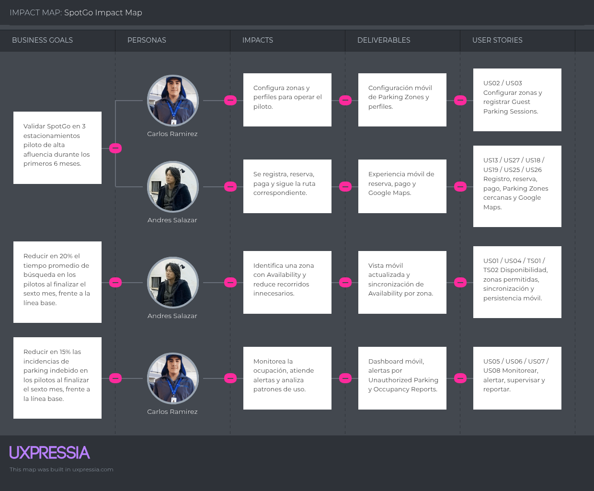

La figura presenta una vista ejecutiva de la relación entre los tres Business Goals, los User Personas, los cambios de comportamiento esperados, los entregables y las historias principales que los habilitan. La tabla desarrolla el detalle completo de las capacidades de pagos, reservas, suscripciones, facturación, consulta de Parking Zones cercanas mediante MapLibre y OpenStreetMap, y apertura de rutas externas en Google Maps. Las aplicaciones móviles y la aplicación web administrativa conforman los clientes del producto; la Landing Page se mantiene como producto digital complementario.

### 2.4.3. Product Backlog

El Product Backlog organiza las historias en los tres sprints previstos hasta la entrega del Trabajo Final. Dentro de cada sprint se conserva el orden por valor de negocio y contribución a los objetivos del proyecto. El número de orden indica la posición de cada historia en la tabla y no establece la secuencia técnica de implementación.

Las estimaciones en puntos de historia usan los valores 1, 2, 3 y 5, con un máximo de 5 puntos por historia. Consideran el esfuerzo, las validaciones, las integraciones y la incertidumbre del alcance completo, incluidos los criterios de aceptación. US12 tiene 1 punto por su navegación mediante enlaces; US04, 2 por consultar zonas según permisos existentes; y US16, 3 por cargar, validar y conservar versiones de una imagen, sin incluir la generación del mapa digital de US17. US13 tiene 2 puntos, suponiendo que reutiliza la autenticación con credenciales y Google de US09; mantiene la creación de la cuenta y el perfil y la validación de duplicados. US27 tiene 2 puntos por registrar y validar los datos de un vehículo asociado con una cuenta. US22 tiene 2 puntos porque consulta facturas existentes y actualiza datos tributarios, sin generar documentos fiscales. US24 tiene 2 puntos por alternar las traducciones existentes de una página estática. TS02 tiene 3 puntos por guardar datos de consulta, identificar información desactualizada y actualizarla al recuperar la conexión; no incluye operaciones de escritura sin conexión. US11 mantiene 3 puntos por su contenido, diseño adaptable y verificación de accesibilidad. Las historias de reservas, pagos, generación del mapa y geolocalización tienen 5 puntos por sus reglas e integraciones. Estos ajustes no reducen los criterios de aceptación ni modifican el alcance. Los sprints representan una distribución inicial de trabajo basada en el valor de negocio y las dependencias funcionales.

**Detalle de Sprints**

| Sprint | Objetivo | US Planeadas | Story Points |
| --- | --- | --- | --- |
| Sprint 1 | Desplegar la versión inicial de la Landing Page, desplegar el Backend con un avance del 70% y presentar las pantallas principales de Driver y Parking Admin desarrolladas inicialmente con Jetpack Compose. | US01, US02, US04, US09, US11, US12, US13, US16, US17, US18, US19 | 39 |
| Sprint 2 | Completar y desplegar al 100% la Landing Page y el Backend, completar al 100% la aplicación Android nativa de Driver con Kotlin y Jetpack Compose, y desarrollar al 40% la aplicación multiplataforma de Parking Admin con Flutter; completar las historias planificadas del sprint. | US03, US05, US06, US14, US15, US27, TS01, TS03, TS05, SP01, SP02 | 34 |
| Sprint 3 | Completar al 100% el desarrollo previsto, incluida la página web administrativa de SpotGo, y entregar las dos aplicaciones móviles funcionando mediante Firebase App Distribution; completar las historias planificadas del sprint. | US07, US08, US10, US20, US21, US22, US23, US24, US25, US26, TS02, TS04 | 42 |

**Product Backlog**

| Order # | Story ID | Title | Story Points | Sprint |
| --- | --- | --- | --- | --- |
| 1 | US01 | Consultar disponibilidad por zona | 5 | Sprint 1 |
| 2 | US04 | Consultar las zonas permitidas | 2 | Sprint 1 |
| 3 | US13 | Registrar una cuenta Driver | 2 | Sprint 1 |
| 4 | US18 | Gestionar reservas y comprobantes virtuales | 5 | Sprint 1 |
| 5 | US19 | Procesar pagos de reservas y cargos adicionales | 5 | Sprint 1 |
| 6 | US02 | Configurar zonas de estacionamiento | 5 | Sprint 1 |
| 7 | US16 | Cargar el plano del estacionamiento | 3 | Sprint 1 |
| 8 | US17 | Generar el mapa digital del estacionamiento | 5 | Sprint 1 |
| 9 | US09 | Autenticarse y acceder a las funciones de SpotGo según el rol | 3 | Sprint 1 |
| 10 | US11 | Comunicar la propuesta de valor en la página de presentación | 3 | Sprint 1 |
| 11 | US12 | Navegar desde la página de presentación hasta el producto móvil | 1 | Sprint 1 |
| 12 | US27 | Registrar un vehículo | 2 | Sprint 2 |
| 13 | TS05 | Confirmar pagos de forma asíncrona | 3 | Sprint 2 |
| 14 | US03 | Registrar una sesión de estacionamiento de invitado | 3 | Sprint 2 |
| 15 | US14 | Registrar un cliente B2B y su cuenta Parking Admin | 3 | Sprint 2 |
| 16 | US15 | Habilitar una cuenta Parking Admin | 2 | Sprint 2 |
| 17 | SP01 | Validar el monitoreo de ocupación con sensores | 3 | Sprint 2 |
| 18 | US05 | Supervisar la ocupación por zona | 5 | Sprint 2 |
| 19 | US06 | Generar alertas operativas | 3 | Sprint 2 |
| 20 | TS01 | Sincronizar datos móviles mediante servicios REST | 5 | Sprint 2 |
| 21 | TS03 | Documentar el contrato de los servicios REST | 2 | Sprint 2 |
| 22 | SP02 | Investigar la estrategia de sincronización móvil | 3 | Sprint 2 |
| 23 | US25 | Consultar zonas de estacionamiento cercanas | 5 | Sprint 3 |
| 24 | US26 | Abrir una ruta en Google Maps | 5 | Sprint 3 |
| 25 | TS04 | Generar comprobantes electrónicos | 5 | Sprint 3 |
| 26 | US20 | Gestionar planes de suscripción | 5 | Sprint 3 |
| 27 | US21 | Consultar comprobantes y facturas | 2 | Sprint 3 |
| 28 | US07 | Consultar el panel operativo móvil | 5 | Sprint 3 |
| 29 | US08 | Generar reportes de ocupación | 3 | Sprint 3 |
| 30 | TS02 | Guardar y sincronizar datos en el dispositivo móvil | 3 | Sprint 3 |
| 31 | US22 | Gestionar la facturación B2B | 2 | Sprint 3 |
| 32 | US23 | Reproducir el video promocional del producto | 2 | Sprint 3 |
| 33 | US24 | Cambiar el idioma de la página de presentación | 2 | Sprint 3 |
| 34 | US10 | Incorporar accesibilidad y opciones de idioma en la aplicación móvil | 3 | Sprint 3 |

La distribución conserva las 11 historias y los 39 puntos previstos para el Sprint 1. Al cierre de ese sprint, está desplegada la versión inicial de la Landing Page, el Backend registra un avance del 70% y se presentan las pantallas principales de Driver y Parking Admin desarrolladas inicialmente con Jetpack Compose. Esto no implica que todos los flujos integrados estén completos. En el Sprint 2 se prevé completar y desplegar al 100% la Landing Page y el Backend, completar al 100% la aplicación Android nativa de Driver y avanzar al 40% con la aplicación Flutter de Parking Admin. El Sprint 3 completará al 100% el desarrollo previsto, incluida la página web administrativa de SpotGo para SuperAdmin, y publicará las dos aplicaciones móviles en Firebase App Distribution. La distribución de historias mantiene las dependencias de registro, administración de cuentas, sensores, pagos, sincronización, reportes, facturación, accesibilidad y los mensajes en inglés de la app Driver.

**Evidencia del Product Backlog en Trello**

**Trello Board Link:** [https://trello.com/invite/b/6aa6e46ebebf57986f7fcd37/ATTIc1ae2804c4145e3b8bfd53325b170b9bFBAEB587/spotgo-trello-board](https://trello.com/invite/b/6aa6e46ebebf57986f7fcd37/ATTIc1ae2804c4145e3b8bfd53325b170b9bFBAEB587/spotgo-trello-board)

*Figura 12 (Trello Board: Product Backlog)*  
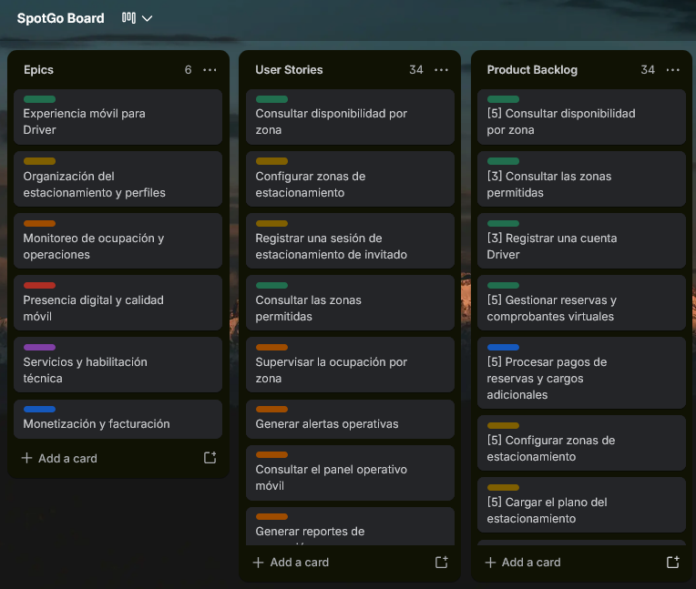

La tabla anterior deja listo el contenido que debe reflejarse en la herramienta y permite comprobar la correspondencia entre el orden, los Story Points y los Sprints.

## 2.5. Strategic-Level Domain-Driven Design

En esta sección se aplica **Domain-Driven Design a nivel estratégico** para analizar y organizar el dominio de SpotGo. A partir del EventStorming se identifican las principales áreas de responsabilidad del sistema, sus relaciones y los Bounded Contexts que permiten separar el dominio en modelos con límites y responsabilidades claras.

### 2.5.1. EventStorming

Para comprender el comportamiento del dominio de SpotGo y representar de manera visual los principales procesos del sistema, se aplicó la técnica de **EventStorming**. Esta permitió identificar los eventos de dominio, comandos, políticas, actores, modelos de lectura y servicios externos involucrados en las diferentes situaciones que ocurren durante el uso y administración de un estacionamiento.

El modelado se desarrolló de manera incremental hasta obtener un **Design-Level EventStorming**, en el cual se representan los principales flujos de SpotGo. Entre ellos se encuentran el registro del Driver y su Vehicle, la autenticación y validación de acceso, la búsqueda de disponibilidad, la creación y gestión de reservas, el procesamiento de Digital Payments, la administración de Subscriptions y la configuración de la infraestructura del estacionamiento.

Asimismo, se modeló el comportamiento operativo relacionado con la ocupación de los Parking Spots mediante sensores. Esto permite representar situaciones como el inicio y finalización de una Parking Session, detección de No-show, sobretiempo, fallas de sensores, conflictos de ocupación, reasignaciones de espacios y generación de alertas. Además, se incluyeron el mapa integrado con **MapLibre** y cartografía de **OpenStreetMap**, junto con la navegación externa mediante **Google Maps** hacia la Parking Zone seleccionada y con **Firebase Cloud Messaging** para comunicar eventos relevantes al usuario.

A partir del análisis de los eventos, comandos y políticas representados en el EventStorming se identificaron cinco principales áreas de responsabilidad dentro del dominio: **Profiles & Vehicles Management**, **Identity & Access Management**, **Parking Infrastructure**, **Payments & Billing** y **Occupancy & Monitoring**. Estos grupos sirven como base para el posterior descubrimiento de los Bounded Contexts y el modelado de los mensajes intercambiados entre ellos.

**Miro Board Link:** [https://miro.com/app/board/uXjVHoqrvyc=/](https://miro.com/app/board/uXjVHoqrvyc=/)

*Figura 13 (Design-Level EventStorming)*  
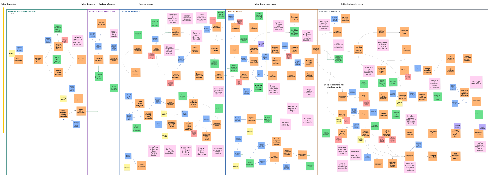

#### *2.5.1.1. Candidate Context Discovery*

A partir del **Design-Level EventStorming** se agruparon los eventos, comandos, políticas y responsabilidades relacionadas para identificar posibles límites dentro del dominio de SpotGo. Este análisis permitió reconocer cinco contextos candidatos, cada uno con responsabilidades y reglas de negocio diferenciadas.

| Contexto candidato | Responsabilidad principal | Clasificación |
| --- | --- | --- |
| **Profiles & Vehicles Management** | Gestionar un User Profile por Account, los vehículos de los Drivers y su clasificación por Tenant. | Supporting Domain |
| **Identity & Access Management** | Gestionar credenciales, sesiones y autorización según el rol del usuario. | Generic Domain |
| **Parking Infrastructure** | Gestionar Parking Zones, Parking Spots, disponibilidad y el ciclo de las reservas. | Core Domain |
| **Payments & Billing** | Gestionar pagos digitales, Payment Tokens, devoluciones, saldos y Subscriptions. | Supporting Domain |
| **Occupancy & Monitoring** | Monitorear la ocupación de los espacios mediante sensores y gestionar incidencias operativas. | Core Domain |

Los contextos **Parking Infrastructure** y **Occupancy & Monitoring** fueron clasificados como **Core Domain**, debido a que concentran las capacidades más relacionadas con la propuesta de valor de SpotGo: la asignación organizada de espacios y el monitoreo de su ocupación.

Por otro lado, **Profiles & Vehicles Management** y **Payments & Billing** cumplen funciones de soporte para completar los principales procesos del sistema, mientras que **Identity & Access Management** se considera un **Generic Domain**, ya que la autenticación y autorización son capacidades comunes en distintos sistemas de software.

También se identificaron capacidades como reservas, Parking Sessions, Guest Parking Sessions, Subscriptions, navegación y notificaciones. Sin embargo, no fueron consideradas Bounded Contexts independientes: las reservas, Parking Sessions y Guest Parking Sessions forman parte de Parking Infrastructure, las Subscriptions pertenecen a Payments & Billing y Google Identity, el servicio de mosaicos de OpenStreetMap consumido por MapLibre, Google Maps y Firebase Cloud Messaging se mantienen como servicios externos. Identity & Access Management valida el acceso con Google y conserva la responsabilidad sobre las sesiones y los roles de SpotGo.

#### *2.5.1.2. Domain Message Flows Modeling*

A partir de los Bounded Contexts identificados se modelaron los principales mensajes que intercambian entre sí. El objetivo de este diagrama es mostrar cómo colaboran los contextos de SpotGo sin repetir todo el flujo temporal del EventStorming.

**Parking Infrastructure** actúa como uno de los principales puntos de coordinación. Para crear y gestionar una reserva recibe información de **Profiles & Vehicles Management** y **Identity & Access Management**, permitiendo validar al Driver, su Vehicle y sus permisos.

Cuando una reserva requiere un pago digital, Parking Infrastructure envía la solicitud a **Payments & Billing**, que responde indicando si el pago fue aprobado o rechazado. Una vez creada o reasignada la reserva, la información se comunica a **Occupancy & Monitoring**, encargado de supervisar la ocupación física del Parking Spot mediante sensores.

Occupancy & Monitoring también puede informar sobre conflictos de ocupación, espacios no disponibles o sobretiempo. En este último caso, puede solicitar a Payments & Billing el procesamiento de un cobro adicional.

Además, SpotGo utiliza **Google Identity** para verificar la identidad presentada durante el inicio de sesión con Google, el servicio de mosaicos de **OpenStreetMap** para el mapa integrado que **MapLibre** renderiza en Android y **Google Maps** para abrir la navegación hacia la Parking Zone seleccionada. El Backend incluye integración opcional con **Firebase Cloud Messaging** para eventos de reservas, pagos y monitoreo; el envío push se activa al configurar FCM. La validación del proveedor no sustituye la autorización ni la sesión de SpotGo.

**Principales mensajes entre contextos**

| Origen | Mensaje | Destino |
| --- | --- | --- |
| Profiles & Vehicles Management | Valid Driver and vehicle | Parking Infrastructure |
| Identity & Access Management | Validated identity and role | Parking Infrastructure |
| Identity & Access Management | Google ID token verification | Google Identity |
| Parking Infrastructure | Payment / Refund Request | Payments & Billing |
| Payments & Billing | Payment approved / rejected | Parking Infrastructure |
| Parking Infrastructure | Reservation created / reassigned | Occupancy & Monitoring |
| Occupancy & Monitoring | Conflict / Unavailability | Parking Infrastructure |
| Occupancy & Monitoring | Additional charge / balance | Payments & Billing |
| Parking Infrastructure | Route to the Parking Zone | Google Maps |
| Parking Infrastructure, Payments & Billing, and Occupancy & Monitoring | Monitoring events / Reservation events / Payment events | Firebase Cloud Messaging (optional, disabled by default) |

Este modelo permite mantener separadas las responsabilidades de cada Bounded Context y hacer explícitas las dependencias necesarias para completar los principales procesos de SpotGo.

*Figura 14 (Domain Message Flows Modeling)*  
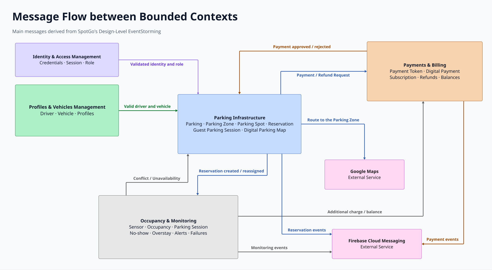

#### *2.5.1.3. Bounded Context Canvases*

A partir de los cinco Bounded Contexts identificados se elaboraron sus respectivos **Bounded Context Canvases**. Estos permiten definir de forma más clara el propósito, responsabilidades, lenguaje ubicuo, reglas de negocio, comunicaciones y dependencias de cada contexto dentro de SpotGo.

**Profiles & Vehicles Management**

Este contexto administra la información del **Driver**, sus vehículos y los perfiles asociados. Su responsabilidad es mantener estos datos disponibles para que otros contextos puedan validar si un Driver y su vehículo se encuentran habilitados para realizar determinadas operaciones.

Se clasifica como **Supporting Domain**, ya que brinda soporte a los procesos principales del sistema, especialmente a la creación de reservas y a la validación de usuarios.

*Figura 15 (Profiles & Vehicles Management Bounded Context Canvas)*  
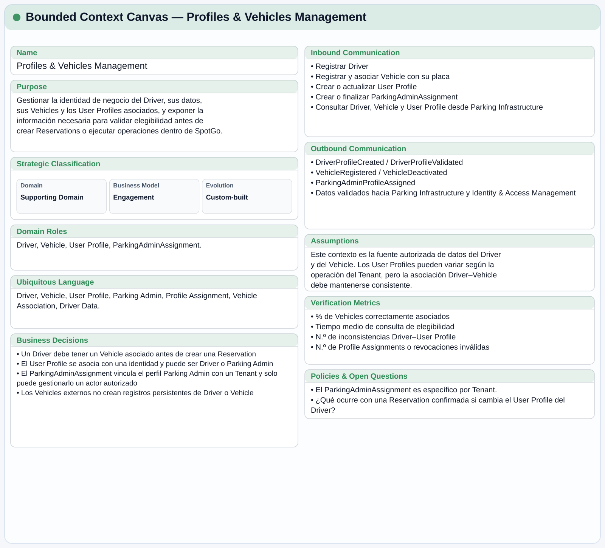

**Identity & Access Management**

Este contexto se encarga de la autenticación y autorización de los usuarios de SpotGo. Permite iniciar sesión con correo y contraseña o mediante Google, y administra credenciales, sesiones y roles para determinar qué operaciones puede realizar cada usuario dentro del sistema.

Se clasifica como **Generic Domain**, debido a que la gestión de identidad y acceso es una capacidad común presente en diferentes sistemas de software.

*Figura 16 (Identity & Access Management Bounded Context Canvas)*  
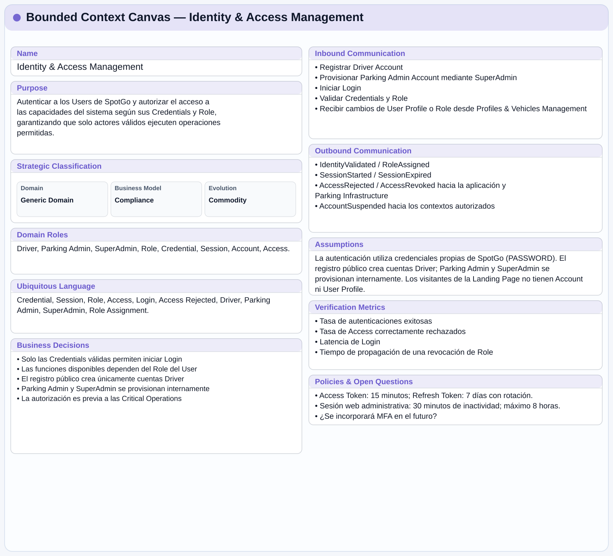

**Parking Infrastructure**

Este contexto administra la estructura del estacionamiento, incluyendo **Parking Zones**, **Parking Spots**, Availability, el **Floor Plan** como fuente definitiva del **Digital Parking Map** y el ciclo de las **reservas** y **Guest Parking Sessions**.

Se considera un **Core Domain**, ya que concentra capacidades centrales de SpotGo como la búsqueda de espacios, asignación de Parking Spots, creación y modificación de reservas y reasignaciones cuando existe algún conflicto de disponibilidad.

Además, se comunica con Payments & Billing para procesar pagos, con Occupancy & Monitoring para conocer el estado operativo de los espacios y con Google Maps para la navegación hacia la Parking Zone seleccionada.

*Figura 17 (Parking Infrastructure Bounded Context Canvas)*  
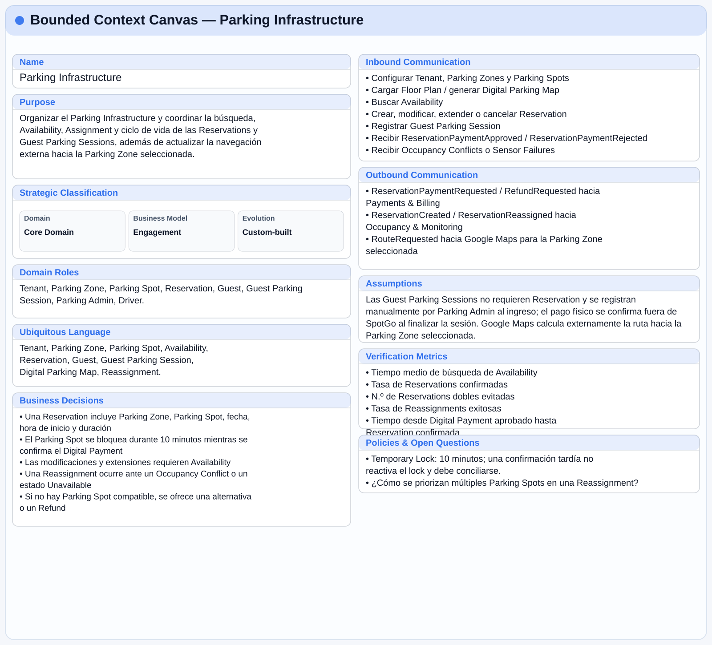

**Payments & Billing**

Este contexto administra las operaciones financieras de SpotGo, incluyendo **Payment Tokens**, **Digital Payments**, devoluciones, cobros adicionales, saldos pendientes, comprobantes y **Subscriptions** de Driver y Tenant. Para Driver aplica el descuento del plan al precio final de las reservas, sin aplicarlo a multas, sobretiempo ni otros cargos adicionales. Tenant paga S/30 mensuales por uso de la app más S/1 por cada Parking Spot registrado, esté operativo o no. Agregar un spot durante un periodo activo genera un cobro prorrateado inmediato con el token predeterminado; el spot permanece inactivo hasta que el pago sea aprobado y el snapshot de la suscripción se actualiza. No hay renovación mensual automática. El proveedor académico predeterminado simula aprobaciones y reembolsos sin contactar servicios externos ni mover dinero.

Se clasifica como **Supporting Domain**, ya que permite completar los procesos comerciales asociados a las reservas. Una de sus reglas principales es que SpotGo no almacena los datos completos de las tarjetas, sino identificadores seguros de pago.

*Figura 18 (Payments & Billing Bounded Context Canvas)*  
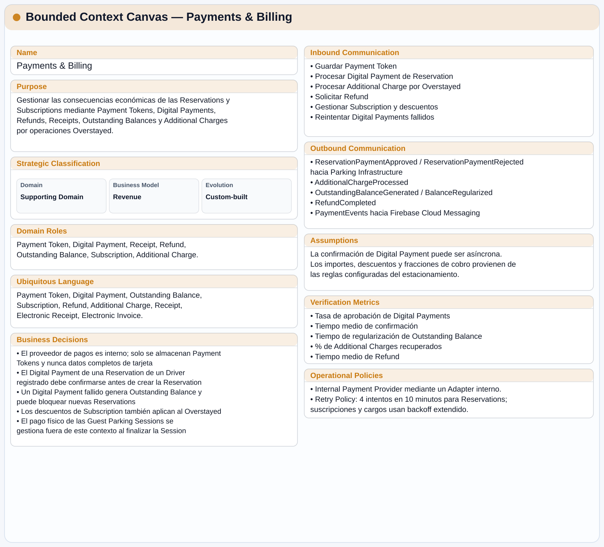

**Occupancy & Monitoring**

Este contexto supervisa la ocupación física de los **Parking Spots** mediante sensores y analiza los eventos relacionados con las **Parking Sessions**, cuya administración pertenece a Parking Infrastructure. También permite detectar situaciones como No-show, sobretiempo, fallas de sensores, conflictos de ocupación y otras incidencias operativas.

Se considera un **Core Domain**, debido a que el monitoreo de la disponibilidad y ocupación constituye una de las capacidades principales de SpotGo.

En este contexto se mantiene una separación entre el estado de una reserva y el estado físico del Parking Spot. Los sensores detectan únicamente si el espacio se encuentra ocupado o disponible, sin identificar automáticamente qué Vehicle lo está utilizando.

*Figura 19 (Occupancy & Monitoring Bounded Context Canvas)*  
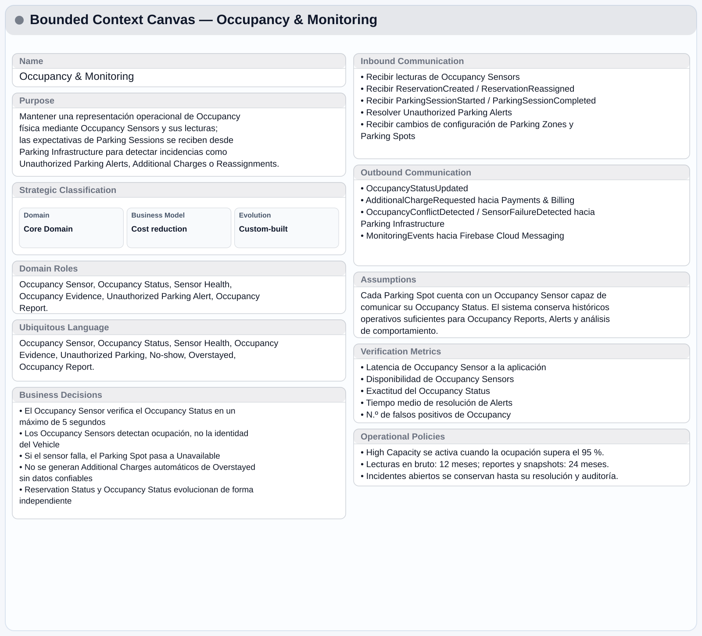

En conjunto, estos canvases permiten establecer límites claros entre las responsabilidades de cada Bounded Context y sirven como base para el posterior diseño de la arquitectura de software de SpotGo.

### 2.5.2. Context Mapping

En esta sección analizamos las relaciones estructurales entre los Bounded Contexts identificados para la solución. A partir de la información obtenida durante el análisis del dominio, se plantean diferentes alternativas de organización y se evalúa el impacto de modificar, dividir o integrar determinadas capacidades.

Los Bounded Contexts considerados son:

- Profiles & Vehicles Management
- Identity & Access Management
- Parking Infrastructure
- Payments & Billing
- Occupancy & Monitoring

El análisis considera las dependencias entre contextos y los patrones de relación propuestos por Domain-Driven Design.

*Figura 20 (Context Mapping Discussion Evidence)*  
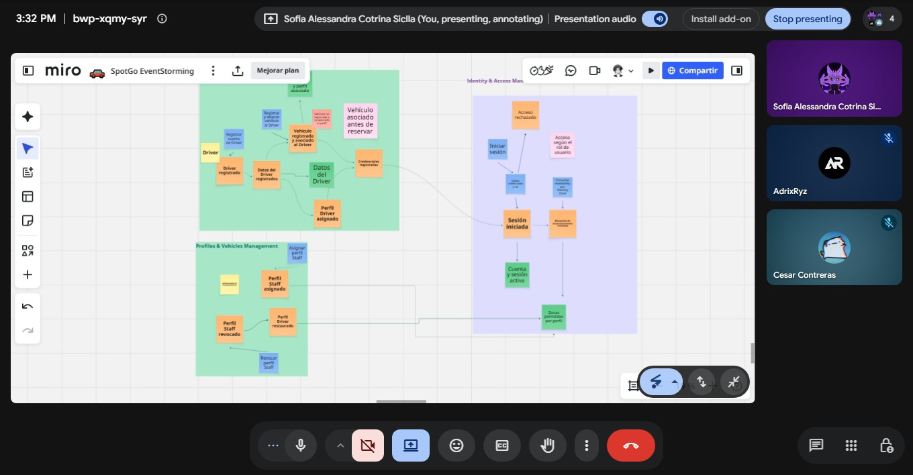

**Análisis de alternativas**

Para definir el Context Map se evaluaron diferentes alternativas considerando el traslado, división o integración de capacidades entre los Bounded Contexts. El análisis permitió identificar cómo cada modificación afectaría las dependencias y responsabilidades existentes.

***Alternativa 1: Mantener los Bounded Contexts actuales***

La primera alternativa consiste en conservar los cinco Bounded Contexts identificados, manteniendo sus responsabilidades y relaciones actuales.

Esta opción permite preservar los límites definidos durante el análisis del dominio y evita introducir nuevas dependencias entre contextos. `Parking Infrastructure` mantiene las operaciones relacionadas con la infraestructura, disponibilidad y reservas, mientras que `Payments & Billing`, `Occupancy & Monitoring`, `Profiles & Vehicles Management` e `Identity & Access Management` mantienen sus responsabilidades específicas.

***Alternativa 2: Dividir Parking Infrastructure***

Se evaluó dividir `Parking Infrastructure` en dos Bounded Contexts especializados:

- `Parking Management`, responsable de los Tenants, sus Parking Facilities, las zonas, los espacios y la disponibilidad.
- `Reservation Management`, responsable de la creación, modificación, cancelación y reasignación de reservas.

Esta alternativa permitiría distribuir las responsabilidades, pero incrementaría las comunicaciones entre contextos. La disponibilidad y las reservas tendrían que coordinarse mediante nuevas relaciones, aumentando la complejidad de integración.

***Alternativa 3: Integrar Payments & Billing***

Otra alternativa consiste en trasladar las capacidades de `Payments & Billing` hacia `Parking Infrastructure`.

Esta opción reduciría la comunicación entre las reservas y el procesamiento de pagos. Sin embargo, combinaría las responsabilidades operativas de estacionamiento con reglas relacionadas con pagos, facturación, reembolsos y cargos adicionales.

Por lo tanto, aunque disminuiría una dependencia externa, aumentaría el acoplamiento de responsabilidades dentro de un mismo Bounded Context.

***Alternativa 4: Crear un contexto compartido para información de Driver y vehículo***

También se evaluó extraer la información relacionada con Driver, vehículo, perfil y elegibilidad hacia un nuevo Bounded Context compartido.

Esta alternativa podría reducir la duplicación de información entre contextos. Sin embargo, `Profiles & Vehicles Management` ya concentra estas responsabilidades, por lo que crear un nuevo contexto podría generar duplicación y añadir una dependencia adicional para los demás contextos.

**Discusión de las alternativas**

Las alternativas fueron comparadas considerando la separación de responsabilidades, las dependencias entre contextos y la complejidad de las comunicaciones.

| Alternativa | Cambio propuesto | Consecuencia |
| --- | --- | --- |
| 1. Mantener estructura actual | Conservar los cinco Bounded Contexts | Mantiene las responsabilidades y relaciones existentes |
| 2. Dividir Parking Infrastructure | Separar infraestructura y reservas | Aumenta la especialización y las comunicaciones |
| 3. Integrar Payments & Billing | Incorporar pagos en Parking Infrastructure | Reduce una comunicación, pero mezcla responsabilidades |
| 4. Crear contexto compartido | Extraer datos de Driver y vehículo | Reduce posible duplicación, pero genera una nueva dependencia |

Después de analizar las alternativas, se decidió conservar los cinco Bounded Contexts originales. Esta aproximación mantiene una separación clara de responsabilidades y evita introducir límites adicionales que incrementen innecesariamente la complejidad de la solución.

**Relaciones y patrones DDD**

El Context Map seleccionado establece las siguientes relaciones estructurales entre los Bounded Contexts:

- **Profiles & Vehicles Management (U) → Parking Infrastructure (D):** `[Customer/Supplier]` Intercambio de información relacionada con el Driver, vehículo y perfil necesaria para las operaciones de estacionamiento.

- **Profiles & Vehicles Management (U) → Identity & Access Management (D):** `[Customer/Supplier]` Intercambio de información relacionada con la elegibilidad y los cambios de perfil utilizados en los procesos de acceso.

- **Identity & Access Management (U) → Parking Infrastructure (D):** `[Supplier]` Proporciona los mecanismos de autenticación y autorización requeridos para acceder a las operaciones de estacionamiento.

- **Parking Infrastructure (U) → Payments & Billing (D):** `[Customer/Supplier]` Solicita el procesamiento de pagos asociados a las reservas y recibe los resultados correspondientes.

- **Payments & Billing (U) → Parking Infrastructure (D):** `[Supplier]` Proporciona los resultados de las operaciones de pago, como pagos aprobados, rechazados y reembolsos.

- **Parking Infrastructure ↔ Occupancy & Monitoring:** `[Partnership]` Intercambio de información relacionada con reservas, ocupación, conflictos de ocupación, reasignaciones y eventos provenientes de sensores.

**Context Map seleccionado**

Como resultado del análisis, se mantiene la estructura conformada por los cinco Bounded Contexts identificados inicialmente. Las relaciones se establecen mediante patrones DDD que permiten definir explícitamente las dependencias y responsabilidades entre los contextos.

*Figura 21 (Context Map)*  
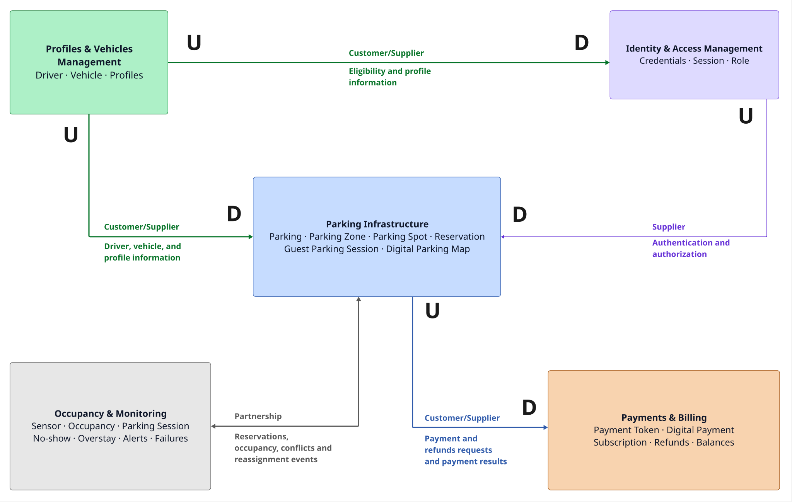

La estructura seleccionada mantiene cada Bounded Context enfocado en sus responsabilidades y establece relaciones explícitas para la comunicación entre ellos. `Parking Infrastructure` conserva las capacidades relacionadas con la gestión de estacionamientos y reservas, mientras que `Payments & Billing` mantiene las reglas correspondientes al procesamiento económico y `Occupancy & Monitoring` las relacionadas con el monitoreo de la ocupación.

### 2.5.3. Software Architecture

#### *2.5.3.1. Software Architecture Context Level Diagrams*

El **Diagrama de Contexto** constituye el primer nivel de abstracción del Modelo C4. Su propósito es delimitar el alcance de **SpotGo** y representar su interacción con los principales actores humanos y sistemas externos.

*Figura 22 (Context Level Diagram)*  
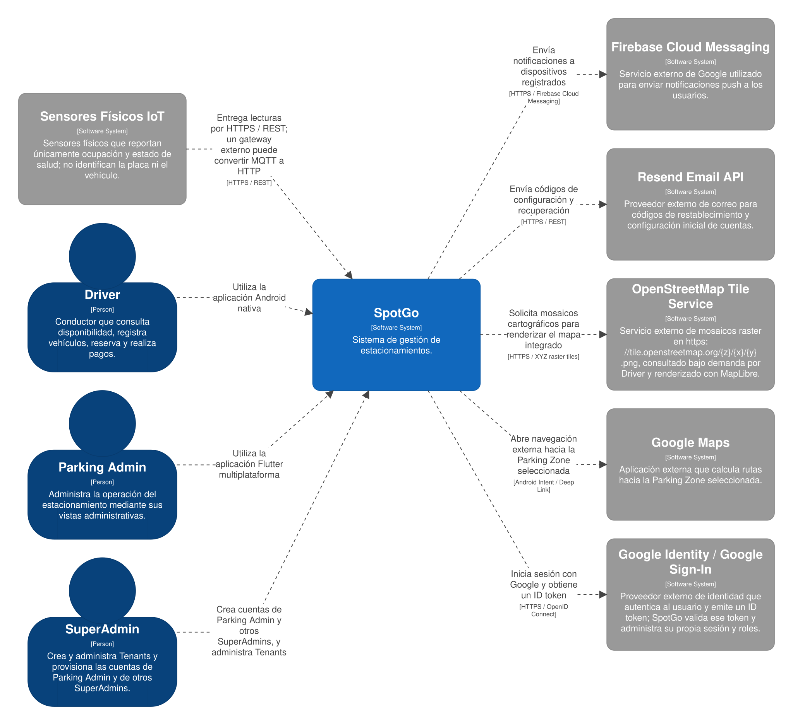

El diagrama identifica tres actores principales. El **Driver** utiliza la aplicación para consultar la disponibilidad de espacios, registrar sus vehículos, realizar reservas y efectuar pagos. El **Parking Admin** utiliza la solución para administrar la infraestructura del estacionamiento, asignar Profile Types a los Drivers de su Tenant y gestionar las reservas y operaciones asociadas. Finalmente, el **SuperAdmin** administra los **Tenants**, crea cuentas de **Parking Admin** y de otros **SuperAdmins**, y realiza la configuración inicial de los estacionamientos.

En cuanto a las integraciones externas, el Backend recibe lecturas de los **Sensores Físicos IoT** por HTTPS/REST; un gateway externo debe traducir MQTT si la red de sensores utiliza ese protocolo. La aplicación Android Driver renderiza el mapa integrado mediante **MapLibre**, que consulta mosaicos del servicio de **OpenStreetMap**; **Google Maps** permite abrir rutas hacia la **Parking Zone** seleccionada. La integración con **Firebase Cloud Messaging** envía notificaciones cuando está habilitada con credenciales; sin ellas, FCM permanece desactivado. La autenticación permite correo y contraseña de SpotGo o inicio de sesión mediante Google. Identity & Access Management valida ambos métodos y emite la sesión de SpotGo; el procesamiento de pagos pertenece al sistema interno de SpotGo.

#### *2.5.3.2. Software Architecture Container Level Diagrams*

El **Diagrama de Contenedores** constituye el segundo nivel del Modelo C4 y descompone SpotGo en sus principales unidades de software. La propuesta distingue tres aplicaciones cliente independientes: la aplicación Android nativa de Driver, la aplicación multiplataforma Flutter de Parking Admin y la página web administrativa de SpotGo para SuperAdmin. También incluye la Landing Page estática, una única instancia del Backend implementada como monolito modular y una única instancia PostgreSQL. El API Gateway y los cinco bounded contexts forman parte del Backend.

*Figura 23 (Container Level Diagram)*  
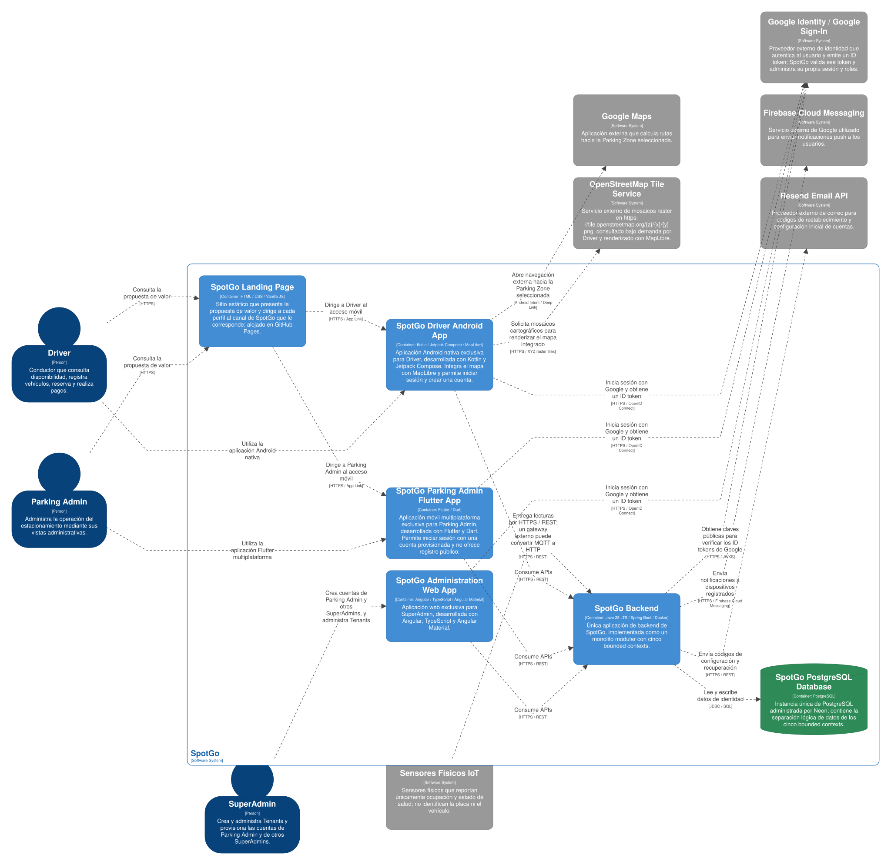

El diagrama representa los siguientes contenedores y módulos:

1. **SpotGo Driver Android App:** Aplicación nativa Android desarrollada con Kotlin y Jetpack Compose para Driver. Permite iniciar sesión y crear una cuenta mediante el registro público.
2. **SpotGo Landing Page:** Sitio estático desarrollado con HTML, CSS y Vanilla JS, desplegado en GitHub Pages. Presenta la propuesta de valor y dirige a cada perfil hacia el canal correspondiente.
3. **SpotGo Administration Web App:** Aplicación web desarrollada con Angular, TypeScript y Angular Material para SuperAdmin. Permite iniciar sesión con una cuenta provisionada y administrar Tenants y cuentas Parking Admin.
4. **SpotGo Parking Admin Flutter App:** Aplicación independiente y multiplataforma desarrollada con Flutter y Dart para Parking Admin. Permite iniciar sesión con una cuenta provisionada y no incluye registro público.
5. **SpotGo Backend:** Única aplicación backend de SpotGo, desarrollada con Java 25 LTS y Spring Boot. Se despliega como un Web Service en Render y organiza sus responsabilidades como monolito modular.
6. **API Gateway:** Componente del Backend que recibe las solicitudes de las aplicaciones cliente mediante HTTPS / REST y las dirige a los módulos correspondientes.
7. **Profiles & Vehicles Management:** Módulo del Backend que gestiona un User Profile por Account, los vehículos de los Drivers y su clasificación por Tenant mediante Profile Types. Los visitantes de la Landing Page no tienen un User Profile.
8. **Identity & Access Management:** Módulo del Backend que gestiona autenticación con correo y contraseña o Google, sesiones, autorización y auditoría. Asigna un único Role Type por Account: DRIVER, PARKING_ADMIN o SUPERADMIN; la cuenta de cada Parking Admin pertenece a un solo Tenant.
9. **Parking Infrastructure:** Módulo del Backend que gestiona cada Tenant como empresa cliente y como su único estacionamiento físico, además de sus Parking Zones y Parking Spots, reglas operativas, disponibilidad, reservas y sesiones.
10. **Payments & Billing:** Módulo del Backend que gestiona pagos digitales tokenizados, suscripciones de Driver y Tenant, descuentos de Driver aplicables solo al precio final de reservas, cuotas de Tenant de S/30 por uso del app más S/1 por Parking Spot registrado, esté operativo o no, sobretiempo, reembolsos, comprobantes y saldos pendientes. Al agregar un spot durante un periodo pagado, procesa un cobro prorrateado inmediato con el token predeterminado y no activa el spot hasta aprobar el pago. El proveedor académico simula las operaciones y no mueve dinero. No implementa renovación mensual automática e incluye idempotencia.
11. **Occupancy & Monitoring:** Módulo del Backend que recibe información de sensores IoT, determina la ocupación física, supervisa la salud de los sensores y genera eventos de conflictos y sobretiempo.

Los cinco bounded contexts mantienen límites lógicos de responsabilidad dentro del mismo Backend y organizan sus datos en una única instancia PostgreSQL alojada en Neon. Los módulos se integran mediante contratos internos y eventos de dominio; no se despliegan como servicios independientes.

#### *2.5.3.3. Software Architecture Deployment Diagrams*

El **Diagrama de Despliegue** representa la distribución física de los elementos de software de SpotGo sobre la infraestructura tecnológica utilizada durante el entorno de producción. Esta vista permite relacionar las aplicaciones cliente con los servidores de aplicación, la infraestructura de bases de datos, la red de sensores IoT y los servicios externos empleados por la solución.

*Figura 24 (Deployment Diagram)*  
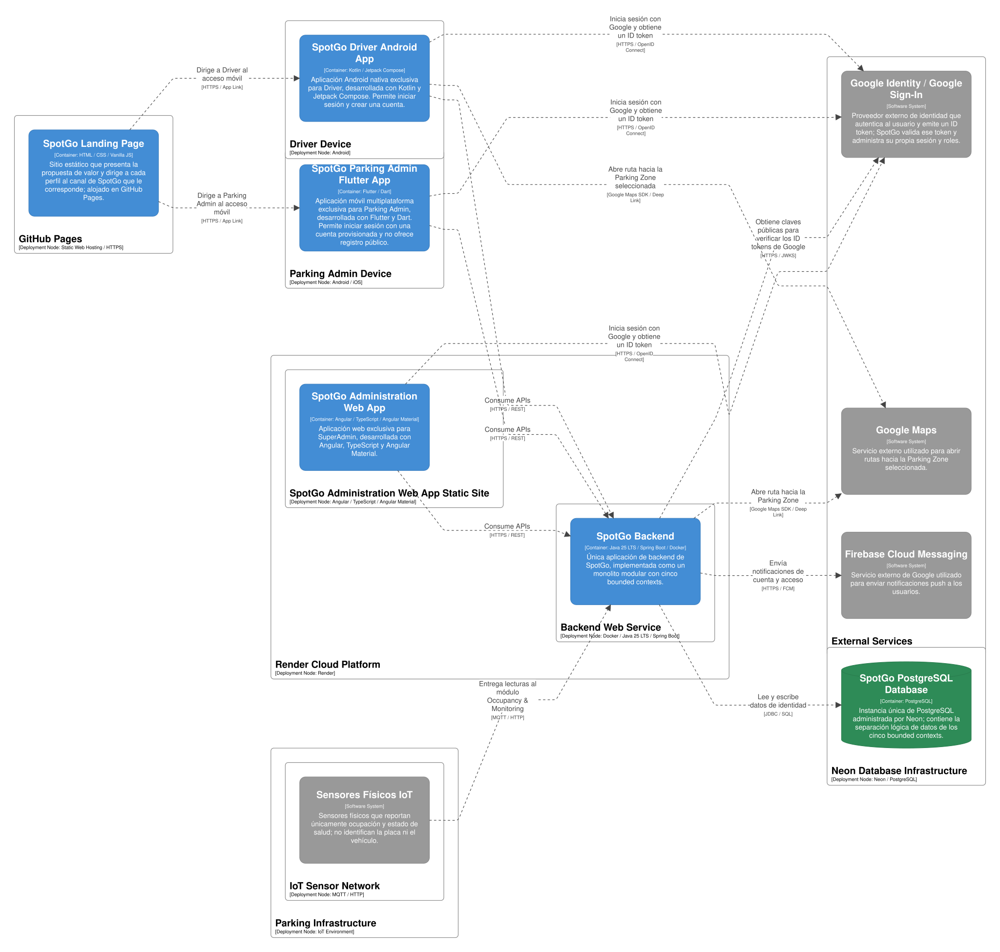

La infraestructura contempla un **Driver Device** que ejecuta la aplicación Android nativa de Driver, un **Parking Admin Device** que ejecuta la aplicación multiplataforma de Parking Admin y un **SuperAdmin Device** desde el cual se accede a la página web administrativa de SpotGo. Los tres clientes se comunican mediante HTTPS / REST con el **API Gateway**, componente del único Backend de SpotGo desplegado en Render.

Dentro de Render se despliega una sola instancia del **SpotGo Backend**, un monolito modular desarrollado con Spring Boot que contiene los cinco bounded contexts, el API Gateway y el procesamiento interno de pagos. La persistencia se concentra en una sola instancia PostgreSQL de **Neon**; los datos se organizan lógicamente según las responsabilidades de cada contexto. La Landing Page estática se aloja en **GitHub Pages**.

Finalmente, la **Parking Infrastructure** recibe datos de la red de sensores físicos IoT mediante endpoints **HTTPS/REST** de **Occupancy & Monitoring**. Si los sensores usan MQTT, un gateway externo debe convertir ese protocolo a HTTP. La aplicación Android consulta mosaicos de **OpenStreetMap** y los renderiza mediante **MapLibre**; **Google Maps** permite abrir rutas hacia una **Parking Zone**. El envío de notificaciones push mediante **Firebase Cloud Messaging** está disponible al habilitar la integración y configurar las credenciales.

## 2.6. Tactical-Level Domain-Driven Design

El diseño táctico traduce los límites identificados durante el diseño estratégico en modelos de dominio concretos para SpotGo. Cada bounded context mantiene un lenguaje ubicuo, reglas de negocio, agregados, servicios y contratos propios, de modo que sus responsabilidades puedan evolucionar sin convertir la base de datos o el modelo de un contexto en una dependencia directa de los demás. En esta sección se desarrollan los cinco bounded contexts definidos para la solución: Profiles & Vehicles Management, Identity & Access Management, Parking Infrastructure, Payments & Billing y Occupancy & Monitoring.

La propuesta se organiza en cuatro capas. La Domain Layer contiene las entidades, objetos de valor, agregados, fábricas, servicios de dominio e interfaces de repositorio. La Interface Layer expone controladores REST y consumidores de eventos. La Application Layer coordina comandos, casos de uso y manejadores de eventos, mientras que la Infrastructure Layer implementa la persistencia, los adaptadores de integración y la mensajería. Las tablas de cada contexto explican los componentes, las clases y los objetos de base de datos presentados en los diagramas de las secciones siguientes.

Como línea base tecnológica, el backend se implementará como un monolito modular en una única aplicación Java 25 LTS con Spring Boot, desplegada en Render. La persistencia utilizará una única instancia PostgreSQL de Neon con separación lógica de los datos por bounded context. SpotGo contará con tres clientes separados por perfil: una aplicación Android nativa con Kotlin, Jetpack Compose y MapLibre para Driver, una aplicación multiplataforma con Flutter y Dart para Parking Admin, y una aplicación web con Angular, TypeScript y Angular Material para SuperAdmin. Los clientes consumen la API REST del Backend sobre HTTPS. Los módulos aplican contratos internos y eventos de dominio para colaborar, sin despliegues independientes por contexto. El servicio de mosaicos de OpenStreetMap, Google Maps, Google Identity para el inicio de sesión y Firebase Cloud Messaging son servicios externos; MapLibre renderiza en Android el mapa integrado y el procesamiento de pagos pertenece al Backend de SpotGo.

Los bounded contexts mantienen responsabilidades lógicas dentro del monolito y comparten una instancia PostgreSQL. La implementación actual usa contratos y eventos Spring locales, y también contiene relaciones JPA y claves foráneas entre algunos contextos —por ejemplo, Profile–Account, Reservation–Profile/Vehicle y Occupancy–Parking—; por ello, la separación es lógica y no una frontera física de datos. Algunos servicios de aplicación también consultan repositorios de otros contextos dentro del mismo proceso. Esta integración es suficiente para el despliegue académico actual, pero no representa aislamiento de base de datos por bounded context.

**Criterios transversales de operación**

| Aspecto | Política adoptada |
| --- | --- |
| Temporary Lock | Al iniciar el pago digital de una reserva se crea un bloqueo temporal del espacio por 10 minutos. Durante ese periodo el espacio no puede ser asignado a otra reserva. Un pago aprobado dentro del plazo transforma la intención en una reserva confirmada; un rechazo, cancelación o vencimiento libera el espacio. Una aprobación recibida después del vencimiento no reactiva el bloqueo y pasa por un flujo de conciliación y reembolso o revisión. |
| Reintentos de pago | El proveedor interno recibe una clave de idempotencia por operación. Los errores transitorios, como timeout, indisponibilidad de red o respuesta 5xx, se reintentan con espera progresiva. Los rechazos definitivos, tokens inválidos, fondos insuficientes o respuestas asociadas a fraude no se reintentan automáticamente. Las operaciones de invitados pagadas en efectivo o POS no ingresan al flujo digital ni generan reintentos en Payments & Billing. |
| Retención del historial | Como política base propuesta, las reservas, sesiones, pagos, comprobantes, reembolsos, saldos y auditorías se conservan durante cinco años. Las lecturas de sensores en bruto se conservan durante doce meses y los reportes o agregados de ocupación durante veinticuatro meses. Los plazos son configurables y cualquier investigación, reclamo o auditoría abierta suspende la eliminación. Al finalizar el plazo, los datos personales se anonimizan o eliminan cuando no sean necesarios para conservar estadísticas agregadas. |
| Expiración de sesiones de acceso | El token de acceso dura 15 minutos. El token de renovación dura siete días, se rota al utilizarse y se revoca al cerrar sesión, cambiar credenciales o detectar un evento de seguridad. En la página web administrativa de SpotGo, utilizada por SuperAdmin, se aplica una expiración por inactividad de 30 minutos y una duración máxima de ocho horas por sesión. |
| Guest Parking Session | La sesión de un invitado no se cierra automáticamente solo por el paso del tiempo, porque su entrada, salida y pago físico son confirmados manualmente por Parking Admin. Si permanece abierta durante 24 horas, se genera una alerta de revisión; este umbral puede configurarse sin cambiar la regla de cierre manual. |
| Sobretiempo y ocupación | La tolerancia operativa para detectar sobretiempo es de cinco minutos. La ocupación física y el estado de una reserva se mantienen independientes. No se genera un cobro adicional únicamente con una lectura no confiable ni se infiere la identidad del vehículo a partir del sensor. |
