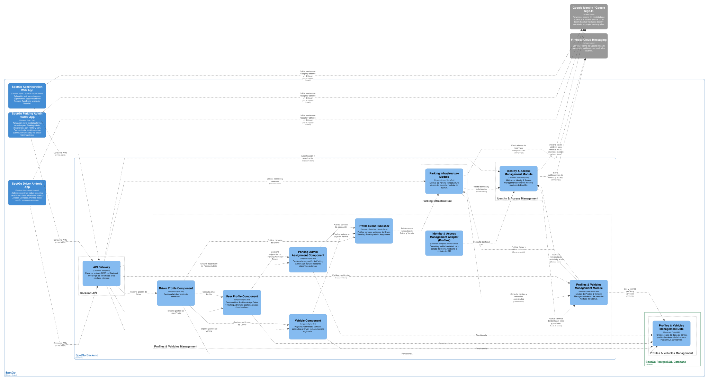
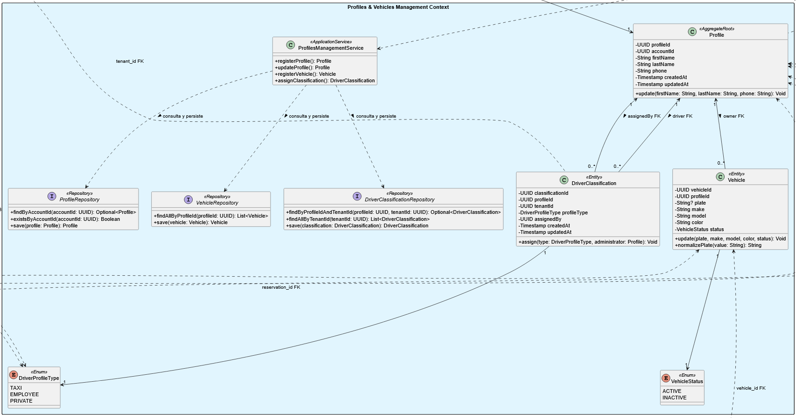
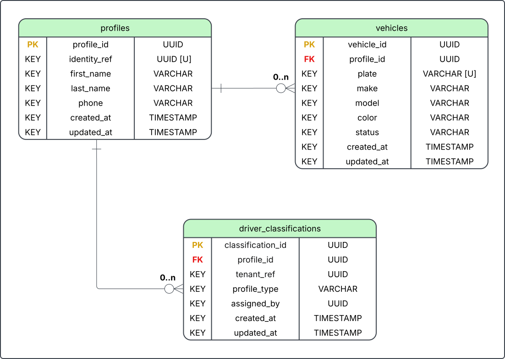

### 2.6.1. Bounded Context: Profiles & Vehicles Management

Profiles & Vehicles Management guarda el perfil personal asociado a una Account, los vehículos de los Drivers y la clasificación de cada Driver por Tenant. En el backend actual, `Profile.accountId` enlaza con IAM; el correo, el rol y el estado de autenticación permanecen en `Account`. No se crean perfiles para Guests. Las entidades de este contexto y las demás entidades del backend comparten una instancia PostgreSQL; algunas asociaciones entre bounded contexts están respaldadas por claves foráneas físicas.

Un Parking Admin puede asignar TAXI, EMPLOYEE o PRIVATE a un Driver del Tenant que administra. Si no hay una clasificación para ese Tenant, se utiliza PRIVATE. Parking Infrastructure aplica ahora esa clasificación contra los tipos permitidos en cada Parking Zone, tanto al listar zonas/disponibilidad como al crear una reserva.

#### *2.6.1.1. Domain Layer*

El modelo persistente implementado está compuesto por tres entidades JPA y dos enumeraciones. La aplicación coordina reglas de identidad y alcance consultando directamente los repositorios de IAM y Parking Infrastructure dentro del mismo monolito modular.

| Elemento | Tipo | Responsabilidad y reglas principales | Atributos u operaciones relevantes |
| --- | --- | --- | --- |
| Profile | Entity / Aggregate Root | Conserva los datos personales y una referencia única a una Account. | profileId, accountId, firstName, lastName, phone, createdAt, updatedAt; update(). |
| Vehicle | Entity / Aggregate Root | Pertenece a un Profile; su placa es opcional y se normaliza a mayúsculas. | vehicleId, profileId, plate, make, model, color, status; update(), normalizePlate(). |
| DriverClassification | Entity / Aggregate Root | Asocia un Profile Driver con un Tenant y guarda el tipo asignado por un administrador. `UNIQUE(profile_id, tenant_id)` limita una clasificación por par. | classificationId, profileId, tenantId, profileType, assignedBy, createdAt, updatedAt; assign(). |
| DriverProfileType | Enumeration | Clasifica al Driver dentro de un Tenant y controla el acceso a zonas que permiten ese tipo. | TAXI, EMPLOYEE, PRIVATE. |
| VehicleStatus | Enumeration | Indica si el Vehicle puede utilizarse en nuevas operaciones. | ACTIVE, INACTIVE. |

No existen un agregado `Driver` independiente, una entidad `UserProfile` separada, un `IdentityReference` ni factories de dominio en el código actual. La cuenta y el rol se resuelven mediante IAM; Parking Infrastructure valida la titularidad del vehículo antes de reservar.

#### *2.6.1.2. Interface Layer*

Los controladores REST reciben las solicitudes autenticadas y delegan las operaciones en los servicios de aplicación. Los UUID del perfil y de la cuenta se obtienen desde la sesión o se validan contra la propiedad del recurso; el cliente no puede elegir un propietario distinto.

| Componente de interfaz | Canal | Responsabilidad | Operaciones principales |
| --- | --- | --- | --- |
| ProfilesController | REST/HTTPS | Crear y consultar/actualizar el perfil de la cuenta autenticada. | `POST /api/v1/profiles`, `GET /api/v1/profiles/me`, `PUT /api/v1/profiles/me`. |
| VehiclesController | REST/HTTPS | Listar, registrar, actualizar o desactivar vehículos del Driver autenticado. | `GET/POST /api/v1/vehicles`, `PATCH/DELETE /api/v1/vehicles/{vehicleId}`. |
| DriverClassificationsController | REST/HTTPS | Asignar y consultar clasificaciones dentro del Tenant autorizado. | `PUT /api/v1/driver-classifications/tenants/{tenantId}/profiles/{profileId}`, `GET /tenants/{tenantId}`, `GET /me`. |

Las respuestas no exponen credenciales, tokens completos ni información de pago. Las aplicaciones cliente consumen estos contratos mediante la API REST del Backend.

#### *2.6.1.3. Application Layer*

La lógica de aplicación está implementada en servicios Spring. ProfilesManagementService valida Account, rol y pertenencia del Parking Admin al Tenant; ProfilesCommandServiceImpl ejecuta comandos de vehículos y ProfilesQueryServiceImpl consulta vehículos.

| Caso de uso | Servicio implementado | Resultado |
| --- | --- | --- |
| Create or update profile | ProfilesManagementService | Crea un Profile único por Account o actualiza firstName, lastName y phone. |
| List, create, update, or deactivate vehicle | ProfilesQueryServiceImpl / ProfilesCommandServiceImpl | Limita la lectura y modificación de vehículos al Profile autenticado. Desactivar conserva la fila con status INACTIVE. |
| Assign or list driver classifications | ProfilesManagementService | Solo el Parking Admin del Tenant puede asignar una clasificación a un perfil DRIVER; si profileType se omite o es null, se guarda PRIVATE. |
| Filter allowed zones and reserve | ParkingQueryServiceImpl / ParkingCommandServiceImpl | Resuelve la clasificación explícita o PRIVATE y exige que el tipo esté permitido por la zona. |

El backend publica eventos locales después de las operaciones de perfil, vehículo y clasificación: `profiles.driver.profile_created`, `profiles.driver.profile_updated`, `profiles.vehicle.registered`, `profiles.vehicle.updated`, `profiles.vehicle.deactivated` y `profiles.driver.classification_assigned`. No existe un consumer de eventos IAM que sincronice perfiles; la aplicación consulta IAM directamente. Los eventos se procesan dentro del proceso Spring y no cuentan con broker, outbox persistente ni entrega durable.

#### *2.6.1.4. Infrastructure Layer*

Las entidades se persisten mediante Spring Data JPA y Hibernate en la instancia PostgreSQL compartida.

| Componente de infraestructura | Implementación | Responsabilidad |
| --- | --- | --- |
| ProfileRepository | Spring Data JPA | Busca un perfil por `account_id` y verifica su unicidad. |
| VehicleRepository | Spring Data JPA | Persiste y consulta vehículos por Profile. |
| DriverClassificationRepository | Spring Data JPA | Busca clasificaciones por Profile y Tenant o lista por Tenant/Profile. |
| Identity and Tenant references | Asociaciones JPA entre módulos | `profiles.account_id` referencia IAM; `driver_classifications.tenant_id` referencia Parking Infrastructure. |
| Event publisher | Spring ApplicationEventPublisher | Emite eventos locales para el listener de notificaciones después del commit. |

`profiles.account_id` tiene una FK física UNIQUE a `accounts.account_id`. `vehicles.profile_id` referencia `profiles`. `driver_classifications.profile_id` y `assigned_by` referencian `profiles`, y `tenant_id` referencia `tenants`. La frontera entre contexts es lógica: estas referencias no están aisladas en bases de datos distintas.

#### *2.6.1.5. Bounded Context Software Architecture Component Level Diagrams*

El diagrama presenta el módulo dentro del monolito modular, sus controladores, servicios, repositorios y relaciones con IAM y Parking Infrastructure. El intercambio entre módulos usa llamadas/repositorios internos y eventos Spring en memoria; no representa servicios desplegados de manera independiente.

*Figura 25 (Profiles & Vehicles Management Component Level Diagram)*  

| Componente | Responsabilidad | Dependencias principales |
| --- | --- | --- |
| Profile management | Crear y actualizar el perfil de la cuenta autenticada. | ProfilesController, ProfilesManagementService, ProfileRepository. |
| Vehicle management | Administrar vehículos que pertenecen al perfil Driver. | VehiclesController, ProfilesCommandServiceImpl, ProfilesQueryServiceImpl, VehicleRepository. |
| Driver classification | Administrar el tipo del Driver por Tenant. | DriverClassificationsController, ProfilesManagementService, DriverClassificationRepository. |
| Profile persistence | Persistir perfiles, vehículos y clasificaciones. | Spring Data JPA, PostgreSQL compartido. |
| IAM and Parking references | Validar Account/roles y relacionar el Tenant. | AccountRepository, RoleAssignmentRepository, TenantRepository y FKs JPA. |
| Domain event publisher | Publicar eventos locales de Profile, Vehicle y DriverClassification. | Spring ApplicationEventPublisher. |

#### *2.6.1.6. Bounded Context Software Architecture Code Level Diagrams*

El diagrama de clases refleja las entidades y repositorios presentes en el código. Se mantienen los nombres de clases en inglés para corresponder con la implementación.

#### ***2.6.1.6.1. Bounded Context Domain Layer Class Diagrams***

*Figura 26 (Profiles & Vehicles Management Domain Layer Class Diagram)*  

| Clase, interfaz o enumeración | Atributos principales | Métodos principales | Relaciones |
| --- | --- | --- | --- |
| Profile | -id, -accountId, -firstName, -lastName, -phone, -createdAt, -updatedAt | +update() | Entidad JPA; accountId es único y tiene asociación con Account. |
| Vehicle | -id, -profile, -plate, -make, -model, -color, -status, -createdAt, -updatedAt | +update(), +normalizePlate() | Pertenece a un Profile. |
| DriverClassification | -id, -profile, -tenantId, -profileType, -assignedBy, -createdAt, -updatedAt | +assign() | Pertenece a un Profile Driver y Tenant; assignedBy es un Profile administrador. |
| DriverProfileType | TAXI, EMPLOYEE, PRIVATE | — | Enum usado en DriverClassification y ParkingZone. |
| VehicleStatus | ACTIVE, INACTIVE | — | Enum usado en Vehicle. |
| ProfileRepository | — | +findByAccountId(), +existsByAccountId() | Spring Data JPA. |
| VehicleRepository | — | +findAllByProfileId(), +findById() | Spring Data JPA. |
| DriverClassificationRepository | — | +findByProfileIdAndTenantId(), +findAllByTenantId(), +findAllByProfileId() | Spring Data JPA. |

| Relación | Multiplicidad y dirección | Significado |
| --- | --- | --- |
| Profile — Vehicle | Profile 1 a Vehicle 0..* | Cada vehículo pertenece a un perfil. |
| Profile — DriverClassification | Profile 1 a DriverClassification 0..* | El Profile Driver clasificado se guarda en `profile_id`; el perfil administrador se guarda en `assigned_by`. |
| Account — Profile | Account 1 a Profile 0..1 | `profiles.account_id` es UNIQUE y FK a IAM. |
| Tenant — DriverClassification | Tenant 1 a DriverClassification 0..* | `driver_classifications.tenant_id` tiene FK a Parking Infrastructure. |

#### ***2.6.1.6.2. Bounded Context Database Design Diagram***

El diseño de base de datos representa las tablas de Profiles & Vehicles Management en la instancia PostgreSQL compartida.

*Figura 27 (Profiles & Vehicles Management Database Design Diagram)*  

| Tabla | Columnas principales | Restricciones y relaciones |
| --- | --- | --- |
| profiles | profile_id, account_id, first_name, last_name, phone, created_at, updated_at | profile_id PK; account_id UNIQUE NOT NULL y FK a accounts.account_id. |
| vehicles | vehicle_id, profile_id, plate, make, model, color, status, created_at, updated_at | vehicle_id PK; profile_id FK a profiles; plate UNIQUE cuando no es NULL; status ACTIVE o INACTIVE. |
| driver_classifications | classification_id, profile_id, tenant_id, profile_type, assigned_by, created_at, updated_at | classification_id PK; profile_id y assigned_by FK a profiles; tenant_id FK a tenants; UNIQUE(profile_id, tenant_id); profile_type TAXI, EMPLOYEE o PRIVATE. |

| Relación de datos | Cardinalidad | Regla |
| --- | --- | --- |
| profiles — vehicles | 1 a 0..* | Todo Vehicle persistente pertenece a un Profile. |
| profiles — driver_classifications | 1 a 0..* | Un Driver puede tener como máximo una clasificación por Tenant; la unicidad corresponde a `(profile_id, tenant_id)`. |
| profiles de Parking Admin a driver_classifications | 1 a 0..* mediante assigned_by | Guarda el perfil que asignó o actualizó la clasificación. |
| profiles.account_id — accounts.account_id | FK física UNIQUE | Relaciona el Profile con IAM. |
| driver_classifications.tenant_id — tenants.tenant_id | FK física | Relaciona la clasificación con el Tenant sin duplicar sus datos. |

El esquema no incluye tablas de invitados, Guest Parking Sessions, credenciales, tokens de pago, asignaciones de rol ni reservas. Esas entidades pertenecen a otros bounded contexts.
