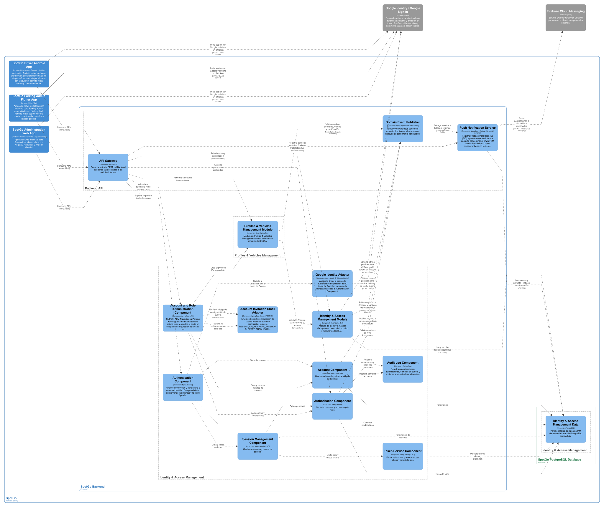
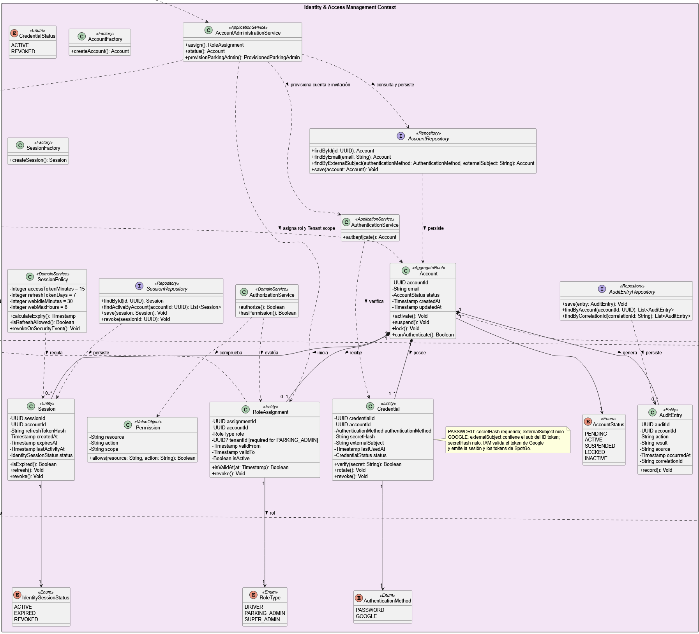
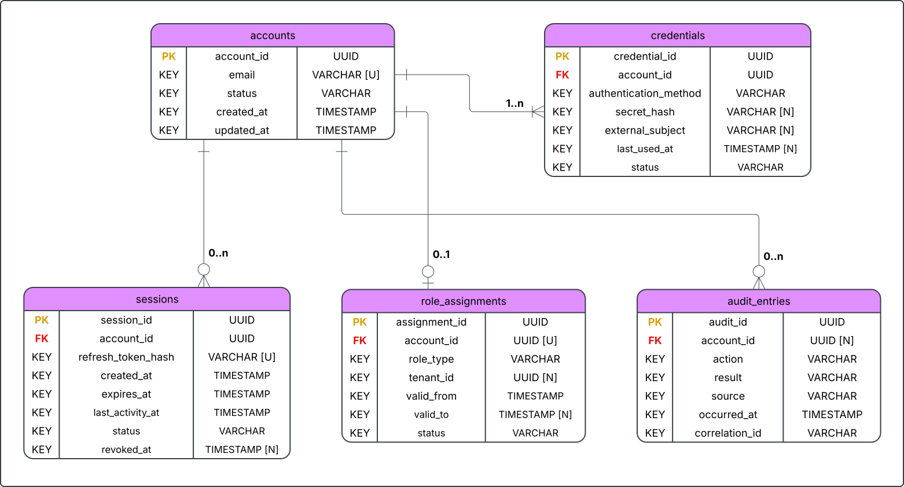

### 2.6.2. Bounded Context: Identity & Access Management

Identity & Access Management (IAM) administra cuentas, credenciales, roles, sesiones, recuperación de contraseña y auditoría de acceso. Cada cuenta tiene como máximo una asignación de rol. El rol DRIVER puede tener un perfil personal separado en Profiles & Vehicles Management; el perfil se crea después del registro y se relaciona con la cuenta mediante una clave foránea, no mediante `identityRef`. El Profile Type por Tenant tampoco es un rol de IAM: lo administra Profiles & Vehicles Management. Una Guest Parking Session no necesita una cuenta.

Los roles implementados son `DRIVER`, `PARKING_ADMIN` y `SUPER_ADMIN`. Una asignación `PARKING_ADMIN` requiere un Tenant existente; un Tenant admite varios Parking Admins. El registro público solo crea cuentas `DRIVER`. Un SuperAdmin provisiona o cambia las cuentas administrativas. Las aplicaciones Driver, Parking Admin y SuperAdmin son clientes separados y consumen el backend sobre HTTPS.

#### *2.6.2.1. Domain Layer*

El modelo de dominio implementado protege las credenciales locales con hashes, conserva el identificador externo verificado para GOOGLE y almacena únicamente el hash SHA-256 del refresh token. Una cuenta puede no tener perfil personal hasta que el Driver lo cree. La base de datos impone una asignación de rol por cuenta y las restricciones de método de autenticación.

| Elemento | Tipo | Responsabilidad y atributos u operaciones implementadas |
| --- | --- | --- |
| Account | Aggregate Root | `id`, `email`, `status`, `createdAt`, `updatedAt`; normaliza correo, `changeStatus()` e `isActive()`. |
| Credential | Entity | `account`, `authenticationMethod`, `secretHash`, `externalSubject`, `lastUsedAt`, `status`; GOOGLE requiere subject y no almacena hash de contraseña; `rotate()`, `usedAt()`, `revoke()`. |
| RoleAssignment | Entity | `account`, `roleType`, `tenantId`, `validFrom`, `validTo`, `status`; solo una fila por cuenta; `PARKING_ADMIN` requiere Tenant; `assign()` e `isEffectiveAt()`. |
| Session | Entity | `account`, `refreshTokenHash`, `lastActivityAt`, `status`, `revokedAt`, `createdAt`, `expiresAt`; `isUsableAt()`, `rotate()`, `touch()`, `revoke()`. |
| AuditEntry | Entity | `account` opcional, `action`, `result`, `source`, `occurredAt`, `correlationId`; registra acciones sin incluir contraseñas ni tokens. |
| PasswordResetCode | Entity | Correo, `codeHash`, `expiresAt`, `attempts`, `requestedAt`, `usedAt`; permite renovación, control de intentos y uso único. |
| UserRole | Enumeration | `DRIVER`, `PARKING_ADMIN`, `SUPER_ADMIN`. |
| AccountStatus | Enumeration | `PENDING`, `ACTIVE`, `SUSPENDED`, `LOCKED`, `INACTIVE`. |
| CredentialStatus | Enumeration | `ACTIVE`, `REVOKED`. |
| AssignmentStatus | Enumeration | `ACTIVE`, `INACTIVE`. |
| AuthenticationMethod | Enumeration | `PASSWORD`, `GOOGLE`. |
| SessionStatus | Enumeration | `ACTIVE`, `REVOKED`, `EXPIRED`. |

Los servicios de aplicación realizan autenticación, asignación de roles, bloqueo de cuentas, renovación y revocación de sesiones. El backend verifica los ID tokens de Google en servidor y nunca acepta un ID de usuario enviado directamente. Si la dirección de Google ya pertenece a otra cuenta, el registro devuelve conflicto: el usuario debe autenticarse en su cuenta y vincular Google desde esa sesión; no se combinan cuentas solo por coincidencia de correo.

#### *2.6.2.2. Interface Layer*

Los controladores REST implementados son `AuthenticationController`, `AccountsController`, `SessionsController` y `AuditEntriesController`. Todos tienen operaciones documentadas en OpenAPI. El acceso administrativo a cuentas, roles y auditorías requiere `SUPER_ADMIN`; el cambio de estado a uno distinto de ACTIVE revoca las sesiones activas.

| Operación | Endpoint | Acceso y resultado |
| --- | --- | --- |
| Sign in / sign up | `POST /api/v1/authentication/sign-in`, `POST /api/v1/authentication/sign-up` | Público; inicia sesión o registra un DRIVER con correo y contraseña. El perfil se crea aparte en `/api/v1/profiles`. |
| Google sign in / registration | `POST /api/v1/authentication/google` | Público; valida el ID token y autentica o crea una cuenta DRIVER. Si el Google Client ID no está configurado, responde 503. |
| Link Google identity | `POST /api/v1/authentication/google/link` | Requiere sesión SpotGo; vincula el subject verificado sin combinar cuentas. |
| Refresh / sign out | `POST /api/v1/authentication/refresh`, `POST /api/v1/authentication/sign-out` | Rota el refresh token de un solo uso o revoca la sesión actual. |
| Password reset | `POST /api/v1/authentication/password-reset/request`, `POST /api/v1/authentication/password-reset/confirm` | Solicita y valida un código de un solo uso; la entrega de correo requiere configuración de Resend. |
| Account and role administration | `/api/v1/accounts` | Consultar la propia cuenta/asignación; SUPER_ADMIN lista cuentas, cambia estados y asigna roles/tenants. `POST /api/v1/accounts/parking-admin` crea una cuenta PARKING_ADMIN, su asignación y perfil, y envía el código de configuración por correo. |
| Tenant onboarding | `POST /api/v1/tenants/onboard` | SUPER_ADMIN crea Tenant y su primer Parking Admin con perfil e invitación por correo en una transacción; si falla el envío, se revierte el alta. |
| Session administration | `/api/v1/sessions/me`, `/api/v1/sessions/{sessionId}` | Lista o revoca sesiones propias. |
| Audit queries | `GET /api/v1/audit-entries` | SUPER_ADMIN consulta registros paginados y opcionalmente filtra por cuenta. |

#### *2.6.2.3. Application Layer*

`AuthenticationService` coordina registro y acceso con contraseña o Google, vinculación de proveedor, actualización y recuperación de contraseña, emisión y renovación de sesiones. `AccountAdministrationService` valida privilegios y Tenant al cambiar roles, administra estados, provisiona cuentas de Parking Admin con un código de configuración por correo y entrega las consultas de auditoría. `TenantOnboardingService` crea Tenant y su administrador inicial con perfil e invitación en una sola transacción. `SessionAuthenticationService` comprueba la sesión y la asignación de rol actuales en cada petición.

| Evento de dominio publicado | Contenido | Consumidores |
| --- | --- | --- |
| `identity.account.registered` | Cuenta creada y método de autenticación; no incluye credenciales. | Notificaciones y otros listeners locales configurados en el monolito. |
| `identity.account.status_changed` | Cuenta y nuevo estado. | Listeners locales de notificación. |
| `identity.role.assigned` | Cuenta, rol y tenant opcional. | Listeners locales de notificación. |
| `identity.google.linked` | Cuenta a la que se vinculó Google. | Listeners locales de notificación. |

Los eventos se publican dentro del proceso Spring y los listeners reaccionan después del commit. No hay broker, outbox persistente ni consumidor de eventos externos para IAM; una interrupción del proceso puede perder una notificación pendiente.

#### *2.6.2.4. Infrastructure Layer*

IAM comparte la instancia PostgreSQL de Neon con los demás módulos del monolito; no usa una base independiente. Las tablas tienen asignación lógica por bounded context y el esquema se actualiza con Hibernate. La aplicación firma tokens de acceso SpotGo y almacena hashes, no refresh tokens en texto plano.

| Configuración | Valor implementado |
| --- | --- |
| Access token | 15 minutos por defecto (`authorization.jwt.access-expiration-minutes`). |
| Refresh token | 7 días por defecto, se rota en cada renovación (`authorization.jwt.refresh-expiration-days`). |
| Password reset code | 15 minutos y hasta 5 intentos por defecto. |
| Google sign-in | Requiere `GOOGLE_CLIENT_ID`, el OAuth Web Client ID aceptado como audiencia. |
| Password reset email | Requiere Resend; sin configuración la solicitud de entrega devuelve 503. |

El verificador de Google usa la biblioteca oficial del cliente Java para validar firma, emisor, audiencia y expiración del ID token, además de exigir correo verificado. El backend emite su propia sesión SpotGo después de validar la identidad del proveedor; el ID token de Google no se usa como token de autorización de la API.

#### *2.6.2.5. Bounded Context Software Architecture Component Level Diagrams*

El diagrama de componentes muestra IAM como módulo del monolito modular, sus controladores y los clientes móviles/web. La persistencia de IAM comparte PostgreSQL con los otros bounded contexts. Los cambios se comunican dentro del proceso mediante los eventos Spring indicados arriba.

*Figura 28 (Identity & Access Management Component Level Diagram)*  

#### *2.6.2.6. Bounded Context Software Architecture Code Level Diagrams*

La vista de clases debe representar las entidades y enumeraciones implementadas descritas en la tabla de esta sección. No se modelan `Permission`, `AccountFactory`, `SessionFactory`, `SessionPolicy`, un `Authorization Controller` ni handlers/consumidores IAM separados, porque no existen como clases del backend actual.

#### ***2.6.2.6.1. Bounded Context Domain Layer Class Diagrams***

*Figura 29 (Identity & Access Management Domain Layer Class Diagram)*  

| Clase o enumeración | Atributos o valores principales | Relaciones y restricciones |
| --- | --- | --- |
| Account | `id`, `email`, `status`, `createdAt`, `updatedAt` | Email único; puede tener credenciales, sesiones, auditoría y una asignación de rol. |
| Credential | `authenticationMethod`, `secretHash`, `externalSubject`, `lastUsedAt`, `status` | FK a Account; PASSWORD requiere hash; GOOGLE requiere external subject y no acepta hash de contraseña. |
| RoleAssignment | `roleType`, `tenantId`, `validFrom`, `validTo`, `status` | FK única a Account; FK nullable a Tenant, obligatoria solo para PARKING_ADMIN. |
| Session | `refreshTokenHash`, `lastActivityAt`, `status`, `revokedAt`, `createdAt`, `expiresAt` | FK a Account; hash del refresh token único por sesión. |
| AuditEntry | `action`, `result`, `source`, `occurredAt`, `correlationId` | FK nullable a Account para registrar intentos sin una identidad autenticada. |
| PasswordResetCode | `email`, `codeHash`, `expiresAt`, `attempts`, `requestedAt`, `usedAt` | Correo único; el código original no se persiste. |
| UserRole, AccountStatus, CredentialStatus, AssignmentStatus, AuthenticationMethod, SessionStatus | Enumeraciones detalladas en la tabla de Domain Layer | Valores usados por las entidades IAM. |

#### ***2.6.2.6.2. Bounded Context Database Design Diagram***

Identity Database representa las tablas IAM dentro de la instancia compartida de PostgreSQL. `role_assignments.tenant_id` tiene una FK física a `tenants`; el perfil Driver se almacena en Profiles & Vehicles Management y referencia `accounts` mediante FK. Las tablas no duplican datos del Tenant ni de Profile.

*Figura 30 (Identity & Access Management Database Design Diagram)*  

| Tabla | Columnas principales | Restricciones y relaciones |
| --- | --- | --- |
| `accounts` | `account_id`, `email`, `status`, `created_at`, `updated_at` | PK `account_id`; email único; estado persistido como enum. |
| `credentials` | `credential_id`, `account_id`, `authentication_method`, `secret_hash`, `external_subject`, `last_used_at`, `status` | FK a `accounts`; restricción de consistencia PASSWORD/GOOGLE; subject externo único por método. |
| `role_assignments` | `assignment_id`, `account_id`, `role_type`, `tenant_id`, `valid_from`, `valid_to`, `status` | `account_id` FK único; `tenant_id` FK a `tenants`; PARKING_ADMIN requiere Tenant; otros roles requieren NULL. |
| `sessions` | `session_id`, `account_id`, `refresh_token_hash`, `created_at`, `expires_at`, `last_activity_at`, `status`, `revoked_at` | FK a `accounts`; hash único; expiración posterior a creación. |
| `password_reset_codes` | `id`, `email`, `code_hash`, `expires_at`, `attempts`, `requested_at`, `used_at` | Email único; solo guarda el hash del código y limita expiración/intentos desde el servicio. |
| `audit_entries` | `audit_id`, `account_id`, `action`, `result`, `source`, `occurred_at`, `correlation_id` | FK nullable a `accounts`; no guarda contraseñas ni tokens completos. |
| `push_device_tokens` | `device_token_id`, `account_id`, `device_token`, `platform`, `created_at`, `last_seen_at` | FK a `accounts`; el campo legado `device_token` guarda el Firebase Installation ID (FID), no un token de registro FCM; es único y el ID sin procesar no se devuelve en REST. Pertenece al módulo de Notifications. |

Las sesiones se revocan al cerrar sesión, cambiar contraseña, completar una recuperación o desactivar la cuenta. La duración de cinco años para auditoría es una política documental; no existe una tarea de purga automática configurada.
