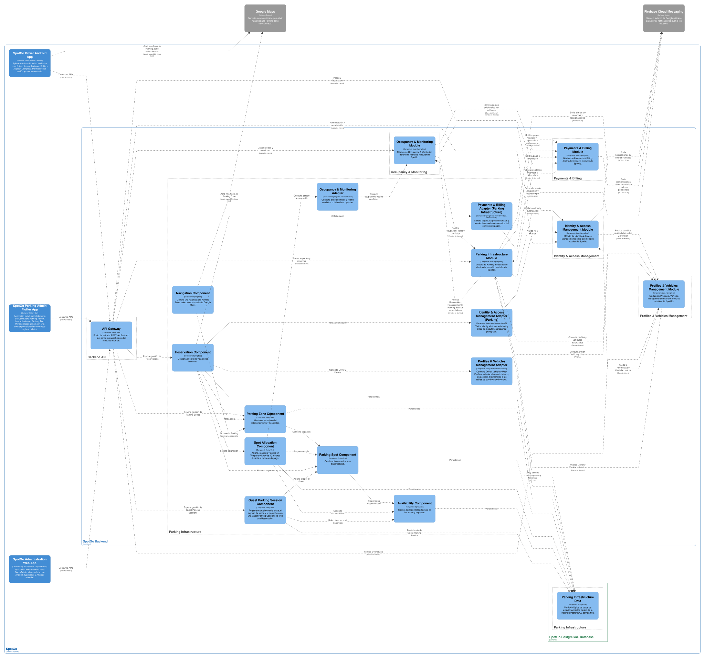
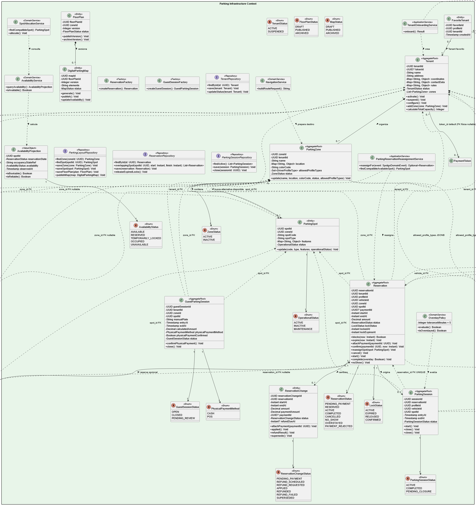
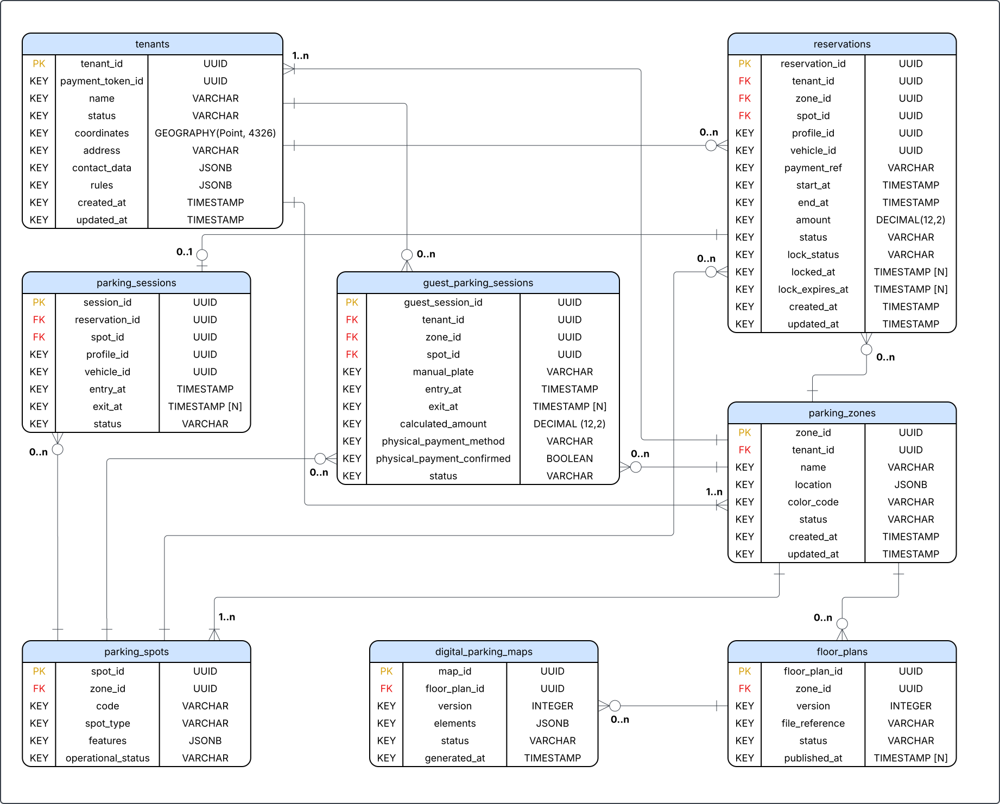

### 2.6.3. Bounded Context: Parking Infrastructure

Parking Infrastructure es el bounded context principal de la operación del estacionamiento. Cada Tenant representa a la empresa cliente y a su único estacionamiento físico: sus datos de dirección, coordenadas y reglas se guardan en el mismo Tenant. Este contexto organiza sus Parking Zones y Parking Spots, administra los planos y mapas digitales, calcula la disponibilidad y gestiona las reservas, las Parking Sessions de un Driver y las Guest Parking Sessions. También coordina la asignación, modificación, extensión, cancelación y reasignación de espacios.

Este contexto es dueño del ciclo de vida de la reserva y de la Parking Session. Occupancy & Monitoring aporta lecturas y estados físicos de sensores, pero no administra estas entidades ni infiere la identidad de un vehículo. Payments & Billing procesa los pagos digitales y emite los comprobantes; Parking Infrastructure solo conserva las referencias necesarias para relacionar una operación económica con una reserva o una sesión. El backend también incluye el módulo Favorites, que persiste los estacionamientos favoritos de cada perfil Driver mediante `favorite_tenants`.

Las reservas corresponden exclusivamente a conductores registrados y se asocian con un Vehicle persistente y un Parking Spot específico. En cambio, una Guest Parking Session se registra manualmente por Parking Admin, conserva únicamente la placa ingresada durante la atención, no tiene reserva ni Driver asociado y utiliza un pago físico en efectivo o POS confirmado fuera de SpotGo.

#### *2.6.3.1. Domain Layer*

La capa de dominio concentra la infraestructura, el ciclo de reserva y las Parking Sessions. El estado físico reportado por los sensores y el estado de la reserva se mantienen como conceptos independientes. `ParkingQueryServiceImpl` calcula la disponibilidad al consultar, combinando el estado del spot, reservas, holds, sesiones abiertas y una lectura física cuando existe; no hay una entidad o tabla persistente de Availability Projection.

| Elemento | Tipo | Responsabilidad y reglas principales | Atributos u operaciones relevantes |
| --- | --- | --- | --- |
| Tenant | Entity | Representa la empresa cliente y el estacionamiento físico operado por ella. Conserva dirección, coordenadas, contacto, token de pago predeterminado y reglas. | `tenant_id`, `name`, `status`, `address`, `coordinates` JSONB, `token_id`, `contact_data` JSONB, `rules` JSONB. |
| ParkingZone | Entity | Agrupa spots del Tenant y define qué tipos de perfil pueden consultar y reservar la zona. | `tenant_id`, `name`, `location` JSONB, `allowed_profile_types` JSONB, `color_code`, `status`. |
| ParkingSpot | Entity | Representa un espacio físico y su estado operativo. El código es único dentro de la zona. | `zone_id`, `code`, `spot_type`, `features` JSONB, `operational_status`. |
| FloorPlan | Entity | Persiste una referencia de archivo y versiones de planos por zona; el backend no convierte archivos. | `zone_id`, `version`, `file_reference`, `status`, `published_at`. |
| DigitalParkingMap | Entity | Persiste elementos JSONB asociados a una versión de FloorPlan; el backend valida las referencias de spots. | `floor_plan_id`, `version`, `elements` JSONB, `status`, `generated_at`. |
| Reservation | Entity | Reserva de un perfil Driver y Vehicle para una zona y spot en un intervalo; enlaza un pago simulado. | `tenant_id`, `profile_id`, `vehicle_id`, `zone_id`, `spot_id`, `payment_id`, `start_at`, `end_at`, `amount`, `status`, campos de hold. |
| ReservationChange | Entity | Registra una reprogramación o extensión solicitada, su importe, pago asociado y estado de aplicación o reembolso. | `reservation_id`, `start_at`, `end_at`, `amount`, `payment_amount`, `payment_id`, `status`, `refund_due_at`. |
| FavoriteTenant | Entity | Guarda la relación favorita entre un perfil Driver y un Tenant. | `favorite_id`, `profile_id`, `tenant_id`, `created_at`; un perfil solo puede guardar una vez cada Tenant. |
| ParkingSession | Entity | Sesión iniciada a partir de una reserva; mantiene el perfil, vehículo, spot y marcas de entrada/salida. | `reservation_id`, `profile_id`, `vehicle_id`, `spot_id`, `entry_at`, `exit_at`, `status`. |
| GuestParkingSession | Entity | Atención manual sin cuenta Driver, perfil, vehículo persistente ni reserva; el Parking Admin confirma efectivo o POS. | `tenant_id`, `zone_id`, `spot_id`, `manual_plate`, `entry_at`, `exit_at`, `calculated_amount`, medio/confirmación de pago físico y estado. |
| Reservation hold | Estado en Reservation | Hold temporal asociado a la intención de pago; no tiene tabla propia. | `lock_status`, `locked_at`, `lock_expires_at`; el servicio programado expira holds vencidos. |
| Tenant rules | JSONB | Guarda tarifas, tolerancia de sobretiempo, duración de hold y reglas de asignación/convivencia. | Configuración por Tenant; no es una entidad `ParkingRuleSet`. |
| Availability | Resultado calculado | Respuesta del servicio de consulta; no es entidad, tabla, vista ni proyección materializada. | Calculada desde estado operativo, reservas, holds, sesiones y lectura física disponible. |
| ReservationStatus | Enumeration | Estado del ciclo de reserva. | `PENDING_PAYMENT`, `RESERVED`, `ACTIVE`, `COMPLETED`, `CANCELLED`, `NO_SHOW`, `OVERSTAYED`, `PAYMENT_REJECTED`. |
| ReservationChangeStatus | Enumeration | Estado de una solicitud de cambio y de su pago o reembolso. | `PENDING_PAYMENT`, `REFUND_SCHEDULED`, `REFUND_REQUESTED`, `APPLIED`, `REFUNDED`, `REFUND_FAILED` y `SUPERSEDED`. |
| LockStatus | Enumeration | Estado del hold almacenado en Reservation. | `ACTIVE`, `EXPIRED`, `RELEASED`, `CONFIRMED`. |
| ParkingSessionStatus / GuestSessionStatus | Enumerations | Estados de ParkingSession y GuestParkingSession, respectivamente. | `ACTIVE`, `COMPLETED`, `PENDING_CLOSURE`; `OPEN`, `CLOSED`, `PENDING_REVIEW`. |

Las reglas esenciales del contexto son las siguientes:

| Regla | Aplicación |
| --- | --- |
| Reserva para Driver | El Driver usa su perfil y un Vehicle de su propiedad; su tipo de perfil por Tenant debe estar permitido por `allowed_profile_types`. Si no tiene clasificación, se interpreta como PRIVATE. |
| Pago previo | La reserva queda en `PENDING_PAYMENT` y el hold se guarda en la misma fila; pasa a `RESERVED` al confirmarse el pago simulado y si el hold sigue vigente. |
| Expiración del hold | Duración configurable en `tenants.rules`; una tarea programada expira holds vencidos. El hold no tiene tabla independiente. |
| Modificación y cancelación | Los cambios se validan contra disponibilidad y reglas. Cancelar no promete un reembolso automático. |
| Conflicto físico | Una alerta de Occupancy & Monitoring puede iniciar una reasignación a un spot elegible del mismo Tenant; una lectura de sensor no identifica al vehículo. |
| Alta de capacidad | El cobro mensual simulado del Tenant considera los Parking Spots registrados. Agregar spots durante un ciclo activo genera un ajuste prorrateado inmediato usando el token predeterminado del Tenant. |
| Guest | Parking Admin registra la placa manual y el pago físico; el flujo no crea cuenta Driver, Vehicle persistente ni reserva digital. |
| Sobretiempo | El cierre compara la permanencia con la tolerancia configurada del Tenant y solicita a Payments & Billing el cargo simulado cuando corresponde. |

#### *2.6.3.2. Interface Layer*

Los controladores REST reciben las solicitudes de las aplicaciones cliente. Dentro del monolito, Parking Infrastructure consulta servicios/repositorios de Profiles & Vehicles Management, IAM, Payments & Billing y Occupancy & Monitoring directamente para aplicar sus reglas; no hay consumidores Parking de los eventos descritos en el diseño conceptual. Los eventos que sí se publican para notificación o reasignación se indican en Application Layer.

| Componente de interfaz | Canal | Responsabilidad | Operaciones o mensajes |
| --- | --- | --- | --- |
| TenantsController | REST/HTTPS | Consulta y actualiza el Tenant dentro del alcance del actor; creación y administración global se limita a SUPER_ADMIN. | Consultar Tenant, actualizar datos y token de pago predeterminado. |
| ParkingZonesController / ParkingSpotsController | REST/HTTPS | Administra zonas y spots, y consulta disponibilidad. Las zonas exponen los `allowedProfileTypes`. | Crear/actualizar zona y spot; consultar zonas, spots y disponibilidad. |
| ReservationsController | REST/HTTPS | Gestiona reservas, cambios y comprobantes informativos asociados a Driver, Vehicle, intervalo y pago simulado. | Crear, confirmar, cancelar, consultar, reprogramar (`POST /api/v1/reservations/{reservationId}/reschedule`), extender (`POST /api/v1/reservations/{reservationId}/extend`), consultar cambios (`GET /api/v1/reservations/{reservationId}/changes`) y descargar PDF (`GET /api/v1/reservations/{reservationId}/receipt`). El envío del PDF por correo usa `POST /api/v1/reservations/{reservationId}/receipt/email` y está deshabilitado por defecto. |
| FavoritesController | REST/HTTPS | Persiste los estacionamientos favoritos del perfil Driver autenticado. | `GET` y `POST /api/v1/favorites`; `DELETE /api/v1/favorites/{favoriteId}`. |
| ParkingSessionsController / GuestParkingSessionsController | REST/HTTPS | Administra Parking Sessions de Driver y atención de Guest separada. | Iniciar/cerrar una sesión de Driver; abrir/cerrar una Guest Parking Session y confirmar pago físico. |
| FloorPlansController / DigitalParkingMapsController | REST/HTTPS | Administra referencias/versiones de planos y mapas JSONB asociados. | Crear/publicar versiones y consultar mapas; no procesa archivos ni genera rutas. |
| Internal module calls | In-process | Consulta Profiles/IAM y Monitoring; solicita pagos simulados, suscripciones y cargos a Payments & Billing. | Llamadas Java dentro de la aplicación, no mensajes de un broker. |
| SpotgoDomainEventPublisher | Evento Spring local | Publica eventos que consumen listeners locales después del commit. | Los nombres implementados aparecen en la tabla de Application Layer. |

Las operaciones de Guest Parking Session se restringen a PARKING_ADMIN del Tenant correspondiente. La aplicación Flutter de Parking Admin y la aplicación Android nativa de Driver utilizan las operaciones permitidas para cada rol.

#### *2.6.3.3. Application Layer*

La Application Layer coordina los casos de uso centrales mediante `ParkingCommandServiceImpl`, `ParkingQueryServiceImpl`, `ReservationLifecycleService` y `ParkingReservationReassignmentService`. Las transacciones protegen reservas/holds; Payments & Billing se invoca directamente para las operaciones simuladas. La reasignación y notificación usan eventos locales dentro del proceso.

| Command | Command Handler | Resultado |
| --- | --- | --- |
| Create or update Tenant | `TenantsController` / `ParkingCommandServiceImpl` | SuperAdmin crea el Tenant; Parking Admin actualiza datos y `rules` JSONB de su Tenant. `POST /api/v1/tenants/onboard` crea atómicamente el Tenant y su primer Parking Admin con perfil e invitación. |
| Configure tenant, zones, and spots | ParkingCommandServiceImpl | Crea y actualiza Tenants, Parking Zones y Parking Spots. Las zonas guardan `allowed_profile_types` para TAXI, EMPLOYEE y PRIVATE. |
| Check availability | ParkingQueryServiceImpl | Calcula bookability por zona e intervalo con estado operativo, reservas, holds, sesiones abiertas y ocupación física consultada a Monitoring. |
| Create reservation | ParkingCommandServiceImpl | Valida titularidad y estado del Vehicle, el tipo permitido en la zona, deuda, disponibilidad e intervalo; crea PENDING_PAYMENT con un hold en la propia fila Reservation. |
| Confirm reservation | ParkingCommandServiceImpl | Cambia a RESERVED solo si el pago asociado está aprobado, pertenece al perfil y coincide con el importe, y el hold sigue vigente. |
| Cancel reservation | ParkingCommandServiceImpl | Cancela una reserva PENDING_PAYMENT o RESERVED y libera su hold; la API no promete solicitar un reembolso automáticamente. |
| Reschedule or extend reservation | ParkingCommandServiceImpl | Registra el cambio solicitado y valida disponibilidad; un cambio de horario con diferencia pagadera se liquida como operación simulada independiente. |
| Reassign reservation | ParkingReservationReassignmentService | Al abrirse un conflicto de ocupación, intenta mover la siguiente reserva confirmada a un spot compatible y disponible del mismo Tenant. |
| Start and close Parking Session | ParkingCommandServiceImpl | Inicia una sesión para una reserva RESERVED dentro de su intervalo, registra la salida y notifica a Billing si corresponde cargo por sobretiempo. |
| Register and close Guest Parking Session | ParkingCommandServiceImpl | Abre y cierra una sesión manual sin identidad Driver ni reserva; calcula el importe y conserva el estado de pago físico. |
| Publish floor plan or map | ParkingCommandServiceImpl | Administra versiones, estados DRAFT/PUBLISHED/ARCHIVED y referencias de archivos/mapas; no convierte archivos. |
| Manage Driver favorites | FavoritesService | Lista, agrega o elimina favoritos por perfil y Tenant; la relación permanece almacenada en PostgreSQL. |

| Domain Event | Consumidor relacionado | Acción |
| --- | --- | --- |
| `parking.reservation.created`, `parking.reservation.confirmed`, `parking.reservation.cancelled` | DomainEventNotificationListener | Envía notificaciones seleccionadas después del commit; FCM solo entrega push si está habilitado. |
| `monitoring.alert.opened` | ParkingReservationReassignmentListener | Inicia en otra transacción una reasignación elegible para un conflicto de ocupación. |
| `parking.reservation.reassigned` | DomainEventNotificationListener | Notifica la nueva asignación a los perfiles y al Tenant destinatarios. |
| `parking.session.started`, `parking.session.completed` | DomainEventNotificationListener y Payments & Billing interno | Notifica la operación; al cerrar sesión, Billing registra cargos adicionales cuando aplica. |
| `parking.zone.created`, `parking.spot.created` | DomainEventNotificationListener | Publica eventos locales de alta de infraestructura. |

La confirmación del pago y de la reserva se coordina mediante llamadas internas al módulo Payments & Billing, no mediante un consumidor durable de mensajes. Los eventos Spring se publican dentro del monolito y sus listeners reaccionan después del commit; no hay broker ni outbox persistente.

#### *2.6.3.4. Infrastructure Layer*

La implementación organiza Parking Infrastructure como un módulo de la única aplicación Java y Spring Boot. Persiste en la instancia PostgreSQL compartida, consulta directamente servicios/repositorios de los otros módulos para reglas internas y publica eventos Spring locales. La aplicación Driver muestra el mapa con MapLibre y cartografía de OpenStreetMap; Google Maps se abre únicamente para navegación externa y el Backend no implementa un adaptador de rutas.

| Componente de infraestructura | Implementación | Responsabilidad |
| --- | --- | --- |
| Tenant Repository Implementation | Java, Spring Boot y PostgreSQL | Persiste los datos de la empresa y de su único estacionamiento físico en Tenant, incluidos dirección, coordenadas y `rules` JSONB. |
| Layout Repository Implementation | Java, Spring Boot y PostgreSQL | Persiste zonas, spots, planos y mapas digitales. |
| Reservation Repository Implementation | Java, Spring Boot y PostgreSQL | Persiste reservas, intervalos, estados y referencias de pago. |
| Parking Session Repository Implementation | Java, Spring Boot y PostgreSQL | Persiste Parking Sessions y Guest Parking Sessions. |
| ReservationLifecycleService | Servicio Spring con tarea programada | Expira holds PENDING_PAYMENT vencidos; `lock_status`, `locked_at` y `lock_expires_at` viven en la fila Reservation. |
| ProfilesManagementService / IAM repositories | Servicios y repositorios Spring internos | Resuelven el Profile, titularidad de Vehicle, clasificación del Driver y alcance de Account dentro del monolito. |
| ParkingPaymentGateway | Contrato interno hacia Payments & Billing | Valida/crea operaciones de pago simuladas, deuda, cobros de spot y cargos por sobretiempo. No mueve dinero real. |
| ParkingOccupancyGateway | Contrato interno hacia Occupancy & Monitoring | Consulta el estado físico actual de un spot para disponibilidad y reserva inmediata. |
| SpotgoDomainEventPublisher | Spring ApplicationEventPublisher | Publica eventos locales y notificaciones después del commit; sin broker ni outbox durable. |
| Parking Infrastructure Database | PostgreSQL | Mantiene las tablas asignadas lógicamente a este contexto, índices por intervalo y registros de operación dentro de la instancia compartida de Neon. |

El hold temporal se almacena en Reservation y la tarea programada cambia a CANCELLED/EXPIRED los holds vencidos; no existe una tabla TemporaryLock independiente. Las reglas de no solapamiento se verifican transaccionalmente y mediante bloqueos de spot. El plazo de cinco años para conservar historial es una política propuesta, no una tarea de retención automática implementada.

#### *2.6.3.5. Bounded Context Software Architecture Component Level Diagrams*

El diagrama de componentes representa Parking Infrastructure como un módulo del monolito modular, con su partición lógica de datos en la instancia PostgreSQL compartida y adaptadores para Profiles & Vehicles Management, Identity & Access Management, Payments & Billing y Occupancy & Monitoring. Las aplicaciones Android de Driver y Flutter de Parking Admin se sitúan fuera del bounded context y acceden a la API mediante el API Gateway del Backend; Driver usa MapLibre para el mapa y abre Google Maps para rutas externas.

*Figura 31 (Parking Infrastructure Component Level Diagram)*  

| Componente | Responsabilidad | Dependencias principales |
| --- | --- | --- |
| Tenant, zone, and spot management | Gestiona empresa, zonas, tipos de Driver permitidos por zona y parking spots. | TenantsController, ParkingZonesController, ParkingSpotsController, ParkingCommandServiceImpl. |
| Reservation and session operations | Crea, confirma, cancela y consulta reservas; inicia/cierra sesiones Driver y Guest. | ReservationsController, ParkingSessionsController, GuestParkingSessionsController, ParkingCommandServiceImpl. |
| Availability queries | Calcula disponibilidad y consulta el estado actual del sensor. | ParkingSpotsController, ParkingQueryServiceImpl, ParkingOccupancyGateway. |
| Floor plans and maps | Administra versiones de planos y mapas digitales. | FloorPlansController, DigitalParkingMapsController, ParkingCommandServiceImpl. |
| Reservation reassignment | Busca un spot alternativo en el mismo Tenant cuando un conflicto de ocupación activa una reasignación. | ParkingReservationReassignmentListener, ParkingReservationReassignmentService. |
| Payment and profile coordination | Valida Driver/Vehicle y llama al módulo de Billing para pagos simulados y cargos. | ProfilesManagementService, ParkingPaymentGateway. |
| Persistence | Persiste el modelo del contexto y relaciones JPA. | Spring Data JPA, PostgreSQL compartido. |

La sesión de Guest conserva efectivo/POS como pago físico confirmado por Parking Admin y no crea DigitalPayment. Occupancy & Monitoring persiste conflictos; Parking Infrastructure consume localmente el evento `monitoring.alert.opened` e intenta reasignar una reserva confirmada.

#### *2.6.3.6. Bounded Context Software Architecture Code Level Diagrams*

La vista de código refleja las entidades JPA y servicios de aplicación implementados. Reservation, ParkingSession y GuestParkingSession representan procesos distintos; el hold temporal forma parte de Reservation y no constituye una entidad aparte.

#### ***2.6.3.6.1. Bounded Context Domain Layer Class Diagrams***

*Figura 32 (Parking Infrastructure Domain Layer Class Diagram)*  

| Clase, interfaz o enumeración | Atributos principales | Métodos principales | Relaciones |
| --- | --- | --- | --- |
| Tenant | -id, -tokenId?, -name, -address, -coordinates, -contactData, -rules, -status | +update() | Empresa y estacionamiento físico; coordenadas, contacto y reglas se almacenan como JSONB. |
| ParkingZone | -id, -tenant, -name, -location, -colorCode, -allowedProfileTypes, -status | +update() | Pertenece a Tenant; `allowedProfileTypes` se almacena en JSONB y permite filtrar TAXI, EMPLOYEE o PRIVATE. |
| ParkingSpot | -id, -zone, -code, -spotType, -features, -operationalStatus | +update(), +setOperationalStatus() | Pertenece a ParkingZone. |
| FloorPlan | -id, -zone, -version, -fileReference, -status, -publishedAt | +publish(), +archive() | Pertenece a ParkingZone y conserva versiones. |
| DigitalParkingMap | -id, -floorPlan, -version, -elements, -status, -generatedAt | +publish(), +archive() | Pertenece a FloorPlan y valida referencias SPOT a la misma zona. |
| Reservation | -id, -tenant, -zone, -spot, -profile, -vehicle, -paymentId?, -startAt, -endAt, -amount, -status, -lockStatus, -lockedAt, -lockExpiresAt | +blocks(), +expire(), +attachPayment(), +confirm(), +reassignSpot(), +cancel(), +start(), +complete(), +noShow() | Profile, Vehicle, Tenant, Zone, Spot y Payment son asociaciones; el hold está en la misma fila. |
| ParkingSession | -id, -reservation, -profile, -vehicle, -spot, -entryAt, -exitAt, -status | +close() | Tiene una reserva única y conserva referencias a Profile, Vehicle y ParkingSpot. |
| GuestParkingSession | -id, -tenant, -zone, -spot, -manualPlate, -entryAt, -exitAt, -calculatedAmount, -physicalPaymentMethod, -physicalPaymentConfirmed, -status | +close(), +confirmPayment() | No requiere Account, Profile, Vehicle ni Reservation. |
| ReservationStatus | PENDING_PAYMENT, RESERVED, ACTIVE, COMPLETED, CANCELLED, NO_SHOW, OVERSTAYED, PAYMENT_REJECTED | — | Enumeration de reserva. |
| ParkingSessionStatus | ACTIVE, COMPLETED, PENDING_CLOSURE | — | Enumeration de ParkingSession. |
| GuestSessionStatus | OPEN, CLOSED, PENDING_REVIEW | — | Enumeration de GuestParkingSession. |
| OperationalStatus | ACTIVE, INACTIVE, MAINTENANCE | — | Enumeration de ParkingSpot. |
| ZoneStatus | ACTIVE, INACTIVE | — | Enumeration de ParkingZone. |
| LockStatus | ACTIVE, EXPIRED, RELEASED, CONFIRMED | — | Estado del hold guardado en Reservation. |
| PublicationStatus | DRAFT, PUBLISHED, ARCHIVED | — | Estado compartido por FloorPlan y DigitalParkingMap. |
| ParkingCommandServiceImpl | — | createTenant(), createZone(), createSpot(), reserve(), confirm(), cancel(), enter(), exit(), guestEnter(), guestExit() | Coordina comandos, validación y llamadas internas a Billing/Profiles/Monitoring. |
| ParkingQueryServiceImpl | — | zones(), spots(), availability(), reservations(), sessions() | Consulta estado y filtra zonas por `allowedProfileTypes`. |
| ParkingReservationReassignmentService | — | reassignNextReservation() | Intenta reasignar una reserva confirmada a un spot compatible del mismo Tenant. |
| ReservationLifecycleService | -lock-cleanup-ms | expireLocks() | Tarea programada que expira holds pendientes vencidos. |
| ReservationRepository | — | overlappingSpot(), overlappingVehicle(), byProfile(), byTenant(), lock() | Spring Data JPA. |
| ParkingSessionRepository / GuestParkingSessionRepository | — | Consultas y bloqueos por reserva, Tenant, Vehicle o Spot | Spring Data JPA. |

| Relación | Multiplicidad y dirección | Significado |
| --- | --- | --- |
| Tenant — ParkingZone | Tenant 1 a ParkingZone 0..* | Cada ParkingZone pertenece a un Tenant. |
| ParkingZone — ParkingSpot | ParkingZone 1 a ParkingSpot 0..* | Cada spot pertenece a una zona. |
| ParkingZone — DriverProfileType | JSONB | `allowed_profile_types` restringe la consulta de zonas y la creación de reservas; las filas existentes con NULL permiten los tres tipos. |
| FloorPlan — DigitalParkingMap | FloorPlan 1 a DigitalParkingMap 0..* | Un plano puede tener varias versiones de mapa digital. |
| Reservation — ParkingSession | Reservation 1 a ParkingSession 0..1 | Una reserva confirmada puede originar una sesión. |
| Reservation — GuestParkingSession | Sin relación | Una sesión de Guest no es una reserva. |
| Profile — Reservation | FK física dirigida | profile_id identifica el perfil Driver validado por Profiles & Vehicles Management. |
| Vehicle — Reservation | FK física dirigida | vehicle_id identifica el Vehicle elegido y su perfil propietario. |
| ParkingSpot — Reservation | ParkingSpot 1 a Reservation 0..* en distintos intervalos | Un spot puede reservarse en intervalos no superpuestos. |
| Occupancy & Monitoring — availability | Consulta directa del módulo | Parking consulta el estado físico para la disponibilidad actual; las reservas futuras no se bloquean solo por una lectura presente. |
| Payments — Reservation | FK y llamadas internas | `payment_id` relaciona Reservation con DigitalPayment y el módulo valida la aprobación durante la confirmación. |

#### ***2.6.3.6.2. Bounded Context Database Design Diagram***

Parking Infrastructure Database representa la partición lógica de datos de este contexto en la instancia PostgreSQL compartida. La implementación usa claves foráneas entre contextos para Profile, Vehicle, DigitalPayment y PaymentToken. Las Parking Zones pertenecen al Tenant y agrupan Parking Spots; los Floor Plans se asocian a cada zona y conservan versiones. La dirección, las coordenadas y las reglas del estacionamiento se almacenan en `tenants`; `rules` es JSONB y no existe una tabla `parking_rules`. El esquema también contiene `reservation_changes` para reprogramaciones y extensiones, y `favorite_tenants` para los estacionamientos guardados por cada perfil Driver.

El objeto `tenants.rules` reúne `tariff_rules.period_minutes`, `tariff_rules.price_per_period`, `overstay_tolerance_minutes`, `lock_duration_minutes`, `allocation_rules` como objeto JSON y `coexistence_rules` como lista de reglas textuales configuradas por Parking Admin. Ejemplos de reglas de convivencia son “Velocidad máxima de 10 km/h”, “No bloquear las vías de circulación” y “Respetar los espacios señalizados”.

*Figura 33 (Parking Infrastructure Database Design Diagram)*  

La implementación actual agrega `tenants.token_id` como FK física nullable a `payment_tokens.token_id`. Payments & Billing utiliza el token predeterminado para cobrar de inmediato el ajuste prorrateado cuando se agrega un Parking Spot durante un periodo activo. El importe mensual se calcula con todos los Parking Spots registrados, estén operativos o no; no se calcula a partir del número de sensores.

| Tabla | Columnas principales | Restricciones y relaciones |
| --- | --- | --- |
| tenants | tenant_id, name, status, coordinates JSONB, address, token_id UUID NULL, contact_data, rules JSONB, created_at, updated_at | tenant_id PK; `token_id` es una FK nullable a `payment_tokens.token_id` y apunta al token predeterminado usado para el ajuste prorrateado por nuevos spots; status ACTIVE o SUSPENDED. `coordinates`, `address` y `rules` describen el estacionamiento físico. |
| parking_zones | zone_id, tenant_id, name, location, color_code, allowed_profile_types JSONB, status, created_at, updated_at | zone_id PK; tenant_id FK a tenants; `name` es configurable para representar pisos o áreas interiores/exteriores. `allowed_profile_types` controla el acceso por TAXI, EMPLOYEE o PRIVATE; si una fila existente no tiene valor, se interpreta como los tres tipos para facilitar la actualización. |
| parking_spots | spot_id, zone_id, code, spot_type, features, operational_status | spot_id PK; zone_id FK a parking_zones; code UNIQUE dentro de zone_id. |
| floor_plans | floor_plan_id, zone_id, version, file_reference, status, published_at | floor_plan_id PK; zone_id FK a parking_zones; combinación zone_id y version UNIQUE para conservar varias versiones por zona. |
| digital_parking_maps | map_id, floor_plan_id, version, elements, status, generated_at | map_id PK; floor_plan_id FK a floor_plans; una versión publicada por plano. |
| reservations | reservation_id, tenant_id, profile_id, vehicle_id, zone_id, spot_id, payment_id, start_at, end_at, amount, status, lock_status, locked_at, lock_expires_at, created_at, updated_at | reservation_id PK; tenant_id, zone_id, spot_id, profile_id y vehicle_id FK; payment_id FK nullable y UNIQUE a digital_payments; intervalos no superpuestos para un spot en estados activos; lock_status, locked_at y lock_expires_at representan el Temporary Lock; status restringido a PENDING_PAYMENT, RESERVED, ACTIVE, COMPLETED, CANCELLED, NO_SHOW, OVERSTAYED o PAYMENT_REJECTED. |
| reservation_changes | reservation_change_id, reservation_id, start_at, end_at, amount, payment_amount, payment_id, status, refund_due_at, created_at, updated_at | PK; reservation_id FK a reservations; payment_id nullable y UNIQUE; status registra pago pendiente, cambio aplicado o estado del reembolso. |
| favorite_tenants | favorite_id, profile_id, tenant_id, created_at | PK; profile_id FK a Profiles & Vehicles Management y tenant_id FK a tenants; combinación profile_id/tenant_id UNIQUE. |
| parking_sessions | session_id, reservation_id, profile_id, vehicle_id, spot_id, entry_at, exit_at, status | session_id PK; reservation_id FK y UNIQUE a reservations; profile_id y vehicle_id FK a Profiles & Vehicles Management; spot_id FK a parking_spots; status ACTIVE, COMPLETED o PENDING_CLOSURE; no más de una sesión activa por vehicle_id según regla de negocio. |
| guest_parking_sessions | guest_session_id, tenant_id, zone_id, spot_id, manual_plate, entry_at, exit_at, calculated_amount, physical_payment_method, physical_payment_confirmed, status | guest_session_id PK; tenant_id, zone_id y spot_id FK internas; status restringido a OPEN, CLOSED o PENDING_REVIEW; no contiene driver_id, vehicle_id, reservation_id ni payment_id digital. |

Availability no se persiste como vista ni como proyección materializada. `ParkingQueryServiceImpl` la calcula en cada consulta con datos de `parking_spots`, `reservations`, holds, sesiones abiertas y la lectura actual de Occupancy & Monitoring.

| Relación de datos | Cardinalidad | Regla |
| --- | --- | --- |
| tenants — parking_zones | 1 a 1..* | El Tenant reúne los datos de la empresa y de su único estacionamiento físico; sus zonas se relacionan directamente con él. |
| parking_zones — parking_spots | 1 a 1..* | Los spots tienen código único dentro de su zona. |
| tenants.token_id a payment_tokens.token_id | FK física nullable | Identifica el token predeterminado usado para cobrar el ajuste prorrateado inmediato al agregar un Parking Spot durante un periodo activo. |
| tenants — floor_plans | 1 a 0..* mediante parking_zones | Cada Floor Plan pertenece a una zona; la combinación zone_id y version es única y permite conservar el historial de versiones. |
| tenants.rules — reglas del estacionamiento | 1 a 1 | El JSONB contiene las reglas de operación del único estacionamiento físico representado por el Tenant. |
| parking_spots — reservations | 1 a 0..* | Las reservas para un spot no pueden solaparse cuando están activas. |
| reservations — reservation_changes | 1 a 0..* | Cada cambio queda asociado a la reserva original y conserva su resultado de pago o reembolso. |
| profiles — favorite_tenants — tenants | Profile 1 a 0..* favoritos; Tenant 1 a 0..* favoritos | La combinación profile_id/tenant_id es única; cada favorito pertenece al perfil autenticado y a un Tenant. |
| reservations — parking_sessions | 1 a 0..1 | Una reserva puede generar como máximo una Parking Session; `parking_sessions.reservation_id` UNIQUE hace cumplir esa cardinalidad. |
| parking_spots — guest_parking_sessions | 1 a 0..* | Un spot puede tener sesiones de Guest en distintos momentos. |
| profile_id, vehicle_id — Profiles & Vehicles Management | Foreign keys físicas | Reservation y ParkingSession apuntan al perfil Driver y al vehículo correspondiente. |
| payment_id — Payments & Billing | FK física nullable y UNIQUE | Cada reserva tiene como máximo una operación de pago; permite NULL antes de crear el pago y se confirma mediante el flujo de pago interno. |

La tabla guest_parking_sessions deja explícita la diferencia entre la atención de un Guest y una reserva digital. El historial de reservas y sesiones se retiene por cinco años como política base propuesta, sin eliminar registros asociados a reclamos, auditorías o incidentes abiertos.
