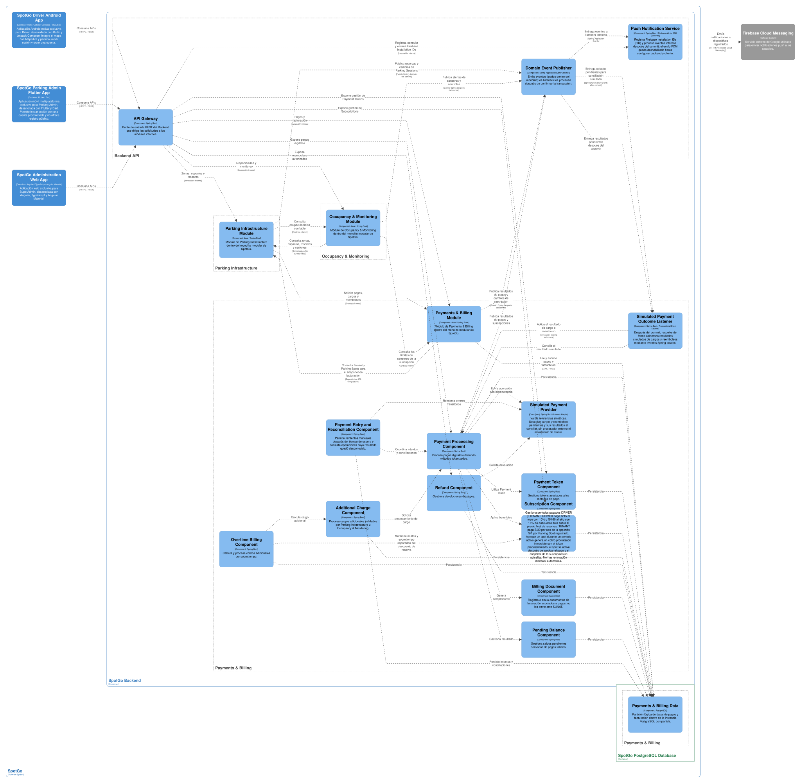
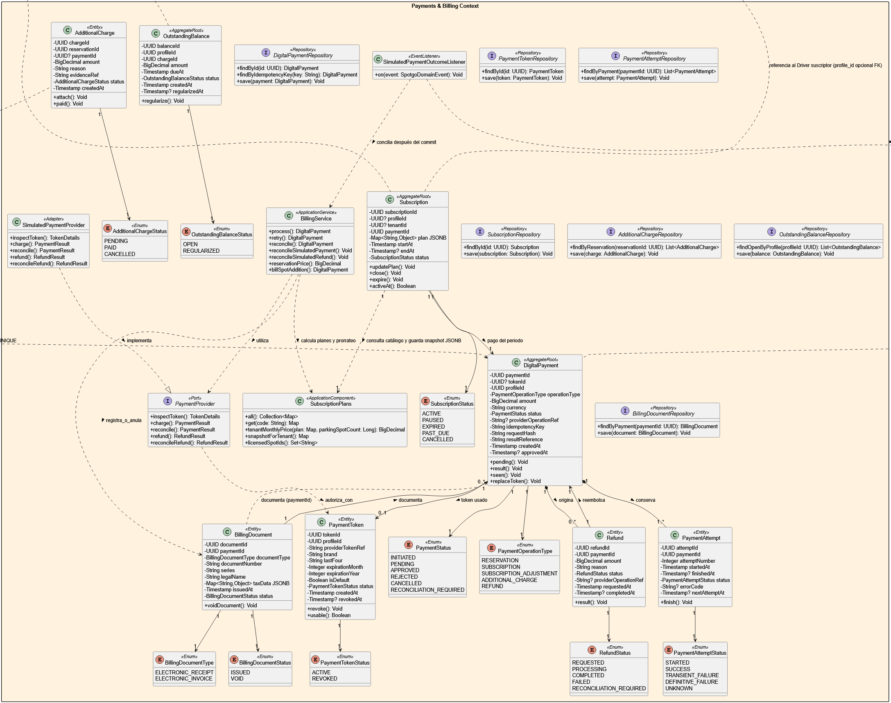
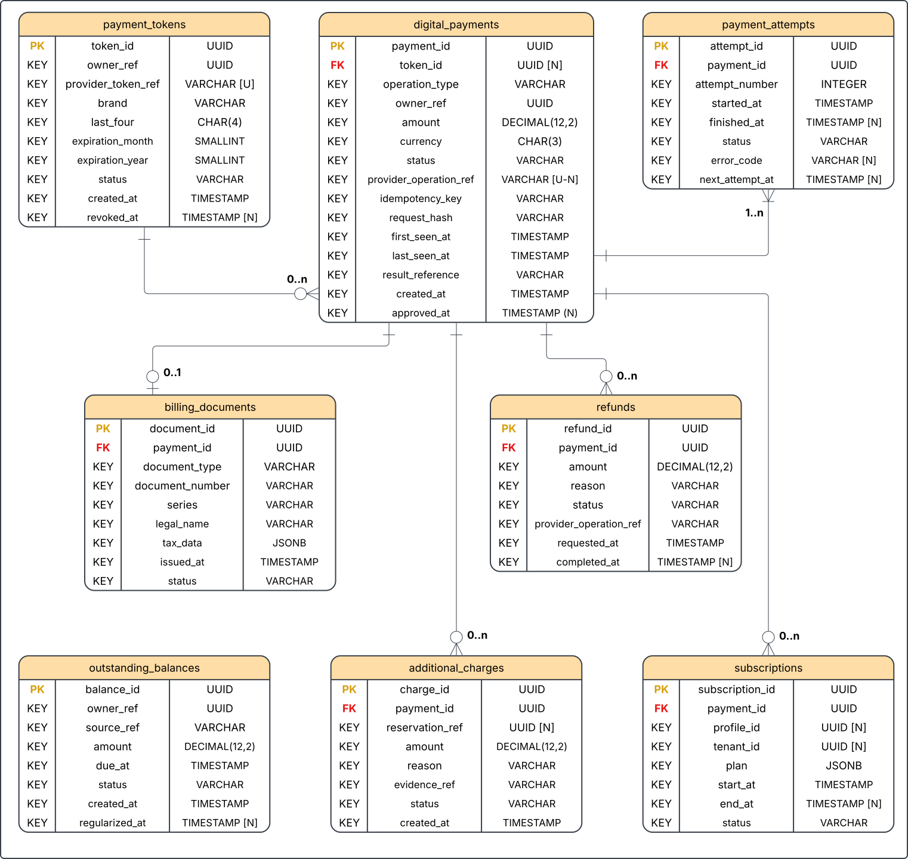

### 2.6.4. Bounded Context: Payments & Billing

Payments & Billing es un bounded context de soporte que concentra las operaciones económicas digitales de SpotGo. Administra tokens de pago, pagos de reservas, suscripciones de Drivers y Tenants, cargos adicionales por sobretiempo, saldos pendientes, reembolsos y comprobantes. Cada fila de `subscriptions` representa un periodo pagado y conserva el snapshot de su plan. Driver puede contratar el plan mensual fijo de S/15, con 10% de descuento sobre el precio final de las reservas, o el anual fijo de S/160, con 15%; el descuento no se aplica a multas. Tenant paga S/30 mensuales por el uso de la app más S/1 por cada Parking Spot registrado, esté operativo o no. Al agregar un spot durante un periodo activo, el backend cobra un ajuste prorrateado inmediato con el token predeterminado de `tenants.token_id`; el spot permanece inactivo hasta aprobar el pago y luego se actualiza el snapshot de la suscripción. El periodo vence automáticamente, pero no existe renovación mensual automática. El proveedor académico simula cargos y reembolsos de forma asíncrona con tokens sintéticos y no contacta procesadores externos ni mueve dinero.

El contexto no procesa los pagos físicos de invitados. En una Guest Parking Session, el Parking Admin registra la placa, calcula el monto y confirma que recibió efectivo o POS fuera del flujo de pago digital. Payments & Billing procesa operaciones digitales de Drivers, como el pago de una reserva, una suscripción o un cargo adicional autorizado, y las cuotas de suscripción de los Tenants.

Un emisor autorizado registra el comprobante asociado a un pago con DNI o RUC según corresponda; el Backend conserva el número, la serie y los datos tributarios, pero no emite documentos automáticamente ni se integra con SUNAT. El modelo no almacena el número completo de una tarjeta ni otros datos financieros sensibles; utiliza Payment Token y referencias del proveedor interno.

#### *2.6.4.1. Domain Layer*

La capa de dominio separa la intención de pago, el resultado del proveedor, la facturación y las obligaciones pendientes. Parking Infrastructure inicia o confirma el pago mediante una llamada directa al adaptador interno de Billing; no existe un evento `ReservationPaymentApproved`. Al aprobarse el pago, Billing confirma la reserva solo si su hold sigue vigente; de lo contrario, solicita un reembolso simulado.

| Elemento | Tipo | Responsabilidad y reglas principales | Atributos u operaciones relevantes |
| --- | --- | --- | --- |
| Digital Payment | Aggregate Root | Registra una operación digital vinculada al perfil que la inicia. Puede usar un token y conserva su resultado e idempotencia. | paymentId, tokenId?, profileId, operationType, amount, currency, status, providerOperationRef, idempotencyKey; pending(), result(), seen(). |
| Payment Token | Entity | Referencia un método sintético o autorizado sin almacenar número completo ni código de seguridad. | tokenId, profileId, providerTokenRef, brand, lastFour, expirationMonth, expirationYear, status; revoke(), usable(). |
| Subscription | Aggregate Root | Representa un único periodo ya pagado, relacionado con un pago aprobado y un snapshot JSONB. Los Driver tienen planes mensual S/15 con 10% de descuento y anual S/160 con 15%; el descuento solo aplica al precio final de reservas. Tenant paga S/30 al mes por el app más S/1 por cada Parking Spot registrado. | subscriptionId, profileId?, tenantId?, paymentId, plan, startAt, endAt?, status; updatePlan(), close(), expire(), activeAt(). |
| Tenant plan snapshot | JSONB value | Conserva el conteo y la lista de Parking Spots licenciados. Al añadir un spot en un periodo activo se procesa un ajuste inmediato prorrateado con el token predeterminado; el spot se activa si el pago se aprueba. | parking_spot_count, licensed_spot_ids, app_usage_price, price_per_iot_device. |
| Payment Attempt | Entity | Conserva cada intento asociado al mismo pago. El reintento es manual y espera 60 segundos luego de un rechazo; resultados pendientes o desconocidos se concilian antes de volver a cobrar. | attemptId, paymentId, attemptNumber, startedAt, finishedAt?, status, errorCode?, nextAttemptAt?; finish(). |
| Additional Charge | Entity | Registra un cargo adicional ligado a una reserva y puede asociarlo con un pago. | chargeId, reservationId, paymentId?, amount, reason, evidenceRef, status; attach(), paid(). |
| Outstanding Balance | Aggregate Root | Conserva un saldo pendiente ligado a un perfil y al cargo que lo originó. | balanceId, profileId, chargeId, amount, dueAt, status, regularizedAt?; regularize(). |
| Refund | Entity | Registra el reembolso solicitado sobre un pago original. | refundId, paymentId, amount, reason, status, providerOperationRef?, requestedAt, completedAt?; result(). |
| Billing Document | Entity | Registra localmente un comprobante asociado a un pago. Un emisor autorizado proporciona la serie y el número; no hay emisión automática ni integración con SUNAT. | documentId, paymentId, documentType, documentNumber, series, legalName, taxData, issuedAt, status; voidDocument(). |
| Payment Status | Enumeration | Define el ciclo de vida del pago. | INITIATED, PENDING, APPROVED, REJECTED, CANCELLED, RECONCILIATION_REQUIRED. |
| Payment Operation Type | Enumeration | Identifica la finalidad de la operación digital. | RESERVATION, SUBSCRIPTION, SUBSCRIPTION_ADJUSTMENT, ADDITIONAL_CHARGE, REFUND. |
| Payment Attempt Status | Enumeration | Define el estado de cada intento. | STARTED, SUCCESS, TRANSIENT_FAILURE, DEFINITIVE_FAILURE, UNKNOWN. |
| Subscription Status | Enumeration | Define el estado del periodo de suscripción. | ACTIVE, PAUSED, EXPIRED, PAST_DUE, CANCELLED. |
| Payment Provider | Domain Port | Define inspección de tokens, cargos, conciliaciones y reembolsos. | inspectToken(), charge(), reconcile(), refund(), reconcileRefund(). |
| Simulated Payment Provider | Adapter | Resuelve de forma asíncrona los cargos y reembolsos simulados sin llamar a un procesador externo ni mover dinero. | Implementa PaymentProvider usando referencias sintéticas. |
| Simulated Payment Outcome Listener | Event Listener | Tras el commit, concilia en segundo plano los resultados de cargos y reembolsos generados por el proveedor simulado. | Consume `billing.payment.status_changed` y `billing.refund.status_changed`. |
| Billing Service | Application Service | Coordina pagos, reintentos manuales, conciliación, descuentos de reserva y prorrateo por nuevos spots. | process(), retry(), reconcile(), reconcileSimulatedPayment(), reconcileSimulatedRefund(), reservationPrice(), billSpotAddition(). |
| Subscription Plans | Application Component | Publica el catálogo fijo de planes y calcula el precio Tenant a partir de los Parking Spots registrados. | all(), get(), snapshotForTenant(), tenantMonthlyPrice(), licensedSpotIds(). |
**Retry and reconciliation behavior**

Each payment starts with one provider attempt. The simulated provider initially returns `PENDING`; an after-commit Spring listener queries the existing operation asynchronously and applies the approved, rejected, or still-pending result. A rejected payment can be retried manually through the retry endpoint after the configured 60-second delay; the same payment and idempotency key are retained, and the attempt number increases. A pending or unknown result must be reconciled before another charge can be submitted. Refund processing likewise enters `PROCESSING` and is resolved asynchronously. These local application events are not durable across a process restart, so the API reconciliation operations remain available. The backend does not schedule automatic payment retries. Its background billing task only expires subscription periods.

| Situation | Backend behavior |
| --- | --- |
| Initial payment | Sends one charge request; the academic provider returns `PENDING` and an operation reference without moving funds. |
| Simulated payment outcome | An after-commit local event reconciles the same provider operation asynchronously. `4242` is approved, `0000` rejected, and `1111` remains pending. |
| Definitive rejection | Sets the next manual retry time to 60 seconds after the rejection. A retry may use a replacement token when the original token was declined. |
| Pending or unknown result | Exposes reconciliation, which queries the existing operation and does not create another charge. A lost in-process callback can be recovered this way. |
| Approved payment | Applies the related reservation, subscription, additional charge, or subscription adjustment. |
| Guest Parking Session | Payment is recorded as a physical payment by Parking Infrastructure; it does not create a DigitalPayment. |
#### *2.6.4.2. Interface Layer*

La interfaz REST expone operaciones autenticadas para los perfiles autorizados. El Backend procesa el pago sin callbacks externos y publica eventos internos después de confirmar la transacción para comunicar el resultado y activar las notificaciones correspondientes.

| API | Responsabilidad implementada |
| --- | --- |
| Payment Tokens | `GET` y `POST /api/v1/payment-tokens`, `PUT /api/v1/payment-tokens/{tokenId}/default` y `DELETE /api/v1/payment-tokens/{tokenId}`. Driver puede agregar métodos simulados, consultarlos, revocarlos y elegir su método predeterminado/favorito; Parking Admin conserva su método predeterminado del Tenant para cargos prorrateados. No recibe números completos ni códigos de seguridad. |
| Digital Payments | Inicia y consulta pagos, lista operaciones, permite reintentar un rechazo después del tiempo de espera y conciliar una operación pendiente o desconocida. |
| Subscriptions | Expone el catálogo fijo, cotizaciones por cantidad de Parking Spots, compra de periodos y consulta o cancelación de suscripciones. No renueva automáticamente. |
| Additional Charges | Consulta y procesa cargos vinculados a una reserva. Un rechazo puede crear un Outstanding Balance. |
| Outstanding Balances | Permite consultar saldos del perfil y su estado. |
| Refunds | Registra solicitudes, inicia el procesamiento, concilia el resultado simulado y permite consultar el estado. |
| Billing Documents | Consulta, registra o anula un documento local; un emisor autorizado proporciona sus datos. No crea un documento fiscal externo ni tiene un endpoint genérico de PDF o email. La app Driver permite descargar una copia PDF informativa en el dispositivo. |

La API mantiene controles de rol y de titularidad para restringir operaciones. El proveedor académico solo acepta referencias sintéticas, como `simulated-visa-4242`; Android construye esa referencia con la marca y los últimos cuatro dígitos elegidos en el flujo de prueba. No hay tokenización real: no se envían ni almacenan números completos de tarjeta o códigos de seguridad, no se contacta un procesador externo y no se mueve dinero. El método predeterminado de Driver se usa en sus pagos; el método predeterminado de Tenant continúa guardado en `tenants.token_id` para el ajuste prorrateado por nuevos spots. Los eventos de resultado se procesan dentro del proceso Spring después del commit; no hay broker, outbox persistente ni callback externo.

#### *2.6.4.3. Application Layer*

`BillingService` registra el primer resultado del proveedor y publica un evento de estado dentro de la transacción. Para la simulación, `SimulatedPaymentOutcomeListener` reconsulta el cargo o reembolso tras el commit y aplica el resultado de manera asíncrona. El estado y la referencia del proveedor quedan almacenados en `digital_payments`, `payment_attempts` o `refunds`. Si el resultado continúa pendiente o se pierde el evento local, el cliente puede solicitar conciliación; esta consulta la operación existente antes de permitir otro cargo.

| Regla implementada | Comportamiento |
| --- | --- |
| Tokenización | Inspecciona una referencia sintética y conserva sus datos resumidos y vencimiento. |
| Pago | Crea una operación idempotente y un primer intento. La simulación devuelve primero `PENDING` y resuelve el resultado tras el commit, sin conexión externa ni movimiento de dinero. |
| Reintento | Un rechazo permite solicitar manualmente otro intento luego de 60 segundos. Se conserva el pago y la clave de idempotencia; no hay reintentos automáticos ni límite programado por una ventana de reintentos. |
| Reconciliación | Consulta el mismo pago cuando su resultado está pendiente o es desconocido. No crea un segundo cargo. |
| Suscripción Driver | El catálogo fijo ofrece S/15 mensual con 10% de descuento y S/160 anual con 15%. El descuento se aplica al precio final de reservas y nunca a multas, sobretiempo ni cargos adicionales. |
| Suscripción Tenant | El único plan es mensual: S/30 por el uso del app más S/1 por cada Parking Spot registrado, operativo o no. El snapshot guarda conteo, IDs licenciados e importe del periodo. |
| Spot agregado | Si se añade un Parking Spot durante un periodo activo, se calcula de inmediato el S/1 prorrateado por el tiempo restante y se cobra al token predeterminado. El spot queda inactivo hasta la aprobación; luego se actualiza el snapshot. |
| Vencimiento | Una tarea programada marca vencidos los periodos cuya fecha final pasó. El sistema no cobra la renovación mensual automáticamente. |
| Comprobante | Un emisor autorizado registra por separado el número, serie y datos tributarios del documento asociado a un pago aprobado. |

Parking Infrastructure se integra con `ParkingBillingAdapter`, que implementa `ParkingPaymentGateway` y consulta al servicio de Billing para validar pagos, aplicar el descuento a reservas y procesar el prorrateo. Occupancy & Monitoring consulta licencias mediante `MonitoringBillingAdapter`; ambos adaptadores son llamadas internas del mismo monolito modular.

#### *2.6.4.4. Infrastructure Layer*

El contexto utiliza Spring Boot 4.1.2 con Java 25, repositorios Spring Data JPA y PostgreSQL. El proveedor configurado por defecto es `SimulatedPaymentProvider`: procesa únicamente referencias sintéticas, simula aprobaciones y reembolsos, y no contacta un procesador ni mueve dinero.

| Componente | Implementación | Responsabilidad |
| --- | --- | --- |
| SimulatedPaymentProvider | Adapter Java/Spring | Simula inspección de token, cargo, conciliación y reembolso. |
| Billing repositories | Spring Data JPA | Conservan tokens, pagos, intentos, periodos, cargos, saldos, reembolsos y Billing Documents. |
| ParkingBillingAdapter | Adaptador en el proceso | Implementa el puerto de pagos consumido por Parking Infrastructure. |
| MonitoringBillingAdapter | Adaptador en el proceso | Consulta el límite de sensores/licencias derivado de los Parking Spots del Tenant. |
| BillingLifecycleService | Tarea Spring programada cada 60 segundos | Marca los periodos vencidos; no intenta renovarlos ni reintenta pagos. |
| PostgreSQL | Base compartida | Persiste los datos del Backend modular. En producción se conecta con las variables de base de datos de Render/Neon. |

En producción Hibernate aplica `ddl-auto=update` y `DbSeeder` carga las filas compatibles de `db.json`, omitiendo IDs de fixture que ya existen y sin modificar ni eliminar datos existentes. El fixture no contiene un `SUPER_ADMIN`; el bootstrap crea esa cuenta con las variables de entorno solo cuando todavía no existe. Las cuentas demo restantes usan `DEMO_ACCOUNT_PASSWORD`. El directorio de evidencia puede apuntar al almacenamiento temporal del contenedor; las imágenes no son persistentes al reiniciar o reemplazar la instancia.

No hay una tarea de retención automática ni una política de eliminación implementada; las filas se conservan en la base hasta que una operación administrativa las modifique.

Los bounded contexts emiten `SpotgoDomainEvent` dentro del monolito modular. Los listeners Spring reaccionan después del commit; el listener de notificaciones envía eventos seleccionados de reservas, pagos, suscripciones y monitoreo mediante Firebase Admin SDK. FCM se activa con `FCM_ENABLED`, `FCM_PROJECT_ID` y `FCM_SERVICE_ACCOUNT_JSON`; el cliente registra su token mediante `/api/v1/notifications/devices`. La publicación ocurre en memoria y no utiliza un broker ni un outbox persistente.

#### *2.6.4.5. Bounded Context Software Architecture Component Level Diagrams*

El diagrama representa los componentes que existen en el módulo Billing del Backend monolítico. Las solicitudes desde Parking Infrastructure y Occupancy & Monitoring cruzan contratos Java internos. Los resultados de Billing se publican en el dispatcher local de eventos después del commit; no existe un broker externo ni un servicio de pagos desplegado por separado.

*Figura 34 (Payments & Billing Component Level Diagram)*  

| Componente | Responsabilidad implementada | Dependencias |
| --- | --- | --- |
| REST Controllers | Exponen las operaciones de pagos, tokens, suscripciones, cargos, saldos, reembolsos y Billing Documents. | Spring Security, BillingService, BillingQueryService. |
| BillingService | Aplica idempotencia, procesa pagos, concilia resultados, calcula descuentos de reserva y prorratea spots nuevos. | Repositorios JPA, PaymentProvider, SubscriptionPlans. |
| SubscriptionPlans | Mantiene el catálogo fijo y construye snapshots Tenant según todos los Parking Spots registrados. | BillingService, ParkingSpotRepository. |
| PaymentProvider | Define el puerto de inspección, cargo, conciliación y reembolso. | SimulatedPaymentProvider. |
| SimulatedPaymentOutcomeListener | Conciliación interna asíncrona para cargos y reembolsos pendientes del proveedor académico. | BillingService, Spring Application Events. |
| Billing repositories | Persisten las entidades económicas y sus estados. | PostgreSQL. |
| ParkingBillingAdapter | Implementa las consultas y comandos del puerto `ParkingPaymentGateway`. | Parking Infrastructure. |
| MonitoringBillingAdapter | Implementa el puerto de consulta de suscripción/licencia de Monitoring. | Occupancy & Monitoring. |
| BillingLifecycleService | Expira periodos vencidos una vez por minuto. | BillingService, SubscriptionRepository. |
#### *2.6.4.6. Bounded Context Software Architecture Code Level Diagrams*

La vista de código describe las entidades persistidas, el puerto `PaymentProvider`, su adaptador simulado, `BillingService` y el listener local de resultados. Los reintentos manuales utilizan el mismo servicio; no existe una clase `RetryPolicy` ni un scheduler de reintentos.

#### ***2.6.4.6.1. Bounded Context Domain Layer Class Diagrams***

*Figura 35 (Payments & Billing Domain Layer Class Diagram)*  

| Clase, interfaz o enumeración | Atributos principales | Métodos principales | Relaciones |
| --- | --- | --- | --- |
| DigitalPayment | paymentId, tokenId?, profileId, operationType, amount, currency, status, providerOperationRef?, idempotencyKey, requestHash, resultReference | pending(), result(), seen(), replaceToken() | Aggregate Root con un Profile iniciador, un token opcional y sus intentos. |
| PaymentAttempt | attemptId, paymentId, attemptNumber, startedAt, finishedAt?, status, errorCode?, nextAttemptAt? | finish() | Entity de DigitalPayment; el reintento manual espera el tiempo configurado. |
| PaymentToken | tokenId, profileId, providerTokenRef, brand, lastFour, expirationMonth, expirationYear, status | revoke(), usable() | Entity registrada por un Profile; un Tenant puede usar uno como token predeterminado. |
| Subscription | subscriptionId, profileId?, tenantId?, paymentId, plan JSONB, startAt, endAt?, status | updatePlan(), close(), expire(), activeAt() | Un periodo pagado asociado a exactamente un DigitalPayment aprobado. |
| Tenant plan snapshot | code, billing_period_months, app_usage_price, price_per_iot_device, parking_spot_count, licensed_spot_ids | tenantMonthlyPrice(), snapshotForTenant() | JSONB guardado dentro de Subscription; cuenta todos los Parking Spots registrados. |
| AdditionalCharge | chargeId, reservationId, paymentId?, amount, reason, evidenceRef, status | attach(), paid() | Entity asociada con Reservation y, opcionalmente, DigitalPayment. |
| OutstandingBalance | balanceId, profileId, chargeId, amount, dueAt, status, regularizedAt? | regularize() | Aggregate Root relacionado con Profile y AdditionalCharge. |
| Refund | refundId, paymentId, amount, reason, status, providerOperationRef?, requestedAt, completedAt? | result() | Entity asociada con el DigitalPayment original. |
| BillingDocument | documentId, paymentId, documentType, documentNumber, series, legalName, taxData JSONB, issuedAt, status | voidDocument() | Como máximo un documento por DigitalPayment; registro local, no integración fiscal. |
| Payment Status | INITIATED, PENDING, APPROVED, REJECTED, CANCELLED, RECONCILIATION_REQUIRED | — | Enumeration de DigitalPayment. |
| Payment Operation Type | RESERVATION, SUBSCRIPTION, SUBSCRIPTION_ADJUSTMENT, ADDITIONAL_CHARGE, REFUND | — | Enumeration de la operación digital. |
| Payment Attempt Status | STARTED, SUCCESS, TRANSIENT_FAILURE, DEFINITIVE_FAILURE, UNKNOWN | — | Enumeration de PaymentAttempt. |
| Payment Token Status | ACTIVE, REVOKED | — | Enumeration de PaymentToken. |
| Subscription Status | ACTIVE, PAUSED, EXPIRED, PAST_DUE, CANCELLED | — | Enumeration de Subscription. |
| Additional Charge Status | PENDING, PAID, CANCELLED | — | Enumeration de AdditionalCharge. |
| Outstanding Balance Status | OPEN, REGULARIZED | — | Enumeration de OutstandingBalance. |
| Refund Status | REQUESTED, PROCESSING, COMPLETED, FAILED, RECONCILIATION_REQUIRED | — | Enumeration de Refund. |
| Billing Document Status | ISSUED, VOID | — | Enumeration de BillingDocument. |
| Billing Document Type | ELECTRONIC_RECEIPT, ELECTRONIC_INVOICE | — | Enumeration de BillingDocument. |
| PaymentProvider | — | inspectToken(), charge(), reconcile(), refund(), reconcileRefund() | Port implementado por SimulatedPaymentProvider. |
| BillingService | — | process(), retry(), reconcile(), reconcileSimulatedPayment(), reconcileSimulatedRefund(), reservationPrice(), billSpotAddition() | Servicio de aplicación. |
| SimulatedPaymentOutcomeListener | event | on(SpotgoDomainEvent) | Invoca la conciliación simulada después del commit. |
| SubscriptionPlans | — | all(), get(), snapshotForTenant(), tenantMonthlyPrice() | Catálogo fijo y cálculo del precio Tenant. |
| Relación | Multiplicidad y dirección | Significado |
| --- | --- | --- |
| DigitalPayment — PaymentToken | Cada DigitalPayment utiliza 0..1 PaymentToken; un PaymentToken puede asociarse con 0..* DigitalPayments | El token autorizado puede reutilizarse en varias operaciones mientras permanezca activo. |
| DigitalPayment — PaymentAttempt | DigitalPayment 1 a PaymentAttempt 1..* | Cada DigitalPayment conserva uno o más intentos; el siguiente reintento manual se permite luego del tiempo de espera configurado. |
| DigitalPayment — BillingDocument | DigitalPayment 1 a BillingDocument 0..1 | El emisor puede registrar como máximo un comprobante local por pago. |
| DigitalPayment — Refund | DigitalPayment 1 a Refund 0..* | Una operación puede originar uno o más reembolsos controlados. |
| Subscription y DigitalPayment | Subscription 1 a DigitalPayment 1 | Cada fila de Subscription corresponde a un periodo pagado y tiene un único pago aprobado; los reintentos pertenecen a ese DigitalPayment. |
| OutstandingBalance — AdditionalCharge | OutstandingBalance 1 a AdditionalCharge 1 | Un saldo representa el cargo adicional no pagado que lo originó. |
| BillingService ..> PaymentProvider | Dependencia dirigida | El servicio utiliza el puerto del proveedor configurado. |
| BillingService ..> PaymentAttempt | Dependencia dirigida | El servicio registra cada intento y aplica el tiempo de espera del reintento manual. |
| BillingService ..> BillingDocument | Dependencia dirigida | El servicio registra o anula el documento local asociado al pago. |
| SimulatedPaymentProvider ..|> PaymentProvider | Implementación | El proveedor académico simula cargos y reembolsos sin mover dinero. |

#### ***2.6.4.6.2. Bounded Context Database Design Diagram***

Payments & Billing Database representa la partición lógica de datos de este contexto y persiste operaciones digitales, suscripciones y documentos dentro de la instancia PostgreSQL compartida. `profile_id`, `tenant_id` y `reservation_id` enlazan entidades de otros bounded contexts según las asociaciones declaradas por JPA. Una Guest Parking Session queda fuera del flujo digital y no se almacena como Digital Payment. No se incluyen datos completos de tarjeta.

Las reglas que no se representan en el diagrama se documentan aquí: `CHECK ((profile_id IS NOT NULL AND tenant_id IS NULL) OR (profile_id IS NULL AND tenant_id IS NOT NULL))` exige un único titular por Subscription; `payment_id` es obligatorio y único para asociar un solo pago a cada periodo, y `CHECK (end_at IS NULL OR end_at >= start_at)` valida el intervalo de vigencia. La aplicación evita iniciar una nueva suscripción mientras exista un periodo vigente, sin índices únicos parciales en la base. Un emisor registra manualmente como máximo un BillingDocument por pago; `billing_documents.payment_id` es UNIQUE. El documento es un registro local y no representa emisión fiscal externa.

*Figura 36 (Payments & Billing Database Design Diagram)*  

La actualización del backend agrega `tenants.token_id` como FK física nullable a `payment_tokens.token_id`. El token predeterminado se utiliza para el cobro prorrateado inmediato al agregar un spot en un periodo activo; `digital_payments.token_id` registra el medio usado en cada operación. El conteo facturable y la lista de IDs licenciados se basan en todos los Parking Spots registrados, sin depender del estado operativo o de los sensores.

| Tabla | Columnas principales | Restricciones y relaciones |
| --- | --- | --- |
| payment_tokens | token_id, profile_id, provider_token_ref, brand, last_four, expiration_month, expiration_year, is_default, status, created_at, revoked_at | token_id PK; profile_id FK to the registering Profile; provider_token_ref UNIQUE; `is_default` persiste el método predeterminado de Driver; el método predeterminado de Tenant se conserva en `tenants.token_id`. No se almacenan números completos ni códigos de seguridad. |
| digital_payments | payment_id, token_id?, profile_id, operation_type, amount, currency, status, provider_operation_ref?, idempotency_key, request_hash, first_seen_at, last_seen_at, result_reference, created_at, approved_at? | payment_id PK; profile_id FK to the initiating Profile; token_id nullable FK to payment_tokens; idempotency_key UNIQUE; provider_operation_ref UNIQUE when present. |
| payment_attempts | attempt_id, payment_id, attempt_number, started_at, finished_at, status, error_code, next_attempt_at | attempt_id PK; payment_id FK a digital_payments; combinación payment_id y attempt_number UNIQUE. |
| subscriptions | subscription_id, payment_id, profile_id, tenant_id, plan JSONB, start_at, end_at, status | subscription_id PK; `payment_id` FK NOT NULL y UNIQUE a digital_payments; profile_id y tenant_id permiten nulos y un CHECK exige que exactamente uno tenga valor; cada fila representa un periodo pagado. `plan` conserva el tipo, duración, precio, beneficios y, para Tenant, parking_spot_count y licensed_spot_ids; end_at se completa al cerrar o vencer el periodo. |
| additional_charges | charge_id, reservation_id, payment_id?, amount, reason, evidence_ref, status, created_at | charge_id PK; reservation_id FK; payment_id nullable and UNIQUE FK to digital_payments. |
| outstanding_balances | balance_id, profile_id, charge_id, amount, due_at, status, created_at, regularized_at? | balance_id PK; profile_id FK; charge_id FK and UNIQUE; amount is non-negative. |
| refunds | refund_id, payment_id, amount, reason, status, provider_operation_ref, requested_at, completed_at | refund_id PK; payment_id FK a digital_payments; amount debe ser positivo; el resultado del proveedor determina el estado del reembolso. |
| billing_documents | document_id, payment_id, document_type, document_number, series, legal_name, tax_data JSONB, issued_at, status | document_id PK; payment_id FK and UNIQUE; document_type is ELECTRONIC_RECEIPT or ELECTRONIC_INVOICE; document number is unique within its series. |

| Relación de datos | Cardinalidad | Regla |
| --- | --- | --- |
| digital_payments — payment_attempts | 1 a 1..* | Cada intento pertenece a una operación. |
| digital_payments — refunds | 1 a 0..* | Los reembolsos se trazan al pago original. |
| digital_payments — billing_documents | 1 a 0..1 | Un pago puede tener como máximo un comprobante principal; el documento es opcional y se registra por un emisor autorizado. |
| payment_tokens — digital_payments | 1 a 0..* mediante token_id | Un token puede reutilizarse mientras esté activo y autorizado. Un DigitalPayment conserva el token utilizado cuando se especifica; los ajustes prorrateados de Tenant usan el token predeterminado de `tenants.token_id`. |
| subscriptions.payment_id a digital_payments | Subscription 1 a DigitalPayment 1 | Cada fila representa un periodo y se vincula con un único pago aprobado mediante `payment_id` NOT NULL y UNIQUE. |
| tenants.token_id a payment_tokens.token_id | FK física nullable | Identifica el token predeterminado que Payments & Billing usa para el ajuste prorrateado inmediato al agregar Parking Spots durante un periodo activo. |
| profile_id — Profiles & Vehicles Management | FK física | DigitalPayment, PaymentToken, Subscription y OutstandingBalance se relacionan con Profile mediante JPA; la columna puede ser nullable en Subscription para planes de Tenant. |
| tenant_id — Parking Infrastructure | FK física nullable | Subscription puede pertenecer a un Tenant; un CHECK exige exactamente uno de `profile_id` o `tenant_id`. |
| reservation_id — Parking Infrastructure | FK física | AdditionalCharge referencia la Reservation que generó el cargo. |

Los planes Driver cuestan S/15 al mes con 10% de descuento y S/160 al año con 15%; ambos descuentos se aplican solo al precio final de las reservas, nunca a multas, sobretiempo u otros cargos. Tenant paga S/30 al mes por el uso del app más S/1 por cada Parking Spot registrado, operativo o no. Al agregar un spot durante un periodo activo, el backend procesa un ajuste prorrateado inmediato con el token predeterminado; el spot sigue inactivo hasta que el proveedor simulado apruebe el pago y el snapshot de Subscription se actualice. No hay renovación mensual automática. Cada periodo pagado se conserva como una fila independiente de `subscriptions` con su precio y conteo aplicados. Los comprobantes se registran por separado y no tienen emisión fiscal externa.

La tabla `payment_attempts` conserva los intentos realizados y permite resolver respuestas UNKNOWN. No hay reintentos automáticos ni limpieza o retención automática de datos implementada; los registros permanecen en la base hasta que se modifiquen mediante una operación administrativa.
