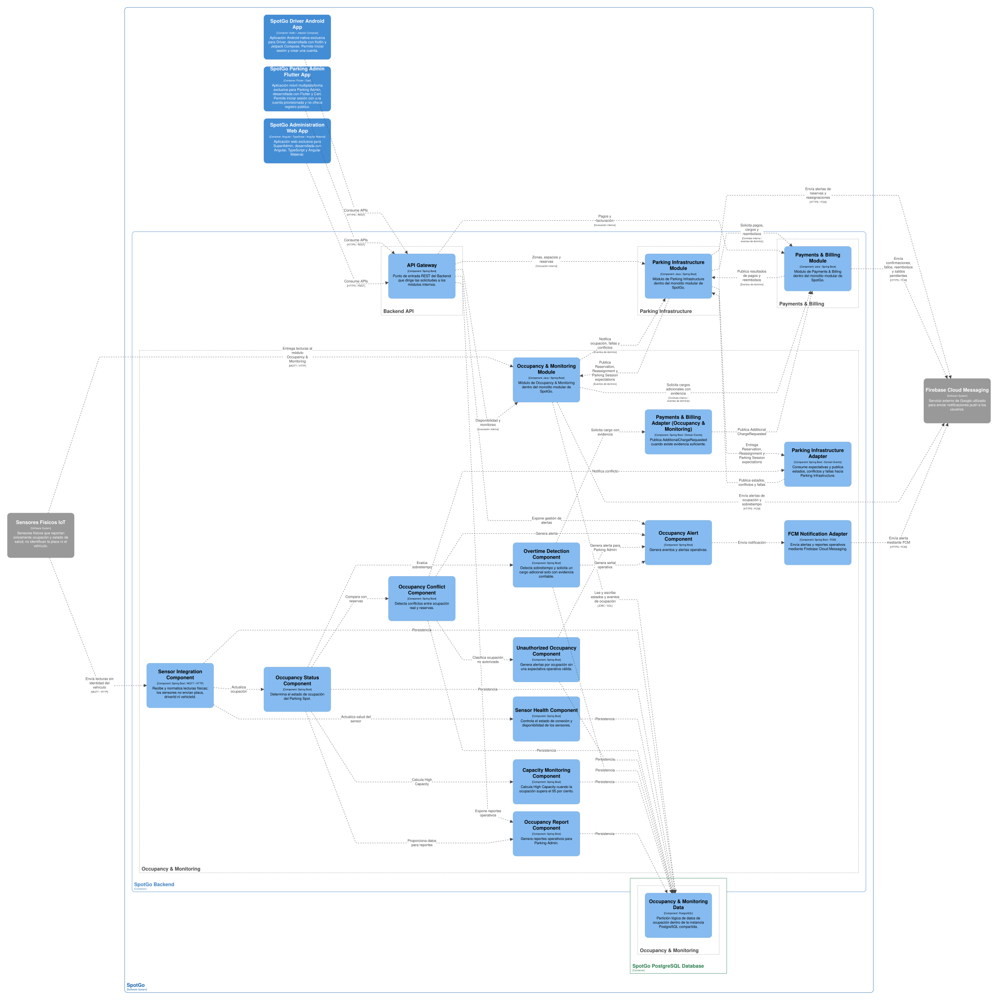
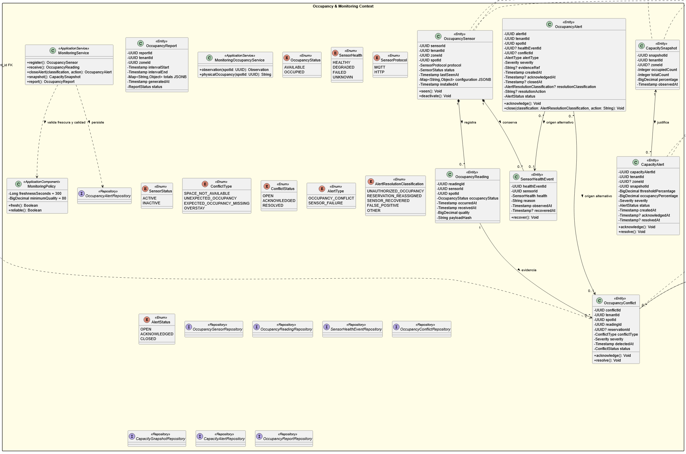
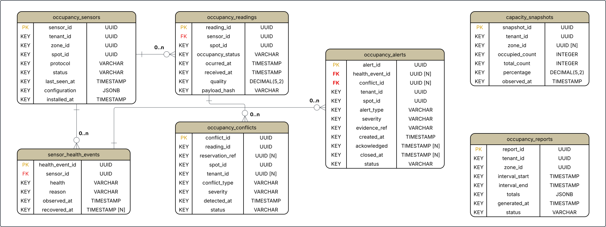

### 2.6.5. Bounded Context: Occupancy & Monitoring

Occupancy & Monitoring recibe lecturas de sensores y conserva el estado físico observado, la salud de los sensores, los conflictos, las alertas y los reportes. La API recibe lecturas mediante REST/HTTPS; aunque `SensorProtocol` permite registrar `MQTT` o `HTTP`, el backend no contiene un cliente ni subscriber MQTT. Un gateway externo puede traducir MQTT a la API. El módulo no determina precios de suscripción; Payments & Billing calcula el importe por Parking Spots registrados y procesa el ajuste prorrateado al agregar espacios durante un periodo activo.

El sensor informa si un espacio está disponible u ocupado, pero no identifica una placa ni un vehículo. Parking Infrastructure conserva las entidades Tenant, Parking Zone, Parking Spot, Reservation y Parking Session. En esta implementación monolítica, Monitoring consulta sus repositorios para validar las referencias y comparar lecturas con reservas o sesiones; no mantiene una proyección de expectativas alimentada por eventos. Un conflicto elegible publica `monitoring.alert.opened`; el listener de Parking Infrastructure busca y reasigna la siguiente reserva confirmada si encuentra un espacio compatible y disponible.

Los estados físicos y de reserva son independientes. Una lectura confiable puede crear o resolver un Occupancy Conflict, pero no elimina su alerta: Parking Admin debe registrar la clasificación y acción al cerrar una alerta resuelta. Billing procesa cargos de sobretiempo mediante el flujo de cierre de Parking Session; Monitoring no publica un evento de cargo adicional.

#### *2.6.5.1. Domain Layer*

El modelo representa sensores, lecturas, estados físicos y reglas de monitoreo. Una lectura válida debe asociarse a un Occupancy Sensor conocido, a un Parking Spot configurado y a una marca de tiempo. Por defecto, una lectura se considera reciente durante 300 segundos y confiable con calidad mínima de 80; si falta una lectura reciente o confiable, la ocupación operativa se reporta como UNAVAILABLE.

| Elemento | Tipo | Responsabilidad y reglas principales | Atributos u operaciones relevantes |
| --- | --- | --- | --- |
| Occupancy Sensor | Entity | Representa el sensor instalado y su relación con Tenant, Zone y Parking Spot. | sensorId, tenantId, zoneId, spotId, protocol, status, lastSeenAt, configuration, installedAt; seen(), deactivate(). |
| Occupancy Reading | Entity | Representa una medición de ocupación recibida por la API. No contiene identidad de vehículo. | readingId, sensorId, spotId, occupancyStatus, occurredAt, receivedAt, quality, payloadHash. |
| Occupancy Status | Enumeration | Define el estado físico observable del Parking Spot. | AVAILABLE, OCCUPIED, UNAVAILABLE. |
| Sensor Health | Enumeration | Define la salud operativa del sensor. | HEALTHY, DEGRADED, FAILED, UNKNOWN. |
| Sensor Protocol | Enumeration | Identifica el protocolo configurado para el sensor; la lectura que procesa el backend entra por REST/HTTPS. | MQTT, HTTP. |
| Occupancy Conflict | Entity | Representa una diferencia entre el estado físico observado y una reserva opcional asociada. | conflictId, tenantId, spotId, readingId, reservationId?, conflictType, severity, detectedAt, status; acknowledge(), resolve(). |
| Occupancy Alert | Entity | Alerta originada por una falla de sensor o un conflicto. | alertId, tenantId, spotId, healthEventId?, conflictId?, alertType, severity, evidenceRef?, createdAt, acknowledgedAt?, closedAt?, resolutionClassification?, resolutionAction?, status; acknowledge(), close(classification, action). |
| Capacity Snapshot | Entity | Conserva el conteo y porcentaje confiable de ocupación de una zona o Tenant. | snapshotId, tenantId, zoneId?, occupiedCount, totalCount, percentage, observedAt. |
| Capacity Alert | Entity | Alerta crítica relacionada con el snapshot que supera el 95 por ciento de ocupación. | capacityAlertId, tenantId, zoneId?, snapshotId, thresholdPercentage, occupancyPercentage, severity, status, createdAt, acknowledgedAt?, resolvedAt?; acknowledge(), resolve(). |
| Sensor Health Event | Entity | Conserva un incidente de sensor y su recuperación. | healthEventId, sensorId, health, reason, observedAt, recoveredAt?. |
| — | — | La lectura conserva calidad y tiempo; MonitoringPolicy valida confiabilidad sin identificar vehículo. | quality, occurredAt, receivedAt; minimumQuality = 80, freshnessSeconds = 300. |
| Occupancy Report | Entity | Conserva el agregado solicitado para una Parking Zone y un intervalo. | reportId, tenantId, zoneId, intervalStart, intervalEnd, totals, generatedAt, status. |
| Monitoring Policy | Application Component | Controla la antigüedad máxima y calidad mínima de una lectura. | freshnessSeconds = 300, minimumQuality = 80. |
| Monitoring Occupancy Service | Application Service | Resuelve la ocupación física actual y devuelve UNAVAILABLE si falta una lectura válida, reciente o confiable. | observation(), physicalOccupancy(). |
| Monitoring Service | Application Service | Registra sensores y lecturas; evalúa salud, conflictos, alertas, capacidad e informes. | register(), receive(), recordHealth(), recoverHealth(), closeAlert(), snapshot(), report(). |
| Sensor Repository | Repository Interface | Persiste sensores y consulta sensores activos por Parking Spot o Tenant. | findById(), activeSpot(), byTenant(), save(). |
| Occupancy Reading Repository | Repository Interface | Persiste lecturas y consulta por sensor, fecha o hash idempotente. | bySensor(), byHash(), save(). |
| Occupancy Alert Repository | Repository Interface | Persiste alertas de incidentes y sus resoluciones registradas. | byTenant(), byConflict(), byHealthEvent(), save(). |
| Capacity Alert Repository | Repository Interface | Persiste alertas críticas y consulta alertas activas por zona o Tenant. | byTenant(), activeForScope(), save(). |
| Capacity Snapshot Repository | Repository Interface | Persiste snapshots y permite consultar agregados. | byTenant(), save(). |
| Occupancy Report Repository | Repository Interface | Persiste reportes y consultas por tenant e intervalo. | byTenant(), save(). |

Las reglas principales del modelo son:

| Regla | Aplicación |
| --- | --- |
| Frescura de lectura | Por defecto se acepta como fresca una lectura de los últimos 300 segundos; `MONITORING_FRESHNESS_SECONDS` permite ajustar el límite. La latencia de red y del sensor debe validarse con el gateway y hardware del piloto. |
| Falla de sensor | Si no existe una lectura confiable o la salud del sensor es FAILED, el spot se reporta como UNAVAILABLE para fines de disponibilidad. |
| Sin identificación de vehículo | Las lecturas no contienen placa, driverId ni vehicleId. La asociación con una reserva se realiza mediante referencias y reglas de conflicto, nunca por reconocimiento automático. |
| Estados independientes | Los estados de ocupación y de reserva se conservan separados. Monitoring compara lecturas confiables con reservas y sesiones por referencias de Parking Infrastructure; un conflicto de sobretiempo publica `monitoring.alert.opened` para que Parking Infrastructure intente reasignar la siguiente reserva compatible. |
| Alta capacidad | Se persiste una alerta crítica de alta capacidad cuando la ocupación supera el 95 por ciento de los Parking Spots operativos disponibles. La alerta queda resuelta cuando la ocupación vuelve al 95 por ciento o menos. |
| Cobro adicional | Monitoring no publica cargos. Al cerrar una Parking Session, Parking Infrastructure y Billing aplican el flujo de cargo adicional si corresponde; las lecturas de baja calidad no se usan para determinar la ocupación confiable. |
| Retención | Las lecturas en bruto se conservan doce meses y los reportes agregados veinticuatro meses como política base propuesta, con suspensión ante incidentes o auditorías. |

#### *2.6.5.2. Interface Layer*

La Interface Layer expone REST/HTTPS para registrar sensores y recibir lecturas. Un gateway externo puede traducir mensajes MQTT a HTTP; el backend no mantiene una conexión ni un subscriber MQTT. Monitoring consulta las referencias operativas de Parking Infrastructure para comparar ocupación con reservas y sesiones, y publica un evento interno cuando detecta un conflicto que puede requerir reasignación.

| Componente de interfaz | Canal | Responsabilidad | Operaciones o mensajes |
| --- | --- | --- | --- |
| Sensor Reading Controller | REST/HTTPS | Registra un sensor y recibe lecturas de ocupación reales, recientes e idempotentes. | `POST /api/v1/occupancy-sensors`, `POST /api/v1/occupancy-readings`. |
| Sensor Administration Controller | REST/HTTPS | Registra sensores, consulta su salud y administra su configuración. | Registrar sensor, asignar spot, consultar estado, desactivar sensor. |
| Occupancy Monitoring Controller | REST/HTTPS | Expone el estado actual y la disponibilidad física observada. | Consultar estado por tenant, zona o spot. |
| Alert Controller | REST/HTTPS | Permite a Parking Admin consultar, reconocer, adjuntar evidencia y cerrar alertas resueltas registrando clasificación y acción. | `GET /api/v1/occupancy-alerts`, `POST .../{alertId}/acknowledge`, `POST .../{alertId}/close`, `PUT .../{alertId}/evidence`. |
| Capacity Alert Controller | REST/HTTPS | Consulta alertas críticas de alta ocupación y registra su reconocimiento. | `GET /api/v1/capacity-alerts`, `POST .../{alertId}/acknowledge`. |
| Occupancy Report Controller | REST/HTTPS | Expone reportes y agregados para el dashboard administrativo. | Generar, consultar y filtrar reportes por intervalo. |
| Parking Infrastructure Adapter | Contrato interno | Consulta el estado de reservas y sesiones para detectar conflictos sin cambiar la propiedad de esas entidades. | Referencias a Reservation, ParkingSession y GuestParkingSession. |
| Monitoring Event Publisher | Evento interno Spring | Publica alertas después del commit para listeners locales. No usa broker, outbox ni transporte durable. | `monitoring.alert.opened`, `monitoring.capacity.high`. |
| Notification Adapter | Evento Spring y FCM opcional | Registra Firebase Installation IDs (FID) y procesa eventos después del commit; el envío FCM se activa únicamente al configurar las credenciales del backend y del cliente. | `monitoring.alert.opened`, `monitoring.capacity.high`, `parking.reservation.reassigned`. |

La aplicación Android nativa de Driver y la aplicación Flutter de Parking Admin consultan los datos de disponibilidad y ocupación permitidos para sus roles a través del API Gateway. Ambas utilizan el mismo contrato de Occupancy Status y las mismas reglas de monitoreo; ninguna incorpora identificación automática del vehículo. La página web administrativa de SpotGo permite a SuperAdmin administrar los Tenants y las cuentas provisionadas sin sustituir las vistas operativas de Parking Admin.

#### *2.6.5.3. Application Layer*

La Application Layer valida la idempotencia, frescura y confiabilidad de las lecturas, actualiza la ocupación física y publica eventos internos después del commit. Las alertas de incidentes no se cierran automáticamente al cambiar el estado de la lectura: Parking Admin debe registrar la clasificación y la acción después de que el conflicto se resuelva o el sensor se recupere. El servicio propietario de Parking Infrastructure realiza la reasignación.

| Command | Command Handler | Resultado |
| --- | --- | --- |
| Register Occupancy Sensor | Register Sensor Handler | Registra un sensor asociado con Tenant, Zone y Spot mediante referencias válidas. |
| Process Occupancy Reading | Process Occupancy Reading Handler | Valida una lectura recibida por REST, comprueba idempotencia y actualiza el estado físico. |
| Evaluate Sensor Health | Evaluate Sensor Health Handler | Determina HEALTHY, DEGRADED, FAILED o UNKNOWN según comunicación y calidad. |
| Mark Sensor Failure | Mark Sensor Failure Handler | Registra SensorHealthEvent, devuelve el spot como UNAVAILABLE y publica `monitoring.alert.opened` después del commit. |
| Detect Occupancy Conflict | Detect Occupancy Conflict Handler | Compara lectura confiable con la expectativa de Parking Infrastructure y crea Occupancy Conflict. |
| Detect Unauthorized Occupancy | Detect Unauthorized Occupancy Handler | Genera una alerta cuando existe ocupación sin una expectativa operativa válida, sin identificar al vehículo. |
| Evaluate Overstay | Evaluate Overstay Handler | Aplica la tolerancia configurada (cinco minutos por defecto) y registra un conflicto; el cargo adicional se procesa al cerrar Parking Session. |
| Evaluate High Capacity | Evaluate High Capacity Handler | Calcula ocupación confiable, persiste alerta crítica por encima de 95 por ciento y la resuelve al retornar al umbral. |
| Resolve Occupancy Alert | Resolve Occupancy Alert Handler | Reconoce la alerta y cierra solo incidentes resueltos o sensores recuperados, almacenando clasificación, acción y hora de cierre. |
| Reassign Affected Reservation | Parking Reservation Reassignment Listener | Tras `monitoring.alert.opened`, busca y asigna la siguiente reserva confirmada a un spot activo, disponible y compatible, y publica el resultado. |
| Generate Occupancy Report | Generate Occupancy Report Handler | Construye un reporte del intervalo solicitado sin modificar lecturas históricas. |

| Domain Event | Listener o consumidor | Acción |
| --- | --- | --- |
| `monitoring.alert.opened` | Parking Reservation Reassignment Listener | Ante un conflicto elegible, inicia una transacción nueva e intenta reasignar la siguiente reserva confirmada a un spot compatible; notifica el resultado a los destinatarios. |
| `monitoring.alert.opened` | Domain Event Notification Listener | Intenta enviar la notificación de incidente por FCM si el proveedor está configurado y habilitado. |
| `monitoring.capacity.high` | Domain Event Notification Listener | Intenta notificar la alerta crítica por FCM si el proveedor está configurado y habilitado; el registro también está disponible por REST. |
| `parking.reservation.reassigned` | Domain Event Notification Listener | Notifica al Driver y al Parking Admin cuando se confirma una reasignación, sujeto a FCM habilitado. |

Monitoring detecta sobretiempo comparando una lectura confiable con la hora final de la reserva y la tolerancia configurada. `monitoring.alert.opened` permite que Parking Infrastructure intente reasignar la siguiente reserva confirmada. El cargo por sobretiempo sigue el endpoint que cierra Parking Session y el flujo de Payments & Billing; no se crea un cargo desde la lectura del sensor.

#### *2.6.5.4. Infrastructure Layer*

La infraestructura utiliza Java y Spring Boot para la API y conserva los datos de Occupancy & Monitoring en una partición lógica dentro de la instancia PostgreSQL compartida. Los eventos se entregan mediante Spring Application Events después del commit y no son durables ante una caída del proceso. El backend recibe lecturas mediante REST/HTTPS; MQTT requiere un gateway externo que publique en el endpoint HTTP. FCM queda deshabilitado por defecto hasta configurar sus credenciales.

| Componente de infraestructura | Implementación propuesta | Responsabilidad |
| --- | --- | --- |
| Sensor HTTP Adapter | Endpoint REST/HTTPS | Recibe lecturas desde el sensor o desde un gateway IoT. |
| Sensor Integration Component | Java, Spring Boot | Valida, normaliza e identifica lecturas repetidas; no abre conexiones MQTT. |
| Sensor Repository Implementation | Java, Spring Boot y PostgreSQL | Persiste configuración, estado y última comunicación de sensores. |
| Occupancy Reading Repository Implementation | Java, Spring Boot y PostgreSQL | Persiste lecturas y consultas por spot o intervalo. |
| Sensor Health Monitor | Proceso programado | Detecta ausencia de lecturas y cambia el estado a FAILED o UNKNOWN según la política. |
| Conflict Detection Component | Consulta interna de Parking Infrastructure | Contrasta lecturas con reservas, Parking Sessions y Guest Parking Sessions existentes; la implementación consulta repositorios compartidos del monolito. |
| Alert Repository Implementation | Java, Spring Boot y PostgreSQL | Persiste alertas, severidad, reconocimiento, evidencia, clasificación y acción de cierre. |
| Capacity Alert Repository Implementation | Java, Spring Boot y PostgreSQL | Persiste alertas críticas vinculadas al snapshot de ocupación y registra reconocimiento o resolución automática al bajar del umbral. |
| Report Repository Implementation | Java, Spring Boot y PostgreSQL | Persiste reportes y agregados de ocupación. |
| Monitoring Event Publisher | Spring Application Events | Entrega eventos a listeners locales después del commit; sin broker ni outbox. |
| FCM Notification Adapter | Firebase Cloud Messaging, opcional | Envía eventos cuando `FCM_ENABLED=true` y existen las credenciales del proyecto Firebase; permanece deshabilitado por defecto. |
| Occupancy & Monitoring Database | PostgreSQL | Mantiene los datos asignados lógicamente al contexto y sus índices temporales dentro de la instancia compartida de Neon. |

La política predeterminada considera una lectura no reciente después de 300 segundos; el monitor de salud se ejecuta cada 60 segundos y registra las fallas en SensorHealthEvent. Esto no demuestra la latencia real de un sensor: la validación de hasta cinco segundos requiere medición conjunta con el gateway y hardware del piloto. El backend no incluye una rutina de depuración de lecturas por antigüedad; doce y veinticuatro meses son políticas de retención propuestas, no una tarea automática desplegada.

#### *2.6.5.5. Bounded Context Software Architecture Component Level Diagrams*

El diagrama de componentes delimita el módulo Occupancy & Monitoring, el ingreso HTTP de lecturas, sus componentes internos y su partición de datos. El flujo externo MQTT necesita un gateway y no está implementado como subscriber en este backend. La comunicación entre módulos usa contratos y eventos Spring locales; FCM es opcional y requiere configuración.

*Figura 37 (Occupancy & Monitoring Component Level Diagram)*  

| Componente | Responsabilidad | Dependencias principales |
| --- | --- | --- |
| Sensor Integration Component | Recibe lecturas por REST/HTTPS, las valida y aplica idempotencia. | Sensor Reading Controller, Process Occupancy Reading Handler. Un gateway externo puede convertir MQTT a HTTP. |
| Occupancy Status Component | Devuelve el estado físico más reciente si el sensor está habilitado, la lectura es fresca y su calidad es aceptable. | Monitoring Occupancy Service, Reading Repository, Monitoring Policy. |
| Sensor Health Component | Supervisa antigüedad y calidad de la lectura, y conserva eventos de falla/recuperación. | Monitoring Service, Sensor Repository, Sensor Health Event Repository. |
| Occupancy Conflict Component | Compara lecturas con reservas y sesiones consultadas en Parking Infrastructure. | Monitoring Service, Parking Infrastructure repositories. |
| Unauthorized Occupancy Component | Crea conflicto y alerta para ocupación sin reserva o sesión válida. | Monitoring Service, Occupancy Conflict Repository, Occupancy Alert Repository. |
| Overtime Detection Component | Detecta sobretiempo a partir de lecturas confiables y genera un conflicto; el cargo adicional lo procesa Billing cuando Parking Admin cierra la sesión. | Conflict Detection Service, Parking Session API, Payments & Billing. |
| Occupancy Alert Component | Persiste, notifica, reconoce y cierra alertas con clasificación y acción registradas por Parking Admin. | Alert Controller, Alert Repository, Domain Event Notification Listener. |
| Capacity Monitoring Component | Calcula ocupación y persiste una alerta crítica si supera 95 por ciento; resuelve la alerta al volver al umbral. | Occupancy Status Component, Capacity Alert Repository. |
| Occupancy Report Component | Genera reportes para Parking Admin. | Occupancy Reports Controller, Monitoring Service, Occupancy Report Repository. |
| Occupancy & Monitoring Database | Persiste sensores, lecturas, conflictos, alertas, snapshots, alertas de capacidad y reportes. | Implementaciones de repositorio. |
| Parking Reservation Reassignment Service | Intenta reasignar la siguiente reserva confirmada a un spot compatible después de un evento elegible. | `monitoring.alert.opened`, Parking Infrastructure. |
| Payments & Billing Adapter | Consulta la cuota de sensores asociada a la suscripción. | Contrato interno de Payments & Billing. |

Las relaciones visuales describen que el sensor no envía placa, driverId ni vehicleId. La implementación conserva la propiedad de los datos en cada contexto, pero Monitoring consulta repositorios de Parking Infrastructure dentro del mismo monolito. El cierre de sesión, no la lectura del sensor, dispara el flujo de Billing para cualquier cargo por sobretiempo.

#### *2.6.5.6. Bounded Context Software Architecture Code Level Diagrams*

La vista de código representa el modelo físico de ocupación y los servicios que convierten lecturas en estados, conflictos, alertas y reportes. En este modelo, ParkingSession no es una entidad propietaria de este bounded context. La notación recomendada utiliza + para operaciones públicas, - para atributos privados y # para elementos protegidos.

#### ***2.6.5.6.1. Bounded Context Domain Layer Class Diagrams***

*Figura 38 (Occupancy & Monitoring Domain Layer Class Diagram)*  

| Clase, interfaz o enumeración | Atributos principales | Métodos principales | Relaciones |
| --- | --- | --- | --- |
| OccupancySensor | -sensorId, -tenantId, -zoneId, -spotId, -protocol, -status, -lastSeenAt, -configuration, -installedAt | +seen(), +deactivate() | Entity; relaciones JPA con Parking Infrastructure. |
| OccupancyReading | -readingId, -sensorId, -spotId, -occupancyStatus, -occurredAt, -receivedAt, -quality, -payloadHash | — | Entity; hash idempotente y FK a sensor. No identifica Vehicle. |
| SensorHealthEvent | -healthEventId, -sensorId, -health, -reason, -observedAt, -recoveredAt? | +recover() | Entity que conserva la falla y recuperación del sensor. |
| OccupancyConflict | -conflictId, -tenantId, -spotId, -readingId, -reservationId?, -conflictType, -severity, -detectedAt, -status | +acknowledge(), +resolve() | Entity; reservationId puede ser NULL y se mantiene como referencia interna. |
| OccupancyAlert | -alertId, -tenantId, -spotId, -healthEventId?, -conflictId?, -alertType, -severity, -evidenceRef?, -createdAt, -acknowledgedAt?, -closedAt?, -resolutionClassification?, -resolutionAction?, -status | +raise(), +acknowledge(), +close(classification, action) | Entity persistida; el cierre requiere incidente resuelto o sensor recuperado y conserva la clasificación y acción de Parking Admin. |
| CapacitySnapshot | -snapshotId, -tenantId, -zoneId?, -occupiedCount, -totalCount, -percentage, -observedAt | — | Entity de cálculo de ocupación. |
| CapacityAlert | -capacityAlertId, -tenantId, -zoneId?, -snapshotId, -thresholdPercentage, -occupancyPercentage, -severity, -status, -createdAt, -acknowledgedAt?, -resolvedAt? | +acknowledge(), +resolve() | Entity crítica; se resuelve al regresar al 95% o menos. |
| AlertResolutionClassification | UNAUTHORIZED_OCCUPANCY, RESERVATION_REASSIGNED, SENSOR_RECOVERED, FALSE_POSITIVE, OTHER | — | Enum registrado junto con la acción de resolución. |
| OccupancyReport | -reportId, -tenantId, -zoneId, -intervalStart, -intervalEnd, -totals, -generatedAt, -status | — | Entity de reportes por Parking Zone e intervalo. |
| MonitoringService | — | +register(), +receive(), +recordHealth(), +recoverHealth(), +closeAlert(), +snapshot(), +report() | Application service de sensores, conflictos, alertas, capacidad e informes. |
| MonitoringOccupancyService | — | +observation(), +physicalOccupancy() | Application service usado por Parking Infrastructure. |
| ParkingReservationReassignmentService | — | +reassignFor(event), +availableFor() | Application service del contexto Parking Infrastructure; busca alternativa compatible tras alerta elegible. |
| MonitoringPolicy | -freshSeconds = 300, -minimumQuality = 80 | +fresh(), +reliable() | Política de frescura y calidad. |
| OccupancyStatus | AVAILABLE, OCCUPIED, UNAVAILABLE | — | Enumeration del estado físico. |
| SensorHealth | HEALTHY, DEGRADED, FAILED, UNKNOWN | — | Enumeration de salud. |
| SensorProtocol | MQTT, HTTP | — | Enumeration de protocolo. |
| ConflictStatus | OPEN, ACKNOWLEDGED, RESOLVED | — | Enumeration de OccupancyConflict. |
| AlertStatus | OPEN, ACKNOWLEDGED, CLOSED | — | Enumeration de OccupancyAlert. |
| OccupancySensorRepository | — | +findById(), +activeSpot(), +byTenant(), +save() | Repository Interface. |
| OccupancyReadingRepository | — | +bySensor(), +byHash(), +save() | Repository Interface. |
| SensorHealthEventRepository | — | +bySensor(), +save() | Repository Interface. |
| OccupancyConflictRepository | — | +openSpot(), +byTenant(), +save() | Repository Interface. |
| OccupancyAlertRepository | — | +byTenant(), +byConflict(), +byHealthEvent(), +save() | Repository Interface. |
| CapacitySnapshotRepository | — | +byTenant(), +save() | Repository Interface. |
| CapacityAlertRepository | — | +activeForScope(), +byTenant(), +save() | Repository Interface. |
| OccupancyReportRepository | — | +byTenant(), +save() | Repository Interface. |

| Relación | Multiplicidad y dirección | Significado |
| --- | --- | --- |
| OccupancySensor — OccupancyReading | OccupancySensor 1 a OccupancyReading 0..* | Cada lectura pertenece a un sensor. |
| OccupancySensor — SensorHealthEvent | OccupancySensor 1 a SensorHealthEvent 0..* | Conserva episodios de salud y recuperación. |
| OccupancyConflict — OccupancyReading | OccupancyReading 1 a OccupancyConflict 0..* | Cada conflicto mantiene la lectura que lo originó. |
| OccupancyConflict — Reservation | Referencia opcional | reservationId puede identificar una reserva de Parking Infrastructure. |
| OccupancyAlert — OccupancyConflict | Referencia opcional | La alerta conserva exactamente una referencia a conflicto o evento de salud. |
| CapacitySnapshot — CapacityAlert | CapacitySnapshot 1 a CapacityAlert 0..* | Cada alerta conserva el snapshot que la justificó. |
| MonitoringService ..> ParkingReservationReassignmentService | Evento local después del commit | `monitoring.alert.opened` inicia el intento de reasignación en otra transacción. |

#### ***2.6.5.6.2. Bounded Context Database Design Diagram***

Occupancy & Monitoring Database representa las tablas asignadas a este contexto dentro de la instancia PostgreSQL compartida. La implementación JPA crea foreign keys tanto dentro del contexto como hacia entidades propietarias de Parking Infrastructure; no existe separación física por esquema o base de datos.

*Figura 39 (Occupancy & Monitoring Database Design Diagram)*  

| Tabla | Columnas principales | Restricciones y relaciones |
| --- | --- | --- |
| occupancy_sensors | sensor_id, tenant_id, zone_id, spot_id, protocol, status, last_seen_at, configuration, installed_at | sensor_id PK; tenant_id, zone_id y spot_id tienen FKs a Parking Infrastructure; protocol MQTT o HTTP; un sensor ACTIVE por Parking Spot. La cuota de Tenant se calcula por Parking Spots registrados, no por sensores instalados o activos. |
| occupancy_readings | reading_id, sensor_id, spot_id, occupancy_status, occurred_at, received_at, quality, payload_hash | reading_id PK; sensor_id FK a occupancy_sensors y spot_id FK a Parking Infrastructure; occupancy_status AVAILABLE u OCCUPIED; UNAVAILABLE se deriva de Sensor Health; unique (sensor_id, payload_hash) permite idempotencia; no contiene placa ni vehicle_id. |
| sensor_health_events | health_event_id, sensor_id, health, reason, observed_at, recovered_at | health_event_id PK; sensor_id FK a occupancy_sensors; conserva episodios de salud y recuperación. |
| occupancy_conflicts | conflict_id, tenant_id, spot_id, reservation_id, reading_id, conflict_type, severity, detected_at, status | conflict_id PK; FKs a tenant, spot, reservation (nullable) y reading; status OPEN, ACKNOWLEDGED o RESOLVED. No guarda una referencia a ParkingSession. |
| occupancy_alerts | alert_id, tenant_id, spot_id, health_event_id, conflict_id, alert_type, severity, evidence_ref, created_at, acknowledged_at, closed_at, resolution_classification, resolution_action, status | alert_id PK; FKs a tenant, spot, health event y conflict; exactamente una de health_event_id o conflict_id es obligatoria; el cierre requiere incidente resuelto o sensor recuperado y guarda clasificación y acción. |
| capacity_snapshots | snapshot_id, tenant_id, zone_id, occupied_count, total_count, percentage, observed_at | snapshot_id PK; FKs a tenant y zone; zone_id puede ser NULL al resumir el Tenant; percentage se calcula de occupied_count y total_count. |
| capacity_alerts | capacity_alert_id, tenant_id, zone_id, snapshot_id, threshold_percentage, occupancy_percentage, severity, status, created_at, acknowledged_at, resolved_at | capacity_alert_id PK; FK a capacity_snapshots y FKs a tenant y zone; severity CRITICAL; se genera por encima de 95% y se resuelve automáticamente al retornar al umbral. |
| occupancy_reports | report_id, tenant_id, zone_id, interval_start, interval_end, totals, generated_at, status | report_id PK; FKs a tenant y zone; zone_id es obligatorio; interval_end mayor que interval_start. |

| Relación de datos | Cardinalidad | Regla |
| --- | --- | --- |
| occupancy_sensors — occupancy_readings | 1 a 0..* | Cada lectura pertenece a un sensor registrado. |
| occupancy_sensors — sensor_health_events | 1 a 0..* | Las transiciones de salud se conservan como historial. |
| occupancy_readings — occupancy_conflicts | 1 a 0..* | Cada conflicto guarda la lectura que lo originó. |
| occupancy_conflicts — occupancy_alerts | 1 a 0..* | Cada alerta conserva la FK al conflicto que la originó. |
| capacity_snapshots — capacity_alerts | 1 a 0..* | Cada alerta de capacidad conserva el snapshot que justificó su creación. |
| Occupancy & Monitoring con Payments & Billing | Contrato interno | Monitoring valida el límite de sensores y si cada sensor está asociado a un Parking Spot licenciado. No determina el precio mensual ni envía conteos de sensores para renovar la suscripción. El flujo de Parking Infrastructure solicita el ajuste prorrateado inmediato al agregar un spot; Payments & Billing usa el token predeterminado del Tenant. |
| tenant_id, zone_id, spot_id, reservation_id — Parking Infrastructure | Foreign keys físicas | Apuntan a tablas del contexto propietario dentro de la misma base PostgreSQL. |

No hay una tarea de purga automática desplegada. Los plazos de doce meses para lecturas y veinticuatro meses para agregados son políticas propuestas. El sensor no registra placas ni identifica vehículos.
