# Capítulo III: Solution UI/UX Design

## 3.1. Product design

### 3.1.1. Style Guidelines

Las Style Guidelines de SpotGo establecen los criterios visuales y de interacción que deberán utilizarse durante el desarrollo de la Landing Page y de la aplicación móvil.

El objetivo es contar con un lenguaje visual centralizado que permita que todos los componentes mantengan una apariencia consistente, independientemente de la pantalla o funcionalidad en la que sean utilizados.

#### 3.1.1.1. *General Style Guidelines*

**Branding**

La identidad visual de SpotGo busca transmitir una imagen de tecnología, orden, confianza y eficiencia. Debido a que el producto está relacionado con la gestión y búsqueda de estacionamientos, la interfaz debe permitir identificar rápidamente información como disponibilidad, ocupación, ubicación y estado de las reservas.

El lenguaje visual evita una apariencia excesivamente decorativa y prioriza componentes funcionales, información resumida y jerarquía visual.

El nombre SpotGo representa la idea de encontrar y utilizar un espacio de estacionamiento de manera rápida, por lo que la identidad se asocia con conceptos como disponibilidad, movimiento, ubicación, rapidez, organización, tecnología.

*Figura 40 (SpotGo Logo)*  

**Tipografía**

Se utilizará Plus Jakarta Sans como familia tipográfica principal. La tipografía se empleará de manera consistente en títulos, textos, botones, etiquetas, estados y metadatos.

Se propone la siguiente jerarquía:

*Figura 41 (SpotGo Typography)*  
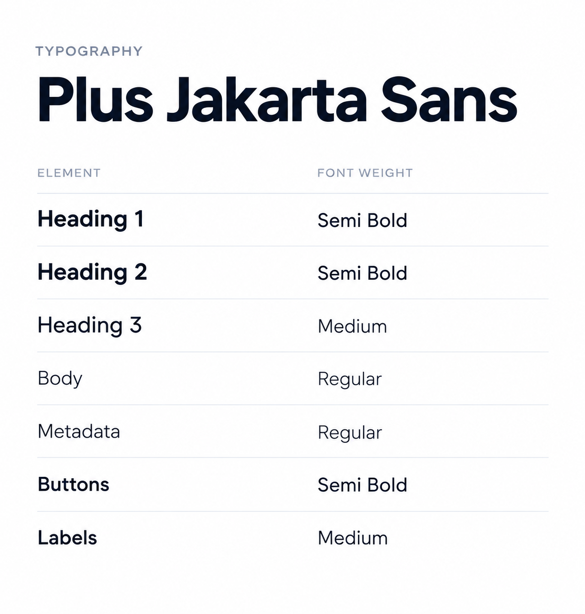

**Paleta de colores**

La paleta implementa un Dark Design System diseñado para reducir la fatiga visual del usuario en entornos de baja luminosidad, priorizando el contraste para identificar rápidamente el estado del estacionamiento:

* **#0F0D17 (Base):** Fondo oscuro profundo que evita deslumbramientos y permite que los colores semánticos resalten.   
* **#FFD84D (Action):** Color ámbar utilizado para los botones de acción principales.   
* **#263044 (Blocks):** Azul grisáceo apagado que manda los espacios ocupados a un segundo plano visual, reduciendo distracciones.   
* **#44E38B (Available):** Verde de alto contraste para que el Driver ubique los espacios libres de inmediato.
* **#FF5D68 (Error/Unavailable):** Rojo destinado a comunicar errores del sistema o espacios físicos inhabilitados.   
* **#F7F5FA (Text):** Blanco para el contenido principal sobre fondos oscuros; el contraste se verifica en cada combinación de texto y superficie.

*Figura 42 (SpotGo Palette)*  
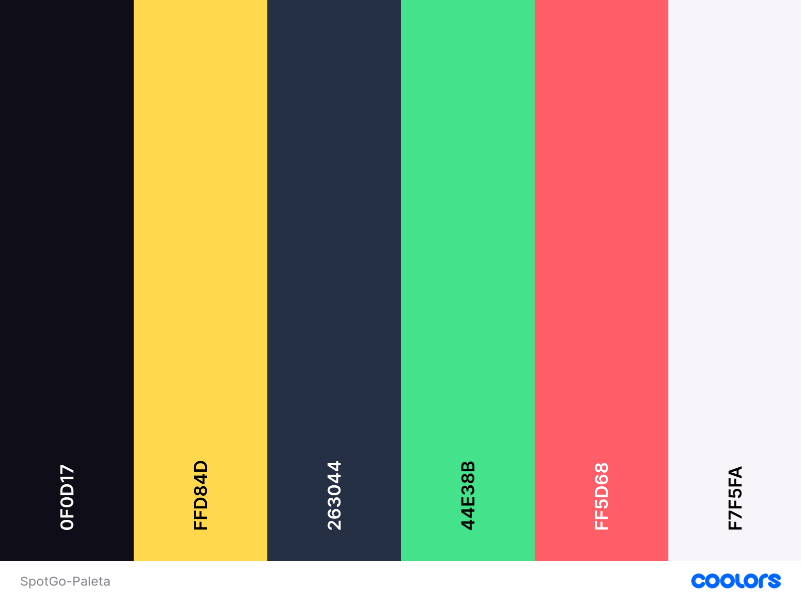

**Espaciado**

La propuesta utiliza una escala de espaciado basada en 4 unidades: 4, 8, 12, 16, 24, 32 y 48. Los espacios de 4 y 8 separan elementos relacionados, como un icono y su etiqueta; 12 y 16 organizan controles y contenido dentro de tarjetas; 24, 32 y 48 separan grupos y secciones. La proximidad distingue información relacionada y la repetición mantiene un ritmo visual consistente.

En web, estos valores se expresan en píxeles CSS; en Android nativo, en dp; y en Flutter, en píxeles lógicos. Se proponen márgenes laterales mínimos de 16 en pantallas móviles y de 24 en desktop, ajustados al ancho disponible. Los componentes deben conservar espacio suficiente para textos traducidos y errores de validación.

**Tono de comunicación y lenguaje**

| Dimensión | Decisión | Aplicación |
| --- | --- | --- |
| Divertido / Serio | Serio | Comunicar disponibilidad, reservas y pagos con precisión, sin bromas en operaciones o incidencias. |
| Formal / Casual | Formal y directo | Utilizar frases breves y vocabulario comprensible, evitando tecnicismos internos. |
| Respetuoso / Irreverente | Respetuoso | Explicar errores sin culpar al usuario y ofrecer una acción de recuperación. |
| Entusiasta / Sereno | Sereno | Confirmar resultados y advertir incidencias sin exageraciones ni mensajes alarmistas. |

La interfaz utiliza English (en_US) por defecto y Latin American Spanish (es_419) como alternativa. Las etiquetas mantienen el mismo significado entre idiomas. Por ejemplo, ante un conflicto de disponibilidad: “This spot is no longer available. Choose another spot.” / “Este espacio ya no está disponible. Selecciona otro espacio.” Los mensajes identifican la situación y el siguiente paso; no exponen detalles de infraestructura.

**Mobile Style Guidelines**

SpotGo contará con dos aplicaciones móviles independientes. La aplicación nativa de Driver se desarrollará con Kotlin y Jetpack Compose; la aplicación multiplataforma de Parking Admin, con Flutter y Dart. Ambas seguirán la misma identidad visual y los mismos criterios de espaciado, sin combinarse en un solo artefacto. Las dimensiones se adaptarán a cada entorno: dp y sp en Android, y píxeles lógicos con escalado de texto en Flutter. La propuesta parte de texto de cuerpo de 16 sp o su equivalente y áreas de interacción de al menos 48 dp o píxeles lógicos, separadas para reducir selecciones accidentales.

Driver utiliza navegación inferior con Explore, Reservations, Payments y Profile; Parking Admin utiliza Dashboard, Occupancy, Alerts y More. Los formularios presentan etiquetas persistentes, errores junto al campo y acciones de recuperación. Las pantallas de reservas y pagos muestran el espacio, horario, importe y resultado antes de continuar. El contenido respeta las áreas seguras del dispositivo y debe seguir siendo utilizable con texto ampliado.

La ocupación, el estado de reserva y la salud del sensor se muestran por separado. Available, Occupied y Unavailable describen la ocupación física; Reserved identifica una reserva y no sustituye esa información. Se utilizan etiquetas, iconos y contraste, además del color, para que el usuario pueda interpretar los estados. La consistencia entre plataformas facilita el aprendizaje y la identificación de las acciones principales.

### 3.1.2. Information Architecture

Esta sección define la organización del contenido de la Landing Page y la aplicación de SpotGo mediante sistemas de organización, etiquetado, búsqueda y navegación que reducen la carga cognitiva. La arquitectura prioriza las necesidades de los usuarios con los roles Driver y Parking Admin. Driver se enfoca en buscar, consultar disponibilidad y reservar espacios; Parking Admin, en administrar y monitorear los estacionamientos.

#### *3.1.2.1. Organization Systems*

En esta sección se definen los sistemas de organización que se plantearán para SpotGo, considerando tanto la Landing Page como las aplicaciones destinadas a los roles Driver y Parking Admin. El objetivo será estructurar la información de manera clara y facilitar el acceso a las funcionalidades principales.

**Organización visual del contenido:**

- **De forma jerárquica (Visual Hierarchy):** Se utilizará principalmente en las interfaces de la aplicación, priorizando la información más relevante para cada usuario. En el caso del Driver, se dará mayor importancia a la disponibilidad, ubicación y precio de los estacionamientos. Para el rol Parking Admin, se priorizarán indicadores como ocupación, disponibilidad, reservas y estado de las zonas.

- **Organización secuencial (Step-by-step):** Se aplicará en procesos que requieran completar diferentes etapas, principalmente en el flujo de reserva de un estacionamiento. El usuario podrá seleccionar una zona, revisar la disponibilidad, seleccionar un espacio, confirmar la reserva y realizar el pago.

- **Organización matricial:** Se utilizará principalmente en las vistas de monitoreo y análisis para Parking Admin. La información podrá visualizarse considerando diferentes variables como zonas, espacios, estados de ocupación y periodos de tiempo.

**Esquemas de categorización:**

- **Según audiencia (Audience-based):** Se aplicará principalmente en la Landing Page, diferenciando el contenido dirigido a **Driver** y **Parking Admin**.

- **Por tópicos:** Se utilizará para agrupar funcionalidades como reservas, Payments, Vehicles, Parking Zones, Monitoring, Reports y Settings.

- **Cronológico:** Se utilizará para organizar información relacionada con reservas, Payments, Parking History y Reports, permitiendo consultar los registros de acuerdo con fechas o periodos.

- **Por estado:** Los Parking Spots se clasifican según su Occupancy Status: **Available, Occupied o Unavailable**. Las reservas se organizan según el estado de la reserva, como **Pending Payment, Reserved, Active, Completed, Cancelled, No-show, Overstayed o Payment Rejected**. Ambas dimensiones se muestran por separado: un espacio físicamente Available puede seguir protegido por una reserva vigente y no estar disponible para una nueva reserva.

#### *3.1.2.2. Labelling Systems*

En esta sección se definen las etiquetas que se plantearán para representar la información y funcionalidades de SpotGo. Estas etiquetas buscarán ser cortas, directas y consistentes, permitiendo que los usuarios comprendan rápidamente el propósito de cada sección o acción.

Para el segmento de **Driver**, se utilizarán etiquetas relacionadas con las principales acciones del usuario:

- **Explore:** búsqueda y exploración de estacionamientos.
- **Reservations:** consulta y gestión de reservas.
- **Payments:** gestión de pagos.
- **Profile:** información y configuración del usuario.
- **Vehicles:** administración de vehículos registrados.

Para el segmento de **Parking Admin**, se utilizarán etiquetas orientadas a la gestión del estacionamiento:

- **Dashboard:** vista general de la operación.
- **Occupancy:** consulta de ocupación física, reservas asociadas y salud de sensores.
- **Alerts:** consulta y gestión de incidencias operativas.
- **More:** acceso a las demás funciones administrativas.
- **Parking Zones:** administración de zonas.
- **Parking Spots:** administración de espacios.
- **Reservations:** gestión de reservas.
- **Reports:** consulta de información y métricas.
- **Settings:** configuración del sistema.

Asimismo, se utilizarán etiquetas consistentes para representar el Occupancy Status de los espacios:

- **Available**
- **Occupied**
- **Unavailable**

La etiqueta **Reserved** se utiliza exclusivamente para el estado de la reserva. La vista presenta por separado la ocupación física, el estado de la reserva y el Sensor Health; una lectura de ocupación no identifica al Driver ni al Vehicle.

Las etiquetas de las acciones utilizarán términos directos como **Reserve**, **View Details**, **Get Directions**, **Confirm** y **Cancel**, evitando textos extensos que puedan dificultar la comprensión de las acciones.

#### *3.1.2.3. SEO Tags and Meta Tags*

En esta sección se definen los SEO Tags y Meta Tags que se plantearán para la Landing Page de SpotGo. Estos elementos estarán orientados a comunicar claramente la propuesta de valor del producto y facilitar su posicionamiento en motores de búsqueda.

**Landing Page**

- **Title:** `SpotGo · Smart Parking`
- **Description:** `Meet SpotGo: mobile parking apps for drivers and parking teams. Find a space, manage reservations and follow parking operations.`
- **Keywords:** `smart parking, parking reservation, parking availability, parking management, Parking Admin, parking spaces`
- **Author:** `SpotGo Team`

La Landing Page se organiza como una página única con seis secciones. **Home** presenta la propuesta de valor; **The apps** reúne las opciones para Driver y Parking Admin; **How it works** explica el recorrido de uso; **About the product** presenta SpotGo; **About the team** presenta a sus integrantes; y **FAQ** responde las preguntas frecuentes.

**ASO Elements de las aplicaciones móviles**

Los siguientes valores constituyen la propuesta inicial de metadatos para las dos aplicaciones móviles independientes: la aplicación nativa de Driver y la aplicación multiplataforma de Parking Admin. La publicación de cada una se ajustará a sus funciones y a los campos admitidos por cada tienda; la descripción actual resume la propuesta de SpotGo y deberá adaptarse a cada perfil antes de su publicación.

| Item | English (en_US) | Latin American Spanish (es_419) |
| --- | --- | --- |
| App Title | SpotGo: Smart Parking | SpotGo: Estacionamiento |
| App Keywords | parking, reservations, availability, parking management, occupancy | estacionamiento, reservas, disponibilidad, gestión, ocupación |
| App Subtitle | Find parking. Manage spaces. | Encuentra y gestiona espacios. |
| App Description | SpotGo connects drivers and parking administrators. Drivers can check parking availability, manage vehicles, reserve spaces and review their payments and receipts. Parking administrators can monitor occupancy, manage zones, review alerts and record guest parking sessions. Sign in with your SpotGo email and password or continue with Google; administrative access is provisioned by the organization. | SpotGo conecta a conductores y administradores de estacionamientos. Los conductores pueden consultar disponibilidad, gestionar vehículos, reservar espacios y revisar sus pagos y comprobantes. Los administradores pueden monitorear la ocupación, gestionar zonas, revisar alertas y registrar sesiones de invitados. Ingresa con tu correo y contraseña de SpotGo o continúa con Google; el acceso administrativo es habilitado por la organización. |

App Keywords expresa los términos de búsqueda del producto; App Subtitle resume su beneficio y App Description explica las funciones y el acceso según el rol. Estos metadatos son una propuesta de diseño y no una evidencia de publicación en una app store.

#### *3.1.2.4. Searching Systems*

En esta sección se definen los mecanismos de búsqueda que se plantearán en SpotGo para facilitar que los usuarios encuentren rápidamente la información que necesitan.

Para el segmento de **Driver**, el sistema de búsqueda estará principalmente orientado a encontrar estacionamientos disponibles. Se planteará una búsqueda mediante mapa que permita visualizar las **Parking Zones** cercanas y consultar información relacionada con su disponibilidad.

La búsqueda podrá complementarse con filtros que permitan reducir los resultados según las necesidades del usuario:

- **Distance:** para encontrar estacionamientos cercanos.
- **Price:** para establecer un rango de precio.
- **Availability:** para mostrar espacios disponibles.
- **Services:** para buscar estacionamientos según los servicios ofrecidos.
- **Operating Hours:** para considerar el horario de funcionamiento.

Los resultados de búsqueda se plantearán mediante tarjetas y elementos visuales dentro del mapa, mostrando información relevante como nombre del estacionamiento, distancia, precio, disponibilidad y ubicación.

Para el rol **Parking Admin**, las consultas se realizan dentro de cada sección administrativa. En **Occupancy** se proponen filtros por Parking Zone, Occupancy Status, estado de la reserva y Sensor Health. En **Alerts**, los filtros corresponden al tipo de incidencia, severidad y estado de resolución; en los registros y reportes, al periodo y la zona. Los resultados muestran el identificador del espacio o registro, sus estados y la última actualización. **Dashboard, Occupancy, Alerts y More** son destinos de navegación y no filtros de búsqueda.

#### *3.1.2.5. Navigation Systems*

En esta sección se definen los sistemas de navegación que se plantearán para guiar a los usuarios a través de la Landing Page y las aplicaciones de SpotGo, permitiéndoles acceder a las funcionalidades necesarias de acuerdo con sus objetivos.

**Navegación de la Landing Page**

- **Global Navigation:** La barra superior ofrece accesos a **The apps, How it works, About the product, About the team y FAQ**. El logotipo permite regresar a **Home**.
- **Section Navigation:** Los enlaces desplazan a la sección correspondiente dentro de la misma página.
- **Call To Action:** Los botones **Explore the apps**, **How SpotGo works** y **Open app** conducen a las secciones de aplicaciones, explicación del producto y acceso a las aplicaciones.
- **Mobile Navigation:** En dispositivos móviles, un menú desplegable permite acceder a las mismas secciones y conserva el acceso a las acciones principales.

**Navegación de SpotGo Driver Android App**

- **Bottom Navigation:** Se planteará una barra de navegación inferior con acceso a las principales funcionalidades: **Explore, Reservations, Payments y Profile**.
- **Contextual Navigation:** Dentro de cada sección se incluirán acciones relacionadas con el contexto del usuario, como **Reserve, View Details, Get Directions y Cancel**.
- **Reservation Flow:** El proceso de reserva utilizará navegación secuencial para guiar al Driver desde la selección del estacionamiento hasta la confirmación de la reserva y el pago.

**Navegación de SpotGo Parking Admin Flutter App**

- **Bottom Navigation:** La aplicación móvil utiliza una barra inferior con **Dashboard, Occupancy, Alerts y More**, consistente con los wireframes y mock-ups de Parking Admin.
- **Dashboard Navigation:** El Dashboard funcionará como punto de entrada para visualizar información general y acceder rápidamente a las principales funciones de administración.
- **Contextual Navigation:** Las acciones de administración estarán disponibles directamente desde las vistas correspondientes, permitiendo consultar una zona, revisar sus espacios o analizar información relacionada con la ocupación.

Finalmente, la navegación mantendrá una estructura consistente entre las diferentes interfaces, utilizando etiquetas claras, jerarquía visual y patrones de interacción similares para facilitar el aprendizaje del sistema.

### 3.1.3. Landing Page UI Design

Esta sección presenta el diseño de la interfaz de la Landing Page de SpotGo, organizada en **Home, The apps, How it works, About the product, About the team y FAQ**. El wireframe define la estructura y jerarquía de esas secciones; el mock-up muestra su apariencia visual, las tarjetas informativas de las aplicaciones, la presentación del producto y del equipo, y las preguntas frecuentes.

#### *3.1.3.1. Landing Page Wireframe*

*Figura 43 (Wireframe de la landing page)*  
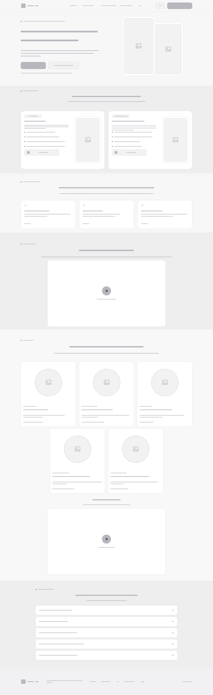

#### *3.1.3.2. Landing Page Mock-up*

*Figura 44 (Mock-up de la landing page)*  
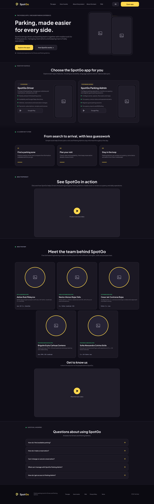

### 3.1.4. Applications UX/UI Design

Esta sección presenta la propuesta de experiencia e interfaz para la aplicación móvil de SpotGo dirigida a Driver y Parking Admin. Los wireframes describen la organización y jerarquía de los elementos; los mock-ups muestran su apariencia visual; y los diagramas resumen las secuencias de interacción y las rutas principales de cada perfil. El repositorio incluye todas las pantallas principales de ambos perfiles, mientras que aquí se muestran únicamente ejemplos representativos.

#### *3.1.4.1. Applications Wireframes*

Los wireframes de baja fidelidad permiten revisar la estructura de cada pantalla y la ubicación de sus controles antes de evaluar el tratamiento visual final. Para Driver, se incluyen ejemplos de acceso, exploración del mapa, consulta y reserva de una zona, gestión de reservas, pagos, vehículos y comprobantes. Para Parking Admin, se muestran ejemplos del dashboard, alertas, zonas, sesiones de invitados, mapa digital y facturación.

**Driver Wireframes**

*Figura 45 (Wireframe de inicio de sesión para Driver)*  
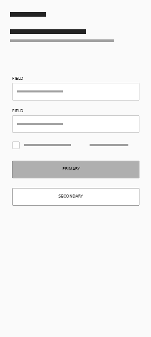

*Figura 46 (Wireframe para explorar estacionamientos disponibles)*  
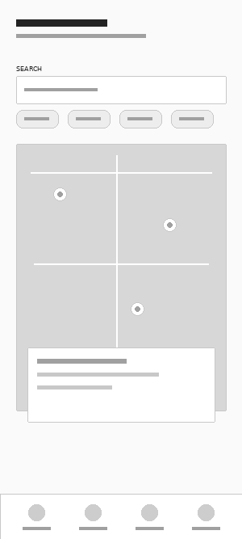

*Figura 47 (Wireframe con el detalle de una zona y la acción de reserva)*  
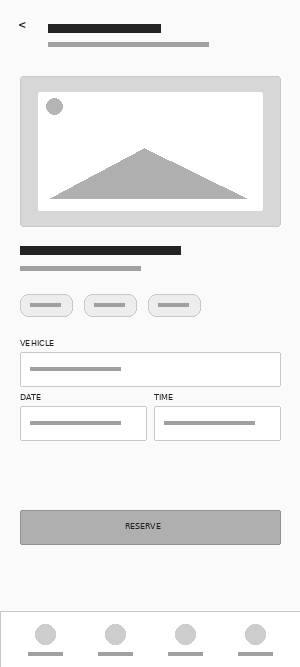

*Figura 48 (Wireframe para consultar las reservas del Driver)*  
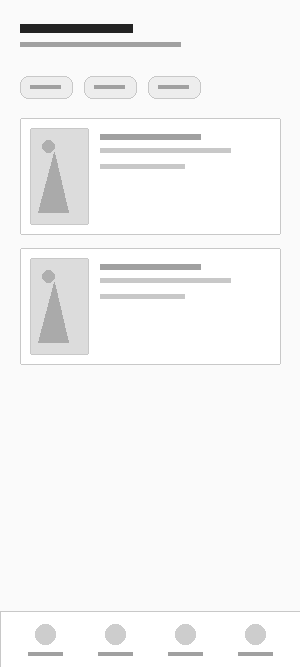

*Figura 49 (Wireframe de la sección de pagos)*  
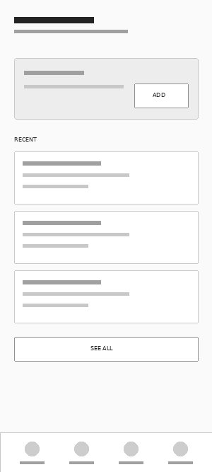

*Figura 50 (Wireframe para administrar vehículos registrados)*  
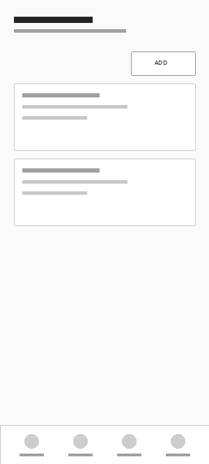

*Figura 51 (Wireframe para consultar comprobantes y facturas)*  
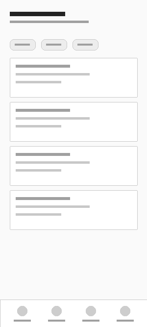

**Parking Admin Wireframes**

*Figura 52 (Wireframe del dashboard administrativo)*  
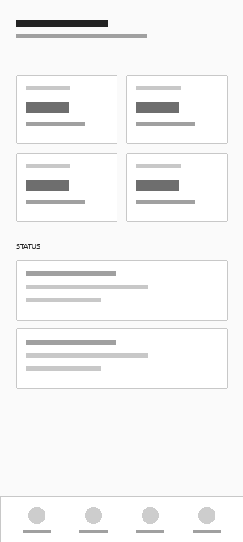

*Figura 53 (Wireframe de alertas operativas)*  
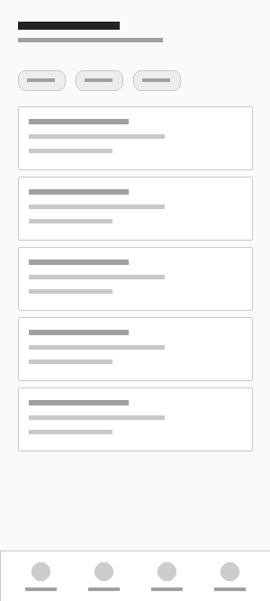

*Figura 54 (Wireframe para administrar zonas de estacionamiento)*  
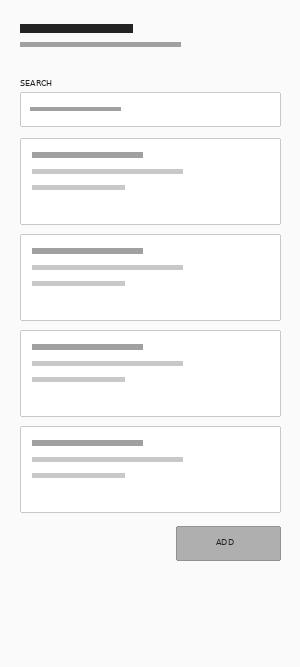

*Figura 55 (Wireframe de sesiones de visitantes)*  
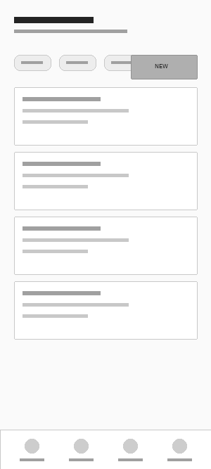

*Figura 56 (Wireframe del mapa digital del estacionamiento)*  
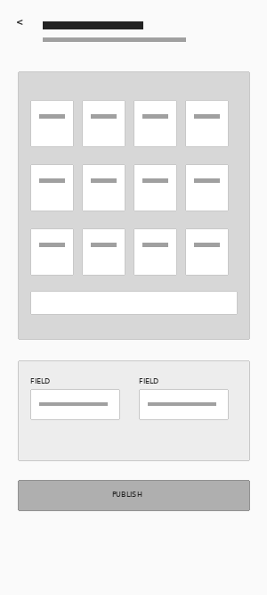

*Figura 57 (Wireframe de facturación para clientes empresariales)*  
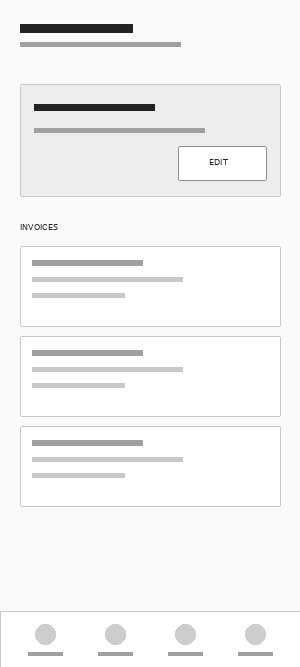

#### *3.1.4.2. Applications Wireflow Diagrams*

Los wireflows combinan pantallas esquemáticas con conexiones para mostrar el orden de navegación y las decisiones disponibles dentro de una tarea. Los seis diagramas siguientes cubren los principales escenarios de acceso, gestión de vehículos, reservas y pagos para Driver, así como infraestructura, operaciones, invitados, reportes y facturación para Parking Admin.

**Driver Wireflows**

*Figura 58 (Wireflow de acceso y administración de vehículos para Driver)*  
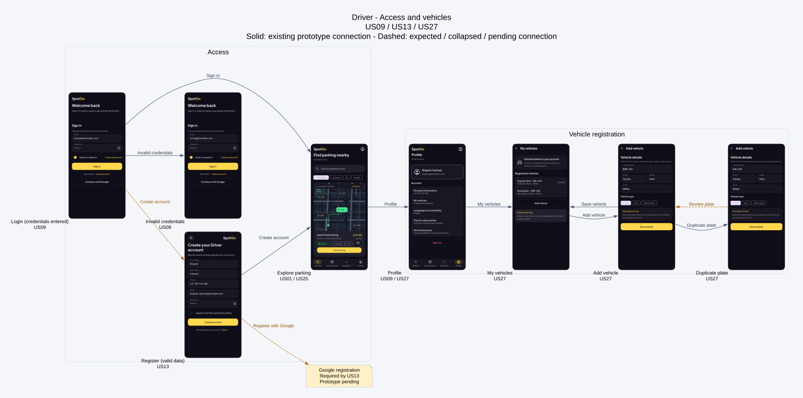

*Figura 59 (Wireflow de reservas y pagos para Driver)*  
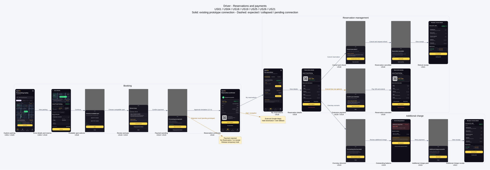

*Figura 60 (Wireflow de planes, suscripciones y documentos para Driver)*  
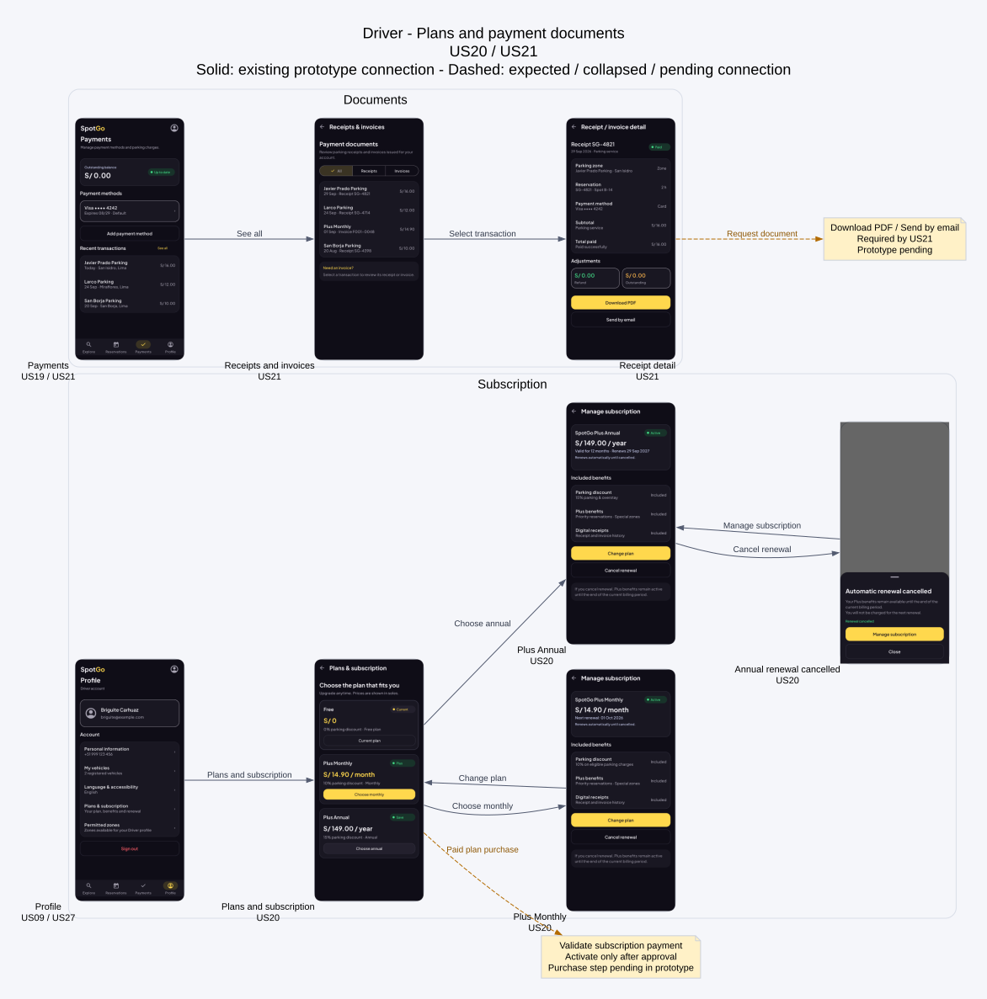

**Parking Admin Wireflows**

*Figura 61 (Wireflow de infraestructura y zonas de estacionamiento para Parking Admin)*  
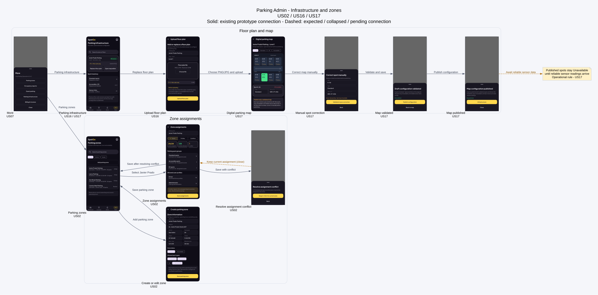

*Figura 62 (Wireflow de operaciones y sesiones de invitados para Parking Admin)*  
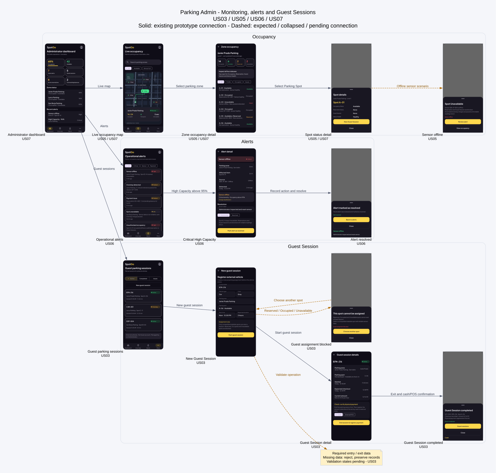

*Figura 63 (Wireflow de reportes y facturación para Parking Admin)*  
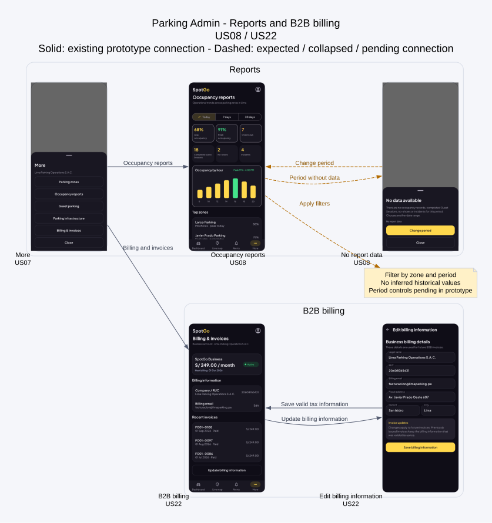

#### *3.1.4.3. Applications Mock-ups*

Los mock-ups aplican la identidad visual de SpotGo a las pantallas y permiten apreciar la jerarquía, los componentes y la presentación de la información en cada aplicación. Se presentan las mismas áreas funcionales seleccionadas en los wireframes para facilitar la comparación entre estructura y propuesta visual.

**Driver Mock-ups**

*Figura 64 (Mock-up de inicio de sesión para Driver)*  
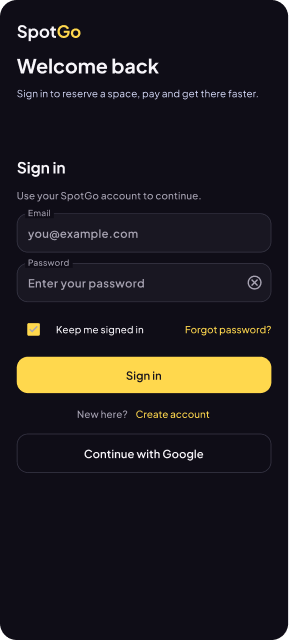

*Figura 65 (Mock-up para explorar estacionamientos disponibles)*  
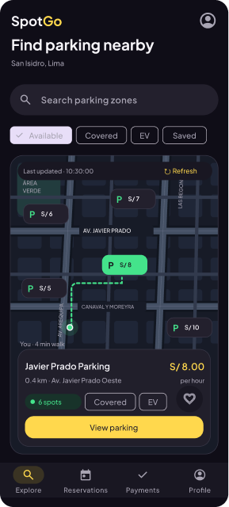

*Figura 66 (Mock-up con el detalle de una zona y la acción de reserva)*  
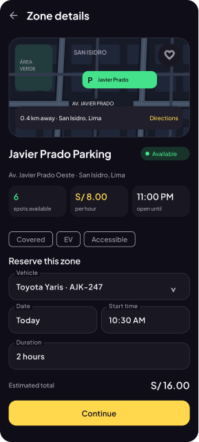

*Figura 67 (Mock-up para consultar las reservas del Driver)*  
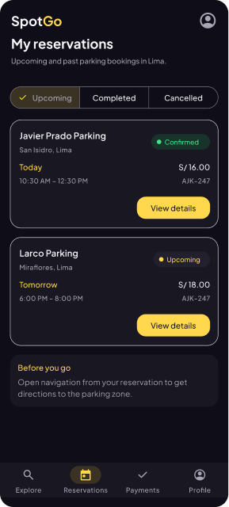

*Figura 68 (Mock-up de la sección de pagos)*  
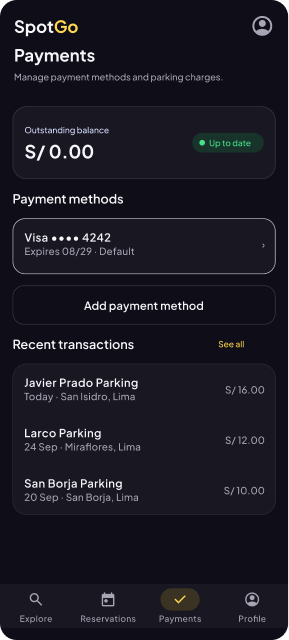

*Figura 69 (Mock-up para administrar vehículos registrados)*  
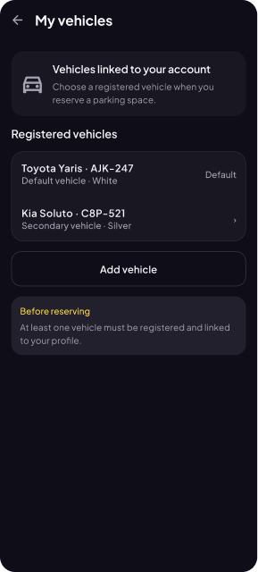

*Figura 70 (Mock-up para consultar comprobantes y facturas)*  
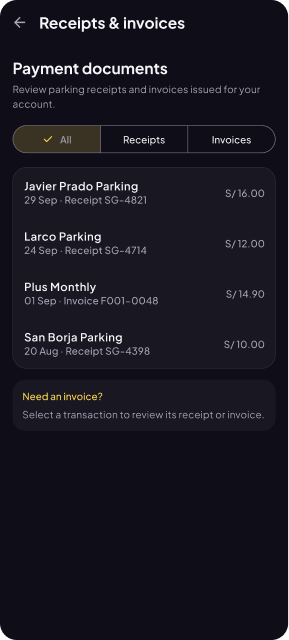

**Parking Admin Mock-ups**

*Figura 71 (Mock-up del dashboard administrativo)*  
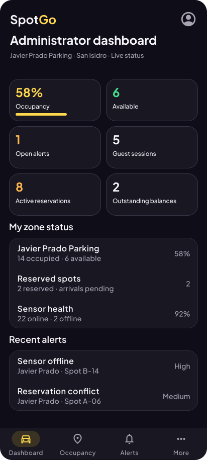

*Figura 72 (Mock-up de alertas operativas de la zona asignada)*  
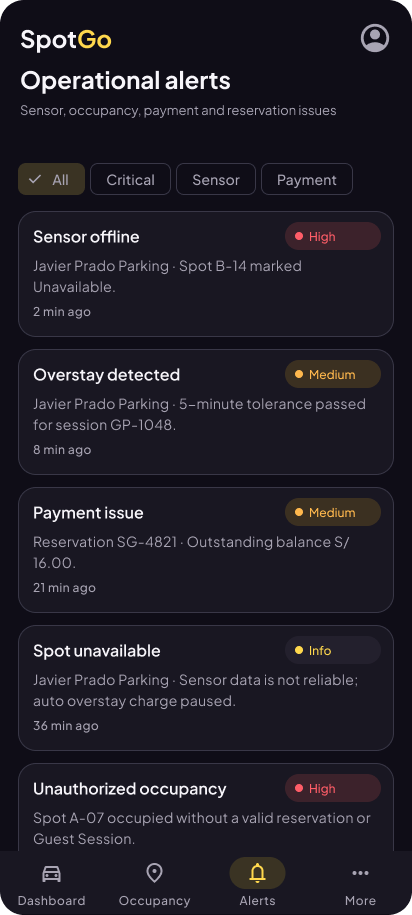

*Figura 73. Mock-up de la zona de estacionamiento asignada.*  
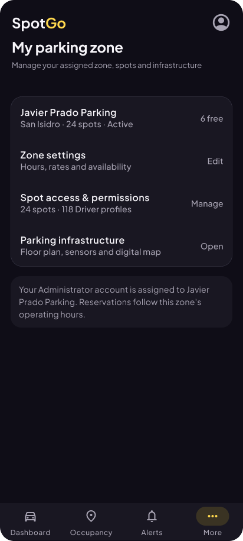

*Figura 74 (Mock-up de sesiones de visitantes)*  
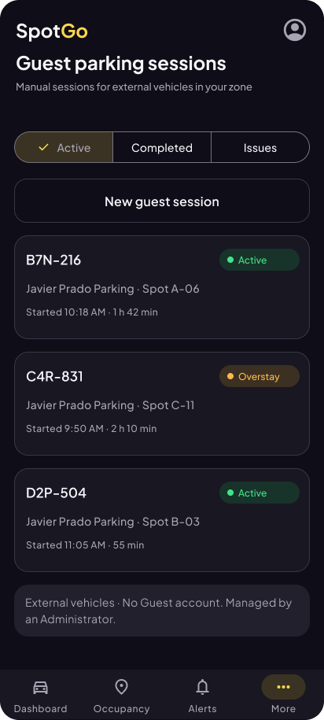

*Figura 75 (Mock-up del mapa digital del estacionamiento)*  
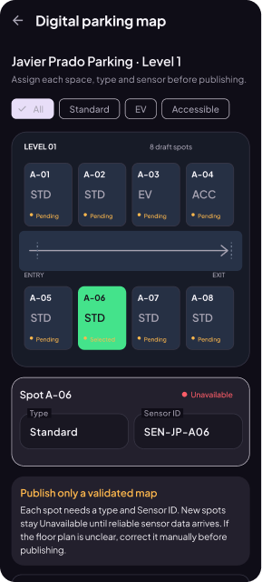

*Figura 76 (Mock-up de facturación para clientes empresariales)*  
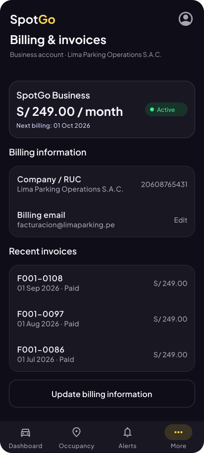

#### *3.1.4.4. Applications User Flow Diagrams*

Los user flows ofrecen una vista de alto nivel de los objetivos, decisiones y recorridos posibles de cada perfil. El flujo de Driver abarca el uso de la aplicación móvil para encontrar y reservar estacionamiento y gestionar servicios asociados. El flujo de Parking Admin representa las tareas de supervisión y administración de la operación.

**Driver User Flows**

**User Flow 1: Registro y acceso a SpotGo**

**User Goal 1**

Como Driver, quiero crear una cuenta o iniciar sesión en SpotGo para acceder a las funcionalidades disponibles para usuarios registrados.

**Task Flow**

1. El Driver abre la aplicación SpotGo.
2. El sistema presenta las opciones de acceso y registro.
3. El Driver indica si ya tiene una cuenta.
4. Si no tiene cuenta, selecciona el registro con credenciales SpotGo o con Google.
5. Con credenciales SpotGo, ingresa su nombre, correo electrónico y contraseña.
6. El sistema valida que los datos requeridos estén completos y que el correo electrónico no esté registrado.
7. Si la información es válida, el sistema crea una cuenta activa con el User Profile Driver por defecto y permite continuar al acceso.
8. Si faltan datos o el correo ya está registrado, el sistema rechaza el registro, informa la causa y no crea una cuenta duplicada.
9. Con Google (primer acceso), el Driver completa la autenticación de Google y el backend valida el ID token. Si no existe una cuenta SpotGo vinculada y los datos de perfil requeridos están disponibles, el Driver confirma el registro público. El sistema crea una cuenta activa con el User Profile Driver, asocia la identidad de Google validada y no solicita ni almacena la contraseña de Google.
10. Si ya existe una cuenta SpotGo con el mismo correo y sin una asociación de Google validada, el sistema exige una verificación autorizada de la cuenta existente antes de vincularla. Conserva su identidad y roles, no crea una cuenta duplicada y no otorga automáticamente un rol administrativo.
11. Si el Driver ya tiene cuenta, selecciona el inicio de sesión con credenciales SpotGo o con Google.
12. El sistema valida las credenciales (o el ID token de Google: firma, emisor, audiencia y expiración) y que la cuenta esté activa.
13. Si el acceso es válido, el sistema crea una Session propia de SpotGo, habilita las funciones del rol Driver y muestra la pantalla principal.
14. Si las credenciales son incorrectas o la cuenta no está activa, el sistema rechaza el acceso e informa al usuario.
15. Si el acceso con Google se cancela o el ID token es inválido o ha expirado, el sistema no emite una Session y permite reintentar o usar correo y contraseña.
16. Si la Session deja de ser válida cuando el Driver solicita información protegida, el sistema rechaza la solicitud y no entrega datos de ocupación, perfil ni zonas restringidas.
17. El registro público solo crea cuentas Driver; no permite seleccionar ni crear el rol Parking Admin.

**User Flow**

*Figura 77 (User Flow 1: Registro y acceso a SpotGo)*  
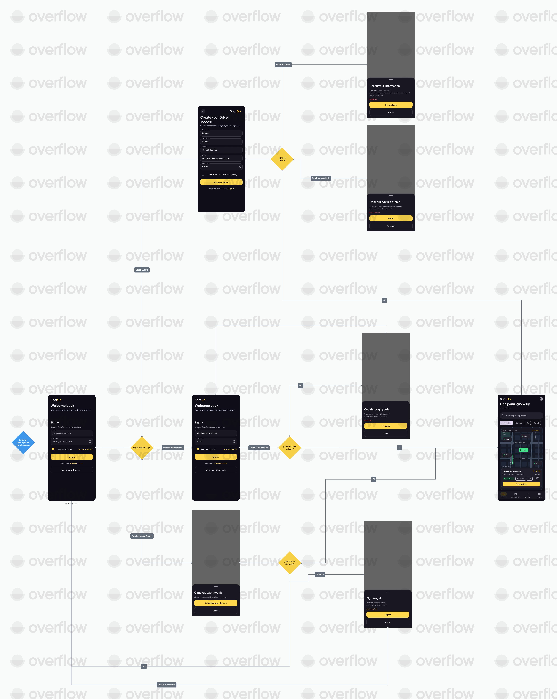

**User Flow 2: Registrar vehículo**

**User Goal 2**

Como Driver, quiero registrar un vehículo en mi perfil para poder seleccionarlo al realizar futuras Reservations.

**Task Flow**

1. El Driver inicia sesión en SpotGo.
2. Desde la pantalla principal, abre su Profile.
3. Accede a la vista de vehículos.
4. Selecciona la opción para registrar un vehículo.
5. Ingresa la placa y los datos descriptivos solicitados, y guarda el registro.
6. El sistema valida que la información requerida esté completa y que el vehículo no esté ya asociado a la cuenta del Driver.
7. Si los datos son válidos, el sistema crea el Vehicle, lo asocia al Driver, almacena la placa y los datos descriptivos, y lo deja disponible para seleccionarlo en una Reservation.
8. El sistema muestra el vehículo registrado en la lista de vehículos del perfil.
9. Si faltan datos o el vehículo ya está asociado a la cuenta, el sistema rechaza la operación, informa la causa y preserva los registros existentes.

**User Flow**

*Figura 78 (User Flow 2: Registrar vehículo)*  
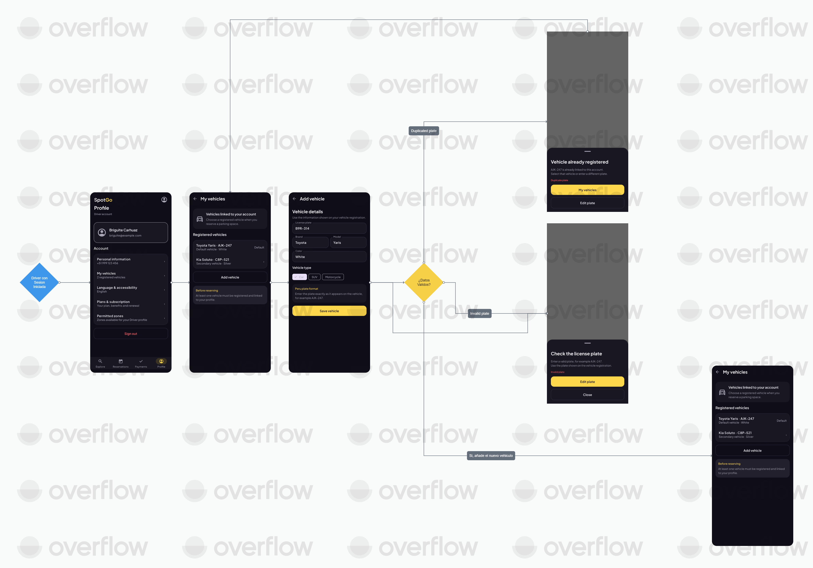

**User Flow 3: Consultar disponibilidad por zona**

**User Goal 3**

Como Driver, quiero consultar la disponibilidad actual de una Parking Zone para identificar si existen Parking Spots disponibles.

**Task Flow**

1. El Driver abre SpotGo e ingresa a la pantalla principal.
2. El sistema consulta las Parking Zones disponibles para el perfil del Driver.
3. El Driver selecciona una Parking Zone.
4. El Driver solicita consultar la disponibilidad actual.
5. El sistema verifica los datos operativos de los Parking Spots de la zona.
6. Un Parking Spot se considera disponible para reserva únicamente si su Occupancy Status es Available, su Sensor Health es operativo y no tiene una Reservation activa, Guest Parking Session activa ni Temporary Lock activo.
7. Si existen espacios disponibles, el sistema muestra la cantidad disponible y la hora de la última actualización.
8. Si no existen espacios disponibles (porque están Occupied, reservados, en una Guest Parking Session, con Temporary Lock o Unavailable), el sistema informa que la zona no tiene Parking Spots disponibles.
9. El sistema no ofrece para reserva espacios Unavailable ni espacios bloqueados temporalmente.
10. Si el Driver solicita actualizar la información, el sistema recupera el estado más reciente y muestra la nueva hora de actualización.

**User Flow**

*Figura 79 (User Flow 3: Consultar disponibilidad por zona)*  
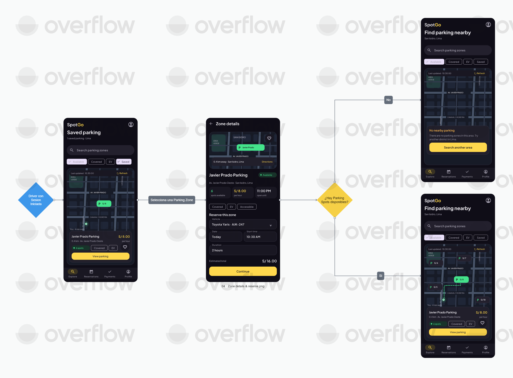

**User Flow 4: Consultar zonas permitidas**

**User Goal 4**

Como Driver, quiero consultar las Parking Zones permitidas para mi perfil para saber en qué estacionamientos puedo utilizar SpotGo.

**Task Flow**

1. El Driver inicia sesión en SpotGo.
2. El sistema identifica su User Profile activo y sus permisos.
3. El Driver accede a la sección de Parking Zones.
4. El sistema consulta las zonas asociadas a los permisos del perfil.
5. Si existen zonas permitidas con disponibilidad, el sistema muestra la lista de zonas permitidas junto con su disponibilidad actual y excluye las zonas no autorizadas.
6. El Driver selecciona una zona para revisar su información.
7. El sistema presenta los detalles disponibles de la zona.
8. Si ninguna zona permitida tiene disponibilidad, el sistema informa que no hay disponibilidad en las zonas autorizadas y sigue sin mostrar zonas no autorizadas.

**User Flow**

*Figura 80 (User Flow 4: Consultar zonas permitidas)*  
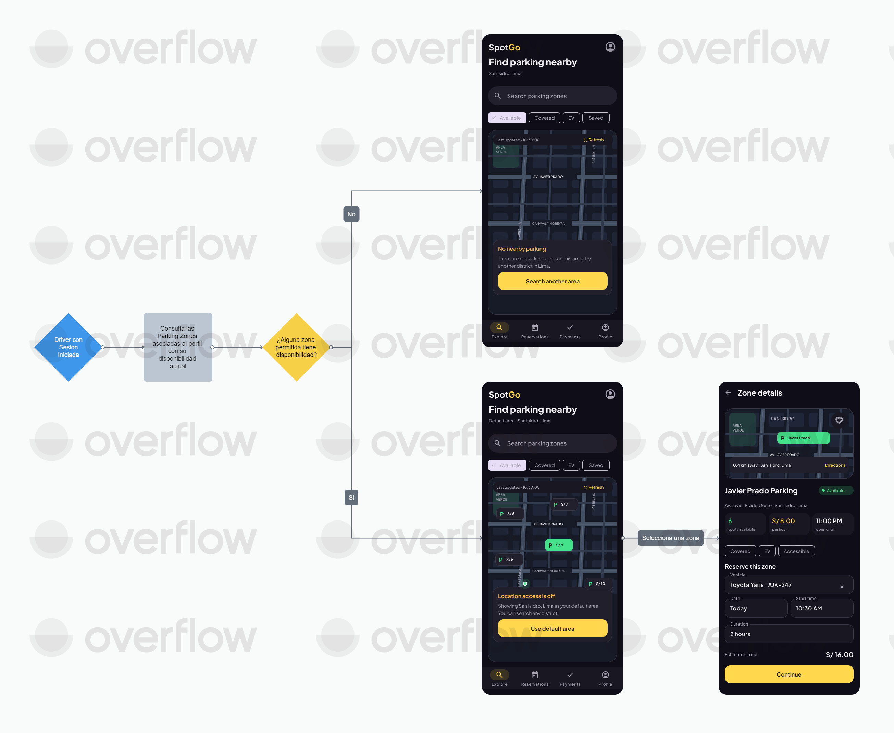

**User Flow 5: Encontrar Parking Zones cercanas**

**User Goal 5**

Como Driver, quiero visualizar las Parking Zones registradas por SpotGo en un mapa integrado para identificar alternativas de estacionamiento cercanas y revisar sus detalles operativos.

**Task Flow**

1. El Driver abre la sección de exploración de estacionamientos.
2. El sistema solicita el permiso de ubicación solo mientras se usa la funcionalidad.
3. Si el Driver concede el permiso, el sistema consulta las Parking Zones registradas en el área correspondiente.
4. La Google Maps API renderiza el mapa integrado.
5. SpotGo muestra las Parking Zones como marcadores.
6. El Driver selecciona un marcador o una zona.
7. SpotGo muestra los datos operativos disponibles, como Availability, precio, horario de atención y detalles de la zona.
8. Si el Driver no concede el permiso, la Google Maps API renderiza el mapa centrado en el área por defecto configurada (por ejemplo, Cercado de Lima), la aplicación informa que la ubicación mejora los resultados y no solicita acceso a la ubicación en segundo plano.
9. Si el Driver habilita el permiso más tarde mientras usa la funcionalidad y vuelve a solicitar las zonas cercanas, SpotGo usa su ubicación actual para esa consulta, sin requerir acceso continuo en segundo plano.
10. Si no existen zonas registradas en el área consultada o la Google Maps API no responde, la aplicación informa la situación y no muestra ubicaciones inexistentes.

**User Flow**

*Figura 81 (User Flow 5: Encontrar Parking Zones cercanas)*  
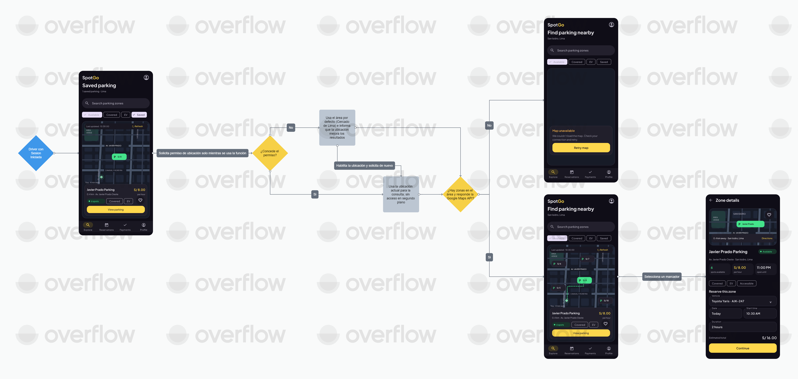

**User Flow 6: Gestionar Reservations y comprobantes virtuales**

**User Goal 6**

Como Driver, quiero reservar un Parking Spot dentro de una zona permitida y administrar la Reservation durante su ciclo de vida para usar el espacio asignado con mi Vehicle registrado y recibir los comprobantes actualizados.

**Task Flow**

**Crear la Reservation**

1. El Driver consulta una Parking Zone permitida y revisa su disponibilidad.
2. Selecciona la opción para realizar una Reservation.
3. El sistema verifica que el Driver tenga al menos un Vehicle registrado. Si no lo tiene, no permite continuar y solicita registrar un Vehicle antes de seleccionar un espacio (User Flow 2).
4. El Driver selecciona el Vehicle, la Parking Zone, el Parking Spot disponible, la fecha, la hora de inicio y la duración.
5. El sistema valida que el Vehicle sea compatible con el User Profile, que el Driver no tenga un Outstanding Balance pendiente, que el Vehicle no tenga ya un Parking Spot o una Reservation activa (máximo uno por Vehicle), que el espacio esté Available con Sensor Health operativo y que el horario solicitado esté dentro del horario operativo.
6. Si las validaciones son correctas, el sistema crea una transacción pendiente, aplica un Temporary Lock al espacio durante el tiempo permitido y el Driver continúa al proceso de pago (User Flow 7).
7. Cuando el pago es aprobado, el sistema confirma la transacción, crea la Reservation con Reservation Status Reserved, bloquea el espacio para otros Drivers y genera el Virtual Receipt con la zona, el espacio, el Vehicle seleccionado y el periodo de validez.
8. Si el espacio deja de estar disponible, otro Driver lo reservó o vence el Temporary Lock antes de confirmar, el sistema libera cualquier bloqueo, no crea la Reservation e informa que debe seleccionarse otra alternativa.
9. Si el pago es rechazado, el sistema libera el Temporary Lock, no confirma la Reservation y no genera el Virtual Receipt.
10. Si la Reservation no se confirma, el sistema no debe mostrarla como una reserva confirmada.

**Consultar y usar la Reservation**

11. El Driver puede consultar sus Reservations y revisar los detalles de cada una.
12. Si el Driver llega después de la hora de inicio y antes de la hora de fin, confirma su check-in, o el Parking Admin confirma que la ocupación corresponde a la Reservation. El sistema cambia la Reservation a Active, registra la Parking Session vinculada y conserva la hora de fin y el monto originales. La lectura del sensor por sí sola no identifica al Vehicle ni inicia la sesión.
13. Si el Driver se retira antes de la hora de fin y el sensor registra el espacio como Available, el sistema mantiene la Reservation protegida hasta su hora de fin, no emite reembolso y no permite que otro Driver reserve ese espacio durante el periodo activo.
14. Si una Reservation pagada, con Sensor Health operativo, nunca registra Occupancy Status Occupied durante todo el periodo reservado, el sistema la marca como No-show al terminar el periodo, libera el espacio y reembolsa el monto pagado.

**Cambiar o cancelar la Reservation**

15. Si el Driver cancela una Reservation pagada que aún no ha comenzado, el sistema cambia su Reservation Status a Cancelled, libera el espacio e inicia la solicitud de Refund por el monto pagado.
16. Si el Driver solicita modificar el horario, el espacio o la duración (incluida una extensión), el sistema valida que la nueva asignación sea compatible con el User Profile y no afecte Reservations posteriores. Luego recalcula la diferencia de precio, genera un Virtual Receipt actualizado antes de confirmar el cambio y deriva cualquier importe adicional al proceso de pago (User Flow 7).

**Reasignación**

17. Si el espacio asignado está ocupado antes del inicio o por una Parking Session con sobrepermanencia, el sistema busca un espacio alternativo disponible y compatible. Al confirmarlo, actualiza la Reservation, el Virtual Receipt y la Parking Zone de destino (que el Driver puede abrir en Google Maps, User Flow 8) y notifica al Driver.
18. Si no existe un espacio compatible, el sistema ofrece instalaciones de estacionamiento alternativas o cancela la Reservation con reembolso total.

**User Flow**

*Figura 82 (User Flow 6: Gestionar Reservations y comprobantes virtuales)*  
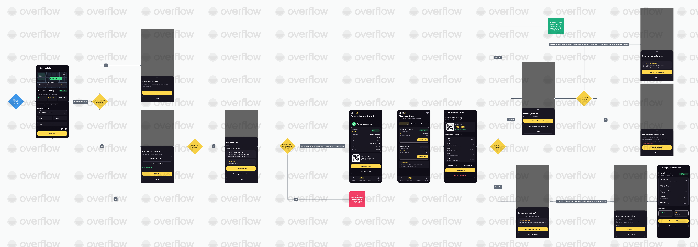

**User Flow 7: Procesar pago de Reservation y cargos adicionales**

**User Goal 7**

Como Driver, quiero pagar mi Reservation y el tiempo adicional de estacionamiento mediante un método de pago guardado para confirmar mi espacio y liquidar la duración real de mi Parking Session.

**Task Flow**

1. El Driver llega al paso de pago de una Reservation o de una operación que requiere un cargo adicional.
2. Si no tiene un método de pago guardado, agrega y autoriza uno mediante el servicio de pago interno. Cuando el servicio confirma la autorización, el sistema almacena el Payment Token asociado al perfil del Driver, sin almacenar los datos completos del método de pago.
3. El sistema muestra el importe que debe pagarse y el método de pago disponible.
4. El Driver selecciona o confirma el método de pago guardado.
5. El sistema verifica que la operación siga vigente y que el Temporary Lock no haya expirado, cuando corresponda.
6. El sistema envía la solicitud de Digital Payment al servicio de pago.
7. Si el pago es aprobado, el sistema registra la transacción como aprobada, confirma la operación relacionada y notifica el resultado al Driver.
8. Si se trata del pago inicial de una Reservation, el sistema confirma la Reservation y permite generar el Virtual Receipt.
9. Si el pago es rechazado, el sistema registra el pago como fallido, informa el resultado, libera el Temporary Lock y no confirma la Reservation ni el Parking Spot.
10. Si el Temporary Lock venció antes de la aprobación, el pago tardío no debe reactivar el bloqueo vencido ni confirmar una Reservation que ya no puede garantizarse.

**Cargo adicional por tiempo extra**

11. Si una Parking Session sigue Occupied después de la hora de fin de la Reservation y del periodo de tolerancia de 5 minutos, el sistema marca la Reservation como Overstayed y genera un Additional Charge según la fracción configurada por el estacionamiento, aplicando el descuento fijo de la Subscription activa del Driver (0%, 10% o 15%).
12. Si el Additional Charge se cobra con éxito mediante el Payment Token, el sistema lo registra como aprobado, actualiza el historial de pagos, notifica al Driver y genera el comprobante aplicable según la información tributaria disponible: Virtual Receipt, Electronic Receipt o Electronic Invoice.
13. Si el cobro del Additional Charge falla, el sistema registra un Outstanding Balance, notifica al Driver, permite reintentar con el mismo método de pago u otro y bloquea nuevas Reservations hasta que el saldo se regularice.
14. El sistema conserva el resultado de la operación para su posterior consulta.

**User Flow**

*Figura 83 (User Flow 7: Procesar pago de Reservation y cargos adicionales)*  
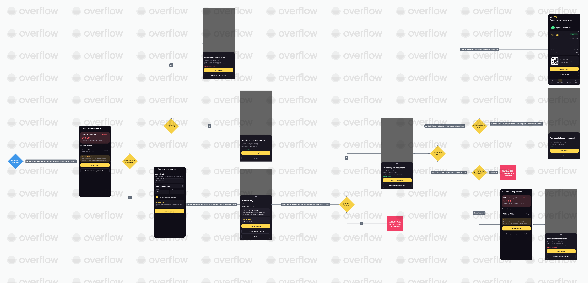

**User Flow 8: Abrir ruta en Google Maps**

**User Goal 8**

Como Driver, quiero abrir en Google Maps la ruta hacia una Parking Zone seleccionada para llegar al estacionamiento.

**Task Flow**

1. El Driver consulta las Parking Zones en el mapa integrado de SpotGo.
2. Selecciona la Parking Zone a la que desea dirigirse.
3. SpotGo recupera la ubicación configurada de la zona seleccionada.
4. Si la zona fue eliminada o su ubicación configurada es inválida, la aplicación informa que el destino no está disponible y no genera una ruta con coordenadas inválidas.
5. Si el destino es válido, el Driver selecciona el botón de enlace de navegación externa (External Navigation Link).
6. SpotGo abre la aplicación de Google Maps con la Parking Zone como destino. SpotGo no calcula una ruta interna dentro del estacionamiento.
7. Google Maps calcula y presenta la ruta desde la ubicación del Driver hacia la Parking Zone.
8. Si la aplicación de Google Maps no está instalada o no puede abrirse, SpotGo ofrece un enlace web compatible o informa que la navegación externa no puede abrirse.
9. El Driver continúa la navegación fuera de SpotGo.

**User Flow**

*Figura 84 (User Flow 8: Abrir ruta en Google Maps)*  
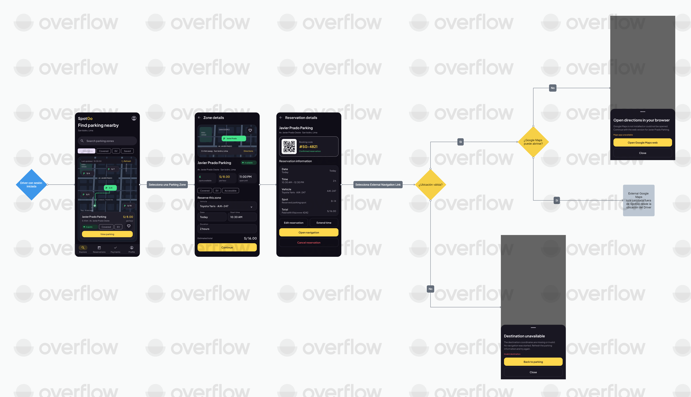

**User Flow 9: Gestionar planes de suscripción**

**User Goal 9**

Como Driver, quiero consultar, seleccionar y gestionar los planes de suscripción Free, Plus Monthly y Plus Annual para obtener los beneficios que se ajusten a mi uso de estacionamiento.

**Task Flow**

1. El Driver inicia sesión y abre su Profile.
2. Accede a la sección Plans and Subscription.
3. El sistema muestra los planes disponibles: Free, Plus Monthly y Plus Annual.
4. El Driver selecciona el plan que desea consultar o contratar.
5. El sistema presenta los beneficios, la duración y las condiciones del plan seleccionado.
6. Si el Driver selecciona Free, el sistema activa el plan: permite consultar disponibilidad, buscar estacionamiento y reservar espacios a la tarifa regular, aplica un 0% de descuento por operación y no habilita zonas especiales.
7. Si el Driver decide contratar un plan Plus, continúa al proceso de pago de la suscripción.
8. Si el Digital Payment es aprobado, el sistema activa la Subscription y habilita los beneficios correspondientes.
9. Si el pago falla o es rechazado, el sistema mantiene el plan actual y no activa los beneficios del nuevo plan.
10. Si el Driver con un plan activo solicita cambiarlo o mejorarlo, el sistema aplica el cambio según las condiciones de pago validado y disponibilidad.
11. Si el Driver decide cancelar la renovación, confirma la acción. El sistema registra la cancelación, mantiene los beneficios hasta la fecha aplicable y no genera un nuevo cargo por la renovación cancelada.
12. El sistema informa el estado actualizado de la suscripción.

**Datos de planes documentados**

- **Free:** sin costo; 0% de descuento; reserva a tarifa regular; no habilita zonas especiales.
- **Plus Monthly:** duración de 30 días; descuento fijo del 10% en Reservations y cargos por fracción u hora; prioriza las Reservations del Driver; habilita zonas especiales.
- **Plus Annual:** duración de 12 meses; descuento fijo del 15% en Reservations y cargos por fracción u hora; conserva los beneficios de Plus Monthly; habilita zonas especiales.
- El descuento de la Subscription se aplica una sola vez por operación, incluidos los cargos por sobrepermanencia.

**User Flow**

*Figura 85 (User Flow 9: Gestionar planes de suscripción)*  
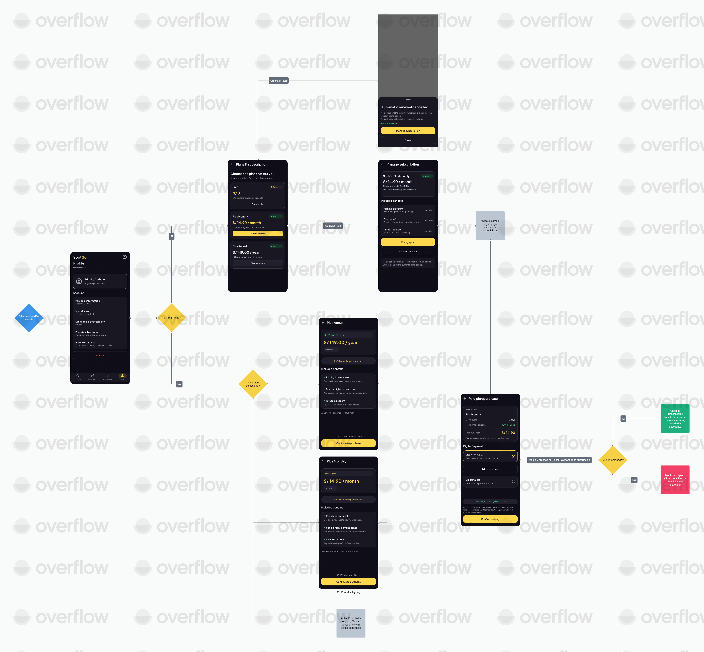

**User Flow 10: Consultar comprobantes y facturas**

**User Goal 10**

Como Driver, quiero consultar mi historial de pagos y obtener mis Virtual Receipts, Electronic Receipts y Electronic Invoices para dar seguimiento a mis operaciones y gastos de estacionamiento.

**Task Flow**

1. El Driver inicia sesión en SpotGo.
2. Accede a la sección Payments o Receipts and Invoices.
3. El sistema muestra el historial de operaciones (Reservations, Parking Sessions vinculadas a una Reservation, Subscriptions y Additional Charges) y los documentos disponibles.
4. El Driver selecciona una transacción.
5. El sistema muestra el detalle de la operación y del documento disponible.
6. El Driver solicita descargar el documento en PDF o enviarlo a su correo electrónico registrado.
7. El sistema procesa la solicitud, entrega o envía el documento cuando está disponible y conserva la operación en el historial.
8. Si la operación tiene un Refund o un Outstanding Balance asociado, el sistema muestra el estado del ajuste, el importe correspondiente y su relación con la operación original.
9. Si no existen documentos disponibles para la operación seleccionada, el sistema informa que no hay un documento disponible.

**Tipos de documentos y registros contemplados**

- Virtual Receipt.
- Electronic Receipt.
- Electronic Invoice.
- Refund.
- Outstanding Balance.
- Additional Charge.

**User Flow**

*Figura 86 (User Flow 10: Consultar comprobantes y facturas)*  
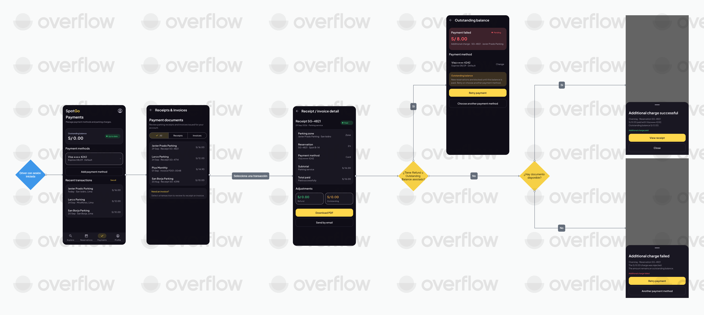

**Parking Admin User Flows**

**User Flow 11: Acceder al panel administrativo**

**User Goal 11**

Como Parking Admin, quiero iniciar sesión en SpotGo para acceder a las funciones administrativas habilitadas para mi Tenant.

**Task Flow**

1. El Parking Admin abre SpotGo.
2. Selecciona la opción de inicio de sesión con credenciales SpotGo o con Google.
3. Ingresa sus credenciales o completa la autenticación de Google.
4. El sistema valida las credenciales (o el ID token de Google) y que la cuenta esté activa.
5. El sistema identifica el Role y el Tenant asociado a la cuenta.
6. Si el acceso es válido, crea una Session y habilita las funciones administrativas correspondientes al Tenant.
7. El sistema muestra el panel operativo del Parking Admin.
8. Si las credenciales son incorrectas o la cuenta está inactiva, el sistema rechaza el acceso e informa el resultado.
9. Si la Session deja de ser válida cuando el Parking Admin solicita información protegida, el sistema rechaza la solicitud y no entrega datos restringidos.
10. Las cuentas Parking Admin son provisionadas internamente por un SuperAdmin, que asocia la cuenta a un Tenant y envía una invitación de acceso. No existe autorregistro de Parking Admin.
11. Si la cuenta no ha sido provisionada, o si una identidad de Google no tiene una cuenta de Parking Admin provisionada, el sistema no otorga un rol administrativo y el Parking Admin no puede completar el acceso administrativo. En el flujo de acceso público solo se crea una cuenta Driver (User Flow 1).

**User Flow**

*Figura 87 (User Flow 11: Acceder al panel administrativo)*  
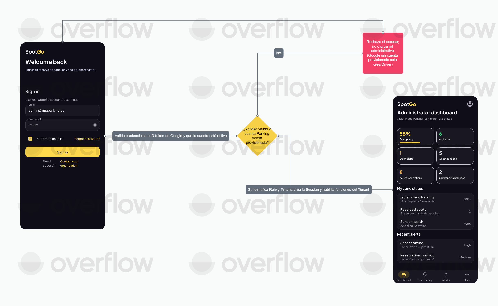

**User Flow 12: Configurar Parking Zones**

**User Goal 12**

Como Parking Admin, quiero crear Parking Zones, asociarlas con User Profiles y configurar sus reglas operativas para organizar los Parking Spots del estacionamiento y aplicar condiciones consistentes de Reservation y facturación.

**Task Flow**

**Precondición:** los Parking Spots del estacionamiento ya están registrados.

1. El Parking Admin inicia sesión y accede a la sección de configuración.
2. Selecciona la opción para crear una Parking Zone.
3. Ingresa los datos de la zona.
4. Configura el horario operativo.
5. Define una billing fraction unit positiva.
6. Selecciona los Parking Spots que pertenecerán a la zona.
7. Asocia los User Profiles autorizados para utilizarla.
8. El sistema valida que los datos de configuración sean correctos.
9. El sistema verifica que los Parking Spots seleccionados no pertenezcan a otra Parking Zone.
10. Si todos los datos son válidos y no existen conflictos, el sistema guarda la zona, sus Parking Spots y las asociaciones con los User Profiles autorizados.
11. Con la configuración guardada, el sistema solo permite Reservations dentro del horario operativo y calcula el tiempo adicional con la billing fraction unit configurada.
12. Si un Parking Spot ya pertenece a otra zona, el sistema identifica el conflicto y no guarda la nueva relación hasta que se resuelva la asignación.
13. Si los datos operativos no son válidos, el sistema solicita su corrección.

**User Flow**

*Figura 88 (User Flow 12: Configurar Parking Zones)*  

**User Flow 13: Cargar Floor Plan y generar Digital Parking Map**

**User Goal 13**

Como Parking Admin, quiero cargar el plano del estacionamiento y configurar sus espacios para generar un Digital Parking Map que represente la infraestructura operativa.

**Task Flow**

1. El Parking Admin inicia sesión y accede a la configuración de infraestructura.
2. Selecciona la opción para cargar o reemplazar el Floor Plan.
3. Selecciona el archivo del plano.
4. El sistema valida que el archivo sea una imagen PNG o JPG.
5. Si el archivo es un PDF, un documento de texto u otro formato no admitido, el sistema lo rechaza, informa que el formato es inválido y permite seleccionar otro.
6. Si el archivo es válido, el sistema lo acepta, lo marca como el Floor Plan autoritativo y lo habilita para el proceso de generación del mapa.
7. Si se reemplaza un plano existente, el sistema conserva la versión anterior para fines de auditoría y usa el nuevo Floor Plan como fuente de la configuración posterior del mapa.
8. El Parking Admin configura los límites del plano y define la ubicación de los Parking Spots y las Parking Zones representados en él.
9. El Parking Admin inicia la generación del Digital Parking Map.
10. Si la información del Floor Plan es insuficiente o ambigua, el sistema no publica un mapa incompleto, informa la limitación y permite continuar con la configuración manual sobre el mismo Floor Plan.
11. Si la configuración está completa y es coherente, el sistema genera el Digital Parking Map, registra los Parking Spots y Parking Zones definidos e inicializa cada espacio como Unavailable hasta recibir datos operativos confiables.
12. El Parking Admin publica el mapa validado.
13. El sistema conserva la configuración publicada para su uso operativo.

**User Flow**

*Figura 89 (User Flow 13: Cargar Floor Plan y generar Digital Parking Map)*  

**User Flow 14: Monitorear ocupación por zona**

**User Goal 14**

Como Parking Admin, quiero monitorear el Occupancy Status de los Parking Spots agrupados por zona, en un resumen operativo centralizado, para supervisar la operación actual del estacionamiento.

**Task Flow**

1. El Parking Admin inicia sesión y abre el Operational Dashboard.
2. El sistema presenta el resumen operativo actual: total de Parking Spots, disponibilidad por Parking Zone, Reservations activas, Guest Parking Sessions abiertas, saldos pendientes (Outstanding Balances) de operaciones de Drivers registrados asociadas al Tenant y alertas operativas pendientes.
3. El Parking Admin revisa el total de Parking Spots y la disponibilidad por Parking Zone.
4. Selecciona una Parking Zone para revisar su estado. Puede filtrar la información por User Profile o por Parking Zone.
5. El sistema agrupa la información por zona y muestra, para cada Parking Spot, el Occupancy Status (Available, Occupied o Unavailable), el Reservation Status cuando corresponde, las Guest Parking Sessions activas y el Sensor Health. El Occupancy Status y el Reservation Status se muestran por separado.
6. Cuando un sensor detecta un cambio de ocupación, el sistema actualiza el Occupancy Status, recalcula la disponibilidad de la zona y la pone a disposición de la aplicación móvil en un máximo de 5 segundos.
7. Si un sensor deja de transmitir datos confiables, el sistema marca el Parking Spot como Unavailable.
8. Mientras el sensor no proporcione datos confiables, el sistema bloquea nuevas Reservations y Guest Parking Sessions para ese espacio, evita cobros automáticos basados en lecturas no confiables, notifica al Parking Admin e inicia la revisión de las Reservations afectadas.
9. El espacio permanece Unavailable hasta que se reciban datos confiables.
10. Cuando los datos vuelven a ser confiables, el sistema muestra el estado operativo sincronizado.
11. Cuando el Parking Admin modifica una configuración, asignación, Reservation, Guest Parking Session o incidencia, el sistema registra en el audit log el usuario, la acción, la fecha, la hora y los datos anteriores y nuevos.

**User Flow**

*Figura 90 (User Flow 14: Monitorear ocupación por zona)*  

**User Flow 15: Gestionar alertas operativas**

**User Goal 15**

Como Parking Admin, quiero revisar y resolver las alertas de Unauthorized Parking y High Capacity para atender incidencias que puedan afectar el funcionamiento del estacionamiento antes de que se vea comprometida la operación.

**Task Flow**

1. El Parking Admin accede al panel operativo.
2. Consulta la sección de alertas.
3. Selecciona una alerta para revisar sus detalles.
4. El sistema presenta la Parking Zone, el Parking Spot y la hora del evento.
5. El Parking Admin revisa los Occupancy Status, Reservation Status, Guest Parking Sessions y Sensor Health relacionados.
6. Identifica el tipo de incidencia:
   - Unauthorized Parking: un Parking Spot Occupied sin Reservation ni Guest Parking Session activa que lo autorice. El sistema lo clasifica como ocupación no validada y no intenta identificar el vehículo mediante imágenes ni datos de placa.
   - Reservation conflict: una Reservation futura asignada a un Parking Spot que sigue ocupado por una Parking Session anterior. El sistema busca un espacio disponible y compatible, conserva el registro de la incidencia y notifica al Parking Admin y al Driver cuando se confirma la reasignación o la alternativa.
   - High Capacity: ver el paso siguiente.
7. Si la alerta corresponde a High Capacity, el sistema la clasifica como crítica cuando la ocupación total del estacionamiento supera el 95% de los Parking Spots operativos disponibles para uso.
8. El Parking Admin registra la clasificación de la incidencia y la acción tomada.
9. Si la acción requerida se completó, marca la alerta como resuelta. El sistema solo la marca como resuelta cuando la acción requerida está completa.
10. El sistema conserva el historial de la incidencia y de la acción administrativa.
11. Si la acción requerida no se ha completado, la alerta permanece pendiente y el sistema informa qué falta atender.

**User Flow**

*Figura 91 (User Flow 15: Gestionar alertas operativas)*  

**User Flow 16: Registrar Guest Parking Session**

**User Goal 16**

Como Parking Admin, quiero registrar y finalizar una Guest Parking Session para atender a los Guests que llegan directamente al estacionamiento sin una cuenta de SpotGo, y que SpotGo calcule su tiempo de estacionamiento mientras el pago físico se liquida a la salida.

**Task Flow**

1. El Guest llega directamente al estacionamiento.
2. El Parking Admin accede a la función de Guest Parking Sessions.
3. Selecciona el Parking Spot que utilizará el Guest.
4. El sistema verifica que el espacio esté Available, tenga datos confiables y no tenga una Reservation activa.
5. El Parking Admin ingresa manualmente la placa del vehículo e inicia la sesión.
6. El sistema valida que existan el Parking Spot, la placa y la hora de ingreso.
7. Si el espacio está disponible y los datos son válidos, el sistema crea una Guest Parking Session activa con el Parking Spot, la placa y la hora de ingreso. No crea una cuenta Driver, no crea un Vehicle persistente, no crea una Reservation y no procesa un pago.
8. Si el espacio tiene una Reservation activa, está ocupado o está Unavailable, o si faltan datos, el sistema rechaza el inicio de la sesión, conserva los registros existentes y solicita seleccionar otro Parking Spot disponible.
9. Cuando el Guest se retira, el Parking Admin selecciona la sesión activa.
10. Registra la hora de salida.
11. El sistema calcula la duración y el importe correspondiente.
12. El Guest realiza el pago físico al Parking Admin mediante efectivo o POS.
13. El Parking Admin confirma el pago físico en el sistema.
14. El sistema valida que exista hora de salida y confirmación de pago.
15. Si los datos están completos, el sistema registra la hora de salida, calcula la duración y el importe, marca la sesión como Closed y conserva la confirmación del pago.
16. Si falta la hora de salida o la confirmación del pago, el sistema rechaza el cierre, mantiene la sesión activa y deja los registros existentes sin cambios.
17. La placa se conserva únicamente como parte del registro de esa sesión.

**Consideraciones de alcance**

- El Guest no necesita una cuenta de SpotGo.
- El Guest no registra un Vehicle persistente ni crea una Reservation.
- SpotGo no procesa el pago físico ni almacena información financiera sensible del Guest.
- La placa se ingresa manualmente; SpotGo no utiliza OCR, IA ni sensores para identificarla.

**User Flow**

*Figura 92 (User Flow 16: Registrar Guest Parking Session)*  

**User Flow 17: Generar reportes de ocupación**

**User Goal 17**

Como Parking Admin, quiero consultar reportes de ocupación agrupados por periodo y Parking Zone para identificar patrones de uso y apoyar decisiones operativas.

**Task Flow**

1. El Parking Admin inicia sesión y accede a la sección de reportes.
2. Selecciona el periodo que desea consultar.
3. Selecciona la Parking Zone correspondiente.
4. El sistema consulta los datos históricos disponibles (Occupancy Status, Reservations, Guest Parking Sessions y Parking Sessions) para los filtros seleccionados.
5. Si existen datos, el sistema agrupa la información por Parking Zone y periodo, y presenta el reporte de ocupación.
6. El Parking Admin revisa los indicadores disponibles: patrones de uso, Guest Parking Sessions completadas, Reservations marcadas como No-show, overstays e incidencias registradas.
7. Si no existen datos para el periodo y la zona seleccionados, el sistema informa que no hay información disponible.
8. El sistema no infiere ni genera valores históricos que no existan en los registros.

**User Flow**

*Figura 93 (User Flow 17: Generar reportes de ocupación)*  

**User Flow 18: Gestionar facturación B2B**

**User Goal 18**

Como Parking Admin, quiero consultar las facturas del servicio SpotGo de mi Tenant y actualizar los datos tributarios autorizados para controlar la facturación B2B de mi estacionamiento.

**Task Flow**

1. El Parking Admin inicia sesión y accede a la sección B2B Billing.
2. El sistema muestra las facturas del servicio SpotGo asociadas al Tenant activo.
3. El Parking Admin revisa el estado, la fecha y el importe de las facturas.
4. Si necesita modificar los datos tributarios, selecciona la opción de actualización.
5. Ingresa los datos nuevos, como RUC o dirección.
6. El sistema valida que la modificación esté autorizada y que los datos sean válidos.
7. Si la validación es correcta, el sistema guarda los nuevos datos y los usa para las futuras facturas B2B.
8. Si la validación falla o la modificación no está autorizada, el sistema rechaza la actualización y conserva los datos tributarios anteriores.

**User Flow**

*Figura 94 (User Flow 18: Gestionar facturación B2B)*  

#### *3.1.4.5. Applications Prototypes*

Los prototipos interactivos de SpotGo permiten validar la navegación y los principales flujos definidos para los perfiles Driver y Parking Admin.

**Driver Prototype:** [https://www.figma.com/proto/sQ2XbvLctkCFweIj0w0SjQ/SpotGo-Design?node-id=1-4&p=f&t=fXxztYJQpDayYoxc-0&scaling=min-zoom&content-scaling=fixed&starting-point-node-id=73%3A2736](https://www.figma.com/proto/sQ2XbvLctkCFweIj0w0SjQ/SpotGo-Design?node-id=1-4&p=f&t=fXxztYJQpDayYoxc-0&scaling=min-zoom&content-scaling=fixed&starting-point-node-id=73%3A2736)

**Parking Admin Prototype:** [https://www.figma.com/proto/sQ2XbvLctkCFweIj0w0SjQ/SpotGo-Design?node-id=1-5&p=f&t=fXxztYJQpDayYoxc-0&scaling=min-zoom&content-scaling=fixed&starting-point-node-id=65%3A5626](https://www.figma.com/proto/sQ2XbvLctkCFweIj0w0SjQ/SpotGo-Design?node-id=1-5&p=f&t=fXxztYJQpDayYoxc-0&scaling=min-zoom&content-scaling=fixed&starting-point-node-id=65%3A5626)
