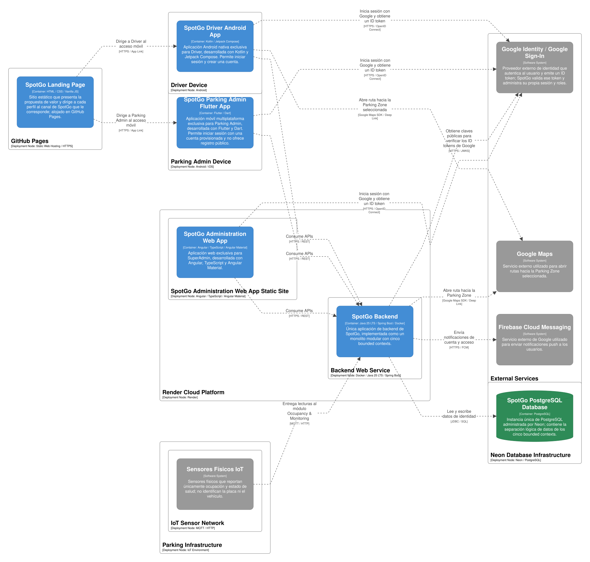

# Capítulo IV: Product Implementation & Validation

## 4. Product Implementation & Validation

### 4.1. Software Configuration Management

Para garantizar un desarrollo fluido, estandarizado y compatible entre todos los miembros del equipo Yachiqo, se ha definido el siguiente entorno de desarrollo para el ecosistema SpotGo:

#### 4.1.1. Software Development Environment Configuration

Se listan a continuación las herramientas utilizadas y previstas a lo largo del ciclo de vida del proyecto, desde la gestión de requisitos hasta el despliegue de componentes:

- **Project & Requirements Management:**
  - **Trello:** Herramienta SaaS para la gestión ágil del Product Backlog, Sprints y seguimiento de User Stories. [Referencia: trello.com](https://trello.com/)
  - **UXPressia:** Herramienta SaaS para la elaboración de mapas de empatía, Journey Maps y User Personas. [Referencia: uxpressia.com](https://uxpressia.com/)
- **Modelado y diagramación:**
  - **Lucidchart:** Utilizado para el diagrama de base de datos, los User Flows y los Wireflows. [Referencia: Lucidchart](https://www.lucidchart.com/)
  - **PlantUML y Structurizr DSL:** Utilizados para los diagramas UML y las vistas C4 de la arquitectura, respectivamente.
- **Product UX/UI Design:**
  - **Figma:** Herramienta para la creación colaborativa de Wireframes, Mock-ups y Prototipos interactivos. [Referencia: figma.com](https://www.figma.com/)
- **Herramientas de Desarrollo (IDEs y Editores):**
  - **Android Studio:** IDE para desarrollar, compilar y ejecutar la parte Kotlin con Jetpack Compose y ensamblar la aplicación Android. [Descarga: Android Studio](https://developer.android.com/studio)
  - **Visual Studio Code:** Editor para la Landing Page y el desarrollo de las aplicaciones Flutter y Angular. [Descarga: Visual Studio Code](https://code.visualstudio.com/download)
  - **IntelliJ IDEA:** IDE optimizado para el desarrollo del Backend con Java y Spring Boot. [Descarga: jetbrains.com/idea](https://www.jetbrains.com/idea/)
- **Stack Tecnológico y Entorno de Ejecución:**
  - **Kotlin & Jetpack Compose:** Lenguaje y toolkit para la aplicación Android nativa de Driver, que permite iniciar sesión y registrarse. [Referencia: Kotlin](https://kotlinlang.org/docs/home.html) y [Jetpack Compose](https://developer.android.com/develop/ui/compose/documentation)
  - **Flutter & Dart:** Framework multiplataforma y lenguaje para la aplicación independiente de Parking Admin, que utiliza cuentas provisionadas y permite iniciar sesión sin registro público. [Instalación: Flutter](https://docs.flutter.dev/install) y [Referencia: Dart](https://dart.dev/guides)
  - **Angular, TypeScript y Angular Material:** Tecnologías de la página web administrativa de SpotGo, destinada únicamente a SuperAdmin. [Angular](https://angular.dev/), [TypeScript](https://www.typescriptlang.org/docs/) y [Angular Material](https://material.angular.dev/)
  - **Android SDK y Gradle Wrapper:** Herramientas de compilación e instalación. El proyecto Android configura SDK 37, Android 10/API 29 como mínimo y JDK 25 para el daemon de Gradle, según `app/build.gradle.kts` y `gradle/gradle-daemon-jvm.properties`; este JDK es independiente del utilizado por el backend. [Referencia: SDK Manager](https://developer.android.com/studio/intro/update#sdk-manager) y [Gradle Wrapper](https://docs.gradle.org/current/userguide/gradle_wrapper.html)
  - **HTML5 / CSS3 / JavaScript (Vanilla JS):** Stack base sin frameworks para la Landing Page pública. [Referencia: MDN Web Docs](https://developer.mozilla.org/en-US/docs/Web)
  - **Java Development Kit (JDK 25 LTS):** Entorno de compilación y ejecución del Backend en Spring Boot, alineado con `java.version` en `pom.xml`. [Documentación de Java SE 25](https://docs.oracle.com/en/java/javase/25/)
  - **Maven Wrapper:** Ejecuta las tareas de compilación y empaquetado del backend mediante `mvnw` o `mvnw.cmd`, sin exigir una instalación global de Maven. [Referencia: Maven Wrapper](https://maven.apache.org/wrapper/)
  - **PostgreSQL (en Neon):** Motor de base de datos relacional Serverless alojado en la nube en la plataforma Neon. [Referencia: neon.tech](https://neon.tech/)
- **Herramientas de Pruebas, Documentación y Despliegue:**
  - **Postman:** Plataforma para verificar y ejecutar pruebas de integración sobre los endpoints de la API RESTful. [Descarga: postman.com](https://www.postman.com/downloads/)
  - **Swagger / OpenAPI:** Documentación interactiva de la API generada desde Spring Boot mediante Springdoc. [Referencia: Springdoc](https://springdoc.org/)
  - **Render:** Plataforma para desplegar el Backend como Web Service y la aplicación web administrativa como Static Site. [Web Services](https://render.com/docs/web-services), [Static Sites](https://render.com/docs/static-sites) y [Docker](https://render.com/docs/docker).
  - **GitHub Pages:** Hosting de la Landing Page estática. [Referencia: GitHub Pages](https://docs.github.com/en/pages)
  - **Git & GitHub:** Control de versiones, colaboración y repositorios de código fuente. [Descarga: Git](https://git-scm.com/downloads) y [Referencia: GitHub](https://docs.github.com/)
  - **Firebase App Distribution:** Plataforma prevista para distribuir las versiones de prueba de las dos aplicaciones móviles a usuarios de prueba al finalizar el Sprint 3. [Referencia: Firebase App Distribution](https://firebase.google.com/docs/app-distribution/)

#### 4.1.2. Source Code Management

El código fuente del proyecto SpotGo se gestiona mediante **Git** como sistema de control de versiones distribuido y **GitHub** como plataforma de alojamiento y colaboración. La organización oficial del equipo es **Yachiqo** (`yachiqo-upc`), y los repositorios correspondientes al proyecto son:

- **Landing Page:** [https://github.com/yachiqo-upc/spotgo-landing.git](https://github.com/yachiqo-upc/spotgo-landing.git)
- **SpotGo Driver Android App (Kotlin / Jetpack Compose):** [https://github.com/yachiqo-upc/spotgo-android-app.git](https://github.com/yachiqo-upc/spotgo-android-app.git). El repositorio incluye las pantallas iniciales de los dos perfiles elaboradas durante el Sprint 1; la aplicación final de Parking Admin se desarrolla por separado en Flutter.
- **SpotGo Parking Admin Flutter App:** [https://github.com/yachiqo-upc/spotgo-flutter-app.git](https://github.com/yachiqo-upc/spotgo-flutter-app.git).
- **Página web administrativa de SpotGo (Angular / TypeScript):** [https://github.com/yachiqo-upc/spotgo-admin-web-app.git](https://github.com/yachiqo-upc/spotgo-admin-web-app.git).
- **RESTful Web Services (Backend):** [https://github.com/yachiqo-upc/spotgo-backend.git](https://github.com/yachiqo-upc/spotgo-backend.git)

**Estrategia de Ramas (GitFlow)**
Se establece un flujo de trabajo estructurado basado en GitFlow para asegurar la estabilidad del software:
- `main`: Rama de producción. Almacena versiones estables, probadas y desplegadas.
- `develop`: Rama de integración continua donde se consolidan las funcionalidades antes de ser promovidas a producción.
- `feature/US[ID]-[nombre]`: Ramas cortas creadas desde `develop` para el trabajo de User Stories específicas (ej. `feature/US01-consult-availability`).
- `release/v[X.Y.Z]`: Ramas de preparación previas a un lanzamiento para realizar pruebas finales.
- `hotfix/[nombre]`: Ramas para corregir errores urgentes detectados en la rama `main`.

**Convenciones de Versionado y Commits**
- **Semantic Versioning (SemVer 2.0.0):** Etiquetado de versiones en `main` bajo el formato `vMAJOR.MINOR.PATCH` (ej. v1.0.0).
- **Conventional Commits 1.0.0:** Todos los commits deben emplear un formato claro (`tipo(alcance): descripción breve`), utilizando tipos como `feat`, `fix`, `docs`, `style`, `refactor` o `test` (ej. `feat(parking): add spot status endpoint`, `docs: add Parking Admin to chapter 2`).

#### 4.1.3. Source Code Style Guide & Conventions

Se establece el uso estricto del idioma **inglés (en_US)** para la denominación de archivos, clases, métodos, variables, tablas y comentarios dentro del código fuente. Se adoptan las siguientes guías de estilo:

- **Landing Page (HTML5 / CSS / Vanilla JS):** Se siguen la [W3Schools HTML Style Guide](https://www.w3schools.com/html/html5_syntax.asp) y la [Google HTML/CSS Style Guide](https://google.github.io/styleguide/htmlcssguide.html). Para JavaScript se adopta la [Google JavaScript Style Guide](https://google.github.io/styleguide/jsguide.html): `lowerCamelCase` para variables y funciones, `UpperCamelCase` para clases, `const` para referencias que no se reasignan y `let` cuando la reasignación es necesaria. Los archivos utilizan nombres descriptivos en minúsculas, los bloques mantienen una indentación consistente y se emplean módulos y funciones con responsabilidades definidas.
- **SpotGo Driver Android App (Kotlin / Jetpack Compose):** Se aplica la [Kotlin Coding Conventions](https://kotlinlang.org/docs/coding-conventions.html) y las recomendaciones oficiales de arquitectura de Android.
- **SpotGo Parking Admin Flutter App (Flutter / Dart):** Se sigue la [Effective Dart Guide](https://dart.dev/guides/language/effective-dart) (`lowerCamelCase` para variables y funciones, `PascalCase` para clases y widgets, `lowercase_with_underscores` para nombres de archivos).
- **SpotGo Administration Web App (Angular / TypeScript):** Se aplican las guías oficiales de estilo de Angular y TypeScript y las convenciones de Angular Material.
- **Backend (Java / Spring Boot):** Cumplimiento de la [Google Java Style Guide](https://google.github.io/styleguide/javaguide.html). La arquitectura respeta la separación en capas (Controllers, Services, Repositories, Entities/DTOs) y las rutas RESTful utilizan sustantivos en plural y minúsculas separados por guiones (ej. `GET /api/v1/parking-zones`).
- **Criterios de Aceptación:** Uso de las [Gherkin Conventions](https://specflow.org/gherkin/gherkin-conventions-for-readable-specifications/) en inglés mediante la estructura `Given - When - Then`.

#### 4.1.4. Software Deployment Configuration

La Landing Page se publica en **GitHub Pages**. El Backend se despliega en **Render** como Web Service y se conecta con PostgreSQL en **Neon**. La página web administrativa de SpotGo para SuperAdmin se despliega en Render como Static Site y se desarrolla con Angular, TypeScript y Angular Material. Las aplicaciones móviles de Driver y Parking Admin son clientes independientes y se distribuirán por separado mediante **Firebase App Distribution** al cierre del Sprint 3.

**Landing Page: GitHub Pages**

1. Clonar `spotgo-landing` y comprobar que `index.html`, `styles.css`, `main.js`, `assets/` e `i18n/` estén disponibles en la raíz del proyecto. Al ser un sitio estático con Vanilla JS, no requiere compilar un framework ni instalar dependencias con npm.
2. Revisar localmente desde un servidor HTTP, por ejemplo `python -m http.server 5500`, y abrir `http://localhost:5500`. El servidor permite cargar las traducciones mediante `fetch`; abrir directamente el archivo HTML no reproduce ese comportamiento.
3. Integrar la versión validada en `main`. En **Settings → Pages**, seleccionar **Deploy from a branch**, la rama **main** y la carpeta **/(root)**, y guardar la configuración. Este procedimiento sigue la [configuración de publicación de GitHub Pages](https://docs.github.com/en/pages/getting-started-with-github-pages/configuring-a-publishing-source-for-your-github-pages-site).
4. Comprobar la ejecución de la publicación y abrir [SpotGo Landing Page](https://yachiqo-upc.github.io/spotgo-landing/). Verificar navegación, diseño adaptable, carga de imágenes y traducciones; los recursos deben conservar rutas relativas compatibles con `/spotgo-landing/`.

**Backend: Render Web Service y PostgreSQL**

1. Clonar `spotgo-backend`, instalar JDK 25 LTS y comprobar `java -version`. Desde la raíz, empaquetar con `./mvnw.cmd -B -DskipTests package` en Windows o `./mvnw -B -DskipTests package` en Linux/macOS. El empaquetado genera `target/spotgo-1.0.0.jar` según el `pom.xml`; `-DskipTests` solo omite pruebas durante este paso y no constituye evidencia de validación.
2. Crear o seleccionar la base PostgreSQL de Neon que utilizará el servicio y obtener su host, nombre de base, usuario y contraseña. Preparar una URL JDBC con el formato `jdbc:postgresql://<host>/<database>?sslmode=require`; los valores reales se configuran como variables del servicio.
3. En Render, crear o seleccionar el Web Service conectado al repositorio `yachiqo-upc/spotgo-backend` y a la rama `main`. Render no ofrece un runtime nativo para Java; el servicio debe ejecutarse con una imagen Docker de Java 25 LTS, construida desde un Dockerfile o publicada previamente en un registro. Consultar la [guía oficial de Docker en Render](https://render.com/docs/docker).
4. Configurar en **Environment** las variables siguientes, correspondientes a las propiedades del proyecto. Render administra las variables y los secretos desde el panel del servicio, y los aplica al próximo despliegue ([documentación](https://render.com/docs/configure-environment-variables)):

| Variable | Configuración o propósito |
| --- | --- |
| `SPRING_PROFILES_ACTIVE` | `production`, para activar `application-production.properties`. |
| `SPRING_DATASOURCE_URL` | URL JDBC de la base PostgreSQL de Neon con SSL. |
| `SPRING_DATASOURCE_USERNAME` | Usuario autorizado de la base. |
| `SPRING_DATASOURCE_PASSWORD` | Contraseña del usuario, configurada como secreto. |
| `JWT_SECRET` | Secreto de firma de los tokens de SpotGo, configurado como secreto. |
| `PORT` | Puerto HTTP asignado al Web Service. `server.port` consume este valor. |
| `APP_PASSWORD_RESET_FROM_EMAIL` | Remitente autorizado para correos de recuperación. |
| `RESEND_API_KEY` | Credencial de envío cuando se habilita la recuperación por correo. |
| `RESEND_API_URL` | URL del servicio de correo; utiliza el valor predeterminado del proyecto si no se redefine. |
| `APP_SEEDER_RESET_BEFORE_SEED` | `false`, para conservar los registros existentes al iniciar. |
| `SPRING_JPA_HIBERNATE_DDL_AUTO` | `validate` sobre un esquema previamente inicializado; `create` se limita a una base vacía de demostración durante su inicialización. |

5. Preparar el esquema antes del primer arranque. El proyecto configura `ddl-auto=create` y contiene un seeder que también participa en `production`: para una base vacía de demostración se puede inicializar el esquema con `create` de forma controlada, y los arranques posteriores deben utilizar `validate` con el reinicio de datos desactivado. Una base con datos existentes requiere un esquema compatible antes de activar `validate`.
6. Incluir en la imagen Docker el artefacto `target/spotgo-1.0.0.jar` y ejecutar `java -jar target/spotgo-1.0.0.jar`. Si se cambia la versión del proyecto, actualizar también el nombre del JAR. El Web Service debe escuchar en el puerto que Render asigna mediante `PORT` y aceptar tráfico externo.
7. Ejecutar el despliegue y revisar los logs de compilación, inicio y conexión PostgreSQL. Render asigna una URL HTTPS al servicio. Comprobar `/v3/api-docs`, `/swagger-ui/index.html` y una operación pública documentada. Las [verificaciones de estado de Render](https://render.com/docs/health-checks) permiten comprobar que el servicio puede recibir tráfico.

El procedimiento anterior utiliza la conexión configurada por el servicio Spring Boot actual. La arquitectura objetivo del capítulo II separa la persistencia en cinco bases lógicas dentro de una sola instancia PostgreSQL; al desplegar servicios independientes, cada contexto debe recibir únicamente las credenciales de su propia base. La URL de un servicio no demuestra por sí sola que toda esa distribución esté implementada.

**SpotGo Driver Android App: Kotlin y Jetpack Compose**

1. Clonar `spotgo-android-app` y abrir la raíz del proyecto en Android Studio. Instalar Android SDK 37 y utilizar JDK 25 para Gradle, conforme a `gradle/gradle-daemon-jvm.properties`. Seleccionar un emulador o dispositivo Android 10/API 29 o superior y sincronizar el proyecto.
2. Desde la raíz Android, generar la versión de prueba con `./gradlew.bat :app:assembleDebug`. El APK se obtiene en `app/build/outputs/apk/debug/app-debug.apk`. Para instalarlo en el dispositivo o emulador conectado, ejecutar `./gradlew.bat :app:installDebug`. En Linux/macOS se utiliza `./gradlew`.
3. Para una entrega release, configurar el almacén de claves, su alias y la firma mediante **Build → Generate Signed Bundle / APK** en Android Studio. Los secretos de firma se mantienen fuera del repositorio. Con la firma configurada, ejecutar `./gradlew.bat :app:assembleRelease` para el APK o `./gradlew.bat :app:bundleRelease` para el AAB; las salidas se conservan en `app/build/outputs/apk/release/` y `app/build/outputs/bundle/release/`, respectivamente.
4. Instalar el APK y comprobar el inicio, el registro público y la navegación de Driver. El AAB se utiliza para distribución mediante un servicio que genere los APK correspondientes y no se instala directamente en el dispositivo. Estas tareas siguen la documentación de [compilación de Android](https://developer.android.com/build/building-cmdline) y [firma de aplicaciones](https://developer.android.com/studio/publish/app-signing).

El repositorio Android inspeccionado contiene las pantallas iniciales de Driver y Parking Admin construidas con Kotlin y Jetpack Compose durante el Sprint 1. La aplicación final de Driver se completará en este cliente nativo; la aplicación final de Parking Admin se desarrollará por separado con Flutter.

**SpotGo Parking Admin Flutter App: Flutter y Dart**

La aplicación de Parking Admin es un cliente móvil independiente y multiplataforma. Se desarrollará con Flutter y Dart, permitirá iniciar sesión con una cuenta provisionada y no incluirá registro público. Cuando su repositorio esté disponible, se documentarán sus instrucciones de compilación; para generar un paquete Android de prueba se utilizará `flutter build apk`.

**SpotGo Administration Web App: Angular y Render Static Site**

La página web administrativa de SpotGo es exclusiva para SuperAdmin y se desarrolla con Angular, TypeScript y Angular Material. Se publica en Render como Static Site, separada del Backend Web Service. Para configurarla, se conecta el repositorio `spotgo-admin-web-app`, se selecciona la rama `main`, se define el comando de compilación disponible en `package.json` y se indica el directorio generado por Angular según `angular.json`. Render publica los archivos estáticos en una URL HTTPS y puede desplegar automáticamente los cambios de la rama configurada ([Static Sites](https://render.com/docs/static-sites)). Si la aplicación usa rutas del lado del cliente, se configura la reescritura necesaria hacia `index.html` ([redirects and rewrites](https://render.com/docs/redirects-rewrites)).

**Distribución móvil: Firebase App Distribution**

Al finalizar el Sprint 3, se cargarán por separado las versiones Android de la aplicación nativa de Driver y la aplicación Flutter de Parking Admin en Firebase App Distribution. Se habilitará el acceso de los usuarios de prueba y se comprobará la instalación y ejecución de cada paquete. Firebase App Distribution admite la distribución de versiones Android a usuarios de prueba desde la consola, Firebase CLI o Gradle ([documentación](https://firebase.google.com/docs/app-distribution/)).

**Diagrama C4 de despliegue**

La vista de despliegue presenta la distribución propuesta de clientes, servicios, instancia PostgreSQL y sensores. Su explicación corresponde a la sección 2.5.3.3. Software Architecture Deployment Diagrams.

*Figura 79 (Diagrama C4 de despliegue)*

### 4.2. Landing Page & Mobile Application Implementation

Esta sección presenta, para cada sprint, la planificación y las evidencias de desarrollo, pruebas, ejecución, documentación de servicios, despliegue y colaboración del equipo correspondientes a los productos digitales de SpotGo: la Landing Page, los servicios backend, la aplicación Android de Driver, la aplicación Flutter de Parking Admin y la aplicación web Angular de SuperAdmin. Cada sprint reúne los artefactos y resultados que permiten documentar el avance de la solución según su alcance.
