### 4.2.1. Sprint 1

Durante el primer sprint nos centramos en el desarrollo y despliegue de la versión inicial de la Landing Page, distribuyendo sus secciones entre los integrantes del equipo. En ella presentamos SpotGo, sus funcionalidades, planes, medios de contacto y la organización. Confirmamos un avance del 70% en el despliegue del backend. Además, presentamos las pantallas principales de Driver y Parking Admin desarrolladas inicialmente con Jetpack Compose. La aplicación final de Driver será nativa Android; la aplicación final de Parking Admin se desarrollará por separado con Flutter.

#### *4.2.1.1. Sprint Planning 1*

<table>
  <tr>
    <td><strong>Sprint #</strong></td>
    <td>Sprint 1</td>
  </tr>
  <tr>
    <th colspan="2" align="left">Sprint Planning Background</th>
  </tr>
  <tr>
    <td><strong>Date</strong></td>
    <td>2026-10-05</td>
  </tr>
  <tr>
    <td><strong>Time</strong></td>
    <td>5:00 PM</td>
  </tr>
  <tr>
    <td><strong>Location</strong></td>
    <td>Reuni&#243;n virtual</td>
  </tr>
  <tr>
    <td><strong>Prepared By</strong></td>
    <td>Nestor Rojas Tello</td>
  </tr>
  <tr>
    <td><strong>Attendees (to planning meeting)</strong></td>
    <td>Carhuaz Centeno, Briguite Eryka / Contreras Rojas, Cesar Jair / Cotrina Siclla, Sofia Alessandra / Rojas Tello, Nestor Alonso / Ruiz Mideyros, Adrian.</td>
  </tr>
  <tr>
    <td><strong>Sprint 0 Review Summary</strong></td>
    <td>No aplica, por ser el primer sprint.</td>
  </tr>
  <tr>
    <td><strong>Sprint 0 Retrospective Summary</strong></td>
    <td>No aplica, por ser el primer sprint.</td>
  </tr>
  <tr>
    <th colspan="2" align="left">Sprint Goal &amp; User Stories</th>
  </tr>
  <tr>
    <td><strong>Sprint 1 Goal</strong></td>
    <td>Desplegar la versi&#243;n inicial de la Landing Page (US11 y US12), alcanzar un avance del 70% en el despliegue del backend y presentar las pantallas core de la aplicaci&#243;n m&#243;vil: autenticaci&#243;n y acceso por rol (US09), registro de cuenta (US13), consulta de disponibilidad y zonas permitidas (US01 y US04), gesti&#243;n de reservas y comprobantes virtuales (US18), pagos (US19), carga de plano, generaci&#243;n del mapa digital y configuraci&#243;n de zonas (US16, US17 y US02). Estas HU orientan tanto las pantallas core como las funcionalidades del Backend que las respaldan. El cumplimiento se verificar&#225; mediante la publicaci&#243;n de la versi&#243;n inicial de la Landing Page, el porcentaje de funcionalidades backend desplegadas respecto al total previsto y la demostraci&#243;n de las pantallas core.</td>
  </tr>
  <tr>
    <td><strong>Sprint 1 Velocity</strong></td>
    <td>39 Story Points como capacidad planificada para el Sprint 1, correspondientes a las 11 historias de usuario seleccionadas.</td>
  </tr>
  <tr>
    <td><strong>Sum of Story Points</strong></td>
    <td>39 Story Points: 35 de las nueve HU seleccionadas y 4 de las HU de la Landing Page (US11 y US12), seg&#250;n las estimaciones del Product Backlog.</td>
  </tr>
</table>

#### *4.2.1.2. Aspect Leaders and Collaborators*

La Leadership-and-Collaboration Matrix (LACX) identifica al líder y los colaboradores de cada aspecto del Sprint 1 para facilitar la coordinación y comunicación del equipo. Se consideran la Landing Page, la autenticación y el registro, la disponibilidad, las reservas y pagos, y la configuración del estacionamiento.

**L (Leader)** identifica a quien coordina el aspecto y revisa sus entregables; **C (Collaborator)** identifica a quienes contribuyen a su desarrollo y revisión. La siguiente distribución corresponde a la organización del equipo durante el Sprint 1.

<table>
  <tr>
    <th align="left">Team Member<br>(Last Name, First Name)</th>
    <th align="left">GitHub Username</th>
    <th align="center">Landing Page</th>
    <th align="center">Autenticación y registro</th>
    <th align="center">Disponibilidad y permisos</th>
    <th align="center">Reservas y pagos</th>
    <th align="center">Zonas, planos, mapa y dashboard</th>
  </tr>
  <tr>
    <td align="left">Carhuaz Centeno, Briguite Eryka</td>
    <td align="left">@briicarhuaz</td>
    <td align="center">C</td>
    <td align="center">C</td>
    <td align="center"><strong>L</strong></td>
    <td align="center">C</td>
    <td align="center">C</td>
  </tr>
  <tr>
    <td align="left">Contreras Rojas, Cesar Jair</td>
    <td align="left">@CesarJrCR</td>
    <td align="center">C</td>
    <td align="center">C</td>
    <td align="center">C</td>
    <td align="center"><strong>L</strong></td>
    <td align="center">C</td>
  </tr>
  <tr>
    <td align="left">Cotrina Siclla, Sofia Alessandra</td>
    <td align="left">@IamAndreek</td>
    <td align="center">C</td>
    <td align="center">C</td>
    <td align="center">C</td>
    <td align="center">C</td>
    <td align="center"><strong>L</strong></td>
  </tr>
  <tr>
    <td align="left">Rojas Tello, Nestor Alonso</td>
    <td align="left">@nes-ro</td>
    <td align="center">C</td>
    <td align="center"><strong>L</strong></td>
    <td align="center">C</td>
    <td align="center">C</td>
    <td align="center">C</td>
  </tr>
  <tr>
    <td align="left">Ruiz Mideyros, Adrian</td>
    <td align="left">@AdrixRyz</td>
    <td align="center"><strong>L</strong></td>
    <td align="center">C</td>
    <td align="center">C</td>
    <td align="center">C</td>
    <td align="center">C</td>
  </tr>
</table>

#### *4.2.1.3. Sprint Backlog 1*

El Sprint Backlog 1 reúne las tareas necesarias para desarrollar las historias de usuario seleccionadas, indicando sus responsables y estado de avance.

**Trello Board Link:** [https://trello.com/invite/b/6aa6e46ebebf57986f7fcd37/ATTIc1ae2804c4145e3b8bfd53325b170b9bFBAEB587/spotgo-trello-board](https://trello.com/invite/b/6aa6e46ebebf57986f7fcd37/ATTIc1ae2804c4145e3b8bfd53325b170b9bFBAEB587/spotgo-trello-board)

*Figura 94 (Trello Board: Sprint Backlog 1)*  
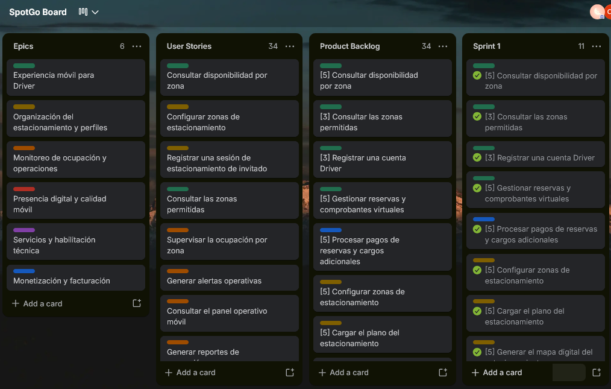

El siguiente desglose presenta las tareas realizadas durante el Sprint 1, sus responsables y su estado de finalización, de acuerdo con la distribución de liderazgo y colaboración de la matriz LACX.

<table>
  <thead>
    <tr><th colspan="3">User Story</th><th colspan="6">Work-Item / Task</th></tr>
    <tr><th>Id</th><th>Title</th><th>Story Points</th><th>Id</th><th>Title</th><th>Description</th><th>Estimation (Hours)</th><th>Assigned To</th><th>Status</th></tr>
  </thead>
  <tbody>
    <tr>
      <td rowspan="2">US01</td><td rowspan="2">Consultar disponibilidad por zona</td><td rowspan="2" align="center">5</td>
      <td>T01</td><td>Pantalla de disponibilidad</td><td>Mostrar espacios disponibles por zona y la fecha de actualizaci&#243;n.</td><td>1</td><td>@briicarhuaz</td><td>Done</td>
    </tr>
    <tr>
      <td>T02</td><td>Consulta de disponibilidad</td><td>Desarrollar la consulta backend de disponibilidad prevista para este sprint.</td><td>2</td><td>@briicarhuaz</td><td>Done</td>
    </tr>
    <tr>
      <td rowspan="2">US04</td><td rowspan="2">Consultar las zonas permitidas</td><td rowspan="2" align="center">2</td>
      <td>T03</td><td>Pantalla de zonas permitidas</td><td>Mostrar las zonas habilitadas para el perfil del Driver.</td><td>0.5</td><td>@briicarhuaz</td><td>Done</td>
    </tr>
    <tr>
      <td>T04</td><td>Consulta de permisos</td><td>Implementar la consulta de zonas seg&#250;n el perfil del Driver.</td><td>1</td><td>@briicarhuaz</td><td>Done</td>
    </tr>
    <tr>
      <td rowspan="2">US13</td><td rowspan="2">Registrar una cuenta Driver</td><td rowspan="2" align="center">2</td>
      <td>T05</td><td>Pantalla de registro</td><td>Desarrollar el formulario de registro y sus mensajes de validaci&#243;n.</td><td>1</td><td>@nes-ro</td><td>Done</td>
    </tr>
    <tr>
      <td>T06</td><td>Registro de cuenta</td><td>Implementar la creaci&#243;n de cuenta y perfil Driver reutilizando los mecanismos de IAM.</td><td>1.5</td><td>@nes-ro</td><td>Done</td>
    </tr>
    <tr>
      <td rowspan="2">US18</td><td rowspan="2">Gestionar reservas y comprobantes virtuales</td><td rowspan="2" align="center">5</td>
      <td>T07</td><td>Pantallas de reservas</td><td>Presentar las vistas de creaci&#243;n y consulta de reservas.</td><td>1.5</td><td>@CesarJrCR</td><td>Done</td>
    </tr>
    <tr>
      <td>T08</td><td>Comprobante virtual y servicios</td><td>Presentar el comprobante virtual y desarrollar el avance de servicios de reservas previsto para el sprint.</td><td>2</td><td>@CesarJrCR</td><td>Done</td>
    </tr>
    <tr>
      <td rowspan="2">US19</td><td rowspan="2">Procesar pagos de reservas y cargos adicionales</td><td rowspan="2" align="center">5</td>
      <td>T09</td><td>Pantalla de pagos</td><td>Presentar el flujo de pago de reservas y cargos adicionales.</td><td>1.5</td><td>@CesarJrCR</td><td>Done</td>
    </tr>
    <tr>
      <td>T10</td><td>Servicios de pago</td><td>Desarrollar el avance backend del procesamiento de pagos previsto para este sprint.</td><td>2</td><td>@CesarJrCR</td><td>Done</td>
    </tr>
    <tr>
      <td rowspan="2">US02</td><td rowspan="2">Configurar zonas de estacionamiento</td><td rowspan="2" align="center">5</td>
      <td>T11</td><td>Pantalla de zonas</td><td>Desarrollar la interfaz de configuraci&#243;n de zonas y sus reglas.</td><td>1.5</td><td>@IamAndreek</td><td>Done</td>
    </tr>
    <tr>
      <td>T12</td><td>Configuraci&#243;n de zonas</td><td>Implementar el avance de servicios para registrar zonas y asociar espacios y perfiles.</td><td>2</td><td>@IamAndreek</td><td>Done</td>
    </tr>
    <tr>
      <td rowspan="2">US16</td><td rowspan="2">Cargar el plano del estacionamiento</td><td rowspan="2" align="center">3</td>
      <td>T13</td><td>Pantalla de carga de plano</td><td>Desarrollar la selecci&#243;n y carga del plano del estacionamiento.</td><td>1</td><td>@IamAndreek</td><td>Done</td>
    </tr>
    <tr>
      <td>T14</td><td>Validaci&#243;n del plano</td><td>Implementar la validaci&#243;n de formato y almacenamiento del plano.</td><td>1.5</td><td>@IamAndreek</td><td>Done</td>
    </tr>
    <tr>
      <td rowspan="2">US17</td><td rowspan="2">Generar el mapa digital del estacionamiento</td><td rowspan="2" align="center">5</td>
      <td>T15</td><td>Pantalla de mapa digital</td><td>Presentar la configuraci&#243;n del mapa digital a partir del plano cargado.</td><td>1.5</td><td>@IamAndreek</td><td>Done</td>
    </tr>
    <tr>
      <td>T16</td><td>Generaci&#243;n del mapa</td><td>Desarrollar el avance de generaci&#243;n de zonas y espacios a partir del plano previsto para el sprint.</td><td>2</td><td>@IamAndreek</td><td>Done</td>
    </tr>
    <tr>
      <td rowspan="2">US09</td><td rowspan="2">Autenticarse y acceder a las funciones de SpotGo según el rol</td><td rowspan="2" align="center">3</td>
      <td>T17</td><td>Pantalla de acceso</td><td>Desarrollar la interfaz de inicio de sesi&#243;n y sus mensajes de error.</td><td>1</td><td>@nes-ro</td><td>Done</td>
    </tr>
    <tr>
      <td>T18</td><td>Autenticaci&#243;n y autorizaci&#243;n</td><td>Implementar el avance de autenticaci&#243;n y acceso por rol previsto para el sprint.</td><td>2</td><td>@nes-ro</td><td>Done</td>
    </tr>
    <tr>
      <td rowspan="2">US11</td><td rowspan="2">Comunicar la propuesta de valor en la página de presentación</td><td rowspan="2" align="center">3</td>
      <td>T19</td><td>Contenido y dise&#241;o adaptable</td><td>Implementar las secciones de SpotGo y revisar su presentaci&#243;n y accesibilidad.</td><td>2</td><td>@AdrixRyz</td><td>Done</td>
    </tr>
    <tr>
      <td>T20</td><td>Despliegue de Landing Page</td><td>Publicar la Landing Page y comprobar su acceso p&#250;blico.</td><td>1</td><td>@AdrixRyz</td><td>Done</td>
    </tr>
    <tr>
      <td rowspan="2">US12</td><td rowspan="2">Navegar desde la página de presentación hasta el producto móvil</td><td rowspan="2" align="center">1</td>
      <td>T21</td><td>Navegaci&#243;n entre secciones</td><td>Implementar los enlaces de navegaci&#243;n de la Landing Page.</td><td>0.5</td><td>@AdrixRyz</td><td>Done</td>
    </tr>
    <tr>
      <td>T22</td><td>Acceso al producto m&#243;vil</td><td>Configurar el enlace al destino oficial del producto m&#243;vil.</td><td>0.5</td><td>@AdrixRyz</td><td>Done</td>
    </tr>
    <tr><td colspan="2"><strong>Total de HU seleccionadas</strong></td><td align="center"><strong>39</strong></td><td colspan="6">11 HU y 22 tareas; 30.5 horas estimadas en total.</td></tr>
  </tbody>
</table>

#### *4.2.1.4. Development Evidence for Sprint Review*

SpotGo reutiliza una base de código desarrollada en ciclos académicos anteriores. Los repositorios actuales `spotgo-landing` y `spotgo-backend` no conservan el historial de commits de ese desarrollo previo, por lo que no es posible presentar una relación de commits que permita trazar cada funcionalidad reutilizada hasta su implementación original.

El repositorio [spotgo-android-app](https://github.com/yachiqo-upc/spotgo-android-app) conserva los siguientes commits de implementación del Sprint 1.

| Repository | Branch | Commit Id | Commit Message | Committed on (Date) |
| --- | --- | --- | --- | --- |
| spotgo-android-app | feature/driver-initial-screens | 81df993 | feat: implement login screen and role layouts | 2026-10-06 |
| spotgo-android-app | feature/driver-initial-screens | 11e8933 | feat: add explore screen | 2026-10-06 |
| spotgo-android-app | feature/driver-initial-screens | d5898f0 | feat: add zone details screen | 2026-10-06 |
| spotgo-android-app | feature/driver-initial-screens | 7bcfac2 | feat: add confirmation screen | 2026-10-06 |
| spotgo-android-app | feature/driver-initial-screens | 407af83 | feat: add reservations screen | 2026-10-06 |
| spotgo-android-app | feature/driver-initial-screens | 0b563b6 | feat: add payments screen | 2026-10-06 |
| spotgo-android-app | feature/driver-initial-screens | 49f628f | feat: add profile screen | 2026-10-06 |
| spotgo-android-app | feature/driver-initial-screens | 85f8f4b | fix: update driver screens | 2026-10-06 |
| spotgo-android-app | feature/parking-admin-initial-screens | 846c44d | feat: add dashboard screen | 2026-10-06 |
| spotgo-android-app | feature/parking-admin-initial-screens | 3958b18 | feat: add occupancy screen | 2026-10-06 |
| spotgo-android-app | feature/parking-admin-initial-screens | 777a1b1 | feat: add alerts screen | 2026-10-06 |
| spotgo-android-app | feature/parking-admin-initial-screens | 971c07c | feat: add more screen | 2026-10-06 |
| spotgo-android-app | feature/parking-admin-initial-screens | 81a3607 | feat: add infrastructure screen | 2026-10-06 |
| spotgo-android-app | feature/parking-admin-initial-screens | 24cdb9e | feat: add upload screen | 2026-10-06 |
| spotgo-android-app | feature/parking-admin-initial-screens | 6234b7d | feat: add map screen | 2026-10-06 |
| spotgo-android-app | feature/parking-admin-initial-screens | 864a98c | fix: update admin screens | 2026-10-06 |
| spotgo-android-app | develop | cb9dbe8 | fix: update register screen and validate full mobile integration | 2026-10-06 |

#### *4.2.1.5. Testing Suite Evidence for Sprint Review*

Durante este sprint no se ejecutaron pruebas unitarias, de integración ni de aceptación. Por ello, no se presentan resultados de pruebas como evidencia del Sprint 1. Las capturas de ejecución y la documentación de servicios se incluyen en sus respectivas secciones, pero no constituyen resultados de pruebas.

#### *4.2.1.6. Execution Evidence for Sprint Review*

Durante este sprint, el equipo desplegó la versión inicial de la **Landing Page** y presentó las **pantallas principales de las experiencias móviles de Driver y Parking Admin**, desarrolladas inicialmente con Jetpack Compose.

**Landing Page**

*Figura 95 (Preview Landing: Home)*  
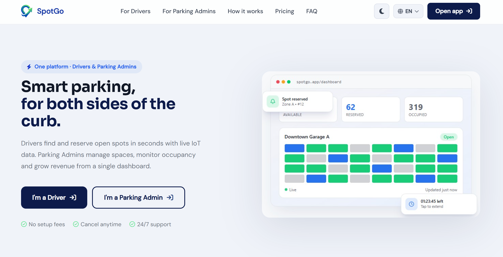

*Figura 96 (Preview Landing: Drivers)*  
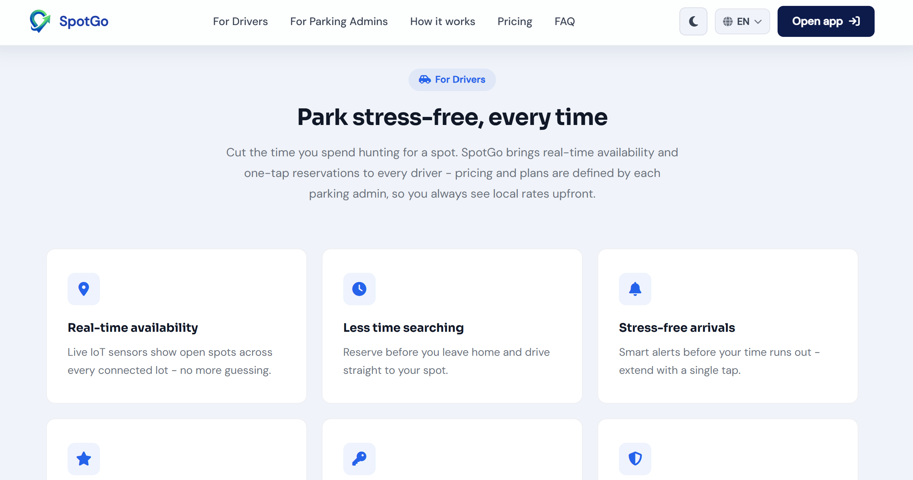

*Figura 97 (Preview Landing: Admins)*  
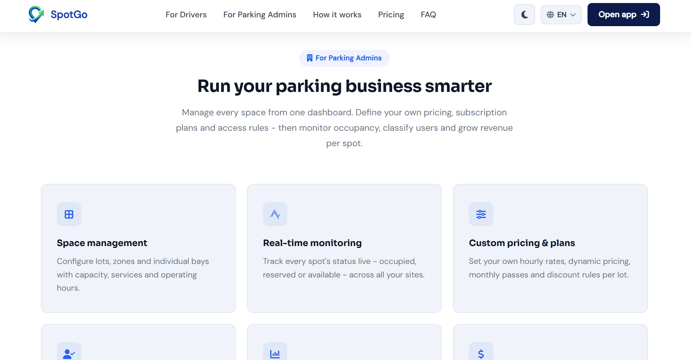

*Figura 98 (Preview Landing: How It Works)*  
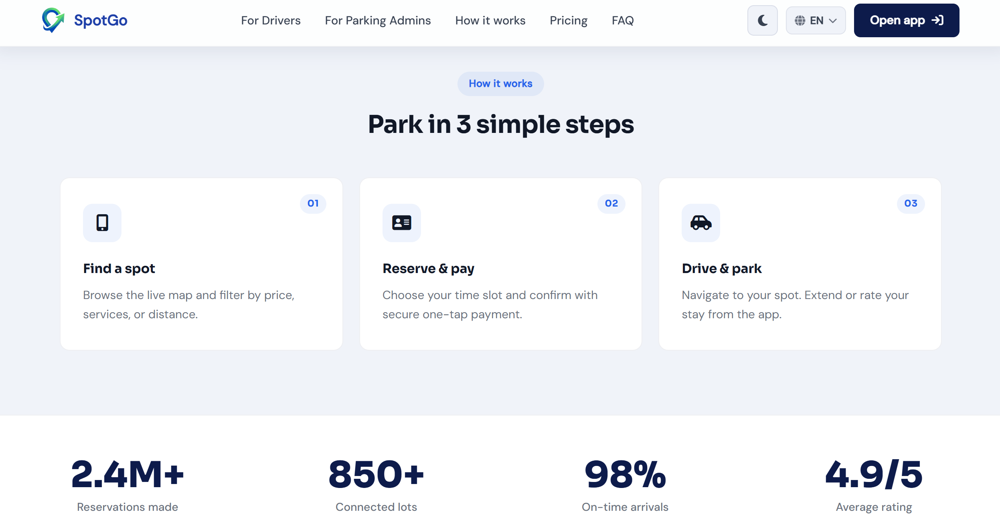

*Figura 99 (Preview Landing: Pricing)*  
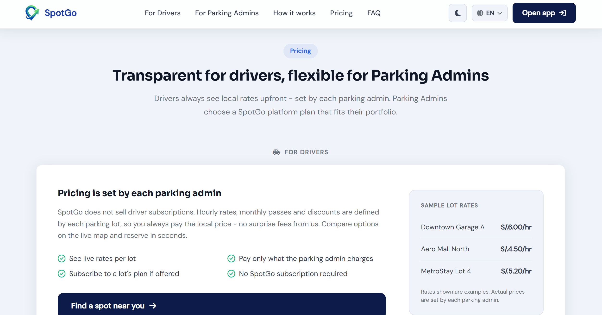

*Figura 100 (Preview Landing: FAQ)*  
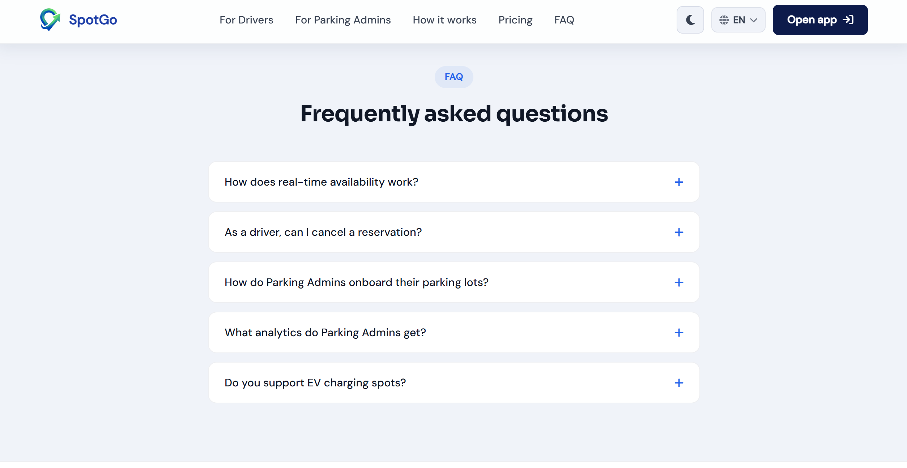

**Preview Landing Demonstration Video Link:** [https://upcedupe-my.sharepoint.com/:v:/g/personal/u20241e177_upc_edu_pe/IQDYdXQpcuFATYFoR1HYgMP_AQa4ZqLQcXEe6XCnQa2-WBY?nav=eyJyZWZlcnJhbEluZm8iOnsicmVmZXJyYWxBcHAiOiJPbmVEcml2ZUZvckJ1c2luZXNzIiwicmVmZXJyYWxBcHBQbGF0Zm9ybSI6IldlYiIsInJlZmVycmFsTW9kZSI6InZpZXciLCJyZWZlcnJhbFZpZXciOiJNeUZpbGVzTGlua0NvcHkifX0&e=rETy8f](https://upcedupe-my.sharepoint.com/:v:/g/personal/u20241e177_upc_edu_pe/IQDYdXQpcuFATYFoR1HYgMP_AQa4ZqLQcXEe6XCnQa2-WBY?nav=eyJyZWZlcnJhbEluZm8iOnsicmVmZXJyYWxBcHAiOiJPbmVEcml2ZUZvckJ1c2luZXNzIiwicmVmZXJyYWxBcHBQbGF0Zm9ybSI6IldlYiIsInJlZmVycmFsTW9kZSI6InZpZXciLCJyZWZlcnJhbFZpZXciOiJNeUZpbGVzTGlua0NvcHkifX0&e=rETy8f)

**Pantallas iniciales de Driver: Jetpack Compose**

*Figura 101 (Preview App: Driver-Explore Parking)*  
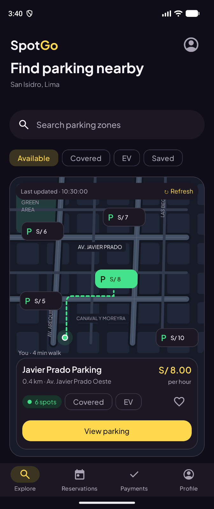

*Figura 102 (Preview App: Driver-Zone Details)*  
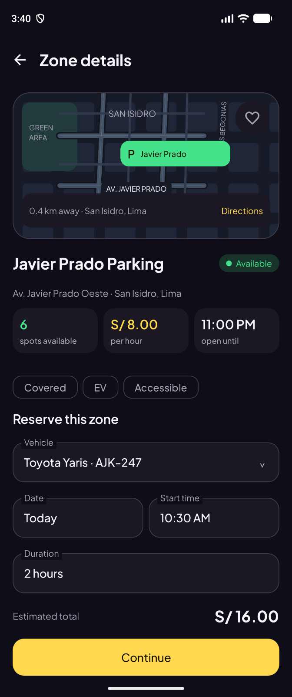

*Figura 103 (Preview App: Driver-Reserve)*  
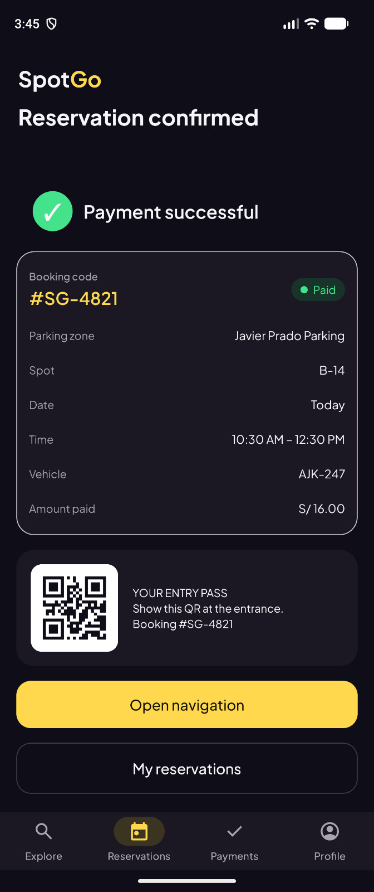

*Figura 104 (Preview App: Driver-Payments)*  
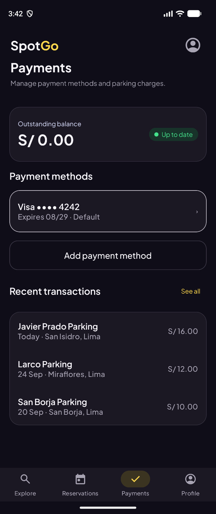

**Pantallas iniciales de Parking Admin: Jetpack Compose**

*Figura 105 (Preview App: Parking Admin-Dashboard)*  
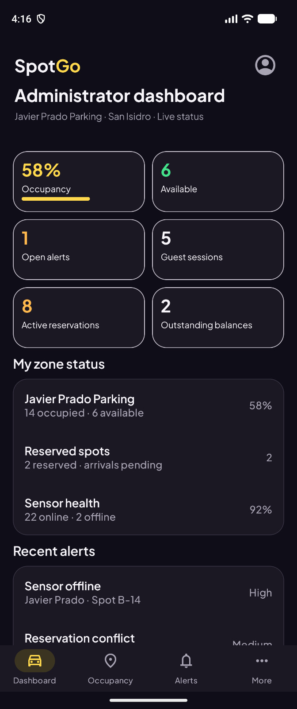

*Figura 106 (Preview App: Parking Admin-Live Occupancy)*  
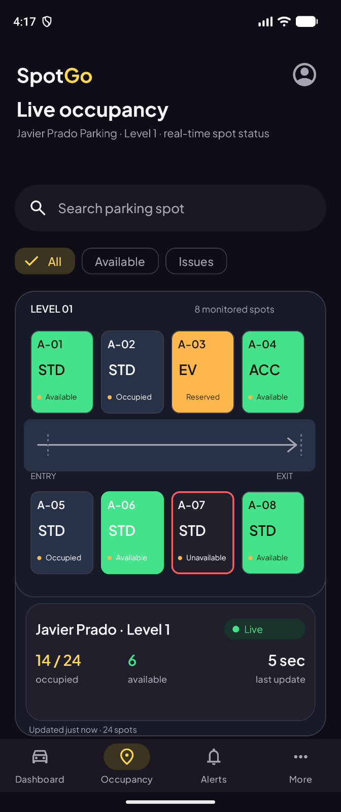

**Preview App Demonstration Video Link:** [https://upcedupe-my.sharepoint.com/:v:/g/personal/u20241e177_upc_edu_pe/IQAWy4vxFCjBS63sL1J9z2-LAWXDqiMcf6jcvocyPZkb68Y?nav=eyJyZWZlcnJhbEluZm8iOnsicmVmZXJyYWxBcHAiOiJPbmVEcml2ZUZvckJ1c2luZXNzIiwicmVmZXJyYWxBcHBQbGF0Zm9ybSI6IldlYiIsInJlZmVycmFsTW9kZSI6InZpZXciLCJyZWZlcnJhbFZpZXciOiJNeUZpbGVzTGlua0NvcHkifX0&e=HhZGcg](https://upcedupe-my.sharepoint.com/:v:/g/personal/u20241e177_upc_edu_pe/IQAWy4vxFCjBS63sL1J9z2-LAWXDqiMcf6jcvocyPZkb68Y?nav=eyJyZWZlcnJhbEluZm8iOnsicmVmZXJyYWxBcHAiOiJPbmVEcml2ZUZvckJ1c2luZXNzIiwicmVmZXJyYWxBcHBQbGF0Zm9ybSI6IldlYiIsInJlZmVycmFsTW9kZSI6InZpZXciLCJyZWZlcnJhbFZpZXciOiJNeUZpbGVzTGlua0NvcHkifX0&e=HhZGcg)

#### *4.2.1.7. Services Documentation Evidence for Sprint Review*

La documentación de los servicios REST de SpotGo se presenta mediante OpenAPI/Swagger. Para la revisión del Sprint 1, se incluyen las rutas base y las operaciones disponibles en el backend, resumidas por recurso en la siguiente tabla.

<table>
  <tr>
    <th align="left">Recurso</th>
    <th align="left">Endpoint Base</th>
    <th align="left">Acciones Implementadas</th>
  </tr>
  <tr>
    <td>Authentication</td>
    <td><code>/api/v1/authentication</code></td>
    <td>POST <code>/sign-up</code>, POST <code>/sign-in</code>, POST <code>/password-reset/request</code>, POST <code>/password-reset/confirm</code></td>
  </tr>
  <tr>
    <td>DetectedSpots</td>
    <td><code>/api/v1/detectedSpots</code></td>
    <td>GET, POST, PATCH <code>/{spotId}/status</code>, GET <code>/blueprint/{blueprintId}</code></td>
  </tr>
  <tr>
    <td>Reservation Receipts (contrato actual; reemplaza la ruta inicial del Sprint 1)</td>
    <td><code>/api/v1/reservations/{reservationId}/receipt</code></td>
    <td>GET PDF informativo; POST <code>/api/v1/reservations/{reservationId}/receipt/email</code> solo cuando el envío esté habilitado para despliegue</td>
  </tr>
  <tr>
    <td>Reservations</td>
    <td><code>/api/v1/reservations</code></td>
    <td>GET, POST, PATCH <code>/{reservationId}</code></td>
  </tr>
  <tr>
    <td>Users</td>
    <td><code>/api/v1/users</code></td>
    <td>GET, GET <code>/{userId}</code>, PATCH <code>/{userId}</code>, PATCH <code>/{userId}/password</code></td>
  </tr>
  <tr>
    <td>Employees</td>
    <td><code>/api/v1/employees</code></td>
    <td>GET, POST, PUT <code>/{employeeId}</code>, PATCH <code>/{employeeId}</code>, DELETE <code>/{employeeId}</code></td>
  </tr>
  <tr>
    <td>Blueprints</td>
    <td><code>/api/v1/blueprints</code></td>
    <td>GET, POST, PUT <code>/{blueprintId}</code>, PATCH <code>/{blueprintId}</code>, DELETE <code>/{blueprintId}</code>, GET <code>/parking/{parkingId}</code></td>
  </tr>
  <tr>
    <td>ClientReports</td>
    <td><code>/api/v1/clientReports</code></td>
    <td>GET, POST, PATCH <code>/{reportId}</code></td>
  </tr>
  <tr>
    <td>OccupancyByHour</td>
    <td><code>/api/v1/occupancyByHour</code></td>
    <td>GET</td>
  </tr>
  <tr>
    <td>WeeklyTrends</td>
    <td><code>/api/v1/weeklyTrends</code></td>
    <td>GET</td>
  </tr>
  <tr>
    <td>Parkings</td>
    <td><code>/api/v1/parkings</code></td>
    <td>GET, POST, GET <code>/{parkingId}</code>, PATCH <code>/{parkingId}</code></td>
  </tr>
  <tr>
    <td>Vehicles</td>
    <td><code>/api/v1/vehicles</code></td>
    <td>GET, POST, DELETE <code>/{vehicleId}</code>, PATCH <code>/{vehicleId}</code></td>
  </tr>
  <tr>
    <td>Analytics</td>
    <td><code>/api/v1/analytics</code></td>
    <td>GET</td>
  </tr>
  <tr>
    <td>Client Plans</td>
    <td><code>/api/v1/clientPlans</code></td>
    <td>GET, GET <code>/{clientPlanId}</code></td>
  </tr>
  <tr>
    <td>Subscriptions</td>
    <td><code>/api/v1/subscriptions</code></td>
    <td>GET, POST, GET <code>/{subscriptionId}</code>, PUT <code>/{subscriptionId}</code>, PATCH <code>/{subscriptionId}</code></td>
  </tr>
  <tr>
    <td>Favorites</td>
    <td><code>/api/v1/favorites</code></td>
    <td>GET, POST, DELETE <code>/{favoriteId}</code></td>
  </tr>
</table>

**Entradas y respuestas de operaciones representativas**

Las solicitudes con cuerpo utilizan JSON (`Content-Type: application/json`). Las operaciones protegidas requieren `Authorization: Bearer <token de SpotGo>`; el token se obtiene al iniciar sesión. Los identificadores de ruta se sustituyen por los del recurso correspondiente. El contrato OpenAPI enlazado detalla los esquemas y respuestas de cada operación.

| Operación | Parámetros o cuerpo | Respuesta documentada |
| --- | --- | --- |
| `POST /api/v1/authentication/sign-in` | `email` y `password`, obligatorios. | `200`: autenticación exitosa; `400`: entrada inválida; `401`: credenciales inválidas. |
| `GET /api/v1/parkings` | Sin cuerpo ni parámetros. | `200`: listado de estacionamientos, con ubicación, capacidad, disponibilidad y tarifa. |
| `POST /api/v1/reservations` | `parkingId`, `spot`, `startDate` y `endDate`, obligatorios; fechas en formato date-time. | `201`: `ReservationResource`, con identificador, código, espacio, fechas, estado e importes; `400`: entrada inválida. |
| `POST /api/v1/blueprints` | `adminId`, `parkingId`, `name` y `dataUrl`, obligatorios. `dataUrl` es una URL o data URI de la imagen del plano. | `201`: `BlueprintResource`; `400`: entrada inválida. |

Ejemplo ilustrativo de cuerpo para crear una reserva; los identificadores deben corresponder a registros existentes:

```json
{
  "parkingId": "1",
  "spot": "B5",
  "startDate": "2026-10-06T14:00:00-05:00",
  "endDate": "2026-10-06T15:00:00-05:00"
}
```

Ejemplo ilustrativo de los campos principales de una respuesta `201`, conforme a `ReservationResource`:

```json
{
  "id": "1",
  "clientId": "3",
  "parkingId": "1",
  "code": "SPG-A1B2C3",
  "spot": "B5",
  "startDate": "2026-10-06T14:00:00-05:00",
  "endDate": "2026-10-06T15:00:00-05:00",
  "status": "active",
  "amount": 3.0,
  "baseAmount": 3.0
}
```

Estos ejemplos describen el contrato de los servicios; no representan resultados de pruebas del sprint.

*Figura 107 (Preview Backend: /sign-in)*  
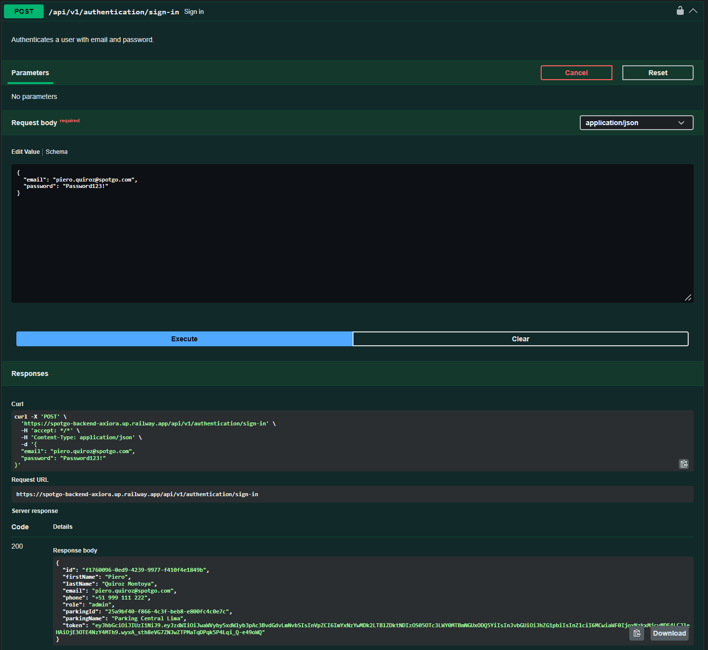

*Figura 108 (Preview Backend: /users)*  
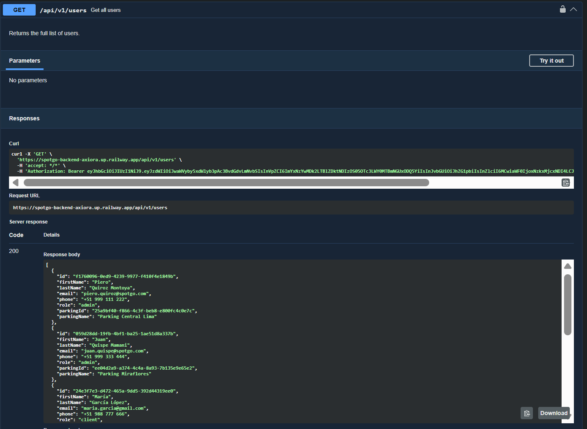

*Figura 109 (Preview Backend: /reservations)*  
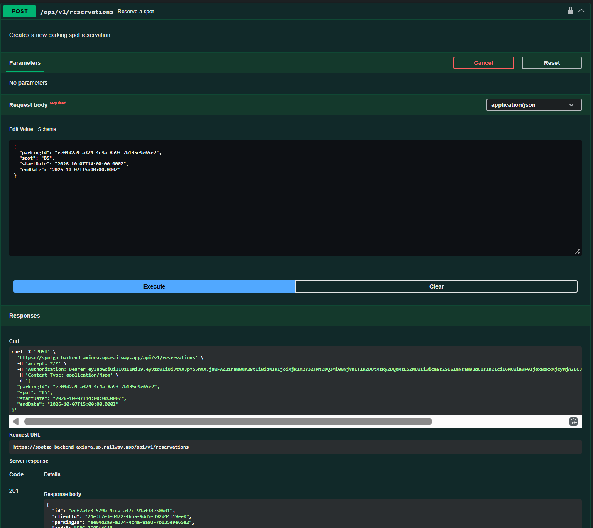

*Figura 110 (Preview Backend: /parkings)*  
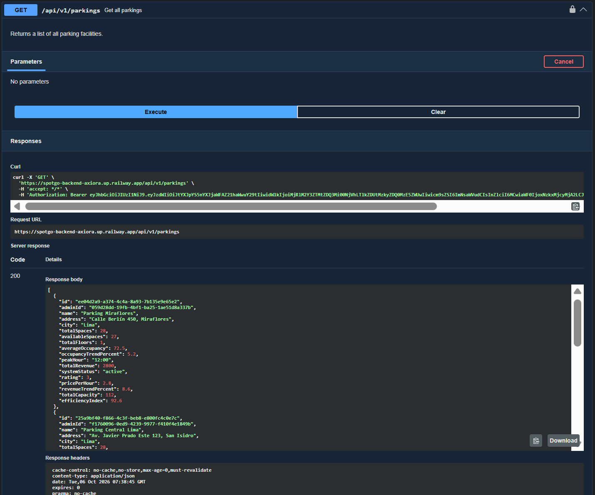

*Figura 111 (Preview Backend: /employees)*  
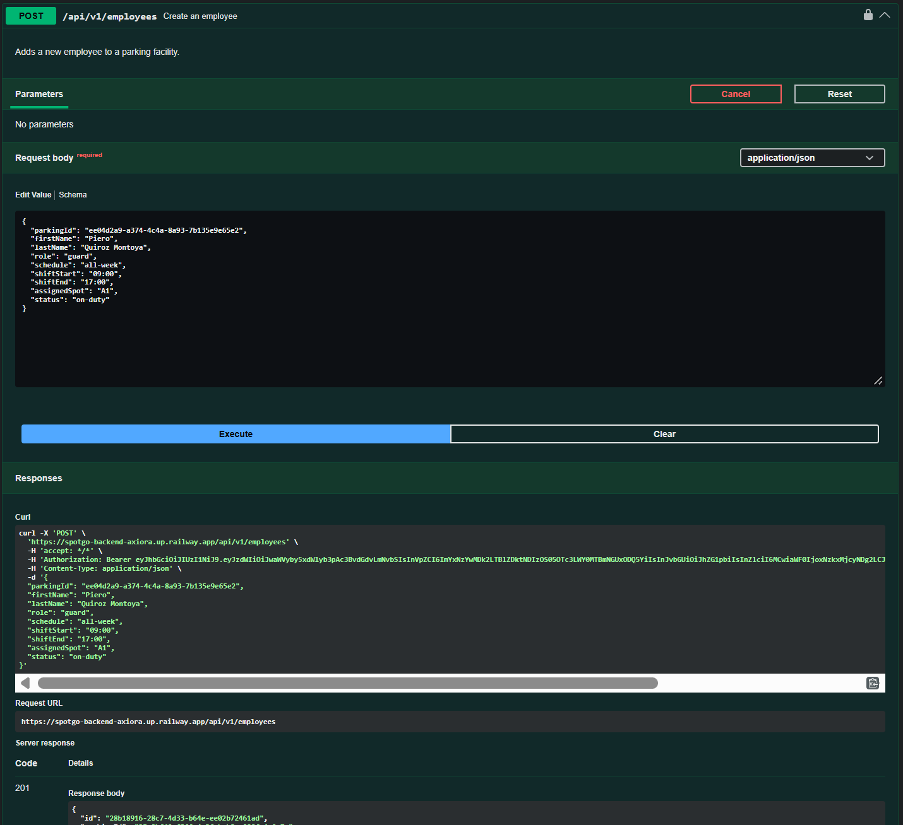

**Preview Backend Demonstration Video Link**: [https://upcedupe-my.sharepoint.com/:v:/g/personal/u20241e177_upc_edu_pe/IQDtFg7KDwEaQL5bcVnR_3VdAaywr1kmuIA_N8LNvtO27Lo?nav=eyJyZWZlcnJhbEluZm8iOnsicmVmZXJyYWxBcHAiOiJPbmVEcml2ZUZvckJ1c2luZXNzIiwicmVmZXJyYWxBcHBQbGF0Zm9ybSI6IldlYiIsInJlZmVycmFsTW9kZSI6InZpZXciLCJyZWZlcnJhbFZpZXciOiJNeUZpbGVzTGlua0NvcHkifX0&e=gVgLvI](https://upcedupe-my.sharepoint.com/:v:/g/personal/u20241e177_upc_edu_pe/IQDtFg7KDwEaQL5bcVnR_3VdAaywr1kmuIA_N8LNvtO27Lo?nav=eyJyZWZlcnJhbEluZm8iOnsicmVmZXJyYWxBcHAiOiJPbmVEcml2ZUZvckJ1c2luZXNzIiwicmVmZXJyYWxBcHBQbGF0Zm9ybSI6IldlYiIsInJlZmVycmFsTW9kZSI6InZpZXciLCJyZWZlcnJhbFZpZXciOiJNeUZpbGVzTGlua0NvcHkifX0&e=gVgLvI)

#### *4.2.1.8. Software Deployment Evidence for Sprint Review*

Durante el Sprint 1, se desplegó la versión inicial de la Landing Page de SpotGo en GitHub Pages.

**Procedimiento de publicación y reproducción**

1. **Landing Page:** publicar la raíz de `spotgo-landing`, rama `main`, mediante **Settings → Pages → Deploy from a branch → /(root)**. Al utilizar HTML, CSS y Vanilla JS, no requiere un proceso de compilación.
2. **Backend:** configurar Java 25 LTS y las variables de conexión PostgreSQL de Neon, puerto y autenticación del perfil `production`.
3. **Pantallas móviles en Jetpack Compose:** para reproducir la ejecución del proyecto Android del Sprint 1, abrir `spotgo-android-app` en Android Studio, sincronizar Gradle y ejecutar en un emulador o dispositivo Android 10/API 29 o superior. El APK de depuración se genera mediante `./gradlew.bat :app:assembleDebug` en `app/build/outputs/apk/debug/app-debug.apk` y se instala con `./gradlew.bat :app:installDebug`.

**Landing Page: GitHub Pages**

**Landing Page Deployment Link:** [https://yachiqo-upc.github.io/spotgo-landing](https://yachiqo-upc.github.io/spotgo-landing)

*Figura 112 (Sprint 1: Deployment Evidence Preview Landing)*  
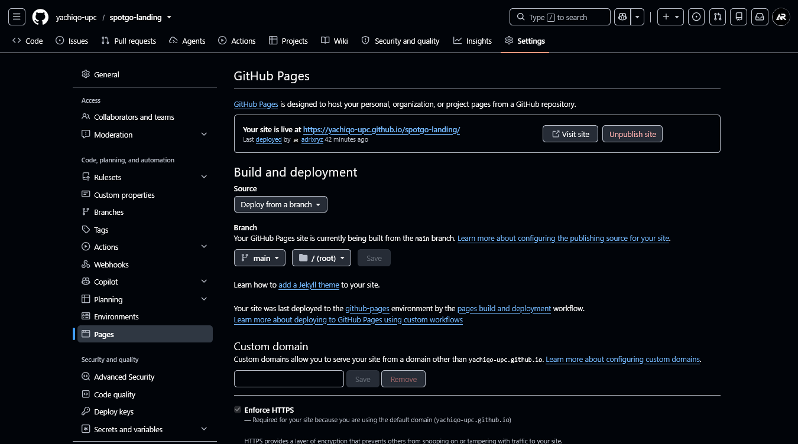

#### *4.2.1.9. Team Collaboration Insights during Sprint*

La siguiente captura corresponde a las contribuciones del repositorio `spotgo-android-app` durante el Sprint 1.

*Figura 113 (Sprint 1: Insights Preview App)*  
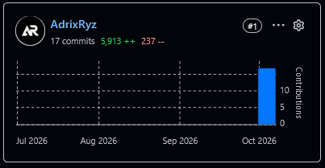
