### 4.2.2. Sprint 2

La meta del Sprint 2 es completar y desplegar al 100% la Landing Page, completar al 100% SpotGo Driver Android App y avanzar al 40% SpotGo Parking Admin Flutter App. También se completará al 100% el Backend, construido con Java 25 LTS y Docker, y se actualizará su despliegue como Web Service en Render. El sprint considera los 11 elementos del Product Backlog asignados al Sprint 2, que suman 34 Story Points.

#### *4.2.2.1. Sprint Planning 2*

<table>
  <tr>
    <td><strong>Sprint #</strong></td>
    <td>Sprint 2</td>
  </tr>
  <tr>
    <th colspan="2" align="left">Sprint Planning Background</th>
  </tr>
  <tr>
    <td><strong>Date</strong></td>
    <td>2026-11-03</td>
  </tr>
  <tr>
    <td><strong>Time</strong></td>
    <td>6:00 PM</td>
  </tr>
  <tr>
    <td><strong>Location</strong></td>
    <td>Reuni&#243;n virtual</td>
  </tr>
  <tr>
    <td><strong>Prepared By</strong></td>
    <td>Contreras Rojas, Cesar Jair</td>
  </tr>
  <tr>
    <td><strong>Attendees (to planning meeting)</strong></td>
    <td>Carhuaz Centeno, Briguite Eryka / Contreras Rojas, Cesar Jair / Cotrina Siclla, Sofia Alessandra / Rojas Tello, Nestor Alonso / Ruiz Mideyros, Adrian.</td>
  </tr>
  <tr>
    <td><strong>Sprint 1 Review Summary</strong></td>
    <td>Se presentó la versión inicial desplegada de la Landing Page, el avance del 70% del Backend y las pantallas principales de Driver y Parking Admin en Jetpack Compose.</td>
  </tr>
  <tr>
    <td><strong>Sprint 1 Retrospective Summary</strong></td>
    <td>Quedó pendiente completar el Backend y la Landing Page, y desarrollar las aplicaciones móviles más allá de sus pantallas iniciales. Para el Sprint 2 se planificó completar Android y avanzar Flutter al 40%.</td>
  </tr>
  <tr>
    <th colspan="2" align="left">Sprint Goal &amp; User Stories</th>
  </tr>
  <tr>
    <td><strong>Sprint 2 Goal</strong></td>
    <td>Completar y desplegar al 100% la Landing Page; completar al 100% SpotGo Driver Android App, desarrollada con Kotlin y Jetpack Compose; avanzar al 40% SpotGo Parking Admin Flutter App, desarrollada con Flutter; y completar al 100% el Backend con Java 25 LTS y Docker, desplegado como Web Service en Render. Se atenderán las historias planificadas del sprint: US27, US03, US14, US15, US05, US06, TS05, TS01, TS03, SP01 y SP02.</td>
  </tr>
  <tr>
    <td><strong>Sprint 2 Velocity</strong></td>
    <td>34 Story Points como capacidad planificada para el Sprint 2, correspondientes a los 11 elementos seleccionados del Product Backlog.</td>
  </tr>
  <tr>
    <td><strong>Sum of Story Points</strong></td>
    <td>34 Story Points: 18 de seis HU, 10 de tres TS y 6 de dos SP, según las estimaciones del Product Backlog.</td>
  </tr>
</table>

#### *4.2.2.2. Aspect Leaders and Collaborators*

La Leadership-and-Collaboration Matrix (LACX) identifica a las personas responsables de cada aspecto del Sprint 2. **L (Leader)** identifica a quien lidera el aspecto y **C (Collaborator)** a quien colabora. Contreras Rojas, Cesar Jair y Ruiz Mideyros, Adrian comparten la responsabilidad de SpotGo Driver Android App. Las celdas vacías indican aspectos sin una asignación de colaboración definida.

<table>
  <tr>
    <th align="left">Team Member<br>(Last Name, First Name)</th>
    <th align="left">GitHub Username</th>
    <th align="center">Backend (100%)</th>
    <th align="center">SpotGo Driver Android App (100%)</th>
    <th align="center">SpotGo Parking Admin Flutter App (40%)</th>
    <th align="center">Landing Page (100%)</th>
  </tr>
  <tr>
    <td align="left">Carhuaz Centeno, Briguite Eryka</td>
    <td align="left">@briicarhuaz</td>
    <td align="center"></td>
    <td align="center"></td>
    <td align="center"><strong>L</strong></td>
    <td align="center"></td>
  </tr>
  <tr>
    <td align="left">Contreras Rojas, Cesar Jair</td>
    <td align="left">@CesarJrCR</td>
    <td align="center"></td>
    <td align="center"><strong>L</strong></td>
    <td align="center"></td>
    <td align="center"></td>
  </tr>
  <tr>
    <td align="left">Cotrina Siclla, Sofia Alessandra</td>
    <td align="left">@IamAndreek</td>
    <td align="center"></td>
    <td align="center"></td>
    <td align="center"></td>
    <td align="center"><strong>L</strong></td>
  </tr>
  <tr>
    <td align="left">Rojas Tello, Nestor Alonso</td>
    <td align="left">@nes-ro</td>
    <td align="center"><strong>L</strong></td>
    <td align="center"></td>
    <td align="center"></td>
    <td align="center"></td>
  </tr>
  <tr>
    <td align="left">Ruiz Mideyros, Adrian</td>
    <td align="left">@AdrixRyz</td>
    <td align="center"></td>
    <td align="center"><strong>L</strong></td>
    <td align="center"></td>
    <td align="center"></td>
  </tr>
</table>

#### *4.2.2.3. Sprint Backlog 2*

El Sprint Backlog 2 reúne las tareas vinculadas a los elementos planificados del Product Backlog. Las historias de usuario aparecen primero, seguidas de las historias técnicas y las historias de investigación.

**Trello Board Link:** [https://trello.com/invite/b/6aa6e46ebebf57986f7fcd37/ATTIc1ae2804c4145e3b8bfd53325b170b9bFBAEB587/spotgo-trello-board](https://trello.com/invite/b/6aa6e46ebebf57986f7fcd37/ATTIc1ae2804c4145e3b8bfd53325b170b9bFBAEB587/spotgo-trello-board)

*Figura 100 (Trello Board: Sprint Backlog 2)*  


<table>
  <thead>
    <tr><th colspan="3">User Story</th><th colspan="6">Work-Item / Task</th></tr>
    <tr><th>Id</th><th>Title</th><th>Story Points</th><th>Id</th><th>Title</th><th>Description</th><th>Estimation (Hours)</th><th>Assigned To</th><th>Status</th></tr>
  </thead>
  <tbody>
    <tr>
      <td>US27</td><td>Registrar un vehículo</td><td align="center">2</td>
      <td>T01</td><td>Registro de vehículos en Android</td><td>Completar el registro de vehículos en SpotGo Driver Android App y los módulos Backend asociados.</td><td>2</td><td>Contreras Rojas, Cesar Jair<br>Rojas Tello, Nestor Alonso<br>Ruiz Mideyros, Adrian</td><td>Done</td>
    </tr>
    <tr>
      <td>US03</td><td>Registrar una sesión de estacionamiento de invitado</td><td align="center">3</td>
      <td>T02</td><td>Sesiones de estacionamiento de invitados</td><td>Completar el registro y control de sesiones de invitados desde SpotGo Parking Admin Flutter App y los módulos Backend asociados.</td><td>2.5</td><td>Carhuaz Centeno, Briguite Eryka<br>Rojas Tello, Nestor Alonso</td><td>Done</td>
    </tr>
    <tr>
      <td>US14</td><td>Registrar un cliente B2B y su cuenta Parking Admin</td><td align="center">3</td>
      <td>T03</td><td>Registro de clientes B2B</td><td>Completar en el Backend la funcionalidad para registrar un cliente B2B y crear su cuenta Parking Admin.</td><td>2.5</td><td>Rojas Tello, Nestor Alonso</td><td>Done</td>
    </tr>
    <tr>
      <td>US15</td><td>Habilitar una cuenta Parking Admin</td><td align="center">2</td>
      <td>T04</td><td>Habilitación de cuentas Parking Admin</td><td>Completar en el Backend la funcionalidad para habilitar una cuenta Parking Admin.</td><td>1.5</td><td>Rojas Tello, Nestor Alonso</td><td>Done</td>
    </tr>
    <tr>
      <td>US05</td><td>Supervisar la ocupación por zona</td><td align="center">5</td>
      <td>T05</td><td>Consulta de ocupación por zona</td><td>Completar los módulos Backend y avanzar la vista de ocupación por zona en SpotGo Parking Admin Flutter App.</td><td>4</td><td>Carhuaz Centeno, Briguite Eryka<br>Rojas Tello, Nestor Alonso</td><td>Done</td>
    </tr>
    <tr>
      <td>US06</td><td>Generar alertas operativas</td><td align="center">3</td>
      <td>T06</td><td>Alertas operativas</td><td>Completar la generación de alertas en el Backend y avanzar su consulta en SpotGo Parking Admin Flutter App.</td><td>2.5</td><td>Carhuaz Centeno, Briguite Eryka<br>Rojas Tello, Nestor Alonso</td><td>Done</td>
    </tr>
    <tr>
      <td>TS05</td><td>Confirmar pagos de forma asíncrona</td><td align="center">3</td>
      <td>T07</td><td>Confirmación asíncrona de pagos</td><td>Completar el procesamiento y la confirmación asíncrona de pagos en el Backend.</td><td>2.5</td><td>Rojas Tello, Nestor Alonso</td><td>Done</td>
    </tr>
    <tr>
      <td>TS01</td><td>Sincronizar datos móviles mediante servicios REST</td><td align="center">5</td>
      <td>T08</td><td>Sincronización de datos móviles</td><td>Completar los servicios REST del Backend e integrar la sincronización requerida por las aplicaciones Android y Flutter.</td><td>4</td><td>Carhuaz Centeno, Briguite Eryka<br>Contreras Rojas, Cesar Jair<br>Rojas Tello, Nestor Alonso<br>Ruiz Mideyros, Adrian</td><td>Done</td>
    </tr>
    <tr>
      <td>TS03</td><td>Documentar el contrato de los servicios REST</td><td align="center">2</td>
      <td>T09</td><td>Documentación de servicios REST</td><td>Completar la documentación de los contratos REST del Backend.</td><td>1.5</td><td>Rojas Tello, Nestor Alonso</td><td>Done</td>
    </tr>
    <tr>
      <td>SP01</td><td>Validar el monitoreo de ocupación con sensores</td><td align="center">3</td>
      <td>T10</td><td>Monitoreo de ocupación con sensores</td><td>Completar la validación del flujo de ocupación y de la información recibida desde los sensores.</td><td>2</td><td>Rojas Tello, Nestor Alonso</td><td>Done</td>
    </tr>
    <tr>
      <td>SP02</td><td>Investigar la estrategia de sincronización móvil</td><td align="center">3</td>
      <td>T11</td><td>Estrategia de sincronización móvil</td><td>Evaluar la estrategia de sincronización para las aplicaciones Android y Flutter y el Backend.</td><td>2.5</td><td>Carhuaz Centeno, Briguite Eryka<br>Contreras Rojas, Cesar Jair<br>Rojas Tello, Nestor Alonso<br>Ruiz Mideyros, Adrian</td><td>Done</td>
    </tr>
    <tr><td colspan="2"><strong>Total de elementos seleccionados</strong></td><td align="center"><strong>34</strong></td><td colspan="6">11 elementos: 6 HU, 3 TS y 2 SP; 27.5 horas estimadas en total.</td></tr>
  </tbody>
</table>

La finalización al 100% de la Landing Page forma parte del objetivo del Sprint 2. Las historias US11 y US12 ya están contabilizadas en el Sprint 1 y no se vuelven a sumar a los 34 Story Points de este sprint.

#### *4.2.2.4. Development Evidence for Sprint Review*

La siguiente tabla reúne los commits de los repositorios en los que se trabajará durante el Sprint 2.

| Repository | Branch | Commit Id | Commit Message | Committed on (Date) |
| --- | --- | --- | --- | --- |
| [spotgo-landing](https://github.com/yachiqo-upc/spotgo-landing) | develop  | d6d9470 | feat: redesign SpotGo Landing Page for mobile apps | 2026-11-05 |
| [spotgo-backend](https://github.com/yachiqo-upc/spotgo-backend) |  |  |  |  |
| [spotgo-android-app](https://github.com/yachiqo-upc/spotgo-android-app) | feature/auth-access-flow | d1fda5c | feat: add driver access flow with in-memory data layer | 2026-11-08 |
| [spotgo-android-app](https://github.com/yachiqo-upc/spotgo-android-app) | feature/driver-workspace | ee730db | feat: add driver workspace screens and navigation | 2026-11-08 |
| [spotgo-android-app](https://github.com/yachiqo-upc/spotgo-android-app) | feature/tests | 697e391 | test: add unit and instrumented test suites | 2026-11-08 |
| [spotgo-flutter-app](https://github.com/yachiqo-upc/spotgo-flutter-app) | feature/parking-admin-flutter | 2bf176a | chore(flutter): configure theme and assets | 2026-11-07 |
| [spotgo-flutter-app](https://github.com/yachiqo-upc/spotgo-flutter-app) | feature/parking-admin-flutter | 5db9354 | feat(auth): implement parking admin access | 2026-11-07 |
| [spotgo-flutter-app](https://github.com/yachiqo-upc/spotgo-flutter-app) | feature/parking-admin-flutter | 6a05d2b | feat(navigation): add admin navigation | 2026-11-07 |
| [spotgo-flutter-app](https://github.com/yachiqo-upc/spotgo-flutter-app) | feature/parking-admin-flutter | 89c4dcb | feat(dashboard): build operational dashboard | 2026-11-07 |
| [spotgo-flutter-app](https://github.com/yachiqo-upc/spotgo-flutter-app) | feature/parking-admin-flutter | 5379b9e | feat(occupancy): implement occupancy monitoring | 2026-11-07 |
| [spotgo-flutter-app](https://github.com/yachiqo-upc/spotgo-flutter-app) | feature/parking-admin-flutter | 05ee55b | feat(alerts): implement operational alerts | 2026-11-07 |
| [spotgo-flutter-app](https://github.com/yachiqo-upc/spotgo-flutter-app) | feature/parking-admin-flutter | b9e2cf7 | feat(zones): add parking zone management | 2026-11-07 |
| [spotgo-flutter-app](https://github.com/yachiqo-upc/spotgo-flutter-app) | feature/parking-admin-flutter | 8048c26 | feat(guests): implement guest sessions | 2026-11-07 |
| [spotgo-flutter-app](https://github.com/yachiqo-upc/spotgo-flutter-app) | feature/parking-admin-flutter | ca8f26b | feat(guests): add creation and checkout flows | 2026-11-07 |
| [spotgo-flutter-app](https://github.com/yachiqo-upc/spotgo-flutter-app) | feature/parking-admin-flutter | 2f5ceca | test(admin): validate parking admin workflows | 2026-11-07 |
| [spotgo-flutter-app](https://github.com/yachiqo-upc/spotgo-flutter-app) | feature/parking-admin-flutter | 244e26f | fix(admin): resolve analyzer, format and test issues | 2026-11-08 |

#### *4.2.2.5. Testing Suite Evidence for Sprint Review*

*Figura 101 (Backend Test Evidence)*  

*Figura 102 (SpotGo Android App Test Evidence)*  

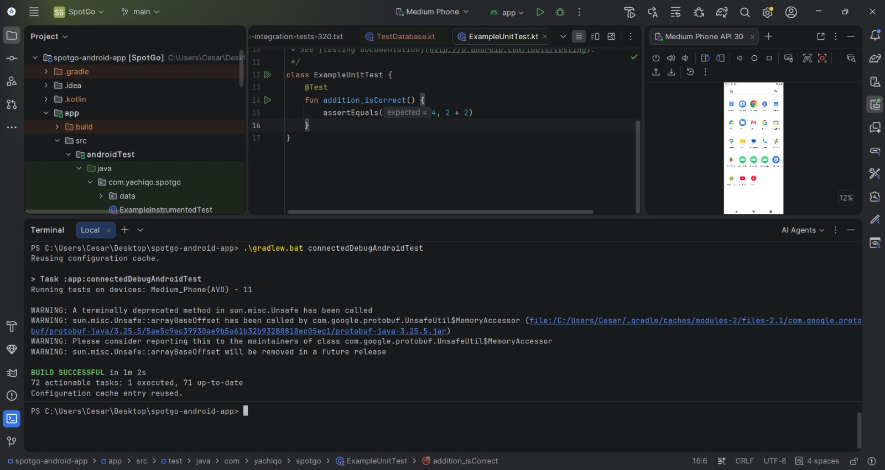

*Figura 103 (SpotGo Flutter App Test Evidence)*  
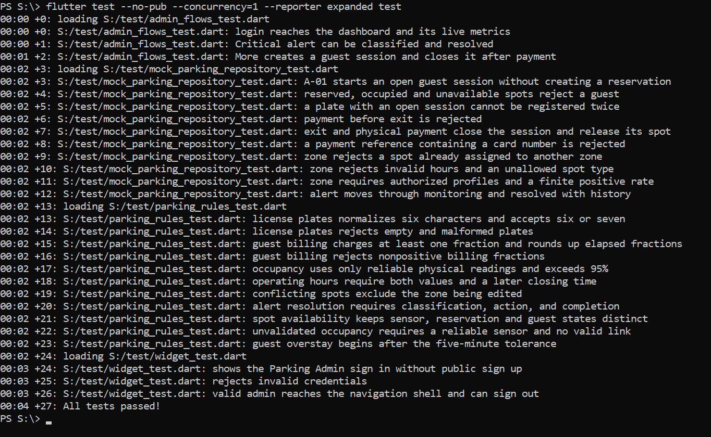

#### *4.2.2.6. Execution Evidence for Sprint Review*

**Landing Page**

*Figura 104 (SpotGo Landing Page: Home)*  
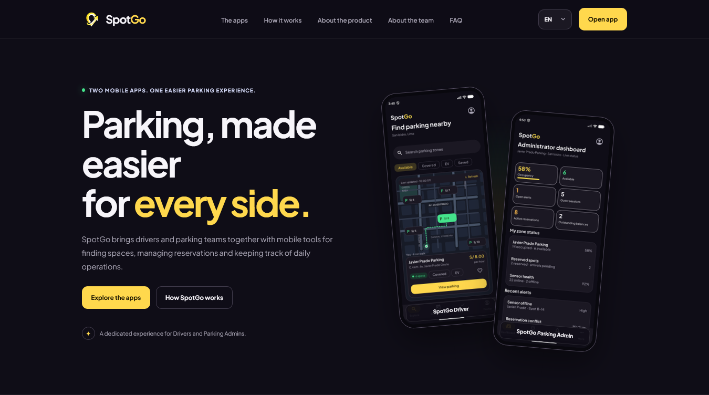

*Figura 105 (SpotGo Landing Page: The Apps)*  
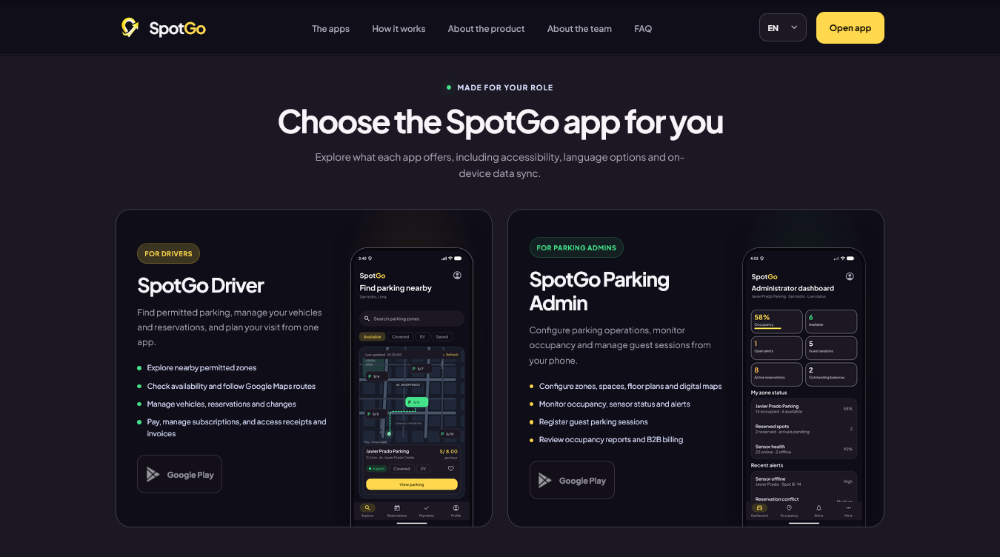

*Figura 106 (SpotGo Landing Page: How it Works)*  
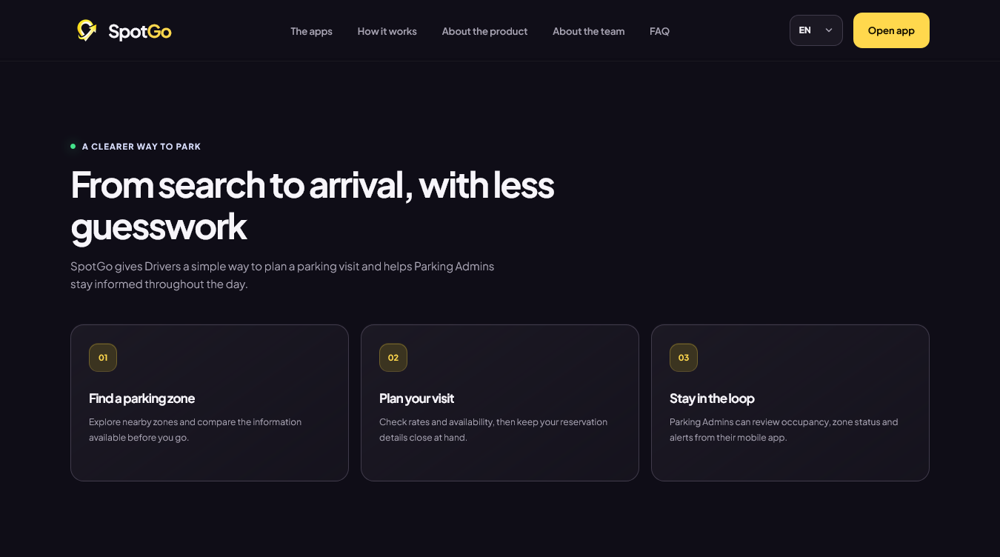

*Figura 107 (SpotGo Landing Page: FAQ)*  
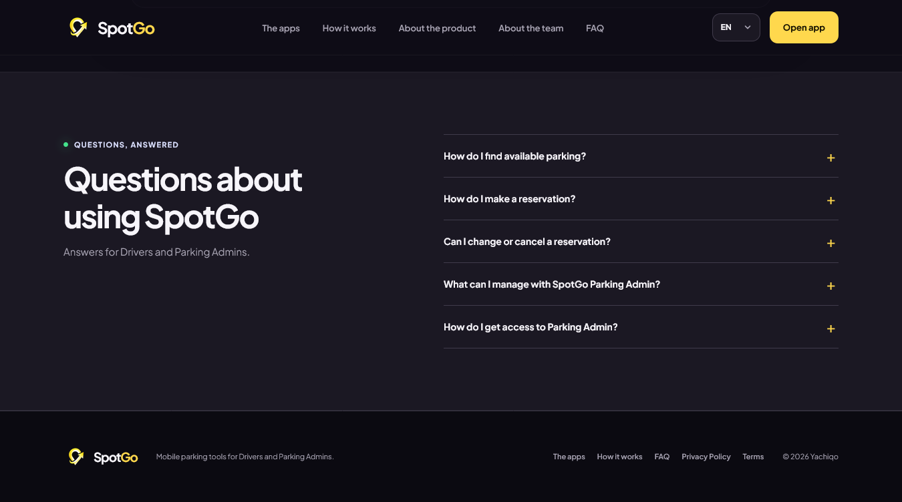

**Landing Page Demonstration Video Link:** [https://upcedupe-my.sharepoint.com/:v:/g/personal/u20241e177_upc_edu_pe/IQB_Jj5fMDvRTLXgP8g9FbLZAdG4cpDEmi_4JIVIlebIiy8?nav=eyJyZWZlcnJhbEluZm8iOnsicmVmZXJyYWxBcHAiOiJPbmVEcml2ZUZvckJ1c2luZXNzIiwicmVmZXJyYWxBcHBQbGF0Zm9ybSI6IldlYiIsInJlZmVycmFsTW9kZSI6InZpZXciLCJyZWZlcnJhbFZpZXciOiJNeUZpbGVzTGlua0NvcHkifX0&e=Jx3xOS](https://upcedupe-my.sharepoint.com/:v:/g/personal/u20241e177_upc_edu_pe/IQB_Jj5fMDvRTLXgP8g9FbLZAdG4cpDEmi_4JIVIlebIiy8?nav=eyJyZWZlcnJhbEluZm8iOnsicmVmZXJyYWxBcHAiOiJPbmVEcml2ZUZvckJ1c2luZXNzIiwicmVmZXJyYWxBcHBQbGF0Zm9ybSI6IldlYiIsInJlZmVycmFsTW9kZSI6InZpZXciLCJyZWZlcnJhbFZpZXciOiJNeUZpbGVzTGlua0NvcHkifX0&e=Jx3xOS)

**SpotGo Android App**

*Figura 108 (SpotGo Android App: Sign-up and Sign-in)*  

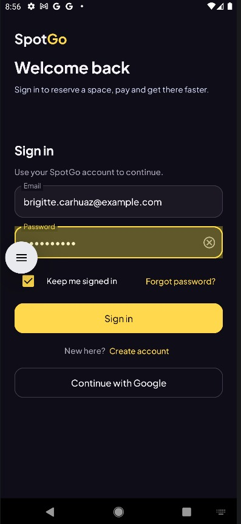

*Figura 109 (SpotGo Android App: Vehicle Registration)*  

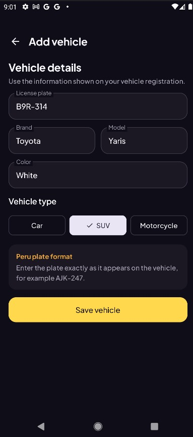

*Figura 110 (SpotGo Android App: Availability and Reservations)*  

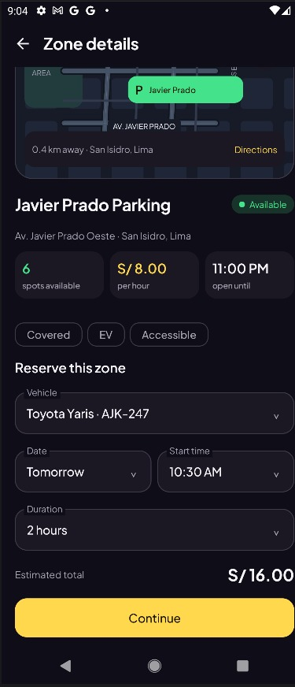

*Figura 111 (SpotGo Android App: Payments and Receipts)*  

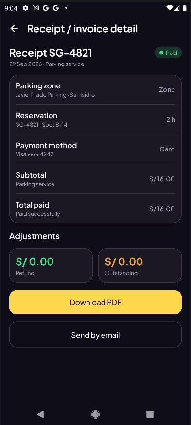

**Android App Demonstration Video Link:**[https://upcedupe-my.sharepoint.com/:v:/g/personal/u20241e177_upc_edu_pe/IQAxJsr3dLiDRaSmY9Q455szATUGQU5i1tn98g1UXWB7a6s?nav=eyJyZWZlcnJhbEluZm8iOnsicmVmZXJyYWxBcHAiOiJPbmVEcml2ZUZvckJ1c2luZXNzIiwicmVmZXJyYWxBcHBQbGF0Zm9ybSI6IldlYiIsInJlZmVycmFsTW9kZSI6InZpZXciLCJyZWZlcnJhbFZpZXciOiJNeUZpbGVzTGlua0NvcHkifX0&e=61cAXb](https://upcedupe-my.sharepoint.com/:v:/g/personal/u20241e177_upc_edu_pe/IQAxJsr3dLiDRaSmY9Q455szATUGQU5i1tn98g1UXWB7a6s?nav=eyJyZWZlcnJhbEluZm8iOnsicmVmZXJyYWxBcHAiOiJPbmVEcml2ZUZvckJ1c2luZXNzIiwicmVmZXJyYWxBcHBQbGF0Zm9ybSI6IldlYiIsInJlZmVycmFsTW9kZSI6InZpZXciLCJyZWZlcnJhbFZpZXciOiJNeUZpbGVzTGlua0NvcHkifX0&e=61cAXb)

**SpotGo Flutter App**

*Figura 112 (SpotGo Flutter App: Guest Parking Sessions)*  
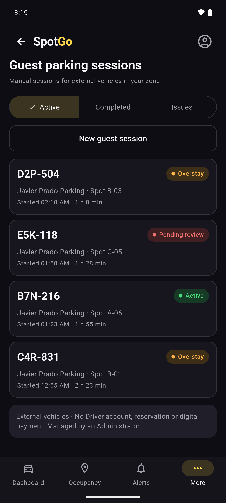

*Figura 113 (SpotGo Flutter App: Occupancy by Zone)*  
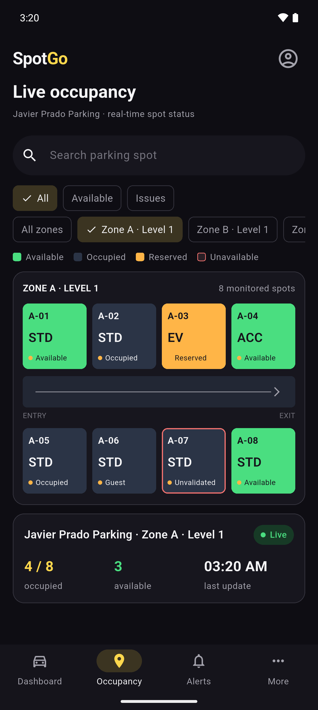

*Figura 114 (SpotGo Flutter App: Operational Alerts)*  
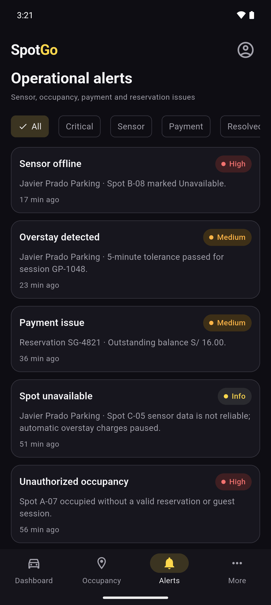

**Demonstration Video Evidence for Sprint Review**

**Flutter App Demonstration Video Link:** [https://upcedupe-my.sharepoint.com/:v:/g/personal/u20241e177_upc_edu_pe/IQBJFOqkN5ELS4wAFnVd6_-9AShYNbDeE_IyNVA_xSh8Sfc?nav=eyJyZWZlcnJhbEluZm8iOnsicmVmZXJyYWxBcHAiOiJPbmVEcml2ZUZvckJ1c2luZXNzIiwicmVmZXJyYWxBcHBQbGF0Zm9ybSI6IldlYiIsInJlZmVycmFsTW9kZSI6InZpZXciLCJyZWZlcnJhbFZpZXciOiJNeUZpbGVzTGlua0NvcHkifX0&e=KhjjCQ](https://upcedupe-my.sharepoint.com/:v:/g/personal/u20241e177_upc_edu_pe/IQBJFOqkN5ELS4wAFnVd6_-9AShYNbDeE_IyNVA_xSh8Sfc?nav=eyJyZWZlcnJhbEluZm8iOnsicmVmZXJyYWxBcHAiOiJPbmVEcml2ZUZvckJ1c2luZXNzIiwicmVmZXJyYWxBcHBQbGF0Zm9ybSI6IldlYiIsInJlZmVycmFsTW9kZSI6InZpZXciLCJyZWZlcnJhbFZpZXciOiJNeUZpbGVzTGlua0NvcHkifX0&e=KhjjCQ)

#### *4.2.2.7. Services Documentation Evidence for Sprint Review*

La documentación OpenAPI/Swagger del Sprint 2 presenta los contratos REST del backend actual de SpotGo. El inventario revisado en el código contiene **32 recursos o rutas base**, que agrupan **121 operaciones HTTP**. Cada operación se identifica por su método y ruta completa: por ejemplo, `GET /api/v1/additional-charges` y `POST /api/v1/additional-charges` son dos operaciones del mismo recurso.

**Inventario completo de servicios del backend para Sprint 2**

La tabla muestra todas las operaciones actuales, incluidas las que ya figuraban en Sprint 1. La cantidad corresponde a operaciones HTTP de cada recurso, no a endpoints nuevos. Se escriben las rutas completas para evitar confundir la ruta base con sus operaciones específicas. Los nombres entre llaves, como `{chargeId}`, son parámetros que se reemplazan por el UUID del recurso.

Por ejemplo, Additional charges permite listar (`GET`), crear (`POST`) y marcar un cargo como impago (`POST /api/v1/additional-charges/{chargeId}/mark-unpaid`). Esta última acción pertenece únicamente a los cargos adicionales; cada servicio define sus propias acciones y no está obligado a implementar los mismos métodos o sufijos.

| Recurso / ruta base | Cantidad de operaciones | Métodos HTTP y rutas completas |
| --- | ---: | --- |
| `/api/v1/additional-charges` | 3 | `GET /api/v1/additional-charges`<br>`POST /api/v1/additional-charges`<br>`POST /api/v1/additional-charges/{chargeId}/mark-unpaid` |
| `/api/v1/billing-documents` | 3 | `GET /api/v1/billing-documents`<br>`POST /api/v1/billing-documents`<br>`POST /api/v1/billing-documents/{documentId}/void` |
| `/api/v1/digital-payments` | 8 | `GET /api/v1/digital-payments`<br>`GET /api/v1/digital-payments/{paymentId}`<br>`POST /api/v1/digital-payments/reservations/{reservationId}`<br>`POST /api/v1/digital-payments/subscriptions`<br>`POST /api/v1/digital-payments/additional-charges/{chargeId}`<br>`POST /api/v1/digital-payments/{paymentId}/process`<br>`POST /api/v1/digital-payments/{paymentId}/retry`<br>`POST /api/v1/digital-payments/{paymentId}/reconcile` |
| `/api/v1/outstanding-balances` | 2 | `GET /api/v1/outstanding-balances`<br>`GET /api/v1/outstanding-balances/total` |
| `/api/v1/payment-attempts` | 1 | `GET /api/v1/payment-attempts` |
| `/api/v1/payment-tokens` | 4 | `GET /api/v1/payment-tokens`<br>`POST /api/v1/payment-tokens`<br>`PUT /api/v1/payment-tokens/{tokenId}/default`<br>`DELETE /api/v1/payment-tokens/{tokenId}` |
| `/api/v1/refunds` | 3 | `GET /api/v1/refunds`<br>`POST /api/v1/refunds`<br>`POST /api/v1/refunds/{refundId}/process` |
| `/api/v1/subscriptions` | 5 | `GET /api/v1/subscriptions`<br>`GET /api/v1/subscriptions/plans`<br>`GET /api/v1/subscriptions/plans/{code}/quote`<br>`GET /api/v1/subscriptions/{subscriptionId}`<br>`POST /api/v1/subscriptions/{subscriptionId}/cancel` |
| `/api/v1/accounts` | 9 | `GET /api/v1/accounts/me`<br>`GET /api/v1/accounts`<br>`GET /api/v1/accounts/{accountId}`<br>`PATCH /api/v1/accounts/{accountId}/status`<br>`GET /api/v1/accounts/me/role`<br>`GET /api/v1/accounts/{accountId}/role`<br>`PUT /api/v1/accounts/{accountId}/role`<br>`POST /api/v1/accounts/parking-admin`<br>`PATCH /api/v1/accounts/me/password` |
| `/api/v1/audit-entries` | 1 | `GET /api/v1/audit-entries` |
| `/api/v1/authentication` | 8 | `POST /api/v1/authentication/sign-in`<br>`POST /api/v1/authentication/google`<br>`POST /api/v1/authentication/google/link`<br>`POST /api/v1/authentication/sign-up`<br>`POST /api/v1/authentication/refresh`<br>`POST /api/v1/authentication/sign-out`<br>`POST /api/v1/authentication/password-reset/request`<br>`POST /api/v1/authentication/password-reset/confirm` |
| `/api/v1/sessions` | 2 | `GET /api/v1/sessions/me`<br>`DELETE /api/v1/sessions/{sessionId}` |
| `/api/v1/capacity-alerts` | 2 | `GET /api/v1/capacity-alerts`<br>`POST /api/v1/capacity-alerts/{alertId}/acknowledge` |
| `/api/v1/capacity-snapshots` | 2 | `GET /api/v1/capacity-snapshots`<br>`POST /api/v1/capacity-snapshots` |
| `/api/v1/occupancy-alerts` | 5 | `GET /api/v1/occupancy-alerts`<br>`POST /api/v1/occupancy-alerts/{alertId}/acknowledge`<br>`POST /api/v1/occupancy-alerts/{alertId}/close`<br>`PUT /api/v1/occupancy-alerts/{alertId}/evidence`<br>`GET /api/v1/occupancy-alerts/{alertId}/evidence` |
| `/api/v1/occupancy-conflicts` | 4 | `GET /api/v1/occupancy-conflicts`<br>`GET /api/v1/occupancy-conflicts/{conflictId}`<br>`POST /api/v1/occupancy-conflicts/{conflictId}/acknowledge`<br>`POST /api/v1/occupancy-conflicts/{conflictId}/resolve` |
| `/api/v1/occupancy-readings` | 2 | `GET /api/v1/occupancy-readings`<br>`POST /api/v1/occupancy-readings` |
| `/api/v1/occupancy-reports` | 2 | `GET /api/v1/occupancy-reports`<br>`POST /api/v1/occupancy-reports` |
| `/api/v1/occupancy-sensors` | 5 | `GET /api/v1/occupancy-sensors`<br>`GET /api/v1/occupancy-sensors/{sensorId}`<br>`POST /api/v1/occupancy-sensors`<br>`POST /api/v1/occupancy-sensors/{sensorId}/deactivate`<br>`GET /api/v1/occupancy-sensors/spots/{spotId}/occupancy` |
| `/api/v1/sensor-health-events` | 4 | `GET /api/v1/sensor-health-events`<br>`GET /api/v1/sensor-health-events/{healthEventId}`<br>`POST /api/v1/sensor-health-events`<br>`POST /api/v1/sensor-health-events/{healthEventId}/recover` |
| `/api/v1/notifications/devices` | 3 | `GET /api/v1/notifications/devices`<br>`POST /api/v1/notifications/devicesapplication/json`<br>`DELETE /api/v1/notifications/devices/{deviceTokenId}` |
| `/api/v1/digital-parking-maps` | 4 | `GET /api/v1/digital-parking-maps`<br>`POST /api/v1/digital-parking-maps`<br>`POST /api/v1/digital-parking-maps/{mapId}/publish`<br>`POST /api/v1/digital-parking-maps/{mapId}/archive` |
| `/api/v1/floor-plans` | 4 | `GET /api/v1/floor-plans`<br>`POST /api/v1/floor-plans`<br>`POST /api/v1/floor-plans/{floorPlanId}/publish`<br>`POST /api/v1/floor-plans/{floorPlanId}/archive` |
| `/api/v1/guest-parking-sessions` | 4 | `GET /api/v1/guest-parking-sessions`<br>`POST /api/v1/guest-parking-sessions`<br>`POST /api/v1/guest-parking-sessions/{guestSessionId}/exit`<br>`POST /api/v1/guest-parking-sessions/{guestSessionId}/confirm-payment` |
| `/api/v1/parking-sessions` | 3 | `GET /api/v1/parking-sessions`<br>`POST /api/v1/parking-sessions`<br>`POST /api/v1/parking-sessions/{sessionId}/exit` |
| `/api/v1/parking-spots` | 4 | `GET /api/v1/parking-spots`<br>`GET /api/v1/parking-spots/availability`<br>`POST /api/v1/parking-spots`<br>`PUT /api/v1/parking-spots/{spotId}` |
| `/api/v1/parking-zones` | 3 | `GET /api/v1/parking-zones`<br>`POST /api/v1/parking-zones`<br>`PUT /api/v1/parking-zones/{zoneId}` |
| `/api/v1/reservations` | 6 | `GET /api/v1/reservations`<br>`GET /api/v1/reservations/{reservationId}`<br>`POST /api/v1/reservations`<br>`POST /api/v1/reservations/{reservationId}/confirm-payment`<br>`POST /api/v1/reservations/{reservationId}/cancel`<br>`POST /api/v1/reservations/{reservationId}/no-show` |
| `/api/v1/tenants` | 5 | `GET /api/v1/tenants`<br>`GET /api/v1/tenants/{tenantId}`<br>`POST /api/v1/tenants`<br>`POST /api/v1/tenants/onboard`<br>`PUT /api/v1/tenants/{tenantId}` |
| `/api/v1/driver-classifications` | 3 | `PUT /api/v1/driver-classifications/tenants/{tenantId}/profiles/{profileId}`<br>`GET /api/v1/driver-classifications/tenants/{tenantId}`<br>`GET /api/v1/driver-classifications/me` |
| `/api/v1/profiles` | 3 | `POST /api/v1/profiles`<br>`GET /api/v1/profiles/me`<br>`PUT /api/v1/profiles/me` |
| `/api/v1/vehicles` | 4 | `GET /api/v1/vehicles`<br>`POST /api/v1/vehicles`<br>`PATCH /api/v1/vehicles/{vehicleId}`<br>`DELETE /api/v1/vehicles/{vehicleId}` |

**Diferencia respecto del Sprint 1:** de las 121 operaciones HTTP del backend actual, 12 coinciden en método HTTP y ruta con la tabla del Sprint 1. Las otras 109 presentan una ruta distinta, un método HTTP distinto o ambos, o corresponden a servicios actualizados que no figuraban en dicha tabla.

**Documentación y condiciones de uso**

Las solicitudes que envían datos, por ejemplo para registrar un invitado, utilizan JSON: un formato de texto con campos y valores. La cabecera `Content-Type: application/json` indica ese formato al backend. Para adjuntar una imagen como evidencia de una alerta se utiliza `multipart/form-data`, que permite enviar archivos.

Las operaciones protegidas requieren el token obtenido al iniciar sesión, enviado mediante `Authorization: Bearer <accessToken>`. Los identificadores son UUID de los recursos correspondientes. El backend comprueba los permisos del usuario y su acceso a la cuenta, perfil o estacionamiento (tenant). Las fechas se expresan en formato ISO 8601.

**Swagger UI:** `/swagger-ui/index.html`

**Contrato OpenAPI completo:** `/v3/api-docs/06-complete-backend`

**Acceso local:** configurar las variables de entorno requeridas por el backend, incluida `JWT_SECRET` (mínimo 32 bytes), y la conexión a PostgreSQL. Ejecutar `SpotgoBackendApplication` con Java 25 y esperar a que finalice el arranque.

**1. Registro y salida de invitados**

Este caso representa a una persona que llega físicamente al estacionamiento sin tener cuenta ni reserva en SpotGo. El Parking Admin registra la placa del vehículo y el espacio donde estacionará. El backend abre la estadía y guarda la hora de entrada. Cuando el vehículo se retira, el administrador registra la salida y confirma si se realizó el pago en efectivo o mediante POS.

La persona conduce el vehículo, pero quien registra la operación en la aplicación es el administrador. Por eso este servicio requiere `PARKING_ADMIN` y solo permite gestionar invitados de su estacionamiento (tenant). El conductor con cuenta que reserva desde la app utiliza el servicio de reservas, no este registro de invitados.

**Quién ejecuta y cómo autorizar:** el administrador del estacionamiento, no el invitado. Para ejecutar desde Swagger, iniciar sesión mediante `POST /api/v1/authentication/sign-in` con el correo y contraseña de una cuenta `PARKING_ADMIN`. Copiar el `accessToken` de la respuesta, pulsar **Authorize**, pegar únicamente ese token (sin anteponer `Bearer`) y confirmar. Luego abrir la operación, pulsar **Try it out**, completar los datos y pulsar **Execute**. Para consultar el esquema y tomar una captura de la documentación no es necesario ejecutar la operación.

| Método y endpoint | Parámetros o cuerpo | Respuesta y comportamiento |
| --- | --- | --- |
| `GET /api/v1/guest-parking-sessions` | Sin cuerpo ni parámetros. | `200`: lista de `GuestView` del tenant. |
| `POST /api/v1/guest-parking-sessions` | `GuestBody`: `spotId` (UUID), `manualPlate` (texto no vacío), `physicalPaymentMethod` (`CASH` o `POS`), obligatorios. | `201`: `GuestView`; verifica disponibilidad y registra entrada actual con estado `OPEN` y salida pendiente. |
| `POST /api/v1/guest-parking-sessions/{guestSessionId}/exit` | UUID de sesión en ruta; `GuestExitBody` con `physicalPaymentConfirmed` (booleano). | `200`: `GuestView`; registra salida y calcula importe según tarifa. Queda `CLOSED` con pago confirmado o `PENDING_REVIEW` con pago pendiente. |
| `POST /api/v1/guest-parking-sessions/{guestSessionId}/confirm-payment` | UUID de sesión; sin cuerpo. | `200`: `GuestView`; confirma pago físico pendiente de una estadía con salida registrada. |

`GuestView` contiene `guestSessionId`, `tenantId`, `zoneId`, `spotId`, `manualPlate`, `entryAt`, `exitAt`, `calculatedAmount`, `physicalPaymentMethod`, `physicalPaymentConfirmed` y `status`. Errores documentados: `400` datos o transición inválidos; `401` sesión inválida; `403` rol o alcance insuficiente; `404` recurso inexistente; `409` duplicado, superposición o estado incompatible.

Ejemplo ilustrativo de entrada; reemplazar el UUID por un espacio existente:

Este JSON es el contenido de **Request body** de `POST /api/v1/guest-parking-sessions`: solicita registrar la entrada de un vehículo invitado. `spotId` identifica el espacio donde estacionará; obtenerlo de la consulta `GET /api/v1/parking-spots` dentro del alcance del administrador y elegir un espacio disponible. El UUID escrito abajo es ficticio: no crea un espacio ni garantiza que exista. `manualPlate` es la placa que ingresa el administrador y `physicalPaymentMethod` indica el medio de pago físico previsto: `CASH` para efectivo o `POS` para terminal de pago. Este campo no confirma que ya se haya pagado; la confirmación se registra al salir o mediante la operación de confirmar pago.

```json
{
  "spotId": "11111111-1111-4111-8111-111111111111",
  "manualPlate": "ABC123",
  "physicalPaymentMethod": "CASH"
}
```

*Figura 115 (OpenAPI/Swagger: Guest Parking Session Services)*

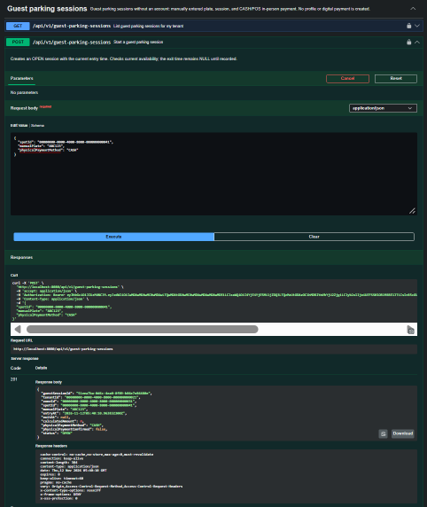

**2. Cálculo y consulta de ocupación**

Este caso representa al administrador que necesita conocer cuántos espacios están ocupados y qué porcentaje de su estacionamiento está en uso. El Parking Admin selecciona su estacionamiento completo o una zona y solicita el cálculo. El backend utiliza las lecturas de los sensores para generar un resumen con la cantidad de espacios ocupados, el total de espacios operativos, el porcentaje y la fecha de observación.

El administrador solicita y consulta el resumen; no introduce manualmente cuántos vehículos hay ni el porcentaje. El conductor no realiza este cálculo administrativo. Si falta una lectura confiable y algún espacio tiene ocupación `UNAVAILABLE`, el backend responde `409` en lugar de presentarlo como libre. El historial permite consultar los resúmenes que ya se generaron.

**Quién ejecuta y cómo autorizar:** el administrador del estacionamiento calcula la ocupación con una cuenta `PARKING_ADMIN`. Iniciar sesión en `POST /api/v1/authentication/sign-in` y pegar solo el `accessToken` en **Authorize**. Después abrir `POST /api/v1/capacity-snapshots`, pulsar **Try it out**, completar el cuerpo y pulsar **Execute**. `SUPER_ADMIN` puede consultar el historial mediante GET, pero el POST requiere `PARKING_ADMIN`. Solo visualizar la documentación no requiere ejecutar estas operaciones.

| Método y endpoint | Parámetros o cuerpo y permisos | Respuesta y comportamiento |
| --- | --- | --- |
| `GET /api/v1/capacity-snapshots` | Query `tenantId` (UUID opcional); sin cuerpo. Roles `PARKING_ADMIN` o `SUPER_ADMIN`, dentro de su alcance. | `200`: lista de `SnapshotView` con historial autorizado. |
| `POST /api/v1/capacity-snapshots` | `SnapshotBody`: `tenantId` (UUID obligatorio), `zoneId` (UUID opcional; `null` resume el tenant). Requiere `PARKING_ADMIN` del tenant. | `201`: `SnapshotView`, con cantidades y porcentaje calculados. Si no hay espacios, el porcentaje es `0.00`. |

`SnapshotView` contiene `snapshotId`, `tenantId`, `zoneId`, `occupiedCount`, `totalCount`, `percentage` y `observedAt`. Errores documentados: `400` datos inválidos; `401` sesión inválida; `403` rol o tenant fuera del alcance; `404` recurso inexistente; `409` referencia o estado incompatible, incluidas lecturas no confiables.

Ejemplo ilustrativo para calcular ocupación de todo un tenant existente:

Este JSON se coloca en **Request body** de `POST /api/v1/capacity-snapshots`. `tenantId` es el identificador del estacionamiento administrado; obtener el `tenantId` correspondiente mediante `GET /api/v1/tenants`. El UUID del ejemplo es ficticio y debe reemplazarse por el real. `zoneId: null` pide calcular la ocupación de todo ese estacionamiento; para una zona concreta, reemplazar `null` por el UUID de una zona perteneciente al mismo tenant. El usuario no introduce cantidades ni porcentajes: el servidor los calcula a partir de las lecturas disponibles. Un identificador válido no garantiza el cálculo si faltan lecturas confiables.

```json
{
  "tenantId": "22222222-2222-4222-8222-222222222222",
  "zoneId": null
}
```

*Figura 116 (OpenAPI/Swagger: Capacity Snapshot Services)*

<!-- FOTO PENDIENTE: 116-swagger-capacity-snapshots.png
Ubicación: assets/images/figures/116-swagger-capacity-snapshots.png
Insertar aquí una captura de Swagger del grupo 05-monitoring, sección Capacity snapshots. Expandir POST /api/v1/capacity-snapshots para mostrar tenantId, zoneId, respuesta 201 SnapshotView y error 409. Incluir GET y su filtro tenantId si caben.
-->

**3. Pago digital de reservas y seguimiento del resultado**

Este caso representa a un conductor con cuenta en SpotGo que ya creó una reserva y desea pagarla desde la aplicación. El Driver selecciona su reserva y un medio de pago previamente registrado. El backend toma el importe de la reserva y crea una operación de pago asociada al conductor; el usuario no envía el precio ni decide si el cobro fue aprobado.

Quien inicia este pago es el Driver propietario de la reserva, no el Parking Admin. A diferencia del invitado del primer caso, este conductor tiene cuenta y utiliza un pago digital. Crear la operación es el primer paso: después se solicita su procesamiento y el proveedor determina el resultado. Si existe un fallo conocido, se puede reintentar; si el resultado quedó pendiente o desconocido, se consulta mediante conciliación sin efectuar otro cargo. La clave de idempotencia permite recuperar la misma operación al repetir su creación con los mismos datos, evitando duplicarla.

**Quién ejecuta y cómo autorizar:** el conductor que es propietario de la reserva, con una cuenta `DRIVER`. Iniciar sesión en `POST /api/v1/authentication/sign-in`, copiar el `accessToken` y pegarlo en **Authorize**. Si antes se autorizó una cuenta `PARKING_ADMIN`, sustituir su token por el del conductor. Abrir `POST /api/v1/digital-payments/reservations/{reservationId}`, pulsar **Try it out**, completar el identificador de reserva y el cuerpo, y pulsar **Execute**. Un Parking Admin no puede crear este pago de reserva en nombre del conductor. Para la captura del contrato basta con desplegar la operación, sin ejecutarla.

| Método y endpoint | Parámetros o cuerpo y permisos | Respuesta y comportamiento |
| --- | --- | --- |
| `POST /api/v1/digital-payments/reservations/{reservationId}` | UUID de reserva; `PaymentBody`: `tokenId` (UUID obligatorio) e `idempotencyKey` (texto obligatorio, máximo 255 caracteres). Requiere `DRIVER` propietario. | `201`: `PaymentView`, creado o recuperado. Misma clave y contenido recuperan la operación; diferente contenido con la misma clave produce `409`. |
| `GET /api/v1/digital-payments/{paymentId}` | UUID de pago; sin cuerpo. Cuenta autorizada sobre el pago. | `200`: `PaymentView` con estado y referencias del pago. |
| `POST /api/v1/digital-payments/{paymentId}/process` | UUID de pago; sin cuerpo. `DRIVER` o `PARKING_ADMIN`, dentro de su alcance. | `200`: `PaymentView` tras procesar. Un pago aprobado se devuelve sin cobrar de nuevo. |
| `POST /api/v1/digital-payments/{paymentId}/retry` | UUID de pago; cuerpo opcional `RetryPaymentBody` con `tokenId` (UUID opcional para cambiar el medio de pago tras un rechazo definitivo). Mismos roles y alcance. | `200`: `PaymentView`; reintenta un fallo conocido respetando la espera y conserva el identificador. Un resultado desconocido requiere conciliación. |
| `POST /api/v1/digital-payments/{paymentId}/reconcile` | UUID de pago; sin cuerpo. Mismos roles y alcance. | `200`: `PaymentView`; consulta un resultado pendiente al proveedor sin efectuar otro cargo. |

`PaymentView` contiene `paymentId`, `tokenId`, `profileId`, `operationType`, `amount`, `currency`, `status`, `providerOperationRef`, `idempotencyKey`, `requestHash`, `firstSeenAt`, `lastSeenAt`, `resultReference`, `createdAt` y `approvedAt`. El cliente no envía importe, estado ni fecha de aprobación. Errores documentados: `400` datos inválidos; `401` sesión inválida; `403` rol o alcance insuficiente; `404` recurso inexistente; `409` conflicto de estado o idempotencia; `503` proveedor no configurado o no disponible.

Ejemplo ilustrativo del cuerpo para pagar una reserva propia existente, con un token de pago previamente registrado:

Este JSON va en **Request body** de `POST /api/v1/digital-payments/reservations/{reservationId}`. Además del cuerpo, completar el parámetro de ruta `reservationId` con el UUID de una reserva propia, consultable mediante `GET /api/v1/reservations`. `tokenId` identifica un medio de pago tokenizado del conductor, consultable mediante `GET /api/v1/payment-tokens`: **no es el `accessToken` usado en Authorize**. El UUID mostrado abajo es ficticio y debe sustituirse por el real. `idempotencyKey` es una clave elegida para identificar ese intento de crear una operación: reutilizarla con los mismos datos recupera la operación anterior y evita duplicarla; usar una clave nueva para una operación distinta. Este POST crea la operación de pago; procesar el cobro es una acción posterior y requiere un proveedor disponible.

```json
{
  "tokenId": "33333333-3333-4333-8333-333333333333",
  "idempotencyKey": "sprint2-reserva-pago-001"
}
```

*Figura 117 (OpenAPI/Swagger: Reservation Digital Payment Services)*

<!-- FOTO PENDIENTE: 117-swagger-reservation-digital-payments.png
Ubicación: assets/images/figures/117-swagger-reservation-digital-payments.png
Insertar aquí una captura de Swagger del grupo 04-payments-billing, sección Digital payments. Expandir POST /api/v1/digital-payments/reservations/{reservationId} para mostrar reservationId, PaymentBody y respuesta 201 PaymentView. Incluir process, retry y reconcile si caben. Mostrar el contrato, sin presentar una aprobación simulada como cobro real ni exponer tokens.
-->

#### *4.2.2.8. Software Deployment Evidence for Sprint Review*

Durante el Sprint 2 se completará el despliegue de la Landing Page en GitHub Pages y se desplegará el Backend como Web Service en Render, construido con Java 25 LTS y Docker.

**Procedimiento de publicación y reproducción**

1. **Landing Page:** publicar la versión completa de `spotgo-landing` desde la rama `main` mediante GitHub Pages. Al utilizar HTML, CSS y Vanilla JS, no requiere un proceso de compilación.
2. **Backend:** compilar con Java 25 LTS, construir la imagen Docker y desplegar el Backend como Web Service en Render.
3. **Aplicaciones móviles:** ejecutar SpotGo Driver Android App desde Android Studio en un emulador o dispositivo Android. Ejecutar SpotGo Parking Admin Flutter App desde Flutter en un emulador o dispositivo compatible.

**Landing Page: GitHub Pages**

**Landing Page Deployment Link:** [https://yachiqo-upc.github.io/spotgo-landing](https://yachiqo-upc.github.io/spotgo-landing)

*Figura 118 (Sprint 2: Deployment Evidence Landing Page)*  


**Backend: Render Web Service**

**Backend Deployment Link:** [https://spotgo-backend.onrender.com/swagger-ui/index.html](https://spotgo-backend.onrender.com/swagger-ui/index.html)

*Figura 119 (Sprint 2: Deployment Evidence Backend)*  


#### *4.2.2.9. Team Collaboration Insights during Sprint*

Las siguientes capturas corresponden a la actividad de los repositorios `spotgo-landing`, `spotgo-backend`, `spotgo-android-app` y `spotgo-flutter-app` durante el Sprint 2.

*Figura 120 (Sprint 2: Insights SpotGo Landing Page)*  
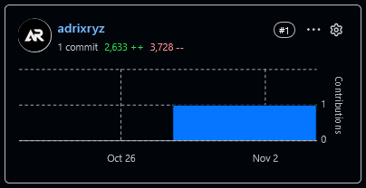

*Figura 121 (Sprint 2: Insights SpotGo Backend)*  


*Figura 122 (Sprint 2: Insights SpotGo Android App)*  


*Figura 123 (Sprint 2: Insights SpotGo Flutter App)*  
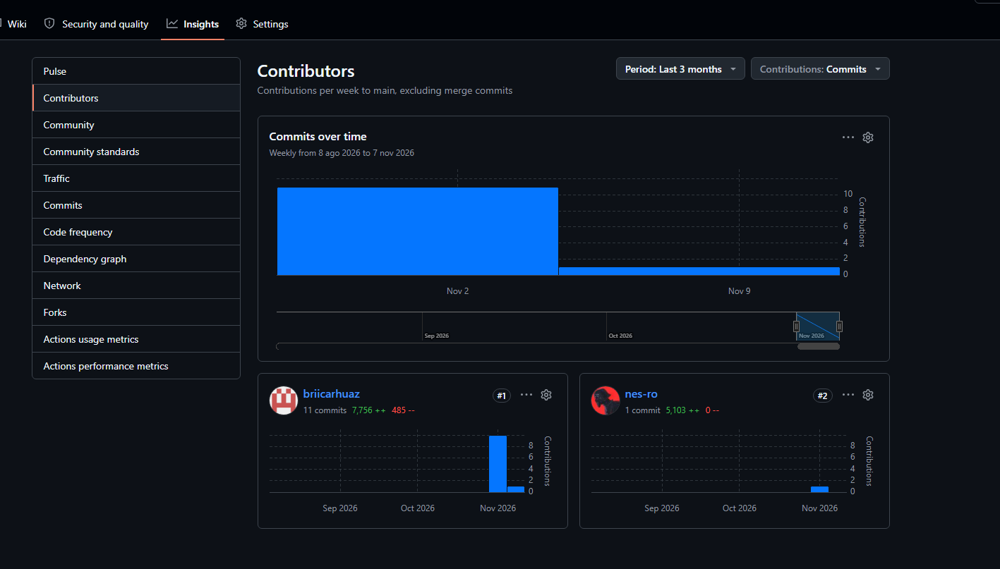
