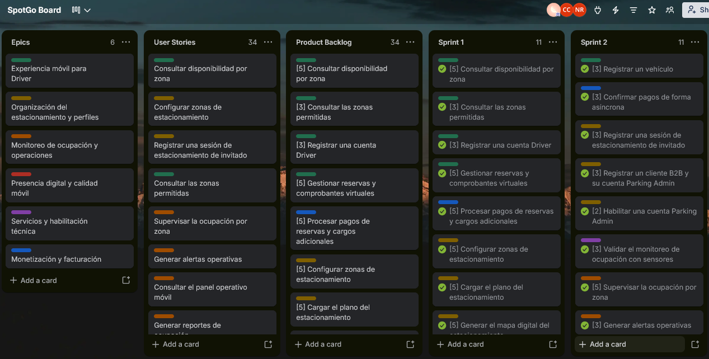

### 4.2.2. Sprint 2

La meta del Sprint 2 es completar y desplegar al 100% la Landing Page, completar al 100% SpotGo Driver Android App y avanzar al 40% SpotGo Parking Admin Flutter App. También se completará al 100% el Backend, construido con Java 25 LTS y Docker, y se actualizará su despliegue como Web Service en Render. El sprint considera los 11 elementos del Product Backlog asignados al Sprint 2, que suman 34 Story Points.

#### *4.2.2.1. Sprint Planning 2*

<table>
  <tr>
    <td><strong>Sprint #</strong></td>
    <td>Sprint 2</td>
  </tr>
  <tr>
    <th colspan="2" align="left">Sprint Planning Background</th>
  </tr>
  <tr>
    <td><strong>Date</strong></td>
    <td>2026-11-03</td>
  </tr>
  <tr>
    <td><strong>Time</strong></td>
    <td>6:00 PM</td>
  </tr>
  <tr>
    <td><strong>Location</strong></td>
    <td>Reuni&#243;n virtual</td>
  </tr>
  <tr>
    <td><strong>Prepared By</strong></td>
    <td>Contreras Rojas, Cesar Jair</td>
  </tr>
  <tr>
    <td><strong>Attendees (to planning meeting)</strong></td>
    <td>Carhuaz Centeno, Briguite Eryka / Contreras Rojas, Cesar Jair / Cotrina Siclla, Sofia Alessandra / Rojas Tello, Nestor Alonso / Ruiz Mideyros, Adrian.</td>
  </tr>
  <tr>
    <td><strong>Sprint 1 Review Summary</strong></td>
    <td>Se presentó la versión inicial desplegada de la Landing Page, el avance del 70% del Backend y las pantallas principales de Driver y Parking Admin en Jetpack Compose.</td>
  </tr>
  <tr>
    <td><strong>Sprint 1 Retrospective Summary</strong></td>
    <td>Quedó pendiente completar el Backend y la Landing Page, y desarrollar las aplicaciones móviles más allá de sus pantallas iniciales. Para el Sprint 2 se planificó completar Android y avanzar Flutter al 40%.</td>
  </tr>
  <tr>
    <th colspan="2" align="left">Sprint Goal &amp; User Stories</th>
  </tr>
  <tr>
    <td><strong>Sprint 2 Goal</strong></td>
    <td>Completar y desplegar al 100% la Landing Page; completar al 100% SpotGo Driver Android App, desarrollada con Kotlin y Jetpack Compose; avanzar al 40% SpotGo Parking Admin Flutter App, desarrollada con Flutter; y completar al 100% el Backend con Java 25 LTS y Docker, desplegado como Web Service en Render. Se atenderán las historias planificadas del sprint: US27, US03, US14, US15, US05, US06, TS05, TS01, TS03, SP01 y SP02.</td>
  </tr>
  <tr>
    <td><strong>Sprint 2 Velocity</strong></td>
    <td>34 Story Points como capacidad planificada para el Sprint 2, correspondientes a los 11 elementos seleccionados del Product Backlog.</td>
  </tr>
  <tr>
    <td><strong>Sum of Story Points</strong></td>
    <td>34 Story Points: 18 de seis HU, 10 de tres TS y 6 de dos SP, según las estimaciones del Product Backlog.</td>
  </tr>
</table>

#### *4.2.2.2. Aspect Leaders and Collaborators*

La Leadership-and-Collaboration Matrix (LACX) identifica a las personas responsables de cada aspecto del Sprint 2. **L (Leader)** identifica a quien lidera el aspecto y **C (Collaborator)** a quien colabora. Contreras Rojas, Cesar Jair y Ruiz Mideyros, Adrian comparten la responsabilidad de SpotGo Driver Android App. Las celdas vacías indican aspectos sin una asignación de colaboración definida.

<table>
  <tr>
    <th align="left">Team Member (Last Name, First Name)</th>
    <th align="left">GitHub Username</th>
    <th align="center">Backend (100%)</th>
    <th align="center">SpotGo Driver Android App (100%)</th>
    <th align="center">SpotGo Parking Admin Flutter App (40%)</th>
    <th align="center">Landing Page (100%)</th>
  </tr>
  <tr>
    <td align="left">Carhuaz Centeno, Briguite Eryka</td>
    <td align="left">@briicarhuaz</td>
    <td align="center"></td>
    <td align="center"></td>
    <td align="center"><strong>L</strong></td>
    <td align="center"></td>
  </tr>
  <tr>
    <td align="left">Contreras Rojas, Cesar Jair</td>
    <td align="left">@CesarJrCR</td>
    <td align="center"></td>
    <td align="center"><strong>L</strong></td>
    <td align="center"></td>
    <td align="center"></td>
  </tr>
  <tr>
    <td align="left">Cotrina Siclla, Sofia Alessandra</td>
    <td align="left">@IamAndreek</td>
    <td align="center"></td>
    <td align="center"></td>
    <td align="center"></td>
    <td align="center"><strong>L</strong></td>
  </tr>
  <tr>
    <td align="left">Rojas Tello, Nestor Alonso</td>
    <td align="left">@nes-ro</td>
    <td align="center"><strong>L</strong></td>
    <td align="center"></td>
    <td align="center"></td>
    <td align="center"></td>
  </tr>
  <tr>
    <td align="left">Ruiz Mideyros, Adrian</td>
    <td align="left">@AdrixRyz</td>
    <td align="center"></td>
    <td align="center"><strong>L</strong></td>
    <td align="center"></td>
    <td align="center"></td>
  </tr>
</table>

#### *4.2.2.3. Sprint Backlog 2*

El Sprint Backlog 2 reúne las tareas vinculadas a los elementos planificados del Product Backlog. Las historias de usuario aparecen primero, seguidas de las historias técnicas y las historias de investigación.

**Trello Board Link:** [https://trello.com/b/6aa6e46ebebf57986f7fcd37](https://trello.com/b/6aa6e46ebebf57986f7fcd37)

*Figura 100 (Trello Board Sprint 2)*  

<table>
  <thead>
    <tr><th colspan="3">User Story</th><th colspan="6">Work-Item / Task</th></tr>
    <tr><th>Id</th><th>Title</th><th>Story Points</th><th>Id</th><th>Title</th><th>Description</th><th>Estimation (Hours)</th><th>Assigned To</th><th>Status</th></tr>
  </thead>
  <tbody>
    <tr>
      <td>US27</td><td>Registrar un vehículo</td><td align="center">2</td>
      <td>T01</td><td>Registro de vehículos en Android</td><td>Completar el registro de vehículos en SpotGo Driver Android App y los servicios Backend asociados.</td><td>2</td><td>Contreras Rojas, Cesar Jair Rojas Tello, Nestor Alonso Ruiz Mideyros, Adrian</td><td>Done</td>
    </tr>
    <tr>
      <td>US03</td><td>Registrar una sesión de estacionamiento de invitado</td><td align="center">3</td>
      <td>T02</td><td>Sesiones de estacionamiento de invitados</td><td>Completar el registro y control de sesiones de invitados desde SpotGo Parking Admin Flutter App y sus servicios Backend.</td><td>2.5</td><td>Carhuaz Centeno, Briguite Eryka Rojas Tello, Nestor Alonso</td><td>Done</td>
    </tr>
    <tr>
      <td>US14</td><td>Registrar un cliente B2B y su cuenta Parking Admin</td><td align="center">3</td>
      <td>T03</td><td>Registro de clientes B2B</td><td>Completar los servicios Backend para registrar un cliente B2B y crear su cuenta Parking Admin.</td><td>2.5</td><td>Rojas Tello, Nestor Alonso</td><td>Done</td>
    </tr>
    <tr>
      <td>US15</td><td>Habilitar una cuenta Parking Admin</td><td align="center">2</td>
      <td>T04</td><td>Habilitación de cuentas Parking Admin</td><td>Completar los servicios Backend para habilitar una cuenta Parking Admin.</td><td>1.5</td><td>Rojas Tello, Nestor Alonso</td><td>Done</td>
    </tr>
    <tr>
      <td>US05</td><td>Supervisar la ocupación por zona</td><td align="center">5</td>
      <td>T05</td><td>Consulta de ocupación por zona</td><td>Completar los servicios Backend y avanzar la vista de ocupación por zona en SpotGo Parking Admin Flutter App.</td><td>4</td><td>Carhuaz Centeno, Briguite Eryka Rojas Tello, Nestor Alonso</td><td>Done</td>
    </tr>
    <tr>
      <td>US06</td><td>Generar alertas operativas</td><td align="center">3</td>
      <td>T06</td><td>Alertas operativas</td><td>Completar la generación de alertas en el Backend y avanzar su consulta en SpotGo Parking Admin Flutter App.</td><td>2.5</td><td>Carhuaz Centeno, Briguite Eryka Rojas Tello, Nestor Alonso</td><td>Done</td>
    </tr>
    <tr>
      <td>TS05</td><td>Confirmar pagos de forma asíncrona</td><td align="center">3</td>
      <td>T07</td><td>Confirmación asíncrona de pagos</td><td>Completar el procesamiento y la confirmación asíncrona de pagos en el Backend.</td><td>2.5</td><td>Rojas Tello, Nestor Alonso</td><td>Done</td>
    </tr>
    <tr>
      <td>TS01</td><td>Sincronizar datos móviles mediante servicios REST</td><td align="center">5</td>
      <td>T08</td><td>Sincronización de datos móviles</td><td>Completar los servicios REST del Backend e integrar la sincronización requerida por las aplicaciones Android y Flutter.</td><td>4</td><td>Carhuaz Centeno, Briguite Eryka Contreras Rojas, Cesar Jair Rojas Tello, Nestor Alonso Ruiz Mideyros, Adrian</td><td>Done</td>
    </tr>
    <tr>
      <td>TS03</td><td>Documentar el contrato de los servicios REST</td><td align="center">2</td>
      <td>T09</td><td>Documentación de servicios REST</td><td>Completar la documentación de los contratos REST del Backend.</td><td>1.5</td><td>Rojas Tello, Nestor Alonso</td><td>Done</td>
    </tr>
    <tr>
      <td>SP01</td><td>Validar el monitoreo de ocupación con sensores</td><td align="center">3</td>
      <td>T10</td><td>Monitoreo de ocupación con sensores</td><td>Completar la validación del flujo de ocupación y de la información recibida desde los sensores.</td><td>2</td><td>Rojas Tello, Nestor Alonso</td><td>Done</td>
    </tr>
    <tr>
      <td>SP02</td><td>Investigar la estrategia de sincronización móvil</td><td align="center">3</td>
      <td>T11</td><td>Estrategia de sincronización móvil</td><td>Evaluar la estrategia de sincronización para las aplicaciones Android y Flutter y los servicios Backend.</td><td>2.5</td><td>Carhuaz Centeno, Briguite Eryka Contreras Rojas, Cesar Jair Rojas Tello, Nestor Alonso Ruiz Mideyros, Adrian</td><td>Done</td>
    </tr>
    <tr><td colspan="2"><strong>Total de elementos seleccionados</strong></td><td align="center"><strong>34</strong></td><td colspan="6">11 elementos: 6 HU, 3 TS y 2 SP; 27.5 horas estimadas en total.</td></tr>
  </tbody>
</table>

La finalización al 100% de la Landing Page forma parte del objetivo del Sprint 2. Las historias US11 y US12 ya están contabilizadas en el Sprint 1 y no se vuelven a sumar a los 34 Story Points de este sprint.

#### *4.2.2.4. Development Evidence for Sprint Review*

La siguiente tabla reúne los commits de los repositorios en los que se trabajará durante el Sprint 2.

| Repository | Branch | Commit Id | Commit Message | Committed on (Date) |
| --- | --- | --- | --- | --- |
| [spotgo-landing](https://github.com/yachiqo-upc/spotgo-landing) |  |  |  |  |
| [spotgo-backend](https://github.com/yachiqo-upc/spotgo-backend) |  |  |  |  |
| [spotgo-android-app](https://github.com/yachiqo-upc/spotgo-android-app) |  |  |  |  |
| [spotgo-flutter-app](https://github.com/yachiqo-upc/spotgo-flutter-app) |  |  |  |  |

#### *4.2.2.5. Testing Suite Evidence for Sprint Review*

*Figura 101 (Backend Test Evidence)*  

*Figura 102 (SpotGo Driver Android App Test Evidence)*  

*Figura 103 (SpotGo Parking Admin Flutter App Test Evidence)*  

*Figura 104 (Landing Page Test Evidence)*  

#### *4.2.2.6. Execution Evidence for Sprint Review*

**Landing Page**

*Figura 105 (SpotGo Landing Page Home)*  

*Figura 106 (SpotGo Landing Page Drivers)*  

*Figura 107 (SpotGo Landing Page Admins)*  

*Figura 108 (SpotGo Landing Page How Work)*  

*Figura 109 (SpotGo Landing Page Pricing)*  

*Figura 110 (SpotGo Landing Page FAQ)*  

**Landing Page Demonstration Video Link:**

**SpotGo Driver Android App**

*Figura 111 (SpotGo Driver Android App Sign-up and Sign-in)*  

*Figura 112 (SpotGo Driver Android App Vehicle Registration)*  

*Figura 113 (SpotGo Driver Android App Availability and Reservations)*  

*Figura 114 (SpotGo Driver Android App Payments and Receipts)*  

**Android App Demonstration Video Link:**

**SpotGo Parking Admin Flutter App**

*Figura 115 (SpotGo Parking Admin Flutter App Guest Parking Sessions)*  

*Figura 116 (SpotGo Parking Admin Flutter App Occupancy by Zone)*  

*Figura 117 (SpotGo Parking Admin Flutter App Operational Alerts)*  

**Demonstration Video Evidence for Sprint Review**

**Flutter App Demonstration Video Link:**

#### *4.2.2.7. Services Documentation Evidence for Sprint Review*

La documentación OpenAPI/Swagger del Sprint 2 reúne los contratos REST de vehículos, sesiones de invitados, cuentas Parking Admin, ocupación, alertas, pagos asíncronos y sincronización móvil.

*Figura 118 (OpenAPI/Swagger: Vehicle and Guest Parking Session Services)*  

*Figura 119 (OpenAPI/Swagger: Occupancy, Sensor and Alert Services)*  

*Figura 120 (OpenAPI/Swagger: Asynchronous Payment and Mobile Synchronization Services)*  

#### *4.2.2.8. Software Deployment Evidence for Sprint Review*

Durante el Sprint 2 se completará el despliegue de la Landing Page en GitHub Pages y se actualizará el Backend como Web Service en Render, construido con Java 25 LTS y Docker.

**Procedimiento de publicación y reproducción**

1. **Landing Page:** publicar la versión completa de `spotgo-landing` desde la rama `main` mediante GitHub Pages. Al utilizar HTML, CSS y Vanilla JS, no requiere un proceso de compilación.
2. **Backend:** compilar con Java 25 LTS, construir la imagen Docker y desplegar el Backend como Web Service en Render.
3. **Aplicaciones móviles:** ejecutar SpotGo Driver Android App desde Android Studio en un emulador o dispositivo Android. Ejecutar SpotGo Parking Admin Flutter App desde Flutter en un emulador o dispositivo compatible.

**Landing Page: GitHub Pages**

**Landing Page Deployment Link:** [https://yachiqo-upc.github.io/spotgo-landing](https://yachiqo-upc.github.io/spotgo-landing)

*Figura 121 (Evidencia del despliegue de la Landing Page en GitHub Pages)*  

**Backend: Render Web Service**

*Figura 122 (Evidencia del despliegue del Backend en Render)*  

**Backend Deployment Link:** [https://spotgo-backend.onrender.com/swagger-ui/index.html](https://spotgo-backend.onrender.com/swagger-ui/index.html)

#### *4.2.2.9. Team Collaboration Insights during Sprint*

Las siguientes capturas corresponden a la actividad de los repositorios del Sprint 2.

*Figura 123 (Sprint 2: Insights de spotgo-flutter-app)*  

*Figura 124 (Sprint 2: Insights de spotgo-android-app)*  

*Figura 125 (Sprint 2: Insights de spotgo-landing)*  

*Figura 126 (Sprint 2: Insights de spotgo-backend)*  
