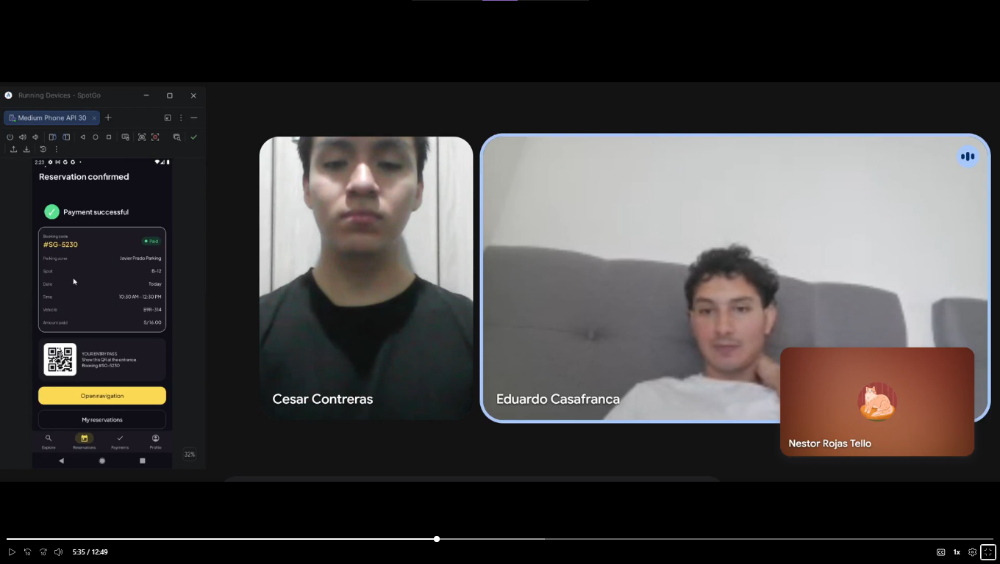
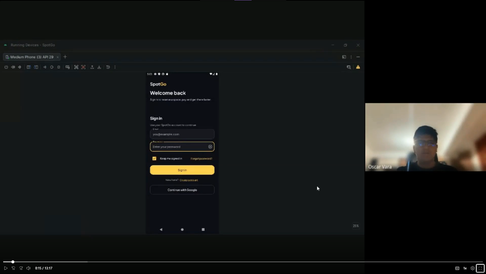

## 4.3. Validation Interviews

### 4.3.1. Diseño de Entrevistas

Primer Segmento Objetivo (Administradores de estacionamientos)

1. Al ver el panel operativo, ¿qué información revisarías primero para saber cómo está tu estacionamiento en ese momento y qué tan fácil te resulta encontrarla?

2. ¿Qué te parece esta forma de mostrar la ocupación y qué información adicional necesitarías para confiar en lo que ves?

3. ¿Qué tan claro te resulta qué ocurrió y qué deberías hacer en cada caso? ¿Qué esperarías ver para poder cerrar la alerta con confianza?

4. Al ver la pantalla para configurar una zona, ¿qué información necesitarías tener a la mano para configurarla sin equivocarte y qué te daría seguridad de que las reglas quedaron bien aplicadas?

5. Con esta pantalla de registro de invitados a la vista, ¿qué pasos te parecen necesarios y cuáles te gustaría que fueran más rápidos para atender a un invitado en la entrada?

6. ¿Qué reporte revisarías primero y qué tan útil te resultaría para tomar decisiones sobre tu estacionamiento?

7. ¿Qué información esperarías ver antes de cargar el archivo del plano y qué te daría confianza de que quedó registrado correctamente?

8. Al ver esta pantalla para generar el mapa digital, ¿qué esperarías que ocurra después de generarlo y cómo sabrías que ya está listo para operar?

9. ¿Qué información revisarías primero en la pantalla de facturación B2B y qué te daría seguridad de que tus datos tributarios están correctos para las próximas facturas?

10. ¿Qué expectativas tendrías sobre este acceso y qué información necesitarías para saber que estás entrando con el rol correcto?

Segundo Segmento Objetivo (Conductores)

1. Al mostrarte el mapa y las tarjetas de estacionamientos, ¿en qué momento notas qué información se está cargando, qué zona está seleccionada y qué tan actualizados están los datos de disponibilidad y precio?

2. Viendo estas etiquetas en la pantalla (por ejemplo "por hora", "distancia", "cubierta", "EV", "saldo pendiente"), ¿qué significa cada una para ti? ¿Usas las mismas palabras que usarías al pedir un estacionamiento en persona?

3. Si al realizar esta reserva te equivocaras al elegir vehículo, fecha o duración, o si entraras a una pantalla por error, ¿cómo crees que podrías deshacer o cancelar sin perder lo que ya avanzaste?

4. Con lo que te acabo de mostrar en la navegación entre pantallas, ¿dirías que los nombres de las pestañas, los iconos y la forma de volver atrás se comportan siempre igual en toda la app? ¿Qué parte notas que no lo haría?

5. Viendo las pantallas de registro y reserva, antes de presionar "Crear cuenta" o "Continuar", ¿qué información crees que la app debería pedirte o avisarte para evitar que cometas errores?

6. En este flujo de reserva que te muestro, ¿tendrías que recordar de memoria qué vehículo, fecha y duración elegiste o la app te los muestra claramente antes de confirmar? ¿Qué datos sientes que te falta ver antes de pagar?

7. Visto el recorrido completo desde abrir la app hasta obtener la reserva confirmada con QR, ¿cuántos pasos sientes que son necesarios? ¿Qué paso dirías que sobra o debería ser más rápido?

8. Observando esta pantalla de detalles de zona (mapa, dirección, atributos, formulario de reserva y total), ¿hay algo que te distraiga o haga difícil encontrar lo más importante, como el precio total y el botón Continuar?

9. Al ver estos mensajes de error o aviso en la app, ¿entiendes qué pasó y qué deberías hacer a continuación? Señala algún mensaje de los que te mostré que no te haya quedado claro.

10. Si en algún momento no entendieras cómo funciona una reserva, un pago o un plan, ¿dónde esperarías encontrar ayuda dentro de lo que te mostré de la app? ¿Consideras que la app te ofrece esa ayuda hoy?

### 4.3.2. Registro de Entrevistas

Validation Interviews Link: [Completar URL del video en OneDrive]

Primer Segmento Objetivo (Administradores de estacionamientos)

Entrevista 1

| | |
|---|---|
| **Screenshot:** | Entrevista Validación S1 1 |
| **Inicia:** | [Completar] |
| **Duración:** | [Completar] |
| **Nombre completo:** | [Completar] |
| **Edad:** | [Completar] años |
| **Distrito:** | [Completar] |
| **Resumen:** | [Completar] |

Entrevista 2

| | |
|---|---|
| **Screenshot:** | Entrevista Validación S1 2 |
| **Inicia:** | [Completar] |
| **Duración:** | [Completar] |
| **Nombre completo:** | [Completar] |
| **Edad:** | [Completar] años |
| **Distrito:** | [Completar] |
| **Resumen:** | [Completar] |

Entrevista 3

| | |
|---|---|
| **Screenshot:** | Entrevista Validación S1 3 |
| **Inicia:** | [Completar] |
| **Duración:** | [Completar] |
| **Nombre completo:** | [Completar] |
| **Edad:** | [Completar] años |
| **Distrito:** | [Completar] |
| **Resumen:** | [Completar] |

Segundo Segmento Objetivo (Conductores)

Entrevista 1

| | |
|---|---|
| **Screenshot:** |   |
| **Inicia:** | 00:00 |
| **Duración:** | 12:49 |
| **Nombre completo:** | Alberto Costa Franca |
| **Edad:** | 28 años |
| **Distrito:** | La Molina |
| **Resumen:** | Alberto señala que en Explorar el mapa se llena rápido con marcadores y tarjetas, que la zona seleccionada se resalta y que la hora de última actualización junto al botón para refrescar le indica que precio y disponibilidad son de ese momento. Considera que las etiquetas usan las mismas palabras que emplearía al pedir un estacionamiento; solo EV le resulta menos conocida, aunque el icono ayuda a entenderla. Puede cambiar el vehículo o la fecha sin perder el resto del formulario, la flecha atrás no borra lo avanzado y el resumen previo a la confirmación le da confianza. Indica que las cuatro pestañas inferiores se mantienen iguales en todas las pantallas y lo compara con apps como Uber. Espera que la app avise si el correo ya está en uso, si la contraseña es muy corta, si el vehículo ya tiene otra reserva en ese horario, si el espacio está ocupado o si hay saldo pendiente; al probarla recibió un aviso de vehículo ocupado que le impidió avanzar. Antes de pagar vio el vehículo con su placa, la fecha, la hora de inicio, la duración y el total con descuento, por lo que no tuvo que recordar datos. Considera que son pocos pasos, que ninguno sobra y sugiere que fecha y hora tengan un valor por defecto. Describe la pantalla de detalles como ordenada, con el total y el botón Continuar resaltados, y los mensajes de error como claros. Finalmente, indica que la app no tiene una sección de ayuda y recomienda incorporar preguntas frecuentes o soporte desde Perfil, pensando en personas mayores o menos familiarizadas con este tipo de software. |

Entrevista 2

| | |
|---|---|
| **Screenshot:** |  |
| **Inicia:** | 12:50 |
| **Duración:** | 13:17 |
| **Nombre completo:** | Óscar Vara |
| **Edad:** | 21 años |
| **Distrito:** | Jesus Maria |
| **Resumen:** | Óscar probó la app mediante un emulador y considera que el flujo de reserva es intuitivo y fácil de seguir: elegir el lugar en el mapa, la hora y el vehículo, pagar y recibir un QR único, lo que le ahorra el tiempo de esperar y buscar estacionamiento. Indica que, a diferencia de un estacionamiento presencial donde solo se ve la tarifa y las plazas disponibles, la app agrega términos como distancia, cubierta y saldo pendiente, que le resultan útiles para facilitar la reserva. Ante un error al elegir el vehículo, la fecha o la duración, le gustaría poder editar solo ese campo sin perder el avance; aceptaría pagar una penalidad si el error fuera suyo, pero apelaría si fuera del sistema. Considera que las pestañas inferiores resultan familiares y sencillas de usar (historial de reservas, lugares de estacionamiento y perfil). Valora que el resumen previo al pago muestre vehículo, hora y lugar, porque le da confianza de que los datos son correctos. Señala que la verificación con un código de seis dígitos puede resultar engorrosa, sobre todo si debe buscarlo en otra aplicación o si no llega, pero la considera un buen método de autenticación y necesario. Describe el mapa como interactivo, pues muestra solo el estacionamiento y su costo por hora, a diferencia de Google Maps, que presenta muchos negocios. Considera claras las validaciones de cada campo y mensajes como "no hay una cuenta registrada con este correo", por lo que no se perdería en el flujo. Finalmente, indica que no vio una sección de ayuda y le gustaría contar con un chat en vivo con un asesor, porque un ticket de soporte no es una comunicación directa, sobre todo en casos urgentes. |

Entrevista 3

| | |
|---|---|
| **Screenshot:** | Entrevista Validación S2 3 |
| **Inicia:** | [Completar] |
| **Duración:** | [Completar] |
| **Nombre completo:** | [Completar] |
| **Edad:** | [Completar] años |
| **Distrito:** | [Completar] |
| **Resumen:** | [Completar] |

### 4.3.3. Evaluaciones según heurísticas
